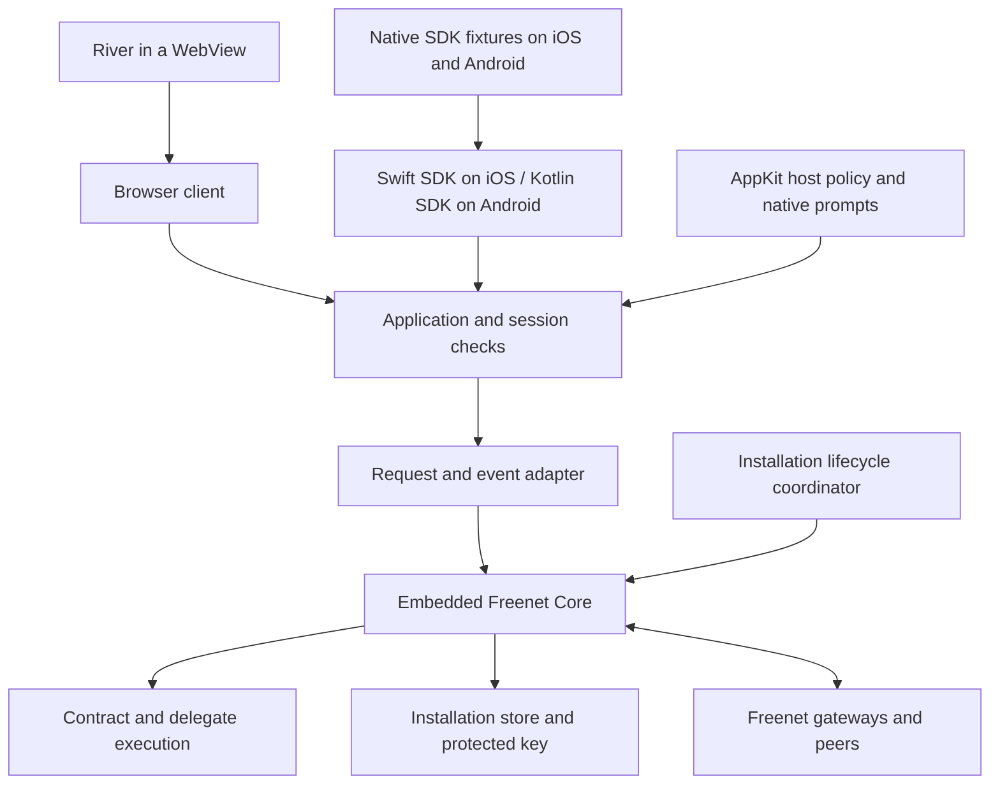
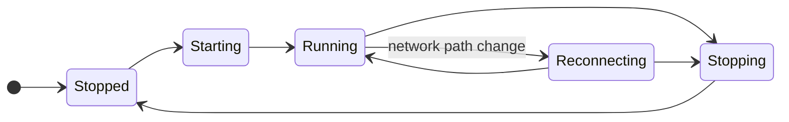

# 1.2 Embedded node and mobile SDK

## Repositories

| Repository | Work in this plan |
| --- | --- |
| [freenet-core](https://github.com/freenet/freenet-core) | Embedded mobile interface, runtime changes and protected key storage |
| [freenet-appkit](https://github.com/glesage/freenet-appkit) | Swift SDK for iOS, Kotlin SDK for Android and platform integration |
| [freenet-stdlib](https://github.com/freenet/freenet-stdlib) | Public browser delegate methods and shared request-handling rules |

## Purpose

Run an embedded Freenet node inside each application installation. Expose its operations to Swift on iOS and Kotlin on Android, and support River's browser client inside an AppKit WebView.

Each installation owns one node, store and encryption key. All application features share its node.

Agree the architecture and Core changes with maintainers before specifying implementation details.

## Architecture

The host supplies access decisions. The SDK applies them to calls and events. The application data layer selects contracts and handles records. Core verifies state, executes delegates and exchanges data with peers.

## SDK interface and packages

Build the mobile interface in `crates/mobile` in freenet-core. Use [UniFFI](https://mozilla.github.io/uniffi-rs/latest/) to generate Swift bindings for iOS and Kotlin bindings for Android.

| Capability | SDK responsibility |
| --- | --- |
| Lifecycle | Start and stop the node, report status and recover connections |
| Contract reads and writes | Forward GET, PUT and UPDATE, including delta and full-state updates |
| Subscriptions | Deliver updates and restore the application's required contract set |
| Delegates | Register, unregister and message approved delegates |
| Prompts and permissions | Connect Core and application requests to trusted host decisions |
| Keys and locking | Use protected platform keys and control private access |
| Migration and recovery | Coordinate migration, export, restore and Forget |
| Traffic measurement | Report network use for the host's budget policy |

Preserve contract code, parameter bytes and record bytes through the bindings. Return each result to its originating caller and verify the returned contract identity.

- Package an XCFramework in the Swift package for iOS and an AAR in the Kotlin library for Android.
- Add the public browser methods needed for delegate registration, unregistration and messages.

### Supplied mobile implementation

The local Core fork at `ea0a09df` supplies `MobileNode`, `NodeSettings`, `NodeClient`, `WebBridge`, `WebBundle` and binding feature `bindgen-cli`. The Core `ios` snapshot at `9061c592` exposes `FreenetNode`, `MobileProfile` and `bindgen`. The AppKit integration owner selects and aligns the release interface, then generates Swift for iOS and Kotlin for Android from that same source. Record the commit, patch set, lockfile and generated/package digests. [Prototype AppKit and mobile branch work](../audits/prototype-appkit-and-mobile-branch-work.md#b1-select-and-align-the-core-mobile-implementation) owns branch integration.

| Supplied behavior | Release verification |
| --- | --- |
| One native request awaiting a reply; timeout resets the connection and subscriptions | Verify queued cancellation, full returned identity, platform callback dispatch and exactly-once demand restoration after reset on iOS and Android |
| Serialized start/stop, timeout abort-and-await and port-release check | Verify one total shutdown deadline, listener/store release and a typed incomplete-shutdown result when release remains unverified |
| Legacy telemetry disabled; separate OpenTelemetry configuration | Explicitly disable both after persisted configuration merging and verify fresh/persisted settings on iOS and Android |
| Defaults: 64 MiB module cache, 128 MiB hosting state, 1 GiB hosting disk | Record actual resolved settings and measure capacity, battery, traffic and teardown reserves on exact iOS and Android artifacts |
| Fixed Wasm reservations and supplied iOS executor/Store limits | Apply [Running Wasm](#running-wasm) and pin measured Android limits per ABI |

These source implementations provide the release starting point. Passing packaged-artifact and real-device evidence establishes the supported profile.

## Node lifecycle and connectivity

### Start, stop and reconnect

One coordinator owns the node task and handles. It serializes all application lifecycle calls, including start, reconnect and stop. Define repeated-call results. Complete stop after the node task ends and the coordinator releases listeners, callbacks and store access.

The host owns the application session. Reconnect replaces the connection. Locking, restore and Forget end affected sessions. Calls and callbacks belong to the current connection and session.

- Use the phone's network status to detect path changes on iOS and Android.
- Rejoin Freenet after a path change, restore required subscriptions and refresh retained state.
- Report the selected loopback port and prefer the previous port when available. Let the host recover its browser context when the port changes.
- Recover node failures while keeping the host process running.
- Disable legacy telemetry and OpenTelemetry explicitly on every start, after configuration merging.

### Offline startup

The release uses durable queued writes on iOS and Android. The node opens its local store and client API before joining Freenet. Users can read retained contracts and save pending changes offline. The application owns its durable queue; the transport adapter schedules submissions and reports results.

| Stage | Required behavior |
| --- | --- |
| Save | Save the exact signed operation and its target, parameters, source context and operation identity in the application's protected recovery records. Acknowledge storage before submission |
| Before the first join since startup | Read retained state and use local delegate storage. Keep signed operations pending and retain the application's subscription demand for restoration after joining |
| Ready to submit | Restore required demand, read available target state and reconcile pending operations. Submit missing operations with the saved signed bytes |
| Connection loss, `PeerNotJoined` or uncertain result | Keep the operation pending; check observed state and retry with bounded backoff when the node is ready |
| Contract result | Let the owning application adapter verify acceptance or handle a definitive refusal under its domain rules. A socket write confirms request transmission; observed contract state supplies acceptance evidence |

River owns message and draft records under [1.6 Application protocols, data and operations](06-data-and-operations.md). EVY owns operation records under [2.11 EVY delegate and private records](../2-evy-on-freenet/11-delegate-and-private-records.md). Their adapters use the contracts' existing merge rules and summary/delta exchange to reconcile concurrent state.

- Resolve gateway hostnames during connection attempts so startup can complete offline.
- Refresh gateway discovery in the background and retry when connectivity returns.
- Expose cached local reads and approved delegate storage before joining.
- Keep durable operation identity across connection and session replacement; verify current authority before replay.
- Report node readiness separately from a connected client socket. Detect connection loss through the iOS and Android network path and operation results.

### Local network access

The host handles local-network consent on iOS and Android. The node can use permitted gateways and peers on the Wi-Fi network, and use public gateways when local access is denied.

- Connect node startup and reconnect to the host's permission decisions.
- Validate both permission outcomes on iOS and Android.

## Requests, events and errors

The transport adapter queues calls and routes replies and events under the caller's authority. River uses the browser route. Native fixtures test Swift on iOS and Kotlin on Android.

Requests retain their target, expected reply and owning session. Connection and session identifiers expire callbacks and prompts when their lifetime ends.

### Matching replies to requests

Allow one submitted request awaiting a reply per connection until Core and stdlib provide reliable request IDs on every enabled success and error path. Subscription updates and unsolicited delegate events continue while that request waits.

Cancellation removes an undispatched transport request. The application's durable operation remains recoverable until its adapter confirms completion or an explicit discard. Cancelling a submitted request ends the caller's wait while Core may still complete it. A timeout also leaves the outcome uncertain. Retain ownership until a terminal reply or connection reset, then check observed state before retrying a write.

For example, Bob cancels a room update while it is running. The message may still reach the room contract. River checks the room state before offering a retry.

- Apply the same queue, cancellation and reply-ownership rules to browser and native calls.
- Reject callbacks from ended connections and sessions.
- Reset a connection when reply ownership remains uncertain.
- Return errors the app can act on, including unavailable operations, uncertain writes and a required app update.
- Dispatch callbacks on the platform executor and keep slow listeners from delaying other delivery.
- Enable parallel requests after validating complete request-ID coverage.

## Subscriptions and application demand

The application data layer keeps one demand entry per contract and records why it is needed. Reasons include active records, retained drafts, pending operations and watched rooms. Screens observe the resulting data.

Retain demand while an application reason remains. Give pending-operation reconciliation priority over background refresh. Storage and cellular budgets bound the required contract set. The SDK restores that set once after reconnect.

For example, River's room list and conversation share one room subscription. Closing the conversation removes its reason. The room list and any pending message keep the subscription active.

- Accept the application's contract set and work priorities through the SDK.
- Release individual subscriptions when the selected client API supports it.
- Use reconnect and restoration to refresh the required set when cleanup follows the connection.
- End delivery on suspension, lock or stop.
- Preserve pending signed bytes and report stale observations when budgets suspend refresh work.

## Delegates and host permissions

Core supplies `UserInputPrompter`, capability grants, startup hooks, periodic wake-ups and persistent delegate subscriptions. Reuse these mechanisms and their Core-defined grants. The mobile construction interface accepts the trusted host prompter and binds application/session authority to calls, grants, startup and autonomous events. The host controls component access and presents trusted native prompts on iOS and Android under [1.3 Single-application host](03-host.md#background-runs-and-delegate-prompts).

Delegate prompts and private replies belong to the originating request and current session. Ending that session expires its prompts and private-event routes.

- Bind delegate registration, unregistration and messages to the application's approved component set.
- Expose host-supplied prompt handling through node construction, including delegate startup and capability requests.
- Combine declared device access, saved application consent and current OS permission status through the host's permission adapter.
- Apply equivalent access checks to browser calls, native calls and private-event delivery.

## Keys and private-data operations

### Keys and locking

Each installation uses its own protected encryption key and private records. The host supplies lock signals and disposes of application contexts. The SDK blocks private operations, clears controlled keys and buffers, and opens a fresh session on unlock.

- Integrate iOS Keychain storage and Android Keystore wrapping with Core's key backend.
- Implement and package required signing adapters for iOS and Android.
- Add Core secret-store lock and unlock operations and expose them through the SDK.
- Support key creation, loading, failure reporting and deletion.

### Migration and recovery

The SDK lifecycle coordinator manages private-data work for the installation. River supplies its existing migration adapter and journal; native EVY uses the shared Rust runner with EVY record adapters. [1.7 Upgrades and migration](07-migration.md#mobile-migration-interface) owns route selection, completion and activation policy.

| Operation | SDK responsibility |
| --- | --- |
| Migration | Select one approved execution route, pause ordinary work and require its verified readback and durable completion checkpoint before activation; expose the Rust runner for native EVY |
| Export | Capture a consistent application snapshot before sealing it, with progress and cancellation |
| Restore | Stage and validate restored records, activate a complete set and open fresh sessions |
| Forget | Block new work, release resources and remove the installation's declared records and keys |

- Coordinate delegate secrets and host records as one application data set.
- Recover interrupted restore and deletion before opening the application.
- Resume ordinary work after a consistent export capture, while sealing finishes separately.

## Wasm runtime and storage

### Running Wasm

Use the [Pulley interpreter](https://docs.wasmtime.dev/examples-pulley.html) for contract and delegate execution in iOS and Android release builds. The initial release uses the measured fixed-reservation profile in [1.1 Mobile feasibility and supported profiles](01-feasibility.md#device-limits).

- Retain the 256 MiB Wasm linear-memory reservation. On iOS, replace each Store after 4 instances and cap the executor pool at 2. Pin the measured Android executor and Store limits for each supported ABI in the release support matrix.
- Agree the supported iOS and Android processor targets with maintainers.
- Validate equivalent contract and delegate results across both platforms, including memory growth and returned-buffer handling within the configured bounds.
- Measure memory use, execution time, throughput and capacity failures on the exact release artifacts. Set mobile limits from that evidence.
- Adopt smaller reservations after an upstream Core release includes the host memory-address handling required after guest memory growth. Pin that release and repeat contract, delegate, memory-growth, capacity and lifecycle tests on iOS and Android before changing the profile.
- Change executor and Store limits through the same measured profile update. Record each setting and artifact digest in the release support matrix.

### Storage

The host supplies installation-specific data, configuration, secret, cache and log paths. Its chosen configuration takes precedence over persisted settings. Keep local-mode and network-mode stores separate.

- Set explicit memory, disk, cache and log budgets using device measurements.
- Separate rebuildable web-app caches from recovery records.
- Keep only current secret values; use application export for recovery.
- Preserve store ownership and usable paths through node restarts and platform data-folder changes.

## Traffic measurement

Expose sent and received socket-payload byte and packet counters through Swift on iOS and Kotlin on Android. Distinguish raw socket traffic from authenticated received traffic, and report estimated IP/UDP overhead separately. Samples identify network path, timing and counter lifetime to retain usage across restarts. [1.11 Cellular data and resource budgets](11-cellular-data-and-resource-budgets.md) owns enforcement thresholds, shutdown reserves and estimated carrier-billed usage.

- Add raw receive-byte and packet measurement before authentication for budget enforcement.
- Preserve usage across counter resets, path changes and budget transitions in the host's persistent accounting.

## Work owned by other plans

| Plan | Responsibility |
| --- | --- |
| [1.1 Mobile feasibility and supported profiles](01-feasibility.md) | Device measurements, supported profiles and resource limits |
| [1.3 Single-application host](03-host.md) | Application sessions, component policy, native prompts and device permissions |
| [1.5 Identity, keys and local protection](05-identity.md) | Key protection, private-data inventory, locking and deletion policy |
| [1.6 Application protocols, data and operations](06-data-and-operations.md) | Record formats, application adapters and operation reconciliation |
| [1.7 Upgrades and migration](07-migration.md) | Migration policy and upgrade activation |
| [1.9 Testing and release](09-testing-and-release.md) | Release validation and distribution |
| [1.10 Backup and restore](10-backup-and-restore.md) | Snapshot, restore and recovery policy |
| [1.11 Cellular data and resource budgets](11-cellular-data-and-resource-budgets.md) | Allowances, traffic accounting and budget enforcement |

## Maintainer review

- Is the proposed embedded-node interface and UniFFI binding approach suitable?
- Can browser and native routes use the same request, session and authorization rules?
- Which Core changes are needed for offline startup, mobile Wasm execution, trusted prompts and locking?
- Which iOS and Android profiles should we validate first?

## Acceptance

- River and native SDK fixtures use an installation-owned embedded node on iOS and Android.
- On iOS and Android, offline startup opens retained state and approved delegate storage. Signed operations survive restart before the first join, replay with the same identity after joining and converge with concurrent remote changes. Failed saves preserve drafts; uncertain replies preserve pending operations.
- Lifecycle calls and node recovery preserve store ownership and current-session delivery.
- Browser and native routes apply equivalent authorization, request ownership, cancellation and errors.
- Subscription restoration preserves the application's required contract set within its budgets.
- Delegates, prompts and private-data access follow host policy.
- Migration, export, restore and Forget preserve complete application records and recover interrupted work.
- Pulley execution and resource use pass iOS and Android profile validation.
- Local-network permission choices and traffic accounting work across network changes on both platforms.
