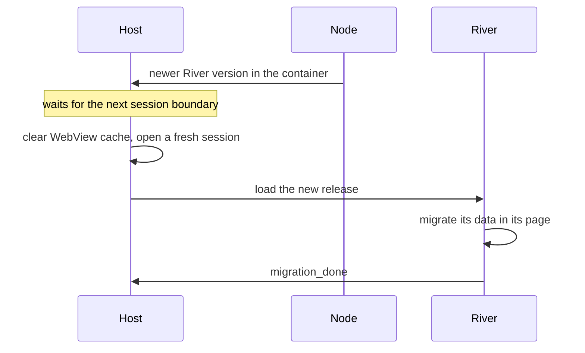
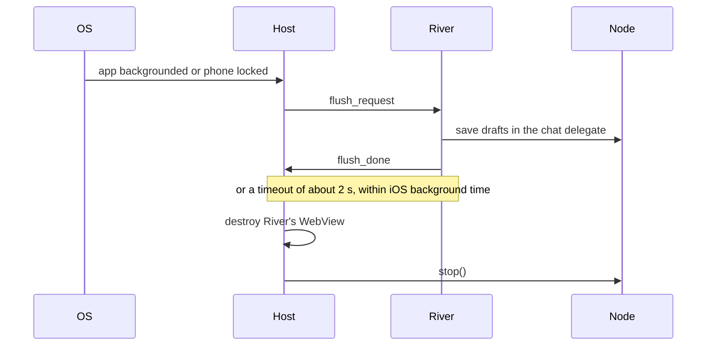

# 1.3 Single-application host

## Repositories

| Repository | Role | Work in this plan |
| --- | --- | --- |
| [freenet-appkit](https://github.com/glesage/freenet-appkit) | Modified | iOS and Android WebView host, bridge script and device adapters |
| [freenet-core](https://github.com/freenet/freenet-core) | Used | Shell page, loopback WebSocket authentication and session admission ([#5264](https://github.com/freenet/freenet-core/issues/5264)) |
| [river](https://github.com/freenet/river) | Used | The hosted app |

## Purpose

Run River in a WebView host on iOS and Android, one application per installation.

## Who controls what

### Application node and key scope

Each installation owns its embedded node, node store, encryption key and host records.

| Part | What it does |
| --- | --- |
| Host | Supplies storage paths, starts and stops the node, owns River's session and enforces device permissions |
| Native screens | Show permission and recovery screens |
| River | Owns its UI, its room subscriptions and its chat delegate |
| Core | Verifies contract state, authenticates client connections and runs delegates |
| Chat delegate | Checks the caller before reading secrets, signing or decrypting |

### Platform placement

| Platform | Application installation |
| --- | --- |
| iOS | River owns a node in its sandbox and its own Keychain entries. The node stops when River goes to the background |
| Android | River owns a node in its process and private files and its own Keystore entries. The node stops when River goes to the background |

Test builds on iOS and Android use separate application IDs and storage from production installations.

## Trusted calls

River's web client connects to the node's loopback WebSocket. Core's loopback binding limits the client API to the phone ([client API exposure](https://github.com/freenet/freenet-core/blob/8942fd239b2b53e606ffb1e26ee986623008afb2/docs/client-api-exposure.md)).

Bind every client connection to River's verified host session through Core's [session admission #5264](https://github.com/freenet/freenet-core/issues/5264). This plan adopts the upstream design when it lands and tests clients with and without an Origin header. Keep admission material in trusted native code and end its authority when the host session ends.

| Release stage | Needs #5264 |
| --- | --- |
| TestFlight internal testing and Play internal testing | No. Testing may start before #5264 lands |
| Public App Store and Google Play release | Yes |

Once #5264 lands, test that another local client cannot act as River on any equivalent API path.

## WebView host

| Profile | How River runs | What protects it |
| --- | --- | --- |
| River on iOS and Android | River's web code in a WKWebView on iOS and an Android WebView, with files served by the embedded node | The trusted bridge, isolated web storage and session admission |
| River in a desktop browser | River's web code inside Core's sandboxed frame | Core's authentication, storage and capability checks |

[1.1 Mobile feasibility and supported profiles](01-feasibility.md) confirmed that River runs in both WebViews, served by the embedded node from its website container ([device results](https://github.com/glesage/freenet-appkit/blob/1988c5cbdfc5c1f88065382de2a4f86093948b6e/docs/device-results.md#river-and-atlas-in-the-webview)).

Host rules:

- Keep node credentials and privileged bridge methods in trusted native code.
- Check each WebView message's source, navigation and target before forwarding it.
- Keep cookies, web storage, caches and files inside the installation.
- Apply the node-only web sandbox to River's code and media. Route outside services, embedded pages and external links through approved adapters. The WebView host enforces this itself, because a page script can get around Core's in-frame shims ([#4845](https://github.com/freenet/freenet-core/issues/4845), [#4846](https://github.com/freenet/freenet-core/issues/4846), [#5123](https://github.com/freenet/freenet-core/issues/5123)).
- Check deep-link targets and parameters before routing.

### Web origin and port reuse

River runs in Core's shell page, inside a sandboxed frame with an opaque origin and no web storage of its own. Core's shell keeps its records in the loopback origin's local storage, such as its `freenet_notify:<key>` alert consent record ([#5165](https://github.com/freenet/freenet-core/issues/5165)).

The WebView keys web storage by origin. The origin includes the host name and the node's loopback port.

- `localhost`, `127.0.0.1` and `[::1]` are three different origins ([#4330](https://github.com/freenet/freenet-core/issues/4330)), so the host always loads `127.0.0.1`.
- The node reuses its previous loopback port, so the origin and its storage stay the same across launches ([Start, stop and reconnect in 1.2 Embedded node and mobile SDK](02-sdk.md#start-stop-and-reconnect)).
- If the port changes, the host starts a fresh shell session and restores the shell's records from its host records through the trusted bridge.
- Host records are secrets in Core's encrypted secret store, under the host namespace from [Keys and host records in 1.2 Embedded node and mobile SDK](02-sdk.md#keys-and-host-records).

### Shell-bridge messages

River's frame posts `__freenet_shell__` messages to Core's shell for anything its opaque origin cannot do. The host's bridge script in the shell page receives each one first. The bridge rejects any message over 64 KiB.

| Message | What Core's shell does | What the host does |
| --- | --- | --- |
| `notification_enable_prompt` | Shows an Enable button, calls `Notification.requestPermission()` from its own frame and replies `notification_status` ([#4801](https://github.com/freenet/freenet-core/pull/4801), [#5094](https://github.com/freenet/freenet-core/pull/5094)) | On the first tap, shows the iOS or Android notification prompt. Replies `notification_status` with the answer |
| `notification` | Shows a browser alert when the browser permission and the app's stored consent allow it | On River's first alert, shows the notification prompt. Shows a native alert when River's choice and the OS permission both allow it. Otherwise the alert stays in River's page |
| `clipboard` | Writes the text after a user tap, at most once per second and at most 2,048 characters ([#3748](https://github.com/freenet/freenet-core/pull/3748), [#4015](https://github.com/freenet/freenet-core/pull/4015)) | Writes the text under the same three rules. Android 13 and later shows a short system confirmation |
| `download` | Saves the file, at most one every 2 seconds | Hands the file to the iOS or Android save dialog |
| `open_url` | Opens an http or https URL in a new tab | Checks the URL and opens it in the system browser |
| `navigate` | Moves the frame within the same app | Checks the room destination |

The host adds three messages of its own:

| Message | Direction | Meaning |
| --- | --- | --- |
| `flush_request` | Host to River | The host is about to stop the node. Save drafts now |
| `flush_done` | River to host | Drafts are saved |
| `migration_done` | River to host | River has finished moving its data to the active release. The old release's data may now be retired |

River's web UI copies invite links with `document.execCommand('copy')` inside its own frame ([util.rs](https://github.com/freenet/river/blob/78307756805f3e02399791dda142c86b83780b8f/ui/src/util.rs)), so those copies need no host involvement.

## Freenet issues being worked on that are required

| Requirement | GitHub links | Check on the selected Core build |
| --- | --- | --- |
| Session admission | [#5264](https://github.com/freenet/freenet-core/issues/5264) | Another local client cannot act as River. Needed before the public store release |
| Private delegate replies | A delegate's notification output goes to every client that has messaged that delegate ([#4682](https://github.com/freenet/freenet-core/pull/4682)). Core withholds it from non-local connections ([#5211](https://github.com/freenet/freenet-core/pull/5211)) | River's chat delegate replies reach only River's session |
| Durable, isolated web storage | [#5165](https://github.com/freenet/freenet-core/issues/5165) | Reload and app termination keep only River's records |

## Activating a release

Each iOS and Android build pins River's container key. A newer version at that key is a new River release.

| Change | What the host does |
| --- | --- |
| New River version in its container | Activates it at the next session boundary: clears River's WebView cache and opens a fresh session. River migrates in its own page and sends `migration_done` |
| New iOS and Android build | The store installs it. The host starts as on any launch |

Drafts and pending messages live in River's chat delegate, so they survive activation.

Load verified files from one release together. Core serves the shell and contract HTML with `Cache-Control: no-store` ([#5886](https://github.com/freenet/freenet-core/pull/5886)). Asset freshness follows the cache and digest checks in [1.4 Application bundles](04-bundles.md#release-verification), including reused asset paths tracked by [#5888](https://github.com/freenet/freenet-core/issues/5888).

## Opening, suspending and reopening an app

[Start, stop and reconnect in 1.2 Embedded node and mobile SDK](02-sdk.md#start-stop-and-reconnect) covers the node's start and stop, including an offline start. The host owns River's session.

When Alice opens River on the subway with no signal:

1. The host loads River's website container from the node's store, without waiting for a peer.
2. River shows "Skate club" from her phone's copy. Her sends wait until the node first joins.
3. Once the node has a peer, the host fetches any update to River's container. A new release activates at the next session boundary.

Online, loading the stored container first saves about 0.5 s on the public network ([cached-app evidence](https://github.com/glesage/freenet-appkit/blob/1988c5cbdfc5c1f88065382de2a4f86093948b6e/docs/findings.md#smaller-items)).

Keep an invite link's URL while Core joins and serves its connecting page. Once the container is available, open Bob's invite at its intended target. Test [#5745](https://github.com/freenet/freenet-core/issues/5745) with the fix in [#5750](https://github.com/freenet/freenet-core/pull/5750).

When Alice leaves River or locks her phone:

- The host ends River's session and releases bridge buffers and native caches.
- Claim memory wiping only for buffers the host controls and wipes.
- Reopening creates a fresh WebView and session, then loads River.

End River's authority through the host session. Core's page token can survive a disconnect and stay valid until it goes unused for 24 hours ([#1976](https://github.com/freenet/freenet-core/pull/1976)). After a node restart, Core closes the WebSocket with code 4401 and the shell reloads River's frame ([#4781](https://github.com/freenet/freenet-core/pull/4781)). River also reloads its own frame on `AUTH_TOKEN_INVALID`, which races the shell's reload ([river#522](https://github.com/freenet/river/issues/522)).

## Base authorization and device access

### Asking for a permission

Each River release declares its device permissions. Today River declares one optional permission, `notifications`. The host asks for each permission at its first use.

| Permission | First use | What the host stores |
| --- | --- | --- |
| Notifications | Alice's first tap on Enable in River's [notification modal](https://github.com/freenet/river/blob/78307756805f3e02399791dda142c86b83780b8f/ui/src/components/room_list/notification_modal.rs), or River's first alert | River's choice, in host records. The OS keeps its own permission |

- Native alerts need both River's choice and the OS permission. Alice can change either in River's settings or the system settings.
- A later River release that declares a new device permission prompts at that permission's first use.
- River's signed release is the check for changed or added delegates, so delegate changes need no approval prompt.
- Recheck the OS permission before each alert. Revoking it stops native alerts at once, and alerts stay in River's page.
- Alerts arrive only while River is in the foreground, as [1.1 Mobile feasibility and supported profiles](01-feasibility.md#message-alerts) confirmed on iOS and Android. A notification tap checks the target and refreshes River's state before showing it.

### Shipping device adapters

| Adapter | River flow | Check |
| --- | --- | --- |
| Notifications | Foreground room messages | River's choice plus the OS permission |
| Clipboard | Invite copy | Tap, size and rate |
| Files | Download | iOS or Android save dialog |
| External link | Open URL | http or https target |
| Internal route | Room invite | Target and arguments |

A new adapter needs a River flow, paired iOS and Android fixtures and a first-use prompt.

### Background runs and delegate prompts

The host leaves delegate prompts and `Background` grants to Core's defaults, because River's chat delegate declares no manifest and raises no prompts ([subscription.rs](https://github.com/freenet/river/blob/78307756805f3e02399791dda142c86b83780b8f/delegates/chat-delegate/src/subscription.rs)).

## Call and event bounds

| Bound | Limit | Where it is enforced |
| --- | --- | --- |
| Shell-bridge message | 64 KiB serialized. Clipboard text keeps its 2,048-character limit | The native WebView bridge, before parsing |
| Contract state, requests and delegate replies | Core's existing limits, such as the 50 MiB contract state ceiling | Core |

## Diagnostics

Expose connection state, node status, storage use, the active River release, permission answers and typed failures.

Exported reports hide keys, message bodies, session tokens and private records by default. Test this with delegate replies, conversation keys and WebSocket query strings, using [River diagnostic redaction #700](https://github.com/freenet/river/pull/700).

## Acceptance

- On iOS and Android, River runs in one WebView, using its installation's own node and store.
- The bridge rejects messages over 64 KiB and messages from the wrong source or target.
- Backgrounding the app or locking the phone sends `flush_request`. River's drafts are saved before the node stops, or the 2-second timeout passes.
- After a restart on the previous port, River keeps its web storage. With that port taken, River gets a fresh session and its shell records come back from host records.
- A new River version activates at the next session boundary. River's `migration_done` reaches the host.
- On iOS and Android, the first Enable tap or first alert shows the notification prompt and saves River's choice. Revoking the OS permission stops native alerts; River's in-page alerts continue.
- Diagnostics hide keys, tokens, decrypted messages and private records.
- Once #5264 lands, another local client cannot act as River on any equivalent API path.
