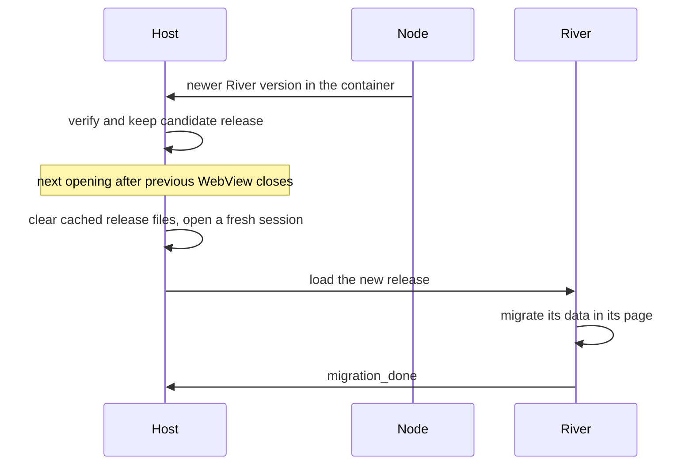
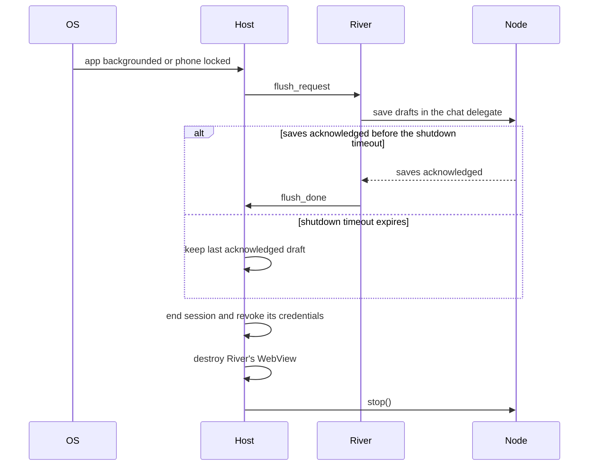

# 1.3 Single-application host

## Repositories

| Repository | Role | Work in this plan |
| --- | --- | --- |
| [freenet-appkit](https://github.com/glesage/freenet-appkit) | Modified | iOS and Android WebView host, bridge script and device adapters |
| [freenet-core](https://github.com/freenet/freenet-core) | Used | Shell page, loopback WebSocket authentication and session admission ([#5264](https://github.com/freenet/freenet-core/issues/5264)) |
| [river](https://github.com/freenet/river) | Modified | File-save requests and results, support report settings action and pending-message counts. Draft messages under 1.6 Application protocols, data and operations; migration messages under 1.7 Upgrades and migration |

## Purpose

Run River in a WebView host on iOS and Android, one application per installation.

## Who controls what

### Installation scope

Each installation owns its embedded node, node store, encryption key and host records.

| Part | What it does |
| --- | --- |
| Host | Supplies storage paths, starts and stops the node, owns River's session and enforces device permissions |
| Native screens | Show permission prompts, startup recovery and support reports for review |
| River | Owns its UI, its room subscriptions and its chat delegate |
| Core | Verifies contract state, authenticates client connections and runs delegates |
| Chat delegate | Checks the caller before reading secrets, signing or decrypting |

### Platform placement

| Platform | Application installation |
| --- | --- |
| iOS | River owns a node in its sandbox and its own Keychain entries. The node stops when River goes to the background |
| Android | River owns a node in its process and private files and its own Keystore entries. The node stops when River goes to the background |

Test builds on iOS and Android use separate application IDs and storage from production installations.

## Trusted calls

River's web client uses the node's loopback WebSocket API. Core's loopback binding limits the client API to the phone ([client API exposure](https://github.com/freenet/freenet-core/blob/8942fd239b2b53e606ffb1e26ee986623008afb2/docs/client-api-exposure.md)).

Bind every client connection to River's verified host session through Core's [session admission #5264](https://github.com/freenet/freenet-core/issues/5264). Adopt the upstream design when it lands. Test clients with and without an Origin header. Keep session credentials in trusted native code and revoke them when the host session ends.

| Release stage | Needs #5264 |
| --- | --- |
| TestFlight internal testing and Play internal testing | No. Testing may start before #5264 lands |
| Public App Store and Google Play release | Yes |

Once #5264 lands, test that every equivalent API path accepts River's admitted session and rejects another local client acting as River.

## WebView host

| Profile | How River runs | What protects it |
| --- | --- | --- |
| River on iOS and Android | River's web code in a WKWebView on iOS and an Android WebView, with files served by the embedded node | The trusted bridge, isolated web storage and session admission |
| River in a desktop browser | River's web code inside Core's sandboxed frame | Core's authentication, storage and capability checks |

[1.1 Mobile feasibility and supported profiles](01-feasibility.md) confirmed that River runs in both WebViews, served by the embedded node from its website container ([device results](https://github.com/glesage/freenet-appkit/blob/1988c5cbdfc5c1f88065382de2a4f86093948b6e/docs/device-results.md#river-and-atlas-in-the-webview)).

Host rules:

- Keep node credentials and privileged bridge methods in trusted native code.
- Check each WebView message's source, navigation and target before forwarding it.
- Keep cookies, web storage, caches and private files inside the installation. Export files only through a user-approved save or share action.
- Apply the node-only web sandbox to River's code and media. Route outside services, embedded pages and external links through approved adapters. The WebView host enforces this itself, because a page script can get around Core's in-frame shims ([#4845](https://github.com/freenet/freenet-core/issues/4845), [#4846](https://github.com/freenet/freenet-core/issues/4846), [#5123](https://github.com/freenet/freenet-core/issues/5123)).
- Check deep-link targets and parameters before routing.

### Web origin and port reuse

River runs in Core's shell page, inside a sandboxed frame with an opaque origin and no web storage of its own. Core's shell keeps its records in the loopback origin's local storage, such as its `freenet_notify:<key>` alert consent record ([#5165](https://github.com/freenet/freenet-core/issues/5165)).

The WebView keys web storage by origin. The origin includes the host name and the node's loopback port.

- `localhost`, `127.0.0.1` and `[::1]` are three different origins ([#4330](https://github.com/freenet/freenet-core/issues/4330)), so the host always loads `127.0.0.1`.
- The node reuses its previous loopback port, so the origin and its storage stay the same across launches ([Start, stop and reconnect in 1.2 Embedded node and mobile SDK](02-sdk.md#start-stop-and-reconnect)).
- If the port changes, the host starts a fresh shell session and restores the shell's records from its host records through the trusted bridge.
- Host records are secrets in Core's encrypted secret store, under the host namespace from [Keys and host records in 1.2 Embedded node and mobile SDK](02-sdk.md#keys-and-host-records).

### Shell-bridge messages

River's frame posts `__freenet_shell__` messages to Core's shell for notification, clipboard, download and navigation requests. The host's bridge script receives them before Core's browser handlers.

Pass serialized JSON text to the native bridge. It checks the byte length before parsing, then checks the source frame, session, type and fields. Handle device requests once and prevent Core's browser handler from repeating the action.

| Message | What Core's browser shell does | What the host does |
| --- | --- | --- |
| `notification_enable_prompt` | Shows an Enable button, calls `Notification.requestPermission()` from its own frame and replies `notification_status` ([#4801](https://github.com/freenet/freenet-core/pull/4801), [#5094](https://github.com/freenet/freenet-core/pull/5094)) | At first use, asks for River's notification choice and the iOS or Android permission. Replies `notification_status` based on both answers |
| `notification` | Shows a browser notification when browser permission and the app's stored consent allow it | On River's first alert, asks for notification permission. Shows a native notification when River's choice and the OS permission both allow it. Otherwise the alert stays in River's page |
| `clipboard` | Writes the text after a user tap, at most once per second and at most 2,048 characters ([#3748](https://github.com/freenet/freenet-core/pull/3748), [#4015](https://github.com/freenet/freenet-core/pull/4015)) | Writes the text under the same three rules. Android 13 and later shows a short system confirmation |
| `download` | Saves the file, at most one every 2 seconds ([download handler](https://github.com/freenet/freenet-core/blob/8942fd239b2b53e606ffb1e26ee986623008afb2/crates/core/src/server/path_handlers/assets/shell_bridge.js#L1143-L1168)) | Requires a user tap and opens the iOS or Android save dialog. Applies the rules in [File saves](#file-saves) |
| `open_url` | Opens an http or https URL in a new tab | Checks the URL and opens it in the system browser |
| `navigate` | Moves the frame within the same app | Checks the room destination |

Host messages:

| Message | Direction | Meaning |
| --- | --- | --- |
| `flush_request` | Host to River | The host is about to stop the node. Save open drafts through 1.6 Application protocols, data and operations |
| `flush_done` | River to host | The chat delegate has acknowledged the draft saves for this session's flush request |
| `migration_done` | River to host | River has finished migration for the named release. Retire the predecessor data and release copy under 1.7 Upgrades and migration |
| `support_report` | River to host | A settings tap asks the host to show a support report for review. Carries River's pending-message counts by send status and their observation time |
| `download_result` | Host to River | Returns the download's `request_id` and a fixed result: `saved`, `cancelled`, `busy`, `invalid` or `failed` |

River's web UI also copies invite links with `document.execCommand('copy')` inside its own frame ([util.rs](https://github.com/freenet/river/blob/78307756805f3e02399791dda142c86b83780b8f/ui/src/util.rs)). Test this path on iOS and Android alongside the clipboard adapter.

### File saves

On iOS and Android:

- Include a `request_id` in each download request. Send its result only to the session that made the request, while that session remains open.
- Require a user tap for each save. Verify it through the platform's input handling, or ask for confirmation in native UI.
- Accept one save request at a time. Return a busy result for further requests while that save is active.
- Check the request size before parsing or decoding. The encoded file and its metadata share the 64 KiB bridge-message limit.
- Require valid base64 data, a supported media type and a filename without path components before opening the system save dialog.
- Decode each accepted file once. The host owns its buffer until the save finishes, fails or is cancelled, then releases the buffer and accepts another user-initiated save.

The native save operation owns the accepted file independently of River's WebView and the node. It can finish if opening the system picker backgrounds River and triggers shutdown. Android uses the system's [create-document picker](https://developer.android.com/training/data-storage/shared/documents-files#create-file).

## Core dependencies

| Requirement | GitHub links | Check on the selected Core build |
| --- | --- | --- |
| Session admission | [#5264](https://github.com/freenet/freenet-core/issues/5264) | Only River's admitted session can act as River. Required before the public store release |
| Private delegate replies | A delegate's notification output goes to every client that has messaged that delegate ([#4682](https://github.com/freenet/freenet-core/pull/4682)). Core withholds it from non-local connections ([#5211](https://github.com/freenet/freenet-core/pull/5211)) | River's chat delegate replies reach only River's session |
| Durable, isolated web storage | [#5165](https://github.com/freenet/freenet-core/issues/5165) | Reload and app termination keep only River's records |

## Activating a release

Each iOS and Android build pins River's container key. A newer version at that key is a new River release.

Verify a candidate release under [1.4 Application bundles](04-bundles.md#release-verification). Activate it the next time the host opens River after closing the previous WebView. Keep the running session on its verified release until then. Complete that release's migration before activating another release.

| Change | What the host does |
| --- | --- |
| New River version in its container | Opens the verified release at the next session boundary. Clears cached release files and preserves web storage. River migrates in its own page and sends `migration_done` |
| New iOS and Android build | The store installs it. The host starts as on any launch |

Save drafts and pending messages in River's chat delegate under [1.6 Application protocols, data and operations](06-data-and-operations.md#bobs-saved-draft). Carry them through delegate and room upgrades under [1.7 Upgrades and migration](07-migration.md).

Accept `migration_done` only from the current session and for the active release version. Keep predecessor data and the previous release copy until the checks in [Reporting completion in 1.7 Upgrades and migration](07-migration.md#reporting-completion) pass.

Load verified files from one release together. Core serves the shell and contract HTML with `Cache-Control: no-store` ([#5886](https://github.com/freenet/freenet-core/pull/5886)). Asset freshness follows the cache and digest checks in [1.4 Application bundles](04-bundles.md#release-verification), including reused asset paths tracked by [#5888](https://github.com/freenet/freenet-core/issues/5888).

## Opening, suspending and reopening an app

[Start, stop and reconnect in 1.2 Embedded node and mobile SDK](02-sdk.md#start-stop-and-reconnect) covers the node's start and stop, including an offline start. The host owns River's session.

When Alice opens River on the subway with no signal:

1. The host loads River's website container from the node's store, without waiting for a peer.
2. River shows "Skate club" from her phone's copy. Her sends wait until the node first joins.
3. Once the node has a peer, the host fetches any update to River's container. A new release activates at the next session boundary.

On a first launch with no stored River release, show a native connection and retry screen until the host can fetch and verify one.

Online, loading the stored container first saves about 0.5 s on the public network ([cached-app evidence](https://github.com/glesage/freenet-appkit/blob/1988c5cbdfc5c1f88065382de2a4f86093948b6e/docs/findings.md#smaller-items)).

Keep an invite link's URL while Core joins and serves its connecting page. Once the container is available, open Bob's invite at its intended target. Test [#5745](https://github.com/freenet/freenet-core/issues/5745) with the fix in [#5750](https://github.com/freenet/freenet-core/pull/5750).

When Alice leaves River or locks her phone:

- Start shutdown once per session. Accept `flush_done` only for that session's outstanding request.
- Wait for `flush_done` or a timeout of up to 2 seconds. Use a shorter timeout if the OS leaves less time for WebView and node teardown. Preserve the last draft save the delegate acknowledged.
- Release bridge buffers and native caches. Keep an accepted native file export under its own save operation until it finishes, fails or is cancelled.
- Wipe session credentials and other sensitive session buffers the host owns. State memory-wiping guarantees only for buffers it controls and tests.
- Reopening creates a fresh WebView and session, then loads River.

Revoke session authority when the host closes River. Test this across Core's page-token lifetime ([#1976](https://github.com/freenet/freenet-core/pull/1976)), WebSocket closure with code 4401 after a node restart ([#4781](https://github.com/freenet/freenet-core/pull/4781)) and River's `AUTH_TOKEN_INVALID` reload ([river#522](https://github.com/freenet/river/issues/522)). Coordinate the shell and River reloads so the host opens one replacement session.

## Device permissions

### Asking for a permission

Each River release declares its device permissions in `app_definition.json`, defined in [1.4 Application bundles](04-bundles.md#app_definitionjson). River declares one optional permission, `notifications`. The host asks for each permission at its first use.

| Permission | First use | What the host stores |
| --- | --- | --- |
| Notifications | Alice's first tap on Enable in River's [notification modal](https://github.com/freenet/river/blob/78307756805f3e02399791dda142c86b83780b8f/ui/src/components/room_list/notification_modal.rs), or River's first alert | River's choice, in host records. The OS keeps its own permission |

- Native notifications need both River's choice and the OS permission. Alice changes River's choice in River's settings and the OS permission in system settings.
- A later River release that declares a new device permission prompts at that permission's first use.
- Verify changed or added delegates through River's signed release under [Execution policy in 1.4 Application bundles](04-bundles.md#execution-policy).
- Recheck River's choice and the OS permission before each notification. After revocation, show alerts in River's page.
- Alerts arrive only while River is in the foreground, as [1.1 Mobile feasibility and supported profiles](01-feasibility.md#message-alerts) confirmed on iOS and Android. A notification tap checks the target and refreshes River's state before showing it.

### Device adapters

| Adapter | River flow | Check |
| --- | --- | --- |
| Notifications | Foreground room messages | River's choice plus the OS permission |
| Clipboard | Invite copy | Tap, size and rate |
| Files | Download | User tap, one iOS or Android save dialog at a time, file size and processing bounds |
| External link | Open URL | http or https target |
| Internal route | Room invite | Target and arguments |

A new adapter needs a River flow and paired iOS and Android fixtures. Define the user action that authorizes it and any permission prompt required at first use.

### Background runs and delegate prompts

Use Core's defaults for delegate prompts and `Background` grants ([subscription.rs](https://github.com/freenet/river/blob/78307756805f3e02399791dda142c86b83780b8f/delegates/chat-delegate/src/subscription.rs)). These grants operate within the node's lifetime. The host stops the node when River goes to the background on iOS and Android.

## Call and event bounds

| Bound | Limit | Where it is enforced |
| --- | --- | --- |
| Shell-bridge message | 64 KiB of serialized UTF-8 JSON | The native WebView bridge, before parsing |
| Clipboard | A user tap, at most once per second and at most 2,048 characters | The clipboard adapter, before writing |
| File save | One active request. The encoded file and metadata share the 64 KiB message limit | The native bridge and save operation, under [File saves](#file-saves) |
| Contract state, requests and delegate replies | Core's existing limits, such as the 50 MiB contract state ceiling | Core |

## Support reports

On iOS and Android, River's settings and the host's startup recovery screen offer "Export support report". The host collects a snapshot and shows it for review. When the user chooses to export it, the host opens the system save or share dialog. Export works offline, including after a node startup failure.

Build a versioned JSON report from this list of allowed fields:

| Area | Allowed fields |
| --- | --- |
| Report | Report format version and collection time |
| Versions | App version and build, Core version, active River release version and digest, platform and OS version |
| Node | Lifecycle state and negotiated node role |
| Connections | OS network-path state and type, loopback WebSocket state, Freenet join state, serving-peer count and each serving connection's state and failure code |
| Storage | Total bytes used by the node store and WebView storage |
| Permissions | Permission name, River's saved choice and current OS permission status |
| Pending messages | Total pending-message count and counts by send status, supplied by River |
| Failures | The latest 50 failures from this app run, with time, component, operation name and typed failure code |

Record each status or measurement's observation time and source (OS, Core, host or River). Mark unavailable values explicitly. Assign serving connections labels that last only for the report, such as `peer-1`.

Validate River's pending-message counts as nonnegative integers for the fixed send statuses. Check that the total equals their sum.

After a node startup failure, use available host and OS observations and mark the remaining fields unavailable. Keep observation times on any values retained from an earlier session.

The host serializes only the allowed fields. Use fixed status values, operation names and failure codes. Keep keys, session tokens, message bodies, private records, peer addresses, URLs and raw logs outside the report.

The host builds the JSON locally. The 64 KiB bridge limit applies to River's `support_report` request. Native report exports share the single active save or share operation with file saves and release their buffers on completion, failure or cancellation.

Test the complete export on iOS and Android:

- Export from River's settings after an offline start, serving-peer loss and a denied notification permission, and from the host's recovery screen after a failed node start. Check the reported versions, states, sources and times against the fixture.
- Seed unique test values in delegate replies, conversation keys, message bodies, session tokens, private records and WebSocket query strings. Export through the settings and recovery actions and scan every exported byte for those values. Include the cases from [River diagnostic redaction #700](https://github.com/freenet/river/pull/700).
- Check that the JSON contains only the allowed fields, unavailable values are marked, and pending-message counts match River's fixture.

## Acceptance

- On iOS and Android, River runs in one WebView, using its installation's own node and store.
- The bridge rejects messages over 64 KiB and messages from the wrong source or target.
- On iOS and Android, each file save requires a verified user tap or native confirmation. The host rejects oversized requests, malformed file data, unsupported media types and filenames with path components. Repeated requests return busy while one save runs.
- Save success, failure and cancellation each release the file buffer and allow the next user-initiated save.
- On iOS and Android, an accepted native file or support report export can finish after the system picker backgrounds River and stops its WebView and node. Returning opens a fresh session.
- Backgrounding the app or locking the phone sends one `flush_request`. The host waits for the delegate's acknowledged saves or the shutdown timeout, then ends the session, destroys the WebView and stops the node. A timeout preserves the last acknowledged draft.
- After a restart on the previous port, River keeps its web storage. With that port taken, River gets a fresh session and its shell records come back from host records.
- A verified River version activates at the next session boundary with web storage intact. Only `migration_done` from the current session and active release permits predecessor cleanup. An interrupted migration resumes before another release activates.
- On iOS and Android, the first Enable tap or first alert shows the notification prompt and saves River's choice. Revoking either River's choice or the OS permission routes alerts to River's page.
- On iOS and Android, the user can review and export a support report while offline and after a node startup failure. The report passes the allowed-field, status and private-data checks in [Support reports](#support-reports).
- Once #5264 lands, every equivalent API path accepts River's admitted session and rejects another local client acting as River. Closing River revokes that session's authority.
