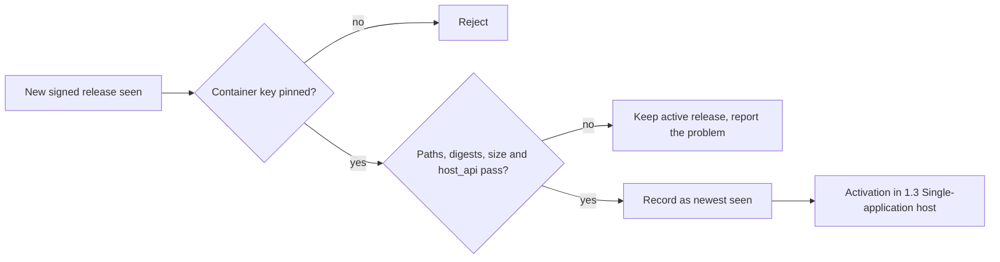

# 1.4 Application bundles

## Repositories

| Repository | Role | Work in this plan |
| --- | --- | --- |
| [river](https://github.com/freenet/river) | Modified | River's release build adds `app_definition.json` to its bundle |
| [freenet-core](https://github.com/freenet/freenet-core) | Modified | `crates/mobile` checks the release's container key against the key pinned in the build |
| [freenet-appkit](https://github.com/glesage/freenet-appkit) | Modified | Host checks before activation: paths, file digests, size caps and `app_definition.json` |

## Purpose

River publishes its web app as a signed bundle in its Freenet website container. This plan adds one file to that bundle, `app_definition.json`, so the iOS and Android hosts know what River needs. It also sets the checks the host runs before it activates a release.

| Area | Result |
| --- | --- |
| Bundle | River's bundle holds `index.html`, its web code, its Wasm files and `app_definition.json` |
| Publishing | River's current release process and the unchanged `fdev website publish` |
| Release identity | A release is River's container key plus the signed version |
| Execution policy | Each iOS and Android build pins River's container key |
| Installation | The host checks each release, then hands it to activation in 1.3 Single-application host |

## The bundle

`fdev website publish` packs a folder that holds `index.html` into a signed website container state ([website publication manual](https://freenet.org/build/manual/publish-a-website/)).

```text
index.html                    # required by fdev website publish
application code and assets   # loaded from index.html
contracts/
  room_contract.wasm          # River's room contract
  chat_delegate.wasm          # River's chat delegate
app_definition.json           # added by this plan
```

### app_definition.json

River's definition:

```jsonc
{
  "format_version": "1",
  "name": "River",
  "description": "Group chat rooms on Freenet",
  "host_api": "1",
  "delegates": ["contracts/chat_delegate.wasm"],
  "permissions": {
    "required": [],
    "optional": ["notifications"]
  }
}
```

| Field | What it holds | Who reads it |
| --- | --- | --- |
| `format_version` | How to read this file | Host |
| `name`, `description` | River's name and one-line description | Host app-management screens |
| `host_api` | The host API version River's code calls | Host, before activation |
| `delegates` | The Wasm path of each delegate River registers | Recovery tools that need River's delegate code |
| `permissions` | Device permissions, as required or optional | Host, when River first uses a permission |

River registers its own chat delegate at startup (see [Setup](#setup)). File a River issue for its release build to write this file and ship both Wasm files under the paths above.

## Release identity

A release is River's container key plus the signed version.

- **Container key.** Core derives it from the container Wasm and the publisher's verifying key. River's release process passes its committed [`published-contract/web_container_contract.wasm`](https://github.com/freenet/river/tree/78307756805f3e02399791dda142c86b83780b8f/published-contract) with `--contract-wasm`. So every River release keeps the key `raAqMhMG7KUpXBU2SxgCQ3Vh4PYjttxdSWd9ftV7RLv`.
- **Version.** An unsigned 32-bit number covered by the publisher signature. River's release process assigns it.

Web code, contracts and delegates ship in the bundle. Native changes ship as matching iOS App Store and Android Google Play builds.

## Publishing

River publishes with its current release process and the unchanged `fdev website publish`:

- River's [Makefile.toml](https://github.com/freenet/river/blob/78307756805f3e02399791dda142c86b83780b8f/Makefile.toml) and [publish workflow](https://github.com/freenet/river/blob/78307756805f3e02399791dda142c86b83780b8f/.claude/rules/river-publish.md) build and publish the bundle.
- [publish-readback.sh](https://github.com/freenet/river/blob/78307756805f3e02399791dda142c86b83780b8f/scripts/publish-readback.sh) reads the release back after publishing.
- fdev's [website subcommand](https://github.com/freenet/freenet-core/blob/8942fd239b2b53e606ffb1e26ee986623008afb2/crates/fdev/src/website.rs) packs, signs and sends the bundle.

Uncertain uploads and two releases at the same version are general Freenet publishing problems. These issues track them:

| Issue | Problem |
| --- | --- |
| [river#634](https://github.com/freenet/river/pull/634) | A publish timed out but landed. River now reads the network before signing |
| [river#635](https://github.com/freenet/river/pull/635) | River's version counter only moves forward |
| [delta#82](https://github.com/freenet/delta/issues/82) | Two different bundles signed at one version never converge |
| [atlas#53](https://github.com/freenet/atlas/issues/53) | A reused version splits the published UI for good |

When River hits a publishing problem that none of these covers, file a Freenet issue.

River's publisher keeps its signing key backed up.

## Execution policy

Each iOS and Android build pins River's container key.

- `crates/mobile` checks the key when the host activates a release. A release under any other key does not run.
- Any contract or delegate in a release signed under that key may run.
- A release that adds or changes a delegate needs no new store build and no user approval. River's signed release is the check.

## Setup

River registers its own chat delegate at startup:

1. River sends `ListRequest` first ([River PR #759](https://github.com/freenet/river/pull/759)).
2. If the delegate is missing, River registers it with empty parameters, then waits for the reply.
3. River loads its rooms.

Registration carries the cipher and nonce fields. Core protects the delegate with the installation key ([#4146](https://github.com/freenet/freenet-core/pull/4146), [#5265](https://github.com/freenet/freenet-core/issues/5265), [#5472](https://github.com/freenet/freenet-core/pull/5472)).

On iOS and Android, test:

- registration on a fresh install
- startup with the delegate already registered
- recovery when the delegate is missing
- an interrupted registration reply
- two starts at once, which leave one registration

## Release verification

The host checks each release before it runs any of the release's code.

| Check | Rule |
| --- | --- |
| Container key | Matches the key pinned in the build. `crates/mobile` checks it at activation |
| Signature and version | The publisher signature is valid. The version is higher than the active release |
| Paths | Reject absolute paths, `..`, symlinks, hardlinks and duplicate paths. Core's unpacker rejects the first four ([#3946](https://github.com/freenet/freenet-core/issues/3946), [#4372](https://github.com/freenet/freenet-core/pull/4372)) |
| File digests | The host records each file's digest when it unpacks the bundle. It checks the digest again before it serves the file. The bundle carries no manifest file |
| Size | Enforce download, decompression, file-count and memory caps |
| `app_definition.json` | The host supports `host_api` and every required permission |

Size caps:

- Core caps contract state at 50 MiB. fdev checks the packed state against it before sending ([#4654](https://github.com/freenet/freenet-core/pull/4654)).
- The download and memory caps come from the [device limits in 1.1 Mobile feasibility and supported profiles](01-feasibility.md#device-limits).
- The decompression and file-count caps come from River's bundles.
- Each publication sends the whole bundle, including assets.

Caching:

- Keep files from one release together. Content-hashed asset names are one tested approach.
- Expect `Cache-Control: no-store` on the shell and contract HTML, including HTML served through an asset route ([#5886](https://github.com/freenet/freenet-core/pull/5886)).
- Check asset digests within the verified release. Record the actual asset `Cache-Control`, `ETag` and `Last-Modified` behavior; asset revalidation remains tracked by [#5888](https://github.com/freenet/freenet-core/issues/5888).
- Test content-hashed and reused asset paths with warm caches, reloads, back/forward navigation and offline startup. Every served file belongs to the verified active release.
- Give each host data directory its own web cache ([#5706](https://github.com/freenet/freenet-core/issues/5706)).

### Installing a release



1. Check the release as in the table above.
2. Record it as the newest release seen, with its version and the time the host saw it.
3. Hand it to [activation in 1.3 Single-application host](03-host.md#activating-a-release).
4. Keep the active release and one earlier copy. If any step fails, keep the working release and the user's data.

| Case | What the host does |
| --- | --- |
| Newer signed release | Runs the steps above |
| Older release | Keeps the active release |
| Unsupported `host_api` or a required permission the host lacks | Keeps the active release and reports what is missing |
| Optional permission the host lacks | River's request returns unavailable |

### Device permissions

River asks for a permission only at first use, under [asking for a permission in 1.3 Single-application host](03-host.md#asking-for-a-permission):

- Alice sees the notifications prompt when she first taps Enable, or when River sends its first alert.
- A release that declares a new device permission prompts at that permission's first use.

## Acceptance

- River's bundle with `app_definition.json` publishes through River's release process and the unchanged `fdev website publish`. It opens in the iOS and Android WebViews.
- River keeps the key `raAqMhMG7KUpXBU2SxgCQ3Vh4PYjttxdSWd9ftV7RLv` across releases.
- On iOS and Android, a release under a different container key fails activation in `crates/mobile`.
- On iOS and Android, a River release that adds a delegate runs without a prompt or a new store build.
- The host rejects unsafe paths, a file whose digest changed after unpacking, an unsupported `host_api` and a bundle over the size caps.
- A release that declares a new permission prompts only when River first uses it.
- Delegate setup resumes after termination. River waits for the registration reply before it sends messages to the delegate.
- On iOS and Android, HTML responses use `Cache-Control: no-store`, and activation with warm caches serves the verified active release's HTML, code and assets together. Reused asset paths pass the same digest checks.
- An older release leaves the active release in place.

Sources: [website publication manual](https://freenet.org/build/manual/publish-a-website/), [container implementation](https://github.com/freenet/freenet-core/tree/8942fd239b2b53e606ffb1e26ee986623008afb2/crates/website-contract), [fdev website subcommand](https://github.com/freenet/freenet-core/blob/8942fd239b2b53e606ffb1e26ee986623008afb2/crates/fdev/src/website.rs).
