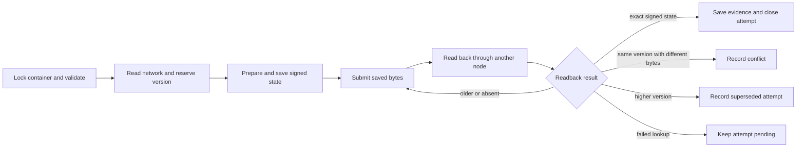

# 1.4 Application bundles

## Repositories

| Repository | Role | Work in this plan |
| --- | --- | --- |
| [freenet-appkit](https://github.com/glesage/freenet-appkit) | Modified | Bundle packaging and installation |
| [river](https://github.com/freenet/river) | Modified | River bundle publication |
| [freenet-core](https://github.com/freenet/freenet-core) | Modified | Separate website preparation and submission in fdev; readback |

## Purpose

Package and publish an application's web UI, contract and delegate artifacts, and host metadata. River's web UI is the AppKit test application on iOS and Android.

Build contracts, archive the web directory, sign it and store it in a Freenet website container. Add metadata, publication evidence and installation checks for the mobile host.

| Area | Required result |
| --- | --- |
| Archive | `index.html`, application assets, `contracts/` from `fdev build`, and `app_definition.json` naming every contract and delegate Wasm file |
| Publication | Validate the archive, assign an increasing version, save the signed state, submit with container Wasm, verify independent readback and replay saved bytes after an uncertain result |
| Installation | Check releases in the packaging CLI and host; track activation, rollback, retention and component setup |
| References | `publication_ref` and `application_content_ref` identify one exact release by container key, version and digest |

## The archive and its definition

`fdev build` writes `contracts/<code_hash>.wasm` and `dependencies.json`. `fdev website publish` requires `index.html`, creates a tar.xz archive, signs its version and archive, and submits it to the website container.

```text
index.html                    # required by fdev website publish
application code and assets   # loaded from index.html
contracts/
  <code_hash>.wasm            # written by fdev build
  dependencies.json           # written by fdev build
app_definition.json           # This plan: host metadata, every field below
```

River ships its two Wasm files by name, as `contracts/room_contract.wasm` and `contracts/chat_delegate.wasm`. Each component entry names its file by path.

Application code loads assets from `index.html` and calls contracts and delegates. Add `app_definition.json` with the metadata the host needs. River's definition:

```jsonc
{
  "format_version": "1",                           // format version: how the host reads this file
  "name": "River",                                 // name and description identify the app
  "description": "Group chat rooms on Freenet",    // in trusted install and app-management screens
  "host_requirements": {                           // what the host must support to run the app
    "host_api": "1",                               // host API version the app code calls
    "protocols": { "river.chat": "1" }             // protocol versions the app code uses
  },
  "components": [                                  // one entry per contract and delegate the app uses
    {
      "alias": "river.room",                       // the app's own name for the component
      "kind": "contract",                          // contract or delegate
      "artifact": "contracts/room_contract.wasm",  // Wasm file in the archive, or a verified reference to it
      "parameters": "ChatRoomParametersV1",        // the app's encoding, since each room has its own { owner }
      "protocols": ["ChatRoomStateV1"],            // state format version this contract stores
      "startup_owner": "river.room-ui"              // River creates each room with its exact owner parameters
    },
    {
      "alias": "river.chat",
      "kind": "delegate",
      "artifact": "contracts/chat_delegate.wasm",
      "parameters": "empty",                       // the exact parameters, here none
      "protocols": ["river.chat/1"],               // message format version this delegate uses
      "startup_owner": "river.host"                 // host registers the admitted chat delegate
    }
  ],
  "permissions": {                                 // each permission the app uses, as required or optional
    "required": [],                                // names are device permission codes in the trusted host
    "optional": ["notifications"]                  // 1.3 Single-application host sets when the host asks
  }                                                // Background lives in a delegate's Wasm manifest
}
```

River's [chat delegate messages](https://github.com/freenet/river/blob/8cf54dd7799514851da7eab051e4cc43f797208d/common/src/chat_delegate.rs), its [delegate built with empty parameters](https://github.com/freenet/river/blob/8cf54dd7799514851da7eab051e4cc43f797208d/ui/src/components/app/chat_delegate.rs#L67-L76) and its [room parameters](https://github.com/freenet/river/blob/8cf54dd7799514851da7eab051e4cc43f797208d/common/src/room_state.rs#L527) show the component fields in real code. Assign `river.chat/1` as River's protocol name and `river.room` and `river.chat` as component aliases. River's [pointer records](https://github.com/freenet/river/blob/8cf54dd7799514851da7eab051e4cc43f797208d/pointer-records.toml) name the same components `river.room-contract` and `river.chat-delegate`.

River website releases carry these identity values. [Release references](#release-references) defines the record used by the host and recovery tools.

- The container identity is the full container `ContractKey`. It derives from the container Wasm and the publisher's verifying key. fdev embeds a stock container Wasm that can change between fdev versions, so the packaging CLI passes each app's container Wasm with `--contract-wasm` on every publication ([dapp-builder skill](https://github.com/freenet/freenet-agent-skills/blob/890ad1b20c03ee99dd0a0ae89ec3e3b17c19eac4/skills/dapp-builder/references/web-container-contract.md)). For River that file is the committed [`published-contract/web_container_contract.wasm`](https://github.com/freenet/river/tree/8cf54dd7799514851da7eab051e4cc43f797208d/published-contract), so every River release keeps the key `raAqMhMG7KUpXBU2SxgCQ3Vh4PYjttxdSWd9ftV7RLv`. Check container identity across releases using [mail#200](https://github.com/freenet/mail/issues/200) and [raven#45](https://github.com/freenet/raven/issues/45) as regression cases.
- The container version is an unsigned 32-bit integer covered by the publisher signature. The packaging CLI assigns each new publication a version higher than every version it has reserved and the verified version read from the network. Unix seconds provide a starting floor, as defined under [Publishing and evidence](#publishing-and-evidence). Retries retain the prepared publication's version.

A bundle carries web code, contracts and delegates. Native app changes ship through matching iOS App Store and Android Google Play releases.

### Release references

`application_content_ref` is a versioned record with `format`, `application_key`, `version` and `digest`. Its digest is base58 BLAKE3 of the exact verified complete signed publication bytes.

| Format | Published identity | Release bytes |
| --- | --- | --- |
| `website/1` | River's full website container key | Signed website container state and its verified archive |

Each release reference identifies one format and one application. A format adapter verifies the publication's identity, signature, version and digest. The host and backup manifest use that adapter to resolve the reference. This plan implements `website/1` and tests it with River.

### Reference adapter and digest encodings

Shared vectors let hosts, publishers and backups identify the same release and detect altered artifacts.

| Value | Algorithm and exact byte input | Wire encoding and consumers |
| --- | --- | --- |
| `application_content_ref.digest`, `website/1` | BLAKE3 of complete signed website container state | Base58 of 32 raw bytes; host verification and backup manifest |
| `publication_ref.archive_digest` | SHA-256 of exact tar.xz archive bytes | Base58 of 32 raw bytes; packaging journal and release verification |
| Policy and native build digests | SHA-256 of canonical build execution-policy bytes or exact packaged build bytes | Base58 of 32 raw bytes; build admission and recovery |
| File-manifest digest | SHA-256 of exact unpacked file bytes | Base58 of 32 raw bytes; packaging and host file checks |

Each metadata field has a consumer: host requirements and permissions feed admission; artifact/parameters/protocols feed Core validation and migration; component roles and inventory ID feed backup/restore; name/description feed trusted River screens; startup owner feeds fixed setup. Versioned metadata changes update those consumers' shared fixtures together.

### Encoding fixture

Use prepared River releases as website encoding fixtures. Verify the publisher signature, full container key, version, complete signed-state BLAKE3 digest and archive SHA-256 digest. Rust, Swift and Kotlin must produce the same reference bytes.

### Signed file manifest

River's signed archive contains `file_manifest.json`: format version, unique relative path, byte length and SHA-256/base58 digest for every other file. The signed container authenticates the manifest and its files. Packaging validates it before signing; the host repeats path, size and digest checks before serving bytes. Include Wasm embedded inside the UI in executable admission checks. Shared iOS and Android fixtures cover altered assets, duplicate paths, omitted files and modified manifests.

### River release metadata

The host uses River release metadata to verify components, request permissions and select recovery adapters for the signed release.

File a River issue for its release build to write `app_definition.json` with the room contract, chat delegate and `notifications` permission defined above. The AppKit host and packaging CLI read this file from the release archive. Ship both Wasm files under the declared paths.

## Execution policy

AppKit owns the policy packaged in matching iOS and Android builds. Exact code and role admission keeps ordinary calls, predecessor recovery and staged migration within the build's declared authority; release requires bypass and recovery fixtures.

Each matching iOS and Android store build includes an execution policy for its owning application and exact Wasm code hash. The policy assigns each hash its allowed roles:

| Role | Allowed execution |
| --- | --- |
| Current | Normal application operations for the declared component and protocol, including any approved retained release |
| Supported predecessor | Reads, export adapters and verified retirement cleanup needed by the declared upgrade paths |
| Migration-only | Approved local migration and verification adapters inside the isolated staging generation |

The policy records exact parameter rules, supported migration pairs and the required runtime/host versions. Core checks it before loading or registering Wasm through every client path, including artifacts embedded in UI Wasm and code supplied by a backup. Pointer records locate candidates; installation verifies each candidate against this policy.

Adding a code hash or expanding its role requires matching iOS and Android store builds. Compatible web releases use the hashes and permissions already admitted by the installed policy. A candidate needing a newer policy waits for the store update while the host retains the working release and saved data. Package all predecessor hashes required by the build's declared restore coverage; backup files supply the verified Wasm bytes and exact registrations under [1.10 Backup and restore](10-backup-and-restore.md#restore).

## Setup

Use a fixed startup sequence for River. Component metadata names the owning startup code and preserves exact artifact, parameters and protocol identity for verification and recovery.

| Application | Startup sequence |
| --- | --- |
| River | Verify the website release and room/chat artifacts, open the authorized session, register the chat delegate with empty parameters, wait for its reply, then load rooms. Room creation uses the selected room contract and exact owner parameters. |

Registration carries the cipher/nonce fields; Core derives delegate protection from the installation KEK ([#4146](https://github.com/freenet/freenet-core/pull/4146), [#5265](https://github.com/freenet/freenet-core/issues/5265), [#5472](https://github.com/freenet/freenet-core/pull/5472)). Persist each startup checkpoint and resume idempotently after interruption. Features open after required component verification and registration replies ([river#709](https://github.com/freenet/river/issues/709), [river#710](https://github.com/freenet/river/pull/710)).

## Publishing and evidence

### Prepare and submit

Saving signed bytes before upload lets a retry reproduce the same release after a timeout or process exit. River publication depends on the integrated fdev operations and exact-byte replay/readback fixtures.

Selected interface: separate fdev preparation and submission. The source checked on 2026-10-09 exposes `publish` and `update`; this plan requires durable preparation before dispatch. Acceptance records the selected Core/fdev commit and proves exact-byte replay and independent readback.

File a Core issue for separate fdev preparation and submission operations:

| Operation | Inputs and result |
| --- | --- |
| Prepare | Takes the release directory, explicit unsigned 32-bit version, publisher key and container Wasm. Returns the exact archive and complete signed container state for durable local storage. |
| Submit | Sends the saved signed state with the same container Wasm and parameters. |

The packaging CLI owns the publication journal, allocates versions and serializes release jobs under the rules below. fdev encodes the archive and signatures and validates the supplied version and state. Fixtures cover local preparation, exact replay after termination and exact readback through another node. Implement these operations in Core's fdev before River's publisher integration.

Use one publisher workspace and durable publication journal per container. Hold an exclusive per-container lock during preparation, submission and reconciliation across local and CI jobs. Include the journal and prepared states in publisher recovery backups. Publisher moves transfer the journal and prepared states with the key. Recovery reconciles pending attempts and the verified network version before preparing another publication.

For each new publication, the CLI reserves and durably records:

```text
version = max(current Unix seconds,
              highest version reserved in the journal + 1,
              highest verified network version recorded in the journal + 1)
```

Each verified network read raises the journal's observed version floor when higher. A new, verified absent container starts with a network floor of zero. A failed lookup waits for a successful read. Calculate in a wider integer and check that the result fits `1..=u32::MAX` before preparation. Version exhaustion reports a release error. Preparation preserves the container's metadata and signature encoding: the four-byte big-endian version followed by the archive bytes ([website container source](https://github.com/freenet/freenet-core/blob/e7d0b06c9326f377d250bf8344baaac2ba2658c6/crates/website-contract/src/lib.rs)). Reserved versions remain consumed after a failed preparation or a cancelled attempt. The CLI prepares exactly one signed state for each reserved version. After termination, a reservation with no complete saved signed state is closed as an interrupted preparation; the next attempt reserves a higher version.



| Step | What the packaging CLI does |
| --- | --- |
| 1. Validate | Locks the container and checks `app_definition.json`, component hashes, parameter fixtures, host API and protocol versions, and archive size limits. Checks device permission names against the host's supported adapters and delegate grants against the Core manifest schema. Reconciles a pending attempt before preparing another publication. |
| 2. Prepare and save | Reads and verifies the network state, reserves the next version, then archives and signs the release once. Durably saves the release folder, file digests, exact archive and complete signed state, container key, container Wasm, signing key name, version and attempt record before submission. A failed save stops the attempt. |
| 3. Submit | Sends the saved signed state with its container Wasm and exact container parameters. Every retry sends those same bytes, signature and version. |
| 4. Read back | Reads through a node other than the publishing node, with `fdev --node-url <url> execute get`. Verifies the container identity and publisher signature, then compares the complete signed state, version, archive digest and files with the prepared copy. An exact match saves the readback evidence and closes the attempt.<br>Produces a `publication_ref`: the full container `ContractKey`, signed version, hash algorithm and archive digest. Produces a `website/1` `application_content_ref` with the full container key, version and BLAKE3 digest of the exact complete signed container state. |
| 5. Reconcile | After a timeout or termination, reads back first as in step 4. An exact match completes the attempt. An older or verified absent state allows replay of step 3. A failed lookup leaves the attempt pending. Different bytes at the same version record a conflict; a higher version records the attempt as superseded. Both outcomes retain the evidence and advance the journal's observed version floor. A subsequent publication starts at step 1 with a higher version. |

The publishing node's PUT reply confirms local persistence, with propagation continuing asynchronously ([#3626](https://github.com/freenet/freenet-core/pull/3626)). The CLI issues a `publication_ref` after exact readback through another node. Retry fixtures cover timeouts, termination and equal-version divergence, using [river#634](https://github.com/freenet/river/pull/634), [river#635](https://github.com/freenet/river/pull/635), [delta#82](https://github.com/freenet/delta/issues/82) and [atlas#53](https://github.com/freenet/atlas/issues/53) as cases.

The readback fixture verifies the container metadata encoding and Ed25519 signature serialization against the container Wasm ([#5437](https://github.com/freenet/freenet-core/issues/5437)).

Changes to release files start a new publication at step 1, with a new reserved version and saved signed state.

An `application_content_ref` identifies the exact signed application publication under [Release references](#release-references). Native iOS and Android builds also record a separate `native_build_ref` with platform, application ID, build number, commit, execution-policy digest and packaged build digest. Recovery checks the publication reference and the target build policy together; native build evidence accompanies the application release reference.

### River publication

File River's publisher integration and version allocation issues together, after the release metadata and fdev preparation/submission issues. River's release jobs follow the packaging CLI's journal, lock, version and retry rules under [Publishing and evidence](#publishing-and-evidence).

River's preparation and submission pass `--contract-wasm published-contract/web_container_contract.wasm` and its existing publisher key. This preserves container key `raAqMhMG7KUpXBU2SxgCQ3Vh4PYjttxdSWd9ftV7RLv`. Copy River's signing key to fdev's key file, `~/.config/freenet/website-keys/<name>.toml`. Back up the key file with the publication journal and prepared signed states.

Reconcile River's existing container version before the first reservation. Route River's publish rules and CI through the same publisher workspace, including the recovery process under [Publishing and evidence](#publishing-and-evidence).

Sources: River's [Makefile.toml](https://github.com/freenet/river/blob/8cf54dd7799514851da7eab051e4cc43f797208d/Makefile.toml), [river-publish.md](https://github.com/freenet/river/blob/8cf54dd7799514851da7eab051e4cc43f797208d/.claude/rules/river-publish.md), [website.rs](https://github.com/freenet/freenet-core/blob/e7d0b06c9326f377d250bf8344baaac2ba2658c6/crates/fdev/src/website.rs) and [publish-readback.sh](https://github.com/freenet/river/blob/8cf54dd7799514851da7eab051e4cc43f797208d/scripts/publish-readback.sh).

## Release verification

The host's installation interface verifies and retains releases and hands them to activation. The packaging CLI checks each archive before publishing. The host repeats the checks before running archive code.

| Check | Requirement |
| --- | --- |
| Container identity, signature and version | Match the selected application and verify the signed snapshot |
| Paths | Reject absolute paths, parent traversal, symlinks, hardlinks and duplicate paths. Core's unpacker rejects the first four too ([#3946](https://github.com/freenet/freenet-core/issues/3946), [#4372](https://github.com/freenet/freenet-core/pull/4372)) |
| Executable content | Match the store build's execution policy, allowed role and declared artifacts. Apply the same checks to copies compiled into the app code, as River's UI Wasm embeds both of River's Wasm files ([constants.rs](https://github.com/freenet/river/blob/8cf54dd7799514851da7eab051e4cc43f797208d/ui/src/constants.rs), [river#424](https://github.com/freenet/river/issues/424)) |
| Resource use | Enforce download, decompression, file-count and memory caps |
| Metadata and components | Verify artifact hashes, supported formats, parameter encodings and application protocols |
| Setup and permissions | Match approved setup and declared permissions |

Core caps contract state at 50 MiB, and fdev checks the packed state against that limit before it sends ([#4654](https://github.com/freenet/freenet-core/pull/4654)). Core's 64 MiB WebSocket limit and the container's 100 MiB web limit sit above it, so the release tooling checks 50 MiB. This plan sets the download and memory caps from the large-record and River download values in [device limits in 1.1 Mobile feasibility and supported profiles](01-feasibility.md#device-limits), and sets the decompression and file-count caps from River's and Atlas's archives. Test the size and file-count caps against archives with stale UI Wasm builds ([harvest#4](https://github.com/freenet/harvest/issues/4), [delta#70](https://github.com/freenet/delta/issues/70)). Each publication sends the whole archive, including assets. A separate blob-store proposal can use [freenet-git pack contracts #3985](https://github.com/freenet/freenet-core/issues/3985) as evidence.

Keep files from one release together after publication. Content-hashed asset names provide one tested approach. Test this against Core's `ETag`, `Last-Modified` and absent `Cache-Control` headers ([#5323](https://github.com/freenet/freenet-core/issues/5323), [harvest#193](https://github.com/freenet/harvest/pull/193)). Give each host data directory its own web cache ([#5706](https://github.com/freenet/freenet-core/issues/5706)).

The installation interface then takes each candidate release through these steps:

1. Check the candidate before running any of its code: host APIs, protocols, setup, device adapters and data compatibility. If the candidate changes delegates, setup or access, ask the user first, under the [base authorization rules in 1.3 Single-application host](03-host.md#base-authorization-and-device-access). For example, a River release that adds a delegate waits for Alice to approve it.
2. Record the candidate as the newest release seen, with its version, digest and the time the host saw it. Keep this record apart from the active release. A local rollback changes the active release and keeps the highest version seen.
3. Hand the verified `application_content_ref` to [activation in 1.3 Single-application host](03-host.md#activating-a-release).
4. Keep the active copy, one backup and every release that a stored record still references, within the storage budget. If any step fails, keep a working copy and the user's saved work.

Release handling:

- A newer signed archive becomes a new candidate and goes through these steps.
- An older publication keeps the active copy and the newest observed record.
- Same-version divergence keeps the accepted bytes and both pieces of evidence, and suspends automatic activation until a higher signed version resolves the conflict.
- Unsupported host APIs or protocols keep the compatible copy and report the unmet requirement.
- A required permission this host lacks keeps the compatible copy and reports the unmet requirement. A request for an optional permission this host lacks returns unavailable.
- A deliberate local rollback passes current data compatibility and execution-policy checks.

## Publisher release backups

The packaging CLI keeps a saved copy of each release, including supported predecessor releases. Each saved copy holds the prepared archive, complete signed state and container Wasm, plus readback evidence when publication completes. The website container holds its latest state, and network availability depends on hosting demand, as described in the [whitepaper status](https://github.com/freenet/paper-1/blob/bff15702759800a003ffbfce639fe859f57d966d/sections/07-status.tex). Core's [netcheck probe](https://github.com/freenet/freenet-core/tree/e7d0b06c9326f377d250bf8344baaac2ba2658c6/crates/netcheck) reads contracts published 24 hours, 48 hours and 7 days earlier, and [#5504](https://github.com/freenet/freenet-core/issues/5504) asks whether 7 days fits demand-driven hosting. Restoring an older release needs its saved copy and a compatible host.

The publisher keeps a tested backup of its signing key file, `~/.config/freenet/website-keys/<name>.toml`, which `--key <name>` reads. The website container accepts updates only from that key, so a restored backup signs the next release to the same container. River's publisher stores River's existing signing key in this file.

## Acceptance

- River's web archive builds, signs, publishes and opens in the supported iOS and Android WebViews.
- Every fixture prepares and submits through the separate fdev capabilities with its container Wasm. River keeps the key `raAqMhMG7KUpXBU2SxgCQ3Vh4PYjttxdSWd9ftV7RLv` across releases. Two releases within one second receive increasing versions, including after clock rollback or journal recovery.
- CLI/CI rejects unsafe paths, hash mismatches, unsupported metadata, invalid parameter fixtures and releases that exceed the selected profile's limits. The install check accepts River's archive with the Wasm copies its UI embeds.
- A failed save in step 2 stops submission. Timeout and termination fixtures replay exactly the saved signed state, archive and version after readback. Termination after reservation consumes that version. Concurrent jobs for one container serialize through the same journal. Same-version conflict and a higher network version retain evidence and require a new publication at a higher version. Step 4 issues references only after exact readback through another node.
- A consumer verifies `publication_ref` and `website/1` references against the saved copy after the live container advances. Each iOS and Android build reference verifies against its packaged build and execution-policy digests.
- On iOS and Android, test current, supported predecessor and migration-only hashes through direct browser WebSocket and native SDK paths. An unknown hash requires a matching store build; embedded Wasm and backup-supplied code receive the same checks. Migration-only code runs only the admitted staging adapters. A changed delegate and a skipped-version restore pass on the policy that declares them.
- Setup resumes after termination. The app waits for the delegate's registration reply before sending messages to it. Changed delegates and new access pass the host's consent checks before activation.
- A restored backup of the publisher's key file signs a valid update to the same container.
- The installation interface handles replayed content, older publications, same-version divergence, unsupported requirements, rollback with changed data and cleanup while a retained record still references a release.

Sources: [website publication manual](https://freenet.org/build/manual/publish-a-website/), [container implementation](https://github.com/freenet/freenet-core/tree/e7d0b06c9326f377d250bf8344baaac2ba2658c6/crates/website-contract), [fdev website subcommand](https://github.com/freenet/freenet-core/blob/e7d0b06c9326f377d250bf8344baaac2ba2658c6/crates/fdev/src/website.rs).
