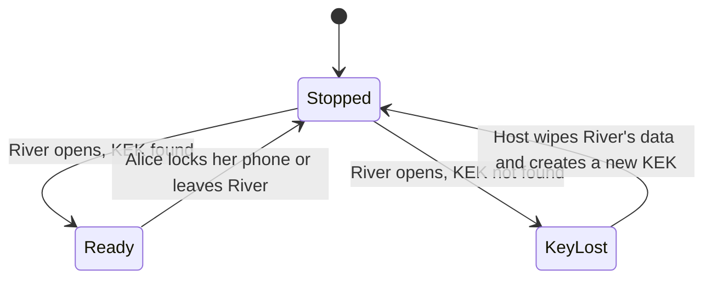

# 1.5 Identity, keys and local protection

## Repositories

| Repository | Role | Work in this plan |
| --- | --- | --- |
| [freenet-core](https://github.com/freenet/freenet-core) | Modified | A host-supplied KEK backend with load, store and delete callbacks through UniFFI. Host records under a reserved namespace in the secret store |
| [freenet-appkit](https://github.com/glesage/freenet-appkit) | Modified | Keychain (Swift, iOS) and Keystore (Kotlin, Android) callbacks; `KeyLost` and Forget screens |
| [river](https://github.com/freenet/river) | Used | River's delegate records and room keys under test |

## Purpose

Protect River's keys and private data on iOS and Android, and let Alice delete them:

- River keeps Alice's signing key for "Skate club" and the DMs she sent in its chat delegate. Core encrypts them with the node encryption key (KEK).
- The iOS Keychain or the Android Keystore holds the KEK.
- When Alice locks her phone, River goes to the background. The node stops and the KEK leaves memory.
- If the KEK is gone, the host reports `KeyLost`.
- Alice can Forget River. The host deletes the KEK first, then wipes River's data.

## Keys

| Key | What it is | Who controls it |
| --- | --- | --- |
| Application | River's website container key. Core computes it from the container code and the publisher's verifying key | Nobody holds it. Anyone can recompute it |
| Publisher | The key that signs each River bundle release | The River publisher |
| User | Alice's signing key for "Skate club". River makes one per room and stores it in its chat delegate | Alice |
| Delegate | River's chat delegate key, a hash of its code. Its secret store holds Alice's signing keys and the DMs she sent | Nobody holds it. Anyone can recompute it |
| Node network key | The key Alice's node uses to connect to other peers. Core creates it on first run and saves it as `transport_keypair` in its secrets directory | Alice's node |
| Node encryption key (KEK) | The key that encrypts every delegate's secret store | Alice's node, through the Keychain or Keystore |

## Node encryption key

Core gains one generic KEK backend that the host supplies. It has three callbacks through UniFFI: load, store and delete. [1.2 Embedded node and mobile SDK](02-sdk.md) builds and packages the bindings.

- Swift implements the callbacks with the iOS Keychain.
- Kotlin implements them with the Android Keystore.
- File a Core sub-issue of [#4137](https://github.com/freenet/freenet-core/issues/4137) for the backend. Use [kek.rs](https://github.com/freenet/freenet-core/blob/8942fd239b2b53e606ffb1e26ee986623008afb2/crates/core/src/config/kek.rs) and [#4140](https://github.com/freenet/freenet-core/issues/4140) as references.

On first start, `crates/mobile` creates one KEK for the installation and stores it through the callbacks.

| Platform | Where the key lives | Key setting |
| --- | --- | --- |
| iOS | A Keychain item | `kSecAttrAccessibleWhenUnlockedThisDeviceOnly` |
| Android 9 to 11 | A file in the app's storage, encrypted with an Android Keystore AES key | [`setUnlockedDeviceRequired(true)`](https://developer.android.com/reference/android/security/keystore/KeyGenParameterSpec.Builder#setUnlockedDeviceRequired(boolean)) |
| Android 12 to 14 | The same file and Keystore key | No unlocked-device setting. The key survives when Alice removes her lock screen, and the app can create it on a phone with no lock screen |
| Android 15 and later | The same file and Keystore key | `setUnlockedDeviceRequired(true)` |

- `setUnlockedDeviceRequired` needs Android 9 (API 28). This sets the Android floor in [supported profiles in 1.1 Mobile feasibility and supported profiles](01-feasibility.md#supported-profiles).
- Core records the backend in `secrets_dir/kek_backend` and loads the key only from that backend.
- `crates/mobile` sets the umask to `0o077` before it starts any thread, as Core's `freenet` binary does ([#4219](https://github.com/freenet/freenet-core/pull/4219)).
- The KEK stays on its phone. Exclude River's encrypted storage from iCloud and Google device backups.
- iOS keeps Keychain items after an app is deleted. At first start after a reinstall, the host deletes a leftover Keychain key that has no matching data, then creates a new one.

## What the key protects

Core derives a separate key for each delegate from the KEK. No derived key leaves Core.

The host keeps its own private records, such as River's notification choice, as secrets in Core's encrypted secret store. They live under a reserved host namespace. `crates/mobile` turns off Core's secret snapshots ([storage in 1.2 Embedded node and mobile SDK](02-sdk.md#storage)), so the phone keeps only each secret's current value.

River's records:

| Record | Where it lives | Protected by |
| --- | --- | --- |
| `room:<owner key>`: Alice's signing key, member records and nickname for "Skate club" | River's chat delegate | The delegate's derived key |
| `rooms_meta`: current room, notification settings and room order | River's chat delegate | The delegate's derived key |
| DMs Alice sent | River's chat delegate | The delegate's derived key |
| Host records, such as the notification choice | Core's secret store, reserved host namespace | Core's derived key |
| "Skate club" messages, members and bans | Room contract state on the network | The [room secret](https://github.com/freenet/river/blob/78307756805f3e02399791dda142c86b83780b8f/README.md#privacy-model) and member signatures |

River's record keys come from [chat_delegate.rs](https://github.com/freenet/river/blob/78307756805f3e02399791dda142c86b83780b8f/ui/src/components/app/chat_delegate.rs) and [room_data.rs](https://github.com/freenet/river/blob/78307756805f3e02399791dda142c86b83780b8f/ui/src/room_data.rs).

## Locking and unlocking

Locking the phone sends River to the background. The host tears down River's WebView and completes the task teardown in [Start, stop and reconnect in 1.2 Embedded node and mobile SDK](02-sdk.md#start-stop-and-reconnect). All node-owned tasks release their key references before shutdown completes. Core drops and zeroizes the KEK and derived keys through their owned wrappers; the tests below check those buffers.

| Event | What happens |
| --- | --- |
| Alice locks her phone or leaves River | The host stops the node and destroys River's WebView. The KEK and derived keys leave memory |
| Alice unlocks and opens River | The node starts and loads the KEK through the Keychain or Keystore. The host opens a fresh WebView |
| The KEK is not found at start | The host reports `KeyLost` |
| The Keychain or Keystore returns an error | The host reports the error and keeps all data. It tries again at the next start |

`KeyLost` means River's encrypted data can no longer be read. The host tells Alice, wipes River's data directory and creates a new KEK. River then starts with no rooms.

Verify Core's zeroizing wrappers with owned test buffers and drop observers when the node stops ([#5599](https://github.com/freenet/freenet-core/issues/5599)).

## Forget

Forget resets River on this phone. Before Alice confirms, the host shows what she will lose: her rooms, her keys and the DMs she sent.

1. The host stops the node and destroys River's WebView.
2. The host deletes the KEK through the delete callback. From now on River's encrypted data cannot be read.
3. The host wipes River's app data directory.

If River stops between steps 2 and 3, the next start finds no KEK. The host then finishes the wipe, as for `KeyLost`.

After Forget:

- Public room messages stay on Freenet.
- Alice's other devices keep their own identities.
- A new identity gets a new KEK.

## Acceptance

- On iOS and Android, the KEK callbacks pass Core's backend tests for load, store and delete.
- On Android 9 to 11 and 15 and later, the Keystore key has `setUnlockedDeviceRequired(true)`. On Android 12 to 14 it does not.
- On Android 9 to 11, 12 to 14 and 15 and later, Alice removes her lock screen. River keeps its data, or reports `KeyLost` if the platform deleted the key.
- On iOS, a reinstall leaves a Keychain key with no data. The first start deletes it and creates a new one.
- On iOS and Android, locking the phone with a River signing key loaded in page memory stops the node and destroys the WebView. The zeroizing check passes. Unlocking and opening River loads the KEK and opens a fresh WebView.
- On iOS and Android, a missing KEK gives `KeyLost`, and the host wipes the unreadable data. A Keychain or Keystore error keeps all data.
- On iOS and Android, Forget deletes the KEK before it wipes the data directory. Stopping River between the two steps finishes the wipe on the next start.
- Host records live in the reserved host namespace and no derived key leaves Core.
