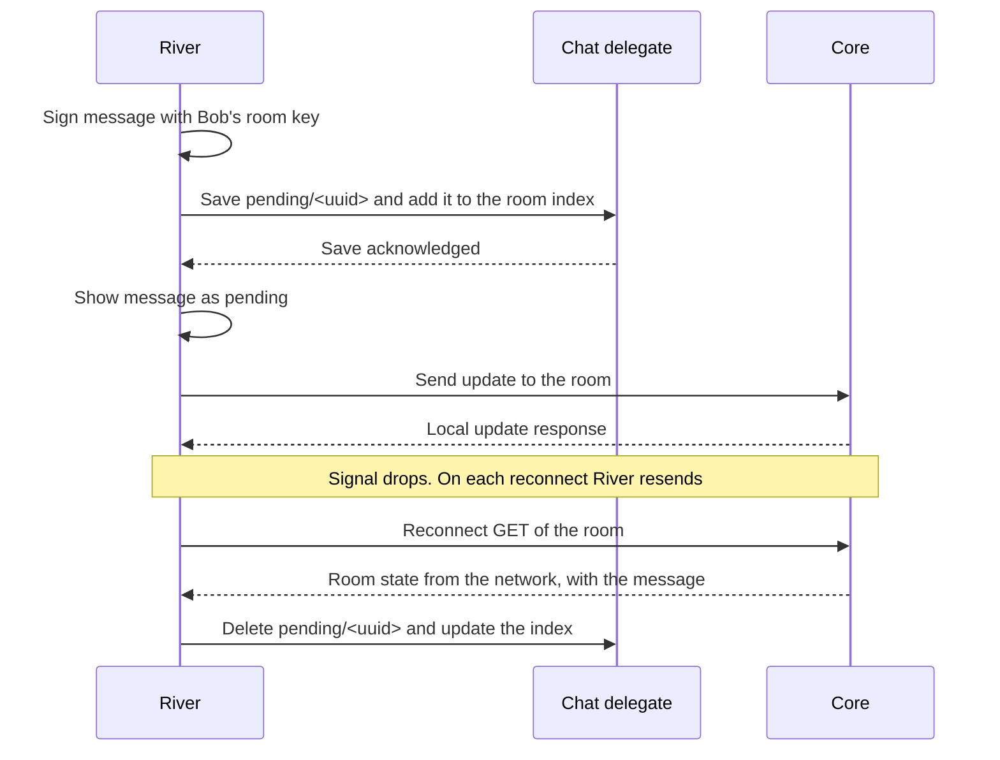
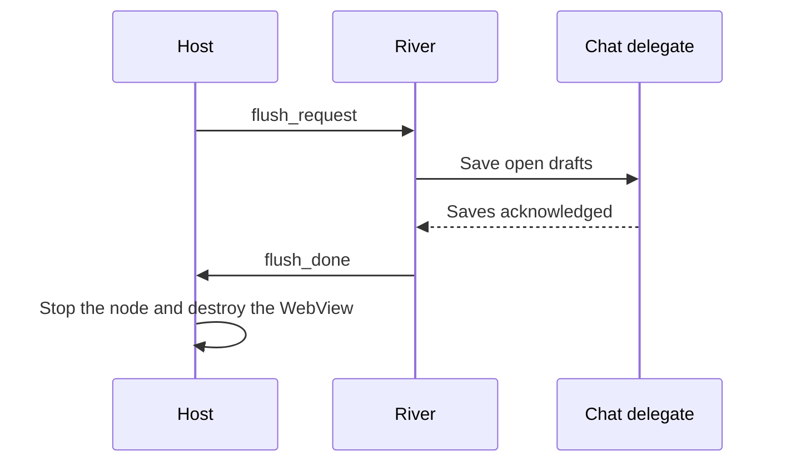

# 1.6 Application protocols, data and operations

## Repositories

| Repository | Role | Work in this plan |
| --- | --- | --- |
| [river](https://github.com/freenet/river) | Modified | Save drafts and pending messages in the chat delegate under unique keys with a per-room index; answer `flush_request`; keep pending messages until a network read shows them; carry late messages forward after a room upgrade |
| [freenet-core](https://github.com/freenet/freenet-core) | Modified | Record when room responses arrive; test and fix local update response timing |
| [freenet-appkit](https://github.com/glesage/freenet-appkit) | Modified | Send `flush_request` before stopping the node; River read, draft, send, invitation and recovery tests on iOS and Android |
| [freenet-stdlib](https://github.com/freenet/freenet-stdlib) | Used | Client API and delegate interface |

## Purpose

Save River's drafts and pending messages so Bob never loses a message, and test this on iOS and Android.

Bob types "Skate session Saturday?" in the "Skate club" room:

1. River saves his draft in its chat delegate.
2. Bob taps send. River [signs the message](https://github.com/freenet/river/blob/78307756805f3e02399791dda142c86b83780b8f/ui/src/signing.rs) and saves it as a pending message. Then it sends it.
3. Bob loses signal. River resends the pending message each time the node reconnects.
4. A network read returns room state that includes the message. River deletes the pending message.

River's chat delegate is the durable queue. AppKit adds no queue of its own.

## How a send works

| Part | What it does |
| --- | --- |
| River | Signs the message, saves drafts and pending messages, resends and shows the result |
| Chat delegate | Stores drafts, pending messages and the per-room index |
| Host | Runs River's WebView. Sends `flush_request` before it stops the node |
| Room contract | Checks the signature and merges the message into room state |

- River sends a message only after the delegate acknowledges the save.
- If the save fails, River keeps the draft and shows a retry action.
- Message IDs come from signatures, so a resent message never shows twice ([message.rs](https://github.com/freenet/river/blob/78307756805f3e02399791dda142c86b83780b8f/common/src/room_state/message.rs)).

| Check | Rule |
| --- | --- |
| Exact release | Load River's real delegate and room contract on the release's Core and stdlib versions ([#5617](https://github.com/freenet/freenet-core/issues/5617)) |
| Repeatable messages | Supply fixed time and random values through test interfaces. River's room contract imports no host clock ([#5465](https://github.com/freenet/freenet-core/issues/5465)) |

## Calling a delegate

Core and stdlib supply delegate messaging. This plan tests River's invitation flow in River's WebView on iOS and Android, with River's real chat delegate.

### Alice invites Carol

Alice invites Carol to "Skate club" through River's [chat delegate](https://github.com/freenet/river/blob/78307756805f3e02399791dda142c86b83780b8f/common/src/chat_delegate.rs):

1. River sends Carol's membership details, the room key and a request ID to the delegate.
2. The delegate returns a 64-byte signature with the same request ID.
3. River checks the signature against Alice's public key. It combines it with Carol's details into a [signed membership record](https://github.com/freenet/river/blob/78307756805f3e02399791dda142c86b83780b8f/common/src/room_state/member.rs).

The test also covers River's [local signing fallback](https://github.com/freenet/river/blob/78307756805f3e02399791dda142c86b83780b8f/ui/src/signing.rs) after a failed call or a bad signature.

| Test | Result |
| --- | --- |
| Message format | Request and reply bytes, request IDs, signing inputs and error strings match River's format. A separate test checks the `SignMessage` request |
| Invalid messages | Changed content under a reused request ID, unknown handles, malformed replies and oversized values give errors. Include results over the release's [stdlib limits](https://github.com/freenet/freenet-stdlib/blob/7782c176a622efc3f284ce4710b4f184c4986405/rust/src/delegate_interface.rs) |
| Failed calls | A missing signing key, an unsupported request or a delegate error reaches River as a defined error |

## Reads and local data

### Bob opens "Skate club"

Core records when Bob's phone receives the room state and passes that time to River. Alice's message may carry a creation time from her device. River keeps the two times apart, because clocks differ and the copy can be older than the network's latest state.

| Test | Result |
| --- | --- |
| Room list and conversation read the same room | Each screen gets its own reply |
| A read also subscribes to the room | River waits for the subscription confirmation before it relies on update notifications ([#2501](https://github.com/freenet/freenet-core/pull/2501)) |
| River opens before the node joins | River reads its saved room copy through [1.2 Embedded node and mobile SDK](02-sdk.md#start-stop-and-reconnect) |
| One screen closes while another watches the room | The other screen keeps its subscription |

### Where River saves data

| Record | Where it lives | How long it lasts |
| --- | --- | --- |
| Drafts, pending messages and the per-room index | River's chat delegate | River deletes a draft when Bob sends or discards it, and a pending message when a network read shows it. [Forget in 1.5 Identity, keys and local protection](05-identity.md#forget) deletes everything |
| Messages already in the room | The node's room copy on disk | Core keeps it within the [storage budget in 1.2 Embedded node and mobile SDK](02-sdk.md#storage). Subscriptions raise its retention priority; eviction can still delete it ([#4212](https://github.com/freenet/freenet-core/pull/4212)) |

[1.5 Identity, keys and local protection](05-identity.md) encrypts these records and deletes them on Forget.

### Bob's saved draft

File a River issue for this change. Keep signing in the page.

| Record | Key | Contents |
| --- | --- | --- |
| Draft | `draft/<uuid>` | Bob's unsent text |
| Pending message | `pending/<uuid>` | The exact signed message and its original room target |
| Per-room index | One small record per room | The current `draft/` and `pending/` keys for that room |

Rules:

- Each new draft or pending message gets a new UUID. River never reuses a deleted key. A late save to a deleted key cannot overwrite a newer record.
- The per-room index is the list of current records. River ignores and removes any record the index does not list.
- River updates the index with `GetVersionedRequest` and `CasStoreRequest`. Two screens editing the same room detect the conflict ([river#347](https://github.com/freenet/river/pull/347), [river#345](https://github.com/freenet/river/issues/345)).
- River batches typing and marks a draft saved only after the delegate acknowledges it ([river#512](https://github.com/freenet/river/issues/512)).
- River enforces limits on record count and size, and reports a failed save when it hits one ([#5560](https://github.com/freenet/freenet-core/issues/5560)).
- Every record stays listable within Core's 4,096-key listing limit ([store.rs](https://github.com/freenet/freenet-core/blob/8942fd239b2b53e606ffb1e26ee986623008afb2/crates/core/src/wasm_runtime/secrets_store/store.rs)).
- River's delegate migration list includes the `draft/` and `pending/` keys.

Add a fixture: Bob deletes a draft, then a late save for that draft arrives. The newer draft stays, and the late record never shows.

### Before the node stops

When Bob locks his phone or leaves River, the host stops the node. River gets a chance to save first, through two [shell-bridge messages in 1.3 Single-application host](03-host.md#shell-bridge-messages):

If `flush_done` does not arrive within about 2 seconds, the host stops the node anyway. This fits within iOS background time. The last acknowledged draft survives.

### Core retention and offline delivery

Core stores room state and sends it to peers. A successful client PUT confirms local storage; propagation continues in the background ([#3626](https://github.com/freenet/freenet-core/pull/3626)). This plan tests cached reads and reconnect delivery while Core keeps the room. Storage tests fill the build's hosting budget and record which rooms Core keeps or evicts.

These open Core threads may give stronger guarantees later:

| Thread | Scope |
| --- | --- |
| [#5041](https://github.com/freenet/freenet-core/issues/5041) | Keep selected contracts on the user's node through demand eviction |
| [#4651](https://github.com/freenet/freenet-core/issues/4651) | Contract storage design, including a backstop for new contracts |
| [#4785](https://github.com/freenet/freenet-core/issues/4785) | Restore subscriptions after a node restart |
| [#3465](https://github.com/freenet/freenet-core/issues/3465) | PUT propagation reliability |
| [#5527](https://github.com/freenet/freenet-core/issues/5527) | Repair latency for dropped broadcast updates |

## Sending updates

| Result | What it shows |
| --- | --- |
| The delegate acknowledges a save | The draft or pending message is on the phone |
| Core answers the update | The message is in the phone's room copy |
| A network read returns the message | The message reached the network. River deletes the pending message |
| An independent peer reads the message | Test evidence that another node has it |

Test Core's response timing with forwarding to a peer blocked. Core must answer after saving locally. Fix Core if the release fails this on its [forwarding path](https://github.com/freenet/freenet-core/blob/8942fd239b2b53e606ffb1e26ee986623008afb2/crates/core/src/operations/update/op_ctx_task.rs).

| What happens to Bob's send | Result |
| --- | --- |
| His phone loses signal, or Wi-Fi has no internet | The pending message stays. River resends it on each reconnect until a network read shows it |
| River starts with no signal, before the node first joins | River shows the message as pending. It sends it after the first join |
| River stops before Core answers | At the next start River resends the pending message with the same bytes |
| The same message arrives twice | The room holds one copy |
| Validation or storage fails | River keeps the draft and shows the error |

### A room that moves to a new contract

When River ships a new room contract, "Skate club" gets a new contract key. River follows the room's [upgrade pointer](https://github.com/freenet/river/blob/78307756805f3e02399791dda142c86b83780b8f/ui/src/components/app/freenet_api/response_handler/update_notification.rs) and moves the room to the new key.

- A pending message keeps its original room target.
- After the upgrade, River resends it to the old room.
- River's room migration carries it forward to the new room.
- River change: the migration also picks up messages that reach the old room after the move.

### Restoring a room after reconnect

- River restores known rooms with `GET { return_contract_code: false, subscribe: true }`. It merges the result and sends any missing local changes as updates ([River PR #759](https://github.com/freenet/river/pull/759)). This GET is the network read that clears pending messages.
- New or missing rooms use a recovery PUT. Failed or timed-out GETs retry.
- If Core returns `NotFound` for a room Bob has never sent to, River keeps the draft and reports the room unavailable ([#5724](https://github.com/freenet/freenet-core/issues/5724)).
- On iOS and Android, measure known-room reconnect, missing-state updates, fresh-room PUTs, `NotFound`, errors and timeouts, with an independent peer reading the result.

Test reconnect delivery through Core's [state comparison](https://github.com/freenet/freenet-core/blob/8942fd239b2b53e606ffb1e26ee986623008afb2/crates/core/src/ring/interest.rs).

### Conflicting changes

| Change | Work in this plan |
| --- | --- |
| Alice edits the room settings on her phone and her laptop | Test River's configuration rank: a valid configuration wins over an invalid one, then the higher version wins, then the greater signature digest breaks an equal-version tie. Deliver both edits in opposite orders, exchange summaries and restart both clients; they keep the same winner. Tell Alice when her edit was overridden ([river#793](https://github.com/freenet/river/pull/793)) |
| A ban changes the room secret while Bob has a draft | Keep the draft. River checks Bob's membership and the room secret before it signs and sends |
| Peers merge changes in different orders or get duplicates | Test real room states, re-delivered deltas, lowered caps and ban-driven removals using River's configuration ranks and bounded cleanup ([river#793](https://github.com/freenet/river/pull/793), [river#815](https://github.com/freenet/river/pull/815)). Run the [merge-law coverage gate in 1.9 Testing and release](09-testing-and-release.md#merge-law-coverage) on the exact room Wasm and parameters |

## Lost network state

Test River's recovery when remote peers lose a room and Alice's phone still holds a copy. Use an isolated test network with fixed gateways and no live peers ([#5552](https://github.com/freenet/freenet-core/issues/5552)).

1. River requests an owner-room subscription and confirms it.
2. Remove the remote copies of "Skate club".
3. River sends Alice's saved copy to the same room contract.
4. An independent peer reads the restored room. Record the recovery time.

River requests owner-room subscriptions through `EnsureRoomSubscription` ([river#235](https://github.com/freenet/river/pull/235), [river#276](https://github.com/freenet/river/pull/276)). Its [re-PUT handler](https://github.com/freenet/river/blob/78307756805f3e02399791dda142c86b83780b8f/ui/src/components/app/freenet_api/response_handler/subscribe_response.rs) waits 20 seconds before it sends the saved copy.

| Condition | Check |
| --- | --- |
| Owner-room subscription | Verify restoration, renewal, unsubscribe and node stop and start on the mobile build. Core supplies local hosting demand ([#5855](https://github.com/freenet/freenet-core/pull/5855)) and persistent subscriptions ([#5728](https://github.com/freenet/freenet-core/pull/5728)). Acknowledgement evidence uses [#5565](https://github.com/freenet/freenet-core/issues/5565) |
| Delegate subscription limit | Test the 256-subscription cap and eviction of the least recently notified room. Check that River resubscribes on start and reconnect ([#5623](https://github.com/freenet/freenet-core/pull/5623), [#5622](https://github.com/freenet/freenet-core/issues/5622)) |
| Room lookup fails | Test missing rooms and failed lookups. Delegate GET returns `None` for both ([stdlib #131](https://github.com/freenet/freenet-stdlib/issues/131)) |
| A room above 1 MiB, sent through NAT | An independent peer reads the restored room ([#5643](https://github.com/freenet/freenet-core/issues/5643)) |
| Hosting and retry timing | Measure room retention and recovery time on the release build. Use the results to set River's retry timing |

## Acceptance

Run these with River's real code, room contract and chat delegate on the release's Core version, on iOS and Android.

| Scenario | Result |
| --- | --- |
| Alice invites Carol | All [delegate-call tests](#calling-a-delegate) pass, including a 64-byte signature verified with Alice's key |
| Two screens read the same room | Replies reach the right screen. Arrival times describe phone receipt |
| Bob edits a draft on two screens; storage fills up or a save fails | The index update detects the conflict. A failed save reports an error and keeps the last acknowledged save |
| Bob deletes a draft, then a late save for it arrives | The newer draft stays and the late record never shows |
| Bob locks his phone while typing | The host sends `flush_request`. River saves the draft and replies `flush_done`, or the host stops after about 2 seconds. Reopening shows the last acknowledged draft |
| River stops while saving, sending or cleaning up | At the next start River resends pending messages with the same bytes. The room holds one copy |
| Peer forwarding stalls | Core answers after saving locally and River reads the message in its room copy |
| Signal drops; Wi-Fi has no internet; River starts before the first join | Pending messages survive restarts. River resends on each reconnect. River deletes each one only after a network read shows it. An independent peer reads each message |
| Bob sends offline, River upgrades the room contract, then Bob reconnects | River resends to the old room. The message appears in the new room |
| A room is missing before its first update | River reads first. `NotFound` keeps the draft and reports the room unavailable |
| Settings conflict, messages repeat or the room secret changes | The [conflicting-change tests](#conflicting-changes) pass. River keeps affected drafts and checks membership and secrets before it signs again |
| Remote room copies disappear while Alice keeps hers | The [isolated recovery test](#lost-network-state) restores the room and an independent peer reads it, including a room above 1 MiB through NAT |
