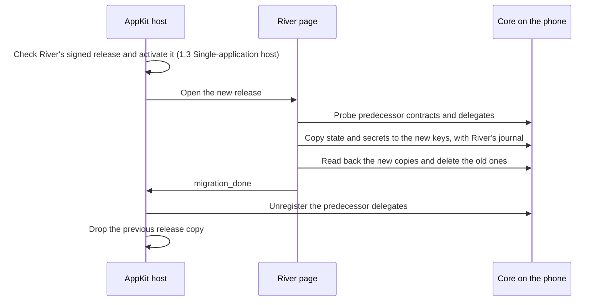

# 1.7 Upgrades and migration

## Repositories

| Repository | Role | Work in this plan |
| --- | --- | --- |
| [river](https://github.com/freenet/river) | Modified | Send the `migration_done` bridge message after River's existing migration finishes; carry pending messages to re-keyed rooms |
| [freenet-appkit](https://github.com/glesage/freenet-appkit) | Modified | Accept `migration_done` in the WebView host and retire the previous release; iOS and Android upgrade tests |
| [freenet-migrate](https://github.com/freenet/freenet-migrate) | Used | Contract and delegate migration library that River already uses |
| [freenet-core](https://github.com/freenet/freenet-core) | Used | Delegate probes, `UnregisterDelegate` and wake-up handling |

## Purpose

Carry River's rooms, keys and private records across upgrades on iOS and Android. River already migrates its own data. This plan runs that migration on phones and adds one rule: the host retires the previous release only after River reports that its migration is complete.

When Alice's phone gets a new River release:

- The host activates releases under [Activating a release in 1.3 Single-application host](03-host.md#activating-a-release).
- River migrates in its own page with its own adapter and journal ([delegate_migration.rs](https://github.com/freenet/river/blob/78307756805f3e02399791dda142c86b83780b8f/ui/src/components/app/freenet_api/delegate_migration.rs), freenet-migrate 0.7).
- While River migrates, its room list shows a migrating state (`RoomListDisplay::Migrating` in [room_list.rs](https://github.com/freenet/river/blob/78307756805f3e02399791dda142c86b83780b8f/ui/src/components/room_list.rs)).
- Predecessor contracts and delegates come from earlier River releases signed by River's publisher key. The key check in [Execution policy in 1.4 Application bundles](04-bundles.md#execution-policy) therefore lets them run.

## Reporting completion

River sends one shell-bridge message when its migration check finishes after the first start of a new release. It sends the message even when nothing needed migrating.

| Field | Contents |
| --- | --- |
| `type` | `migration_done` |
| `release_version` | The River release version that ran the migration |
| `retired_delegates` | Predecessor delegate keys that River has emptied and no longer needs |

The host accepts the message only from River's frame in the current session. It ignores any key in `retired_delegates` that matches a delegate in the active release's `app_definition.json`.

Until `migration_done` arrives, the host keeps the previous release copy and every predecessor delegate. If the app stops during migration, River's journal resumes the work on the next start, and River sends the message then.

## Component identity and re-keying

A contract or delegate key derives from BLAKE3 over its code hash and exact parameter bytes. New code or new parameters give a new key. The old state stays under the old key. Parameter encodings belong to River and need shared fixtures.

| River component | Identity inputs |
| --- | --- |
| Room contract | Code hash and `ChatRoomParametersV1 { owner: VerifyingKey }` |
| Chat delegate | Code hash and empty parameters, yielding BLAKE3 of the code hash |
| Website container | Code hash of the container Wasm and the publisher's verifying-key parameters |

Sources: [River FREENET.md](https://github.com/freenet/river/blob/78307756805f3e02399791dda142c86b83780b8f/FREENET.md), [publication rules](https://github.com/freenet/river/blob/78307756805f3e02399791dda142c86b83780b8f/.claude/rules/river-publish.md) and the dapp-builder skill's [upgrade and migration guide](https://github.com/freenet/freenet-agent-skills/blob/890ad1b20c03ee99dd0a0ae89ec3e3b17c19eac4/skills/dapp-builder/references/upgrade-and-migration.md). [Core upgrade issue #2776](https://github.com/freenet/freenet-core/issues/2776) is related protocol work.

### Predecessor registry

When River ships a new room contract, Alice's "Skate club" room gets a new key, and its state stays under the old key. River's predecessor registry lists the earlier versions, so the new release can derive their keys and find their state.

River keeps one TOML registry per component, oldest version first. The current key comes from the Wasm in the bundle, so each registry lists only earlier versions.

| Registry | Component | Fields per entry |
| --- | --- | --- |
| [common/legacy_room_contracts.toml](https://github.com/freenet/river/blob/78307756805f3e02399791dda142c86b83780b8f/common/legacy_room_contracts.toml) | Room contract | `version`, `description`, `date`, `code_hash` |
| [legacy_delegates.toml](https://github.com/freenet/river/blob/78307756805f3e02399791dda142c86b83780b8f/legacy_delegates.toml) | Chat delegate | The same, plus `delegate_key` and `irregular_key` |

| Step | Who | Rule |
| --- | --- | --- |
| 1. Record | Developer | Add the old version to the registry before rebuilding the Wasm. River runs `cargo make add-migration` for the delegate and `cargo make add-room-contract-migration` for the room contract |
| 2. Check | CI | Fail the build when a component's Wasm changes without a new entry, or when `freenet_migrate_build::codegen()` generates an empty table. River's [delegate migration rules](https://github.com/freenet/river/blob/78307756805f3e02399791dda142c86b83780b8f/.claude/rules/delegate-migration.md) run both checks. A misnamed TOML table reads as an empty registry ([freenet-migrate#20](https://github.com/freenet/freenet-migrate/issues/20)) |
| 3. Probe | River | On first start of the new release, derive each old key from the entry's code hash and the room's exact parameter bytes, then probe newest first. Keep the parameter bytes unchanged, because re-encoded parameters produce a different key. Core answers a probe of an unregistered delegate with `DelegateError::Missing` ([#5729](https://github.com/freenet/freenet-core/pull/5729)) |
| 4. Carry forward | River | Move the state the probe finds to the new key. The [walk policy](#walk-policies) decides between the newest copy and all copies merged. Delegate secrets move as in [Delegate secret export and import](#delegate-secret-export-and-import) |

Registry cases:

- For `irregular_key = true`, probe the recorded `delegate_key` in place of the derived key. River's V1 chat delegate uses this entry.
- Users with data only in River delegate versions V4 to V6 rejoin their rooms by invite. The registry covers versions whose messages the current code can read ([river#204](https://github.com/freenet/river/issues/204)). Include V4 to V6 invite recovery in the fixtures.

### Walk policies

| Policy | Part | What the walk does | Trade-off | River component |
| --- | --- | --- | --- | --- |
| `UnionAllGenerations` | Delegate secrets | Merges every generation that answers | Can bring back secrets deleted by leaving them out. River limits this with ranked tombstones ([river#590](https://github.com/freenet/river/issues/590)) | Chat delegate |
| `NewestFirstWins` | Contract state | Takes the newest real state and stops at an unknown newer generation | Protects against rollback | Room contract |

### Delegate secret export and import

River's adapter calls freenet-migrate's `migrate_delegate_secrets_journaled` and owns its journal. It reads through the predecessor delegate's messages, writes through the new delegate's handlers and marks a pair complete after a verified readback.

River moves the entries in the chat delegate's key index:

| Entry | What it holds for Alice | Defined in |
| --- | --- | --- |
| `room:<owner key>` | One room's state, her signing key (`self_sk`), her member records and her nickname | `ROOM_KEY_PREFIX` in [chat_delegate.rs](https://github.com/freenet/river/blob/78307756805f3e02399791dda142c86b83780b8f/ui/src/components/app/chat_delegate.rs), `RoomSlot` in [room_data.rs](https://github.com/freenet/river/blob/78307756805f3e02399791dda142c86b83780b8f/ui/src/room_data.rs) |
| `rooms_meta` | Her current room, notification settings and room order | `ROOMS_META_KEY` in the same file, `RoomsMeta` in `room_data.rs` |
| `outbound_dms` | Her outbound DMs | `OUTBOUND_DMS_STORAGE_KEY` in [common/src/chat_delegate.rs](https://github.com/freenet/river/blob/78307756805f3e02399791dda142c86b83780b8f/common/src/chat_delegate.rs#L15) |
| `draft/<uuid>`, `pending/<uuid>` and the per-room index | Bob's drafts and signed messages waiting to be sent | [Bob's saved draft in 1.6 Application protocols, data and operations](06-data-and-operations.md#bobs-saved-draft) |

River re-keys its chat delegate roughly weekly. It rebuilds these entries on startup, outside the key index:

- `signing_key:` entries, from `room:<owner key>`, with `signing::migrate_signing_key` in [signing.rs](https://github.com/freenet/river/blob/78307756805f3e02399791dda142c86b83780b8f/ui/src/signing.rs).
- `room_sub:`, `room_members:` and `room_secret:` caches, after River sends `EnsureRoomSubscription` for each room Alice owns ([subscription.rs](https://github.com/freenet/river/blob/78307756805f3e02399791dda142c86b83780b8f/delegates/chat-delegate/src/subscription.rs)).

River's privacy notes state that secrets pass through River's page as plaintext during migration.

Include a predecessor with a corrupt blob in the fixtures ([#4909](https://github.com/freenet/freenet-core/issues/4909)). Completion waits for a valid migration, and retries keep the user's deletions.

### Pending messages across a room move

A pending message keeps its original room target, as [A room that moves to a new contract in 1.6 Application protocols, data and operations](06-data-and-operations.md#a-room-that-moves-to-a-new-contract) describes. Bob sends a message to "Skate club" while offline, and River then ships a new room contract:

1. After the upgrade, River resends Bob's message to the old room key.
2. River's room migration carries the old room's messages forward to the new room.
3. The migration also picks up messages that reach the old room after the move, so Bob's late message appears in the new room.

### Core-assisted migration

Core may later move delegate secrets to a successor itself ([Core RFC #5255](https://github.com/freenet/freenet-core/issues/5255)). River keeps its own migration until then.

## Retiring the old version

River and the host retire the old version in this order:

| Step | Who | What happens |
| --- | --- | --- |
| 1. Verify | River | A readback of the new delegate shows every entry the walk found |
| 2. Reclaim | River | Deletes the predecessor copies through the predecessor delegate's own delete message |
| 3. Report | River | Sends `migration_done` with the emptied keys |
| 4. Unregister | Host | Sends `UnregisterDelegate` for each key in `retired_delegates`. Core drops the key's record, and its `NodeStarted` runs and wake-ups stop at the next fire ([#5747](https://github.com/freenet/freenet-core/pull/5747) review item S8) |
| 5. Drop | Host | Deletes the previous release copy |

Use River's full predecessor list as the retirement workload ([river#586](https://github.com/freenet/river/issues/586)).

## Upgrade test window

AppKit tests River upgrades on iOS and Android from two starting points:

| Starting point | Example |
| --- | --- |
| The River release in the previous iOS and Android build | Alice updates from last month's build |
| River's oldest supported version | The oldest entry River's registries still cover |

The versions come from River's own registries. Testing every version pair is River's responsibility.

Pin the selected release's room and chat-delegate Wasm hashes, original parameter bytes and both predecessor registries in the upgrade fixtures. Include the published generations on each side of the configuration-rank change ([river#793](https://github.com/freenet/river/pull/793)) and the bounded-cleanup change ([river#815](https://github.com/freenet/river/pull/815)). Both changes re-key the room contract and the chat delegate; fixtures load each generation's actual Wasm and derive its own keys. Exercise direct and skipped-release upgrades on iOS and Android, with a populated successor and an interrupted journal.

## Acceptance

- Shared fixtures derive the same keys on iOS and Android, including empty parameters and recorded irregular keys. CI requires a registry entry for changed Wasm.
- On iOS and Android, upgrades from both starting points in the [upgrade test window](#upgrade-test-window) keep Alice's "Skate club" room, keys, DMs, drafts and pending messages.
- A test migrates from a real predecessor River chat delegate Wasm under Pulley on iOS and Android ([river#630](https://github.com/freenet/river/issues/630)).
- The pinned configuration-rank and bounded-cleanup generations in the [upgrade test window](#upgrade-test-window) migrate on iOS and Android. The fixtures preserve keys, private records and pending bytes across direct and skipped-release upgrades.
- On iOS and Android, kill the app during migration. The next start resumes River's journal. The host keeps the previous release and predecessor delegates until `migration_done` arrives. River shows its migrating state until then.
- After `migration_done` on iOS and Android, the predecessor copies are gone, the old delegate keys are unregistered and get no further wake-ups, and the previous release copy is deleted.
- The host ignores a `migration_done` from a stale session and never unregisters a delegate of the active release.
- Bob sends a message offline, River upgrades its room contract, and Bob reconnects. The message appears in the new room on iOS and Android. A message that reaches the old room after the move also appears in the new room.
