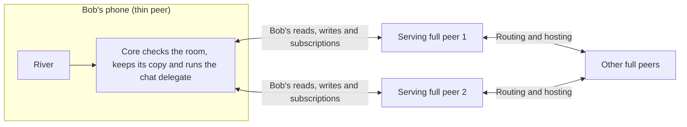

# 1.8 Thin-peer protocol

## Repositories

| Repository | Role | Work in this plan |
| --- | --- | --- |
| [freenet-core](https://github.com/freenet/freenet-core) | Modified | Thin-role protocol and serving-peer support |
| [freenet-appkit](https://github.com/glesage/freenet-appkit) | Modified | Switch River's phone node to the thin role; iOS and Android traffic and carrier tests |
| [river](https://github.com/freenet/river) | Used | Mobile app workload |
| [freenet-test-network](https://github.com/freenet/freenet-test-network) | Used | NAT and peer-loss test network |

## Purpose

Run the phone's node as a thin peer on iOS and Android. A thin peer sends and receives only its user's own traffic. Full peers route and host for the rest of the network.

When Bob reads and posts in "Skate club" on his phone:

| Stage | Phone node role |
| --- | --- |
| Development, before this plan is built | Full peer |
| After this plan is built | Thin peer for River |
| Every released River build, internal or public | Thin peer |

No River build is released before the end of milestone 1 (Freenet mobile AppKit). Record the node role and the exact protocol and build in every test result.

[1.1 Mobile feasibility and supported profiles](01-feasibility.md) measured full-peer traffic on Wi-Fi ([finding](https://github.com/glesage/freenet-appkit/blob/1988c5cbdfc5c1f88065382de2a4f86093948b6e/docs/findings.md#phones-are-full-peers-on-the-public-network)):

| Run | Upload | Download |
| --- | --- | --- |
| iPhone 13 mini, full peer, first two minutes, 27 peers | 7.2 MB, about 60 KiB/s | 6.4 MB, about 60 KiB/s |
| Android emulator, full peer, first two minutes, 22 peers | About 22 KiB/s | About 22 KiB/s |
| iPhone 13 mini, idle | Under 1 KiB/s | Under 1 KiB/s |
| Android emulator, idle, 1 peer | 1.4 KiB/s | 1.1 KiB/s |
| Loading River's 1.06 MB bundle on the public network | 9 KiB | 1.2 MiB |

Released builds use the thin role for two reasons:

- At 60 KiB/s, one hour of traffic uses about 210 MiB each way and drains the battery.
- Google Play allows an app to relay traffic for others only when relaying is the app's main purpose ([Device and Network Abuse policy](https://support.google.com/googleplay/android-developer/answer/16559646)). Chat is River's main purpose, so River's iOS and Android builds send only the user's own traffic.

| Upstream source | Role in this plan |
| --- | --- |
| [Mobile app discussion #420](https://github.com/freenet/freenet-core/discussions/420) | Mobile scope: a limited node runs on the device |
| [Smartphone discussion #811](https://github.com/freenet/freenet-core/discussions/811) | Mobile support scope |
| [Incentive discussions #136](https://github.com/freenet/freenet-core/discussions/136), [#137](https://github.com/freenet/freenet-core/discussions/137) and [#893](https://github.com/freenet/freenet-core/discussions/893) | Open. Core intends to tie the resources a peer uses on others to a karma score |
| [Outbound-only light-client proposal #5917](https://github.com/freenet/freenet-core/issues/5917) | Open design proposal. Extend it with this plan's on-device verification, two serving peers, subscription delivery and iOS and Android carrier requirements |
| [Whitepaper peers and ring section](https://github.com/freenet/paper-1/blob/bff15702759800a003ffbfce639fe859f57d966d/sections/03-primitives.tex) | Describes one peer role |

## Scope and trust boundary

A thin peer opens terminal connections to full peers for its own reads, writes and subscriptions. On the phone, Core verifies contracts, keeps subscribed state, runs delegates and protects secrets. Serving full peers handle onward routing, hosting and subscription roots. The phone treats state it receives as input for local verification.

Each thin phone keeps at least two serving peers for its contracts. If one serving peer withholds an update, the phone still receives it through the other.

Gateways keep the link of a peer that has not joined the ring ([#5656](https://github.com/freenet/freenet-core/pull/5656)). The thin role gives these links explicit admission and retention rules:

- Keep an admitted terminal connection while its subscriptions or a bounded idle lease remain active, including receive-only sessions.
- Set capacity and fairness rules for phones that share one carrier address.

| Core area | Required change |
| --- | --- |
| Connect protocol | Negotiate a versioned thin role and acknowledge it explicitly. Released builds accept only the thin role |
| Connection manager | Keep terminal connections and their role across reconnects and network changes |
| Serving-peer selection | Assign routing and hosting to full peers. Keep at least two serving peers per phone. Bound connection attempts and retries, with capacity and reachability errors |
| Subscription delivery | Deliver only the phone's active subscriptions down terminal connections. Define unsubscribe, resubscribe and cleanup after a disconnect |
| Lifecycle and configuration | Persist the role and keep thin behavior across startup and Wi-Fi or cellular changes |
| SDK and diagnostics | Report the negotiated role, serving peers and failure reasons. Add them to the [diagnostics in 1.3 Single-application host](03-host.md#diagnostics). Detect offline and serving-peer loss from the OS network path watched by [1.2 Embedded node and mobile SDK](02-sdk.md) and from the serving connections. Test outages that leave Core's peer count unchanged ([finding](https://github.com/glesage/freenet-appkit/blob/1988c5cbdfc5c1f88065382de2a4f86093948b6e/docs/findings.md#the-peer-count-stays-up-during-an-outage)) |

An unsupported protocol or role fails visibly and retries with bounded backoff, keeping the thin role. When the attempts run out, the app shows a disconnected state and keeps local work.

Test cleanup when peers disappear abruptly, and remove duplicate subscriptions after reconnect. Check the client Unsubscribe call with [1.2 Embedded node and mobile SDK](02-sdk.md). Delivery for a released subscription stops when its lease ends, while other screens keep theirs.

## Traffic measurement

Measure thin-peer traffic on iOS and Android with the [harness](https://github.com/glesage/freenet-appkit/tree/1988c5cbdfc5c1f88065382de2a4f86093948b6e/harness) `watch` scenario and Core's upload and download counters. Publish the results with the resolved transport and bandwidth settings from [Transport profile in 1.2 Embedded node and mobile SDK](02-sdk.md#transport-profile). Keep both bandwidth caps unset for these measurements. Record node role and serving peers alongside the traffic counters.

| Workload | What to record |
| --- | --- |
| Foreground idle | Upload and download per minute, including keepalives and subscription upkeep |
| Active use | Upload and download for River's join, read and send sequence |
| Reconnect and network change | Upload and download per reconnect, with a room state above 1 MiB. River's reconnect uses code-free GET subscriptions, deltas and fallback PUTs ([River PR #759](https://github.com/freenet/river/pull/759)); record each part |
| Serving-peer loss | Upload and download across the loss and the switch to a replacement peer |

Each message Bob sends today costs the whole room state, because Core forwards the full merged state ([#4072](https://github.com/freenet/freenet-core/pull/4072)).

## Upstream work and carrier evidence

This plan develops the thin role through [Core's outbound-only light-client proposal #5917](https://github.com/freenet/freenet-core/issues/5917) and builds it with [1.2 Embedded node and mobile SDK](02-sdk.md).

1. Add this plan's requirements to #5917: on-device verification and delegates, at least two serving peers, negotiated terminal connections, receive-only subscriptions and iOS and Android carrier coverage.
2. Agree peer discovery, admission, retention and resource accounting with Core's maintainers.
3. Link the implementation and release that satisfy these requirements. Track negotiation, terminal connections, serving-peer selection, subscription delivery and carrier tests there.

| Proposal decision | Requirements |
| --- | --- |
| Resource accounting | Define how thin peers repay serving full peers. Thin peers use serving capacity and route for no one ([#136](https://github.com/freenet/freenet-core/discussions/136), [#137](https://github.com/freenet/freenet-core/discussions/137) and [#893](https://github.com/freenet/freenet-core/discussions/893)) |
| GET routing | Keep GET routing for subscribed contracts ([#4222](https://github.com/freenet/freenet-core/issues/4222)). Handle relay GETs that drop at the first hop without fallback ([#4229](https://github.com/freenet/freenet-core/issues/4229)) |
| Hosting demand | Define how reads, PUTs and subscriptions count under demand-driven hosting ([#4642](https://github.com/freenet/freenet-core/issues/4642)) |
| Protocol overhead | Name the summary and hosting exchanges that thin peers skip ([#4965](https://github.com/freenet/freenet-core/issues/4965), [#5157](https://github.com/freenet/freenet-core/issues/5157)) |

These upstream changes reduce phone traffic:

| Change | State |
| --- | --- |
| Compress every peer message with zstd ([#3336](https://github.com/freenet/freenet-core/issues/3336)) | Proposal filed 2026-09-29 |
| Send a code hash first and the Wasm only when the receiver lacks it ([#5707](https://github.com/freenet/freenet-core/issues/5707)) | Open proposal |
| Send client UPDATEs as deltas against the receiver's state summary ([#4072](https://github.com/freenet/freenet-core/pull/4072) left the delta format for later) | Core issue to be filed |
| Cut summary and interest-sync traffic ([#5203](https://github.com/freenet/freenet-core/pull/5203), [#5109](https://github.com/freenet/freenet-core/pull/5109)) | Draft PRs under Core's bandwidth tracking issue [#5153](https://github.com/freenet/freenet-core/issues/5153) |

### Carrier evidence

Carrier transport problems are general to Freenet. Track them in Core's issues and file a new issue where none exists. This plan tests each supported carrier path on iOS and Android. The selected release profile uses encrypted UDP with hole punching ([#2211](https://github.com/freenet/freenet-core/pull/2211)) and `transport-quic: off`. Core 0.2.152 also maps `prefer` to `shadow`, with application traffic on UDP ([QUIC modes](https://github.com/freenet/freenet-core/blob/8942fd239b2b53e606ffb1e26ee986623008afb2/crates/core/src/transport/quic.rs#L82)). UDP reachability remains a carrier acceptance requirement. A transport-profile change repeats the iOS and Android carrier, serving-peer-loss, traffic, memory and lifecycle tests.

| Source | State | What it means for phones |
| --- | --- | --- |
| [CGNAT discussion #5051](https://github.com/freenet/freenet-core/discussions/5051) | Open | A phone-hotspot user reports that the carrier blocks UDP |
| [Relay fallback #2925](https://github.com/freenet/freenet-core/issues/2925) | Closed without an implementation | No relay exists for carrier paths that block UDP |
| [SOCKS5 #2409](https://github.com/freenet/freenet-core/issues/2409) | Open | A possible path where UDP is blocked |
| [NAT'd node streams at about 1% of uplink #5643](https://github.com/freenet/freenet-core/issues/5643) | Open | Fetches of NAT-published states of 1 to 4 MiB stall or fail. Measure cold fetch on the selected Core build, including a room state above 1 MiB |
| [Dual-stack IPv6 #3648](https://github.com/freenet/freenet-core/pull/3648), [IPv6 on gateways #3666](https://github.com/freenet/freenet-core/issues/3666) | #3648 merged, #3666 open | IPv6-only carriers reach the IPv4 gateways through NAT64 until #3666 lands |
| [1200-byte packets #3619](https://github.com/freenet/freenet-core/pull/3619) | Merged | Avoids IP fragmentation on carrier NAT paths |
| [Stream-listener wakeups #5751](https://github.com/freenet/freenet-core/pull/5751) | Merged 2026-10-03 | Run lossy-link regression cases on the build |
| [Duplicate-packet acknowledgements #5803](https://github.com/freenet/freenet-core/pull/5803) | Shipped in [Core 0.2.142](https://github.com/freenet/freenet-core/releases/tag/v0.2.142) | Test dropped acknowledgements, duplicate packets and interrupted receives |
| [Wake recovery #4951](https://github.com/freenet/freenet-core/issues/4951), [state after suspend #4153](https://github.com/freenet/freenet-core/issues/4153) | Open | Resume regression cases |

Run the carrier-NAT and serving-peer-loss cases on freenet-test-network's Docker NAT simulation as well as on carriers. Check its stdlib version against Core first.

## Acceptance

- The Core build includes upstream thin-role support agreed through [#5917](https://github.com/freenet/freenet-core/issues/5917), with every requirement in [Scope and trust boundary](#scope-and-trust-boundary) covered by the linked implementation and tests.
- On real iOS and Android phones, Bob joins "Skate club", reads it and sends a message through terminal connections. Core verifies state and runs River's chat delegate on the phone.
- Traces show only the phone's own traffic and bounded protocol overhead. Serving full peers handle onward routing and hosting.
- Each phone keeps at least two serving peers. When one serving peer withholds Alice's update, Bob's phone still receives it through the other.
- On real iOS and Android phones and the isolated NAT network, receive-only subscriptions stay active past the transient timeout, and a session stays active for more than one hour. More than two thin peers behind one carrier address keep their subscriptions within the serving peer's capacity. Disconnected subscriptions are cleaned up when their lease ends.
- Unsupported roles, incompatible versions and full serving capacity produce visible failures. Retry, restart, resume and network-change tests keep the thin role.
- Malformed state, wrong contract identities and forged updates fail on-device checks. Serving peers receive only River's network payloads. Signing keys stay on the phone.
- When a serving peer drops, sent messages stay in the phone's copy of the room, and the phone resends them through a replacement serving peer. Repeated losses end in a visible disconnected state.
- Idle, active, reconnect and serving-peer-loss traffic is measured and published for iOS and Android.
