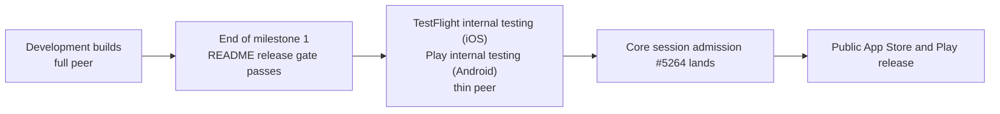

# 1.9 Testing and release

## Repositories

| Repository | Role | Work in this plan |
| --- | --- | --- |
| [freenet-appkit](https://github.com/glesage/freenet-appkit) | Modified | Cross-plan tests, store build checks, developer package and signed River test builds |
| [river](https://github.com/freenet/river) | Modified | River test fixtures, invite-only test rooms and tester support |
| [freenet-core](https://github.com/freenet/freenet-core) | Used | Core build and compatibility |
| [freenet-migrate](https://github.com/freenet/freenet-migrate) | Used | River upgrade fixtures |
| [freenet-test-network](https://github.com/freenet/freenet-test-network) | Used | Isolated test networks |

## Purpose

Test River end to end on real iOS and Android phones, across the earlier plans of milestone 1 (Freenet mobile AppKit). Each earlier plan owns its own acceptance. This plan covers only:

- Tests that span several plans, such as an invite, a send and an upgrade in one run.
- Store build checks and test distribution.

River runs its signed web UI in one WebView, served by the phone's embedded node in the thin-peer role from [1.8 Thin-peer protocol](08-thin-peer.md).

## Distribution

- River test builds go to TestFlight internal testing on iOS and Play internal testing on Android.
- Distribution starts at the end of milestone 1, when the README release gate passes. Every distributed build runs as a thin peer.
- These channels have no store review. This plan makes no review claim.
- Public store release of River waits for Core's session admission design ([#5264](https://github.com/freenet/freenet-core/issues/5264)). Internal testing may start before it lands.

Release the [developer package](#developer-package) when the tests pass.

## River scope

- Record River's container key, bundle version, room and chat-delegate Wasm hashes, original parameter bytes and predecessor registries for every run. Keep the release fixtures from the [upgrade test window in 1.7 Upgrades and migration](07-migration.md#upgrade-test-window), including the configuration-rank and bounded-cleanup generations.
- Instantiate River's chat delegate on the Core build in a compatibility fixture. Check that its freenet-stdlib host-function imports match that Core build ([#5617](https://github.com/freenet/freenet-core/issues/5617), [#5719](https://github.com/freenet/freenet-core/issues/5719), [#5717](https://github.com/freenet/freenet-core/issues/5717)).
- Drive River's own UI with real embedded Core, contract validation and delegate signing. Deterministic fixtures isolate transport and fault cases.
- Run contract-notification tests with the node in network mode ([#5273](https://github.com/freenet/freenet-core/issues/5273)).
- Build isolated test networks with [freenet-test-network](https://github.com/freenet/freenet-test-network). Its Docker NAT simulation covers carrier-NAT cases. Pass [Test-network dependencies](#test-network-dependencies) before running the harness.
- Give each isolated node its gateways with `--gateway` and `--skip-load-from-network` ([#4264](https://github.com/freenet/freenet-core/pull/4264)). Supply a nonempty gateway list and check that every node's peers belong to the isolated network ([#5552](https://github.com/freenet/freenet-core/issues/5552)).
- Record results in the [support matrix in 1.1 Mobile feasibility and supported profiles](01-feasibility.md#support-matrix), with an Android phone column added.
- Label each observation by its source: the phone's local copy or an independent network read.

River publishes its signed bundle through its [web container contract](https://github.com/freenet/river/blob/78307756805f3e02399791dda142c86b83780b8f/contracts/web-container-contract/src/lib.rs). River's UI calls the chat delegate's `SignMember` and `SignResponse` when Alice invites Carol ([invitation_builder.rs](https://github.com/freenet/river/blob/78307756805f3e02399791dda142c86b83780b8f/ui/src/components/members/invitation_builder.rs)). That exchange forms an [authorized member](https://github.com/freenet/river/blob/78307756805f3e02399791dda142c86b83780b8f/common/src/room_state/member.rs). River signs chat messages in the page. Check that Bob's [authorized message](https://github.com/freenet/river/blob/78307756805f3e02399791dda142c86b83780b8f/common/src/room_state/message.rs) reaches the room's [recent messages](https://github.com/freenet/river/blob/78307756805f3e02399791dda142c86b83780b8f/common/src/room_state.rs).

### Test-network dependencies

Use a harness dependency set that links one compatible freenet-stdlib version into each NAT test binary. The dependency alignment is tracked in [Core #5950](https://github.com/freenet/freenet-core/issues/5950): freenet-test-network 0.1.24 requires stdlib `^0.1.29`, while Core 0.2.152 uses 0.12.1. Select an upgraded harness release or a reviewed, pinned dependency change before the first linked NAT run.

- Record the harness, Core and stdlib revisions, dependency lock digest, enabled features, Rust toolchain and linker version with the test results.
- Inspect the dependency graph of each affected test binary and fail on a second stdlib version.
- Build the actual NAT test binaries with `--locked` using rust-lld and the selected current mold release on Linux. Both builds must link, and the selected CI build must run the NAT cases.
- Run contract and delegate byte/protocol fixtures against the selected Core before using the harness results for iOS and Android acceptance.

### Merge-law coverage

Every consuming application supplies a manifest of its contracts, exact Wasm hashes and parameters, required properties and regression fixtures. Run `fdev verify-merge --json` from the selected Core revision and retain the report, command arguments, corpus digest and fixture results with both iOS and Android release artifacts.

| Check | Required evidence |
| --- | --- |
| Executed properties | Each required `properties[]` row has `cases_run` at or above the manifest's minimum, a `held` verdict, zero `violations` and zero `inconclusive`. The manifest supplies the states, deltas, summaries and correctly ordered base/result transitions each property needs |
| Size and case budget | Each required focused run has zero `cases_skipped_oversized` and zero `cases_skipped_budget` in every property row. Set `--max-case-bytes` to cover the combined state, delta and summary inputs of its largest required case, and set `--max-cases` to execute the generated cases |
| Sampling | In each required focused run, `states_sampled` equals `corpus_states` and `transitions_sampled` equals `corpus_transitions`. Split larger corpora into bounded fixture sets while preserving chronological order and base/result orientation |
| Boundary cases | Include near-capacity states, concurrent equal-version records, removals, lowered caps and repeated deltas. Keep explicit deterministic tests for each required associativity triple and the resulting reconciled fixpoint |
| Reproduction | Replaying the pinned corpus with the recorded verifier and arguments gives the same coverage and results. Run the application's native contract tests and its iOS and Android runtime conformance tests as well |

The counted reports and size option are supplied by [Core #6043](https://github.com/freenet/freenet-core/pull/6043). Use focused corpora and explicit triple fixtures for the sampling and associativity limits tracked in [#6053](https://github.com/freenet/freenet-core/issues/6053). Core's associativity check tests reconciliation to a stable state ([#5924](https://github.com/freenet/freenet-core/pull/5924)). Treat every merge-law violation as a release failure, including laws assigned to the network's report-only tier ([#6015](https://github.com/freenet/freenet-core/pull/6015)). Diagnose inconclusive rejected merges through [#5725](https://github.com/freenet/freenet-core/issues/5725) and supply a conclusive regression fixture before release.

## River acceptance cases

Each case runs on iOS and Android.

| Scenario | Passing result |
| --- | --- |
| Install and invite | A clean install checks River's signed bundle against the build's pinned publisher key. Opening Alice's invite joins the intended room. An invalid or substituted invite fails visibly |
| Send and sign | River signs Bob's message in the page, saves it, sends it and sees it in room state. An independent peer retrieves it. The chat delegate answers `SignMember` for Alice's invitation of Carol, and the signature verifies with Alice's key |
| Offline and interrupted send | Queue a send before the first join, with no signal and on Wi-Fi with no internet. Restart offline, lose a submission reply and reconnect with concurrent room updates. The message reaches an independent peer after reconnect, and the room holds one copy |
| Background and resume | Lock or background the phone during startup, signing, sending and refresh. The host sends `flush_request`, River saves its drafts, then the node stops and the WebView closes. Resuming opens a fresh WebView with drafts, keys and sent messages intact |
| Repeated node lifecycles | Run the in-process start, stop, timeout and startup-failure cases from [Acceptance in 1.2 Embedded node and mobile SDK](02-sdk.md#acceptance). Each stopped node generation has zero live owned tasks; stale callbacks stop and the port and store are reusable |
| Connectivity | Switch between Wi-Fi and cellular and remove a serving peer. Subscriptions return after reconnect |
| Compatible web update | Install a new River release while a session runs. The release activates under [Activating a release in 1.3 Single-application host](03-host.md#activating-a-release), and drafts and pending messages survive |
| Interrupted upgrade | Upgrade from both starting points in the [upgrade test window in 1.7 Upgrades and migration](07-migration.md#upgrade-test-window) and kill the app during migration. The next start finishes it, and River sends `migration_done` |
| Device limits and accessibility | Memory, Wasm execution, battery and storage stay within the [device limits in 1.1 Mobile feasibility and supported profiles](01-feasibility.md#device-limits) and [Running Wasm in 1.2 Embedded node and mobile SDK](02-sdk.md#running-wasm). Keyboard, focus, large text and screen-reader flows work. River tracks two mobile layout gaps in [river#714](https://github.com/freenet/river/issues/714) and [river#718](https://github.com/freenet/river/issues/718) |

## Developer package

Provide these materials for River test builds on iOS and Android:

- A River WebView starter, with Swift and Kotlin examples that start, stop and report on the node
- The supported-version matrix and dependencies
- iOS and Android setup, build and distribution instructions
- Diagnostic export and the release checklist

## Store requirements

Use one River release and invite-only test rooms with a named room owner and a monitored tester-support channel.

| Requirement | Evidence |
| --- | --- |
| Application identity | Each iOS and Android build pins River's publisher key. The activation check in [Execution policy in 1.4 Application bundles](04-bundles.md#execution-policy) passes for River's container `raAqMhMG7KUpXBU2SxgCQ3Vh4PYjttxdSWd9ftV7RLv` |
| Device access | Tester notes list the notification, clipboard, file, external-link and navigation adapters from [Shell-bridge messages in 1.3 Single-application host](03-host.md#shell-bridge-messages) |
| Tester support | Test invitations name the room owner, support contact and test-data handling. The owner can remove a participant with River's room controls |
| Runtime | Pulley runs the contracts and delegate on iOS and Android |
| Privacy | The checklist records public room data, peer-visible keys and IP addresses, private device records, and the declarations TestFlight and Play require |
| Encryption | The checklist records X25519, AES-GCM, ChaCha20, XChaCha20-Poly1305, Ed25519, BLAKE3, HKDF-SHA256 and SHA-256, following [Encryption export regulations](https://developer.apple.com/documentation/security/complying-with-encryption-export-regulations) |

### Store build checks

This plan owns the shared iOS and Android build checks. The consuming application supplies its name, minimum OS values, publisher key, merge-law contract set and cipher list. Test with River at iOS 16 and Android API 28. Packaging fails if an enabled check fails. Record dated store and SDK requirements before each upload.

| Check | iOS | Android |
| --- | --- | --- |
| Pulley only | No Cranelift native backend and no JIT entitlement | No Cranelift native backend for any ABI |
| ABIs | arm64 devices | arm64-v8a and x86_64 only |
| No file sharing | `Info.plist` has no `UIFileSharingEnabled` | – |
| [16 KB pages](https://developer.android.com/guide/practices/page-sizes) | – | `zipalign -c -P 16 -v 4` passes on the APK, and every LOAD segment of each 64-bit `.so` has 16 KB alignment (`llvm-objdump -p`) |
| Build SDK | Xcode 26 and the iOS 26 SDK ([upcoming requirements](https://developer.apple.com/news/upcoming-requirements/)) | `targetSdk` 36 or later ([target API](https://support.google.com/googleplay/android-developer/answer/11926878)) |
| Minimum OS | River uses iOS 16, as in [1.1 Mobile feasibility and supported profiles](01-feasibility.md#supported-profiles) | River uses API 28 (Android 9) |
| Release signing | Distribution certificate | Upload key, with Play App Signing |
| Privacy and encryption | `PrivacyInfo.xcprivacy` is in the `.app`, and `Info.plist` sets `ITSAppUsesNonExemptEncryption` | – |
| No test harness | The binary has no `appkit.scenario` or `APPKIT_RESULT` | `classes*.dex` and native libraries have no `appkit.scenario` or `APPKIT_RESULT` |
| Merge laws | [Merge-law coverage](#merge-law-coverage) passes on the supplied contract set; River declares its room contract | Same |
| Core version | The checklist records the Core version and the network's `min-compatible-version` | Same |

From 2027-02-01, Play blocks app updates that lack 16 KB page support. The merge-law fixtures follow [Sending updates in 1.6 Application protocols, data and operations](06-data-and-operations.md#sending-updates) and pass [Merge-law coverage](#merge-law-coverage).

### Core version and the network

Peers refuse a node whose Core version is below the network's `min-compatible-version` ([#1360](https://github.com/freenet/freenet-core/pull/1360), [#3294](https://github.com/freenet/freenet-core/pull/3294)). The build reads its minimum from `FREENET_MIN_COMPATIBLE_VERSION`. Desktop nodes update themselves and reconnect ([#2521](https://github.com/freenet/freenet-core/pull/2521), [#2516](https://github.com/freenet/freenet-core/pull/2516)), and Core's maintainers want peers to update quickly during alpha ([D2918](https://github.com/freenet/freenet-core/discussions/2918)). iOS and Android builds keep their packaged Core version. Release rules:

- Each iOS and Android build records its Core version and the network's `min-compatible-version`.
- A new iOS and Android build ships before the network's minimum passes the packaged Core version.
- A phone that falls behind gets "update the app" from the SDK ([typed errors in 1.2 Embedded node and mobile SDK](02-sdk.md#requests-events-and-errors)). River tells the user to install the new build.

## Release tests

Run every release test on the distributed iOS and Android builds, with the phone in the thin-peer role.

| Release test | Passing evidence |
| --- | --- |
| Independent build | A second developer builds and installs River from the starter instructions on iOS and Android |
| River | Every case in [River acceptance cases](#river-acceptance-cases) passes through River's UI and real chat delegate |
| Local network | The local-network case in the [acceptance in 1.2 Embedded node and mobile SDK](02-sdk.md#acceptance) passes with River |
| Release profile | The [release-profile evidence in 1.1 Mobile feasibility and supported profiles](01-feasibility.md#release-profile-evidence) records the exact artifacts, runtime, ABIs, effective transport and bandwidth settings, and real-phone and carrier coverage |
| Test harness | [Test-network dependencies](#test-network-dependencies) passes for every linked NAT binary used by the release |
| Merge-law coverage | The [merge-law coverage gate](#merge-law-coverage) passes for every declared contract with the saved reports and boundary fixtures |
| Store checks | Every [store requirement](#store-requirements) and [store build check](#store-build-checks) holds |
| Core version | The [Core version rules](#core-version-and-the-network) hold for both builds. A test peer that requires a newer Core gives "update the app" on iOS and Android |
| Diagnostics | Reports show versions, node role, lifecycle state, observation source and pending-message status, with [host redaction in 1.3 Single-application host](03-host.md#diagnostics) |

## Acceptance

- Every River acceptance case and release test passes on iOS and Android.
- The TestFlight internal and Play internal builds install and run River for invited testers.
- Results are published with exact revisions, devices, OS versions, network conditions and redacted logs.
