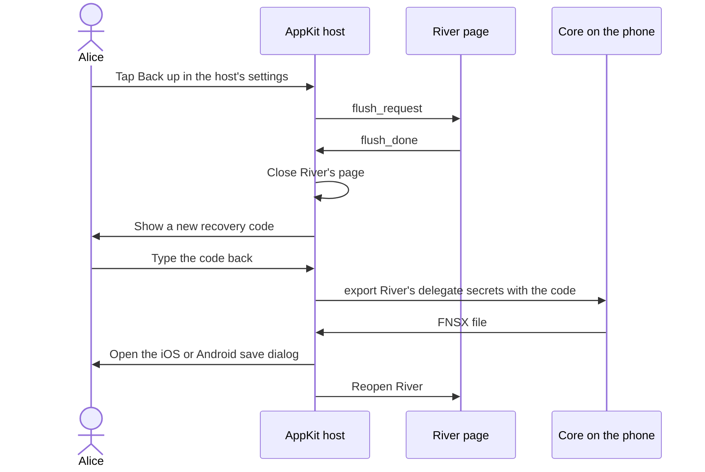
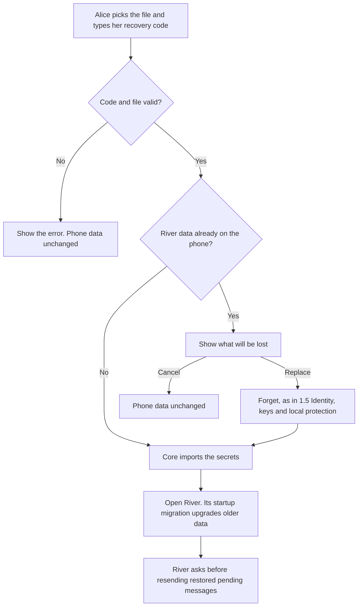

# 1.10 Backup and restore

## Repositories

| Repository | Role | Work in this plan |
| --- | --- | --- |
| [freenet-appkit](https://github.com/glesage/freenet-appkit) | Modified | Recovery-code screen, iOS and Android save and open dialogs, restore flow and tests |
| [river](https://github.com/freenet/river) | Modified | Ask before resending restored pending messages |
| [freenet-core](https://github.com/freenet/freenet-core) | Used | FNSX `export` and `import` of delegate secrets |

## Purpose

Alice saves River's keys and private records in one encrypted file. On a new iPhone or Android phone, she opens the file with her recovery code and gets her rooms, DMs and drafts back.

Backup uses existing tools:

- Core's `export` and `import` write and read River's delegate secrets as a passphrase-encrypted [FNSX file](https://github.com/freenet/freenet-core/blob/8942fd239b2b53e606ffb1e26ee986623008afb2/docs/secrets-at-rest.md).
- River's identity export ([`riverctl identity export`](https://github.com/freenet/river/blob/78307756805f3e02399791dda142c86b83780b8f/cli/README.md), `IdentityExport` in River's UI, [river#136](https://github.com/freenet/river/issues/136)) lists Alice's room identities. Tests compare it before and after a restore.
- River's normal startup migration in [1.7 Upgrades and migration](07-migration.md) upgrades data from an older River release.

AppKit adds only the mobile parts:

| Part | What it does |
| --- | --- |
| Recovery-code screen | Creates the code that encrypts the file, and asks for it on restore |
| Save and open dialogs | The iOS and Android system file dialogs, for example to iCloud Drive or Google Drive |
| Restore | Imports the file, replacing any River data already on the phone |

The backup file is the same on iOS and Android. Alice can save it on an iPhone and restore it on an Android phone.

## Export and import

### Recovery code

Each export creates a new recovery code. The phone never stores it.

- Generate 32 random bytes and encode them as 52 uppercase RFC 4648 base32 characters, without padding.
- Show the code in groups of four characters. Alice types it back before the save dialog opens.
- On restore, accept lower case and ignore spaces and hyphens. Check the length and the unused tail bits.
- The decoded 32 bytes are the FNSX passphrase.

### The backup file

The file is one Core FNSX file. It holds River's delegate secrets for every delegate listed in the `delegates` field of River's `app_definition.json` ([1.4 Application bundles](04-bundles.md)):

| Entry | What it holds for Alice |
| --- | --- |
| `room:<owner key>` | Each room's state, her signing key, member records and nickname |
| `rooms_meta` | Current room, notification settings and room order |
| `outbound_dms` | Outbound DMs |
| `draft/<uuid>`, `pending/<uuid>` and the per-room index | Drafts and signed messages waiting to be sent |

Device-only items stay on the phone: the node encryption key, node keys and session tokens.

### Export

1. The host closes River's page the same way it does on backgrounding: it sends `flush_request`, River saves its drafts and replies `flush_done` ([1.3 Single-application host](03-host.md#shell-bridge-messages)). No River write is in flight during export.
2. Alice confirms her new recovery code.
3. Core exports River's delegate secrets into an FNSX file encrypted with the code.
4. The host opens the iOS or Android save dialog, as Freenet Mail does through the browser shell ([mail#77](https://github.com/freenet/mail/issues/77), [mail#194](https://github.com/freenet/mail/pull/194)). The host deletes its temporary copy once Alice saves or cancels.
5. The host reopens River.

Consistent snapshots while the node keeps writing are a general Freenet need. File a Core issue for consistent secret-store snapshots during export.

### Restore

1. Alice opens Restore in the host's settings or on first start, picks the file in the iOS or Android open dialog and types her recovery code.
2. The host checks that the file opens with the code. A wrong code or a damaged or cut-off file stops here, with phone data unchanged.
3. If the phone already has River data, the host shows what will be lost: the rooms, DMs, drafts and pending messages on this phone. Alice cancels or confirms.
4. On confirm, the host runs [Forget in 1.5 Identity, keys and local protection](05-identity.md#forget), then imports.
5. Core imports the secrets under their recorded delegate keys.
6. The host opens River and tells it that this start follows a restore. River's normal startup migration upgrades data from an older River release.
7. River lists the restored pending messages. Alice chooses to resend or discard them.
8. River checks each restored signing key against Alice's member entry in "Skate club", then fetches messages, members and bans.

The host writes a "restore in progress" marker before step 4 and removes it after step 5. If the app stops in between, the next start runs Forget and asks Alice to restore again.

### Older River releases

Core's export holds secrets but not the delegate code that wrote them ([#4035](https://github.com/freenet/freenet-core/issues/4035)). A fresh phone has only the current River delegate registered, so River's startup migration cannot read secrets from an older delegate. Until #4035 lands, the host compares the file's delegate keys with the current release's delegates and tells Alice when a backup comes from an older River release. Once #4035 lands, Core registers the older delegate from the file, and River's startup migration carries the secrets forward.

## Acceptance

- On iOS and Android, export from River and restore onto a fresh installation. Alice's signing keys, room secrets, DMs and drafts return. River's identity export lists the same identities as before.
- A file saved on iOS restores on Android, and a file saved on Android restores on iOS.
- Export during typing keeps every draft River acknowledged before `flush_done`.
- A wrong recovery code, a damaged or cut-off file and an unknown format stop the restore with phone data unchanged.
- Restoring onto a phone with River data shows what will be lost. Cancel keeps the data. Confirm runs Forget, then imports.
- After a restore, River asks before resending restored pending messages. Resent messages appear once in the room.
- Killing the app during import leads, on the next start, to Forget and a new restore prompt.
- Until #4035 lands, a backup from an older River release is reported as older. After #4035 lands, it restores and River's startup migration upgrades it.
- Device-only items stay on the phone they came from. A copied backup file opens only with its recovery code.
