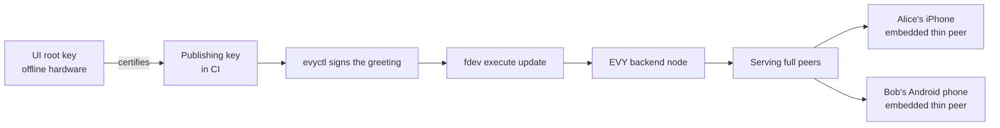
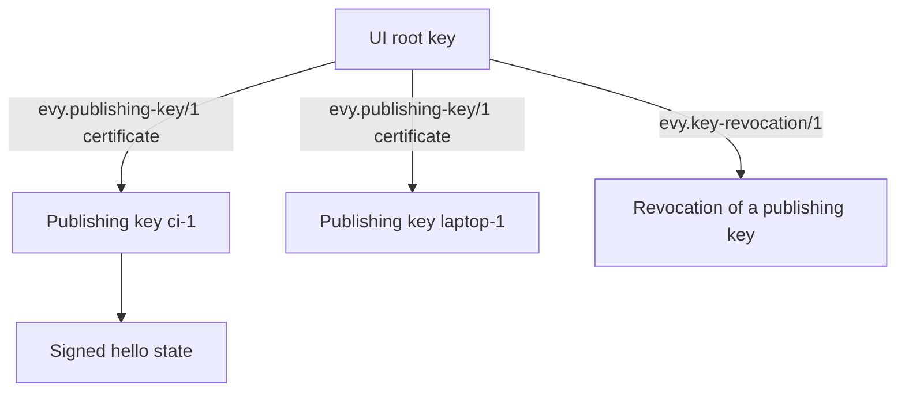
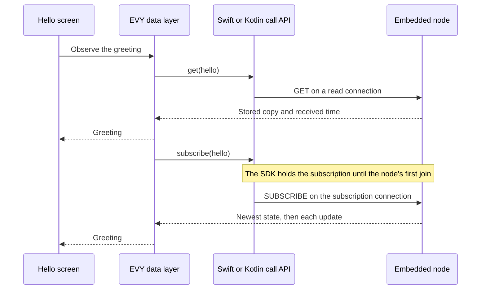
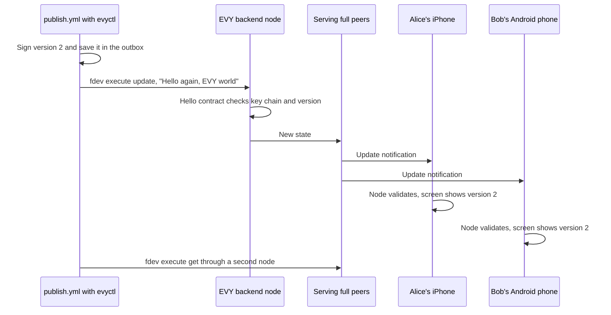
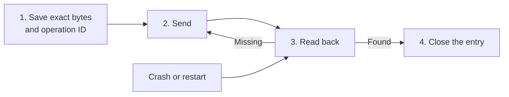

# 2.1 Hello EVY world

## Repositories

| Repository | Role | Work in this plan |
| --- | --- | --- |
| [evy](https://github.com/EVY-Platform/evy) | Modified | New `freenet/` Rust workspace with shared signing rules, the hello contract, the outbox library and the `evyctl` CLI. Key certificates and revocations in `freenet/keys/`. Native Hello screen in the iOS bootstrap build. New Kotlin and Compose app in `android/` with the same screen. Contract keys in `types/freenet/contract-keys.json`. Publishing job in `.github/workflows/publish.yml` |
| [freenet-core](https://github.com/freenet/freenet-core) | Modified | `crates/mobile` gains the native contract and delegate call interface, with native session admission under [#5264](https://github.com/freenet/freenet-core/issues/5264). `fdev execute` sends and reads states |
| [freenet-appkit](https://github.com/glesage/freenet-appkit) | Modified | Swift and Kotlin call API, added to the packages from [1.2 Embedded node and mobile SDK](../1-freenet-mobile-appkit/02-sdk.md) |
| [freenet-stdlib](https://github.com/freenet/freenet-stdlib) | Used | Contract and delegate interfaces, and the Rust client inside `crates/mobile` |

## Purpose

EVY on iOS and Android runs its own embedded Freenet node, reads a signed greeting from the hello contract and follows its updates. This plan also builds four things that every later EVY contract uses:

- the native Swift and Kotlin call API for contracts and delegates
- EVY's signing keys: an offline UI root key that certifies online publishing keys
- `evyctl`, which signs EVY states and hands all network work to `fdev`
- the outbox, one library that makes every send safe to repeat after a crash

The example:

- Alice opens EVY on her iPhone and Bob opens EVY on his Android phone. Both development bootstrap builds open on a native Hello screen.
- Each phone GETs and SUBSCRIBEs to the hello contract and shows "Hello EVY world".
- The EVY publisher runs `evyctl hello publish --message "Hello again, EVY world"`. Both screens change within 30 seconds, while both apps keep running.



## Supplied EVY code and integration scope

EVY today has a SwiftUI reader on iOS with local data and draft stores. It reads resources over JSON-RPC on a WebSocket, backed by PostgreSQL: [EVYWebsocket.swift](https://github.com/EVY-Platform/evy/blob/d0fb7e6475f1dfc5c74325e37d4e92aed88d84ed/ios/evy/Data/API/EVYWebsocket.swift#L57) and [coreResource.ts](https://github.com/EVY-Platform/evy/blob/d0fb7e6475f1dfc5c74325e37d4e92aed88d84ed/api/src/data/resources/coreResource.ts).

This plan adds the embedded node and the native call API beside that code. The backend keeps its authenticated JSON-RPC route for backend calls.

## EVY signing keys

EVY signs its own contract states with a two-level key chain.

| Key | Kept in | Signs |
| --- | --- | --- |
| UI root key | An offline hardware signing device | Publishing key certificates and revocations only |
| Publishing key | Online, one key per place that publishes: `ci-1` in the GitHub environment `publishing`, `laptop-1` in the publisher's OS keychain for emergencies | Hello states, and every later EVY-signed state |
| Payment root key | A separate offline hardware signing device | Nothing in this plan. Money keys stay apart from UI keys |

All three are Ed25519 keys. The UI root key's 32-byte verifying key is the parameter of every EVY-signed contract, so contract keys depend on the root key and not on publishing keys.



A certificate and a revocation are small JSON files in `freenet/keys/`:

```jsonc
// freenet/keys/certificates/ci-1.json
{
  "key": "5HqT...Wd",       // publishing verifying key, base58
  "name": "ci-1",
  "signature": "Zm9v...=="  // UI root key over "evy.publishing-key/1" + RFC 8785 JSON of key and name
}

// freenet/keys/revocations/ci-1.json
{
  "key": "5HqT...Wd",
  "signature": "YmFy...=="  // UI root key over "evy.key-revocation/1" + RFC 8785 JSON of key
}
```

| Rule | What happens |
| --- | --- |
| Accepting a state | The certificate verifies with the root key, the state signature verifies with the certified key, and that key is not revoked |
| Revoking a key | Revocations live in contract state, outside the signed value. Merges keep every revocation. A state signed by a revoked key is dropped, whatever its version |
| Undoing a bad version | Versions have no jump limit. After a typo or a leak, the root revokes the key that signed the bad version. A new certified key then publishes the fix at any version |
| Losing a publishing key | Publishing keys have no backup. The root revokes the lost key and certifies a new one. Apps need no update |
| Changing the root key | Every contract key changes. New contract keys ship in new iOS and Android builds |

## The hello contract

A new Rust workspace in evy's `freenet/` folder starts with three crates:

- `freenet/common/`: RFC 8785 canonical JSON, signing domains, the key chain rules and `(version, hash)` ordering. Contracts, `evyctl` and reader test vectors share it.
- `freenet/contracts/hello/`: the hello contract.
- `freenet/evyctl/`: the EVY publisher's CLI.

Freenet derives a contract key from the contract's Wasm and its parameter bytes. The hello contract's parameters are the 32 bytes of the UI root verifying key. Its state:

```jsonc
{
  "value": {
    "version": 2,                              // one higher with each greeting, starting at 1
    "message": "Hello again, EVY world",       // 1 byte to 1 KiB of UTF-8
    "certificate": { "key": "5HqT...Wd", "name": "ci-1", "signature": "Zm9v...==" },
    "signature": "q3V0...Lw=="                 // publishing key, see below
  },
  "revocations": []                            // root-signed revocations, sorted by key
}
```

The publishing key signs the bytes `evy.hello/1` followed by the RFC 8785 canonical JSON of `version`, `message` and `certificate`. Signatures are standard padded base64 of 64 bytes. The whole state is RFC 8785 canonical JSON. `value_hash` is BLAKE3 of the canonical bytes of the complete `value`, including `signature`.

The contract implements the four functions of freenet-stdlib's [contract interface](https://github.com/freenet/freenet-stdlib/blob/7782c176a622efc3f284ce4710b4f184c4986405/rust/src/contract_interface/trait_def.rs):

| Function | Rule |
| --- | --- |
| `validate_state` | The bytes are canonical JSON. `value` has exactly the fields shown and passes the key chain rules. `version` is 1 or more. Each revocation verifies with the root key. `value` may be absent when its key was revoked |
| `update_state` | Takes whole states only. Keeps every revocation from both states. Drops a value whose key is revoked. Keeps the remaining value with the higher `(version, value_hash)` |
| `summarize_state` | `version`, `value_hash` and the list of revoked keys |
| `get_state_delta` | The whole state when the peer lacks a revocation or holds a lower tuple. Otherwise an empty delta |

Ordering compares versions as numbers, then the 32 hash bytes as unsigned bytes. At equal versions the higher hash wins, so every peer keeps the same state.

CI in evy runs a test for each rule and runs `fdev verify-merge` on fixture states under [Merge-law coverage in 1.9 Testing and release](../1-freenet-mobile-appkit/09-testing-and-release.md#merge-law-coverage). The workspace uses the freenet-stdlib release that matches the Core version in the SDK.

## Native contract and delegate calls

The milestone 1 Swift and Kotlin packages start, stop and report on the node. This plan adds calls. `crates/mobile` gains a `NodeClient` UniFFI object that uses freenet-stdlib's Rust client on the node's local client API. The Swift package and the Kotlin library wrap it.

| Call | Swift on iOS | Kotlin on Android | Result |
| --- | --- | --- | --- |
| Read | `try await client.get(key)` | `client.get(key)`, a suspend function | The state. Before the node joins, the stored copy and its received time |
| Follow | `client.subscribe(key)`, an `AsyncStream` | `client.subscribe(key)`, a `Flow` | The current state, then each update |
| Create | `client.put(code:parameters:state:)` | `client.put(code, parameters, state)` | The contract key |
| Change | `client.update(key:state:)` | `client.update(key, state)` | Accepted, refused with a reason, or uncertain |
| Delegate | `client.register(delegate:)`, `client.send(delegate:messages:)` | `client.register(delegate)`, `client.send(delegate, messages)` | The delegate's replies |

Bytes pass through unchanged. The SDK checks that each reply names the requested contract or delegate key.

### Native session admission

Use Core's session-admission design under [#5264](https://github.com/freenet/freenet-core/issues/5264) to authenticate the EVY native host and bind its calls to the current installation and session. Agree the native binding and its credential lifecycle with Core's maintainers before implementation. The selected Core build must pass this boundary before EVY's reviewed pilot or public release on iOS and Android.

| Boundary | Required behavior |
| --- | --- |
| Session owner | Trusted native code holds the admission credential. SDUI documents and reader-controlled values carry application data only |
| Connections | Core verifies admission on the subscription connection, priority connection, both read connections and every replacement connection |
| Equivalent API paths | Apply the same check to every route that can perform the same contract, delegate, secret-export, secret-import or administrative operation |
| Delegate calls | Core admits only the verified host session. The host then authorizes the ordinary reader messages from [2.4 SDUI data and actions](04-data-and-actions.md#caller-rules) and the runner's lifecycle messages from [2.11 EVY delegate updates and recovery](11-delegate-updates-and-recovery.md#lifecycle-messages) |
| Replies | Private replies reach only the admitted session that owns the call. Any unsolicited private output uses a reviewed confidential-delivery path |
| Session end | Backgrounding, locking or stopping ends admission and drops the session's calls and callbacks. Foreground startup creates a fresh admitted session |

[Native-client RFC #5919](https://github.com/freenet/freenet-core/issues/5919) separates app authentication from connection addressing and native `Background` grants. Treat addressed pushes and native grants as proposed interfaces whose adoption needs the matching Core and stdlib implementation and tests. Session authentication proves the caller; the delegate's `MessageOrigin`, feature, scope, domain and context checks then decide its allowed operations. Core's [hosted-user isolation #5991](https://github.com/freenet/freenet-core/pull/5991) applies to hosted users; embedded EVY uses the native session boundary defined here.

### Matching replies to requests

Some Core replies and errors carry no request ID or contract key, so replies are matched by order. The SDK therefore keeps one request awaiting a reply per connection and uses separate connections for separate work:

| Connection | Carries | Rule |
| --- | --- | --- |
| Subscription | Every SUBSCRIBE and its update notifications | Opened once per session. Request timeouts never touch it. If it drops, the SDK subscribes the app's demand set again once |
| Priority | Delegate calls such as signing, every PUT and UPDATE, and replay of saved writes | Never waits behind reads |
| Reads, two connections | GETs | Reads for the screen on display go before background reads |

Every connection in this table follows [Native session admission](#native-session-admission), including a connection reopened after a timeout.

Timeouts end the caller's wait without touching subscriptions:

- A read times out after 15 seconds with `timedOut`. The SDK closes that read connection and opens a new one.
- A write or delegate call times out after 30 seconds with `uncertain`. The caller keeps its saved bytes and reads the contract before sending again.
- A reply that arrives on a closed connection is dropped.
- When Core and freenet-stdlib return a request ID on every reply and error, the SDK sends parallel requests on one connection.

Other rules:

- Callbacks arrive on the main actor on iOS and the main dispatcher on Android. Each subscriber has its own buffer, so a slow screen never delays another.
- Errors the app can act on: `unavailable` (the network has no copy), `refused` with the contract's reason, `uncertain`, `timedOut`, `updateApp` (peers need a newer Core) and `stopped`.
- The app's data layer keeps one demand entry per contract. Screens observe its data. The SDK restores the demand set once after a reconnect or restart.
- Before the node first joins, a GET answers from the stored copy and the SDK holds each SUBSCRIBE until the join.

### Background and lock

Locking the phone sends the app to the background. In the background the app ends native session admission and stops the node. Every open call ends with `stopped`, every subscription ends and the session closes. Calls and callbacks from a closed session are dropped. Back in the foreground the app starts the node, opens a fresh admitted session and subscribes its demand set again.

## The EVY app on iOS and Android

Both apps start the embedded node at launch, in network mode and the thin-peer role from [1.8 Thin-peer protocol](../1-freenet-mobile-appkit/08-thin-peer.md), with Core's default storage and memory settings. The node runs while the app is in the foreground, as in [foreground lifecycle in 1.1 Mobile feasibility and supported profiles](../1-freenet-mobile-appkit/01-feasibility.md#foreground-lifecycle).

| | iOS | Android |
| --- | --- | --- |
| App | The existing SwiftUI app in [`ios/`](https://github.com/EVY-Platform/evy/tree/d0fb7e6475f1dfc5c74325e37d4e92aed88d84ed/ios) | A new Kotlin and Compose app in `android/`, built with Gradle |
| Node and SDK | The `FreenetAppKit` Swift package with this plan's call API | The `org.freenet.appkit` Kotlin library with this plan's call API |
| Minimum OS | iOS 17, the deployment target of EVY's [Xcode project](https://github.com/EVY-Platform/evy/blob/d0fb7e6475f1dfc5c74325e37d4e92aed88d84ed/ios/evy.xcodeproj/project.pbxproj), because its views use the Observation framework ([EVYState.swift](https://github.com/EVY-Platform/evy/blob/d0fb7e6475f1dfc5c74325e37d4e92aed88d84ed/ios/evy/Data/EVYState.swift)). It meets the iOS 16 minimum in [1.1 Mobile feasibility and supported profiles](../1-freenet-mobile-appkit/01-feasibility.md#supported-profiles) | Android 9 (API 28), from 1.1 Mobile feasibility and supported profiles. `targetSdk` 36 |
| Processor targets | arm64 on iPhone and on the iOS Simulator | arm64-v8a and x86_64 only |
| Local network | `NSLocalNetworkUsageDescription`: "EVY connects to Freenet peers on your Wi-Fi." | `ACCESS_LOCAL_NETWORK` in builds that target API 37 or later |
| Builds in this plan | Development bootstrap build on an iPhone and on the iOS Simulator | Debug bootstrap build on an Android phone and on the Android emulator |

Both apps get the SDK from [1.9 Testing and release](../1-freenet-mobile-appkit/09-testing-and-release.md). The local network rows follow [1.2 Embedded node and mobile SDK](../1-freenet-mobile-appkit/02-sdk.md).

### Contract keys

`evyctl keys --out types/freenet/contract-keys.json` computes each contract key from the built Wasm and the parameters, and writes it to the file. Its `hello` entry holds the hello contract's base58 key and code hash. Xcode copies the file into the iOS app bundle and Gradle copies it into the Android assets.

A change to the hello contract's code or to the UI root key gives a new contract key, which ships in new iOS and Android builds. A new publishing key changes nothing in the apps.

### The Hello screen

The native Hello screen lives only in the development bootstrap build. It proves the node, the call API and the hello contract on real phones. The phone's node runs the hello contract's `validate_state` on every state it receives, so the screen shows only messages signed by a certified, unrevoked publishing key.



The data layer owns the greeting subscription. Leaving the screen ends only the screen's observation.

### Offline and before the first read

| Situation | The Hello screen shows |
| --- | --- |
| The node has joined | The newest message, for example "Hello EVY world" |
| A higher `(version, value_hash)` arrives | The winning message, while both apps keep running, including a higher hash at the same version |
| A revocation arrives for the key that signed the shown message | The message from the next valid state, or "The greeting is not available right now" until one arrives |
| Offline or not joined yet, with a stored copy | The stored message and "Offline. Received 10:42" |
| Offline or not joined yet, nothing stored | "Connecting to Freenet". The message appears once the node joins |
| The network has no copy of the contract | "The greeting is not available right now" and a Retry button |
| Peers need a newer Core than the app ships | "Update EVY", with a link to the App Store or Google Play |
| The app returns from the background | The stored message, then the newest once the node has joined again |

## Publishing a new greeting

`evyctl` builds and signs EVY states. `fdev` does all network work. Every EVY-signed contract state uses this one routine. `evyctl hello publish --message "Hello again, EVY world"`:

1. Reads the current state with `fdev execute get` through the EVY backend node. Sets `version` to one above it, or to 1 when the contract is absent.
2. Signs the value with the publishing key. Adds its certificate and every revocation in `freenet/keys/revocations/`.
3. Saves the exact state bytes in the [outbox](#the-outbox), in `.evyctl/outbox/<value_hash>.json`, before sending.
4. Sends with `fdev execute put` and the contract code and parameters for version 1, and with `fdev execute update --as-state` after that.
5. Reads back with `fdev execute get` through a second node and compares with the saved bytes:
   - Same bytes: publication is complete and the outbox entry closes.
   - Absent, or a lower tuple: resend the same saved bytes.
   - A higher tuple: stop and report the winning state.
   - No answer: keep the outbox entry. The next run reads back first.

| Where it runs | Publishing key |
| --- | --- |
| `.github/workflows/publish.yml`, started by a maintainer. This is the normal path | `ci-1`, from the GitHub environment `publishing` |
| The publisher's laptop, for emergencies | `laptop-1`, from the OS keychain |

The EVY backend node is a full peer on an always-on server. It stays subscribed to the hello contract, so at least one full peer always hosts it.



## The outbox

The outbox is one EVY library. Every EVY program that sends bytes or calls an outside service uses it. `evyctl` is its first user.



| Step | What the library does | In `evyctl` |
| --- | --- | --- |
| 1. Save | Saves the exact bytes and an operation ID before anything is sent | A file in `.evyctl/outbox/` |
| 2. Send | Sends the saved bytes | `fdev execute put` or `fdev execute update` |
| 3. Read back | Checks that the target holds the saved bytes or a newer version | `fdev execute get` through a second node |
| 4. After a crash | Reads back every open entry first, then resends the same bytes | Runs before `evyctl` signs anything new |

Each user supplies its own store, send step and read-back step. A resend always uses the saved bytes, so a repeat has one effect.

## Acceptance

- On iOS and Android, the development bootstrap build on a real phone opens on the Hello screen and, on Wi-Fi, shows "Hello EVY world" within 5 seconds. Record the time on the iPhone, the Android phone, the iOS Simulator and the Android emulator.
- On iOS and Android, Alice on her iPhone and Bob on his Android phone keep the Hello screen open while `publish.yml` runs `evyctl hello publish --message "Hello again, EVY world"`. Both screens show the new message within 30 seconds, while both apps keep running. Both phones run in the thin-peer role from 1.8 Thin-peer protocol.
- On iOS and Android, after one successful read, the app relaunched in Airplane Mode shows the stored message and its received time. Back online, it subscribes and shows any higher `(version, value_hash)`. A fresh install in Airplane Mode shows "Connecting to Freenet", then the greeting once the phone is online.
- On iOS and Android, locking the phone stops the node and ends all calls with `stopped`. Unlocking and returning to EVY starts the node, subscribes again and shows a greeting published while the phone was locked.
- On iOS and Android, a test peer sends a state signed by an uncertified key and a state with a lower version. The phone's node rejects both, and the screen keeps "Hello again, EVY world".
- The UI root key revokes `ci-1` after it signed version 900. A state from `laptop-1` at version 3 then replaces it on the contract's peers and on both phones. A later copy of version 900 is rejected.
- Contract tests cover each rule in [the hello contract](#the-hello-contract): equal versions with different bytes, a message over 1 KiB, a missing signature, a forged certificate, a revoked key, extra fields, noncanonical JSON and noncanonical signature encoding. `fdev verify-merge` passes with the report and fixture coverage required by [Merge-law coverage in 1.9 Testing and release](../1-freenet-mobile-appkit/09-testing-and-release.md#merge-law-coverage).
- `evyctl` reads back each publish through a second node. A fixture that drops the reply to the first UPDATE leads `evyctl` to resend the same saved bytes. A crash after step 3 ends with one published state on the next run. Competing equal-version states arrive in opposite orders: peers and both phones keep the higher-hash state after restart, and the losing run stops and reports the winner.
- Call API tests on iOS and Android: a delegate call completes within 1 second while 50 background reads wait. A read that times out leaves every subscription delivering updates. A write that times out returns `uncertain`, and a read shows whether it landed. A test delegate registers and answers through `send`.
- Native session admission passes on iOS and Android before reviewed pilot and public release. A second local client, including one that omits Origin or claims EVY's app identity, is refused contract calls, signing, decryption, private replies, export, import, deletion and delegate unregistration through every equivalent API path. The subscription, priority, read and replacement connections all require admission. A credential from the session ended by lock, background or restart is refused; a fresh admitted session succeeds.
