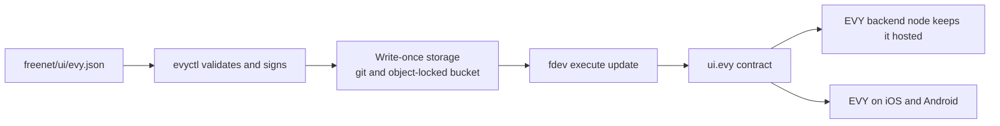

# 2.2 EVY UI contracts and publishing

## Repositories

| Repository | Role | Work in this plan |
| --- | --- | --- |
| [evy](https://github.com/EVY-Platform/evy) | Modified | UI contract in `freenet/contracts/ui/`. UI document `freenet/ui/evy.json` with Home and Hello. `evyctl ui publish` and `evyctl ui fallback`. Write-once storage in `freenet/published/` and one object-locked bucket. Backend node subscriptions. `ui.evy` in `types/freenet/contract-keys.json` |
| [freenet-core](https://github.com/freenet/freenet-core) | Used | Node, `fdev execute` and `fdev verify-merge` |
| [freenet-stdlib](https://github.com/freenet/freenet-stdlib) | Used | Contract interface |

EVY's existing SDUI schema and flows are the starting point, as listed in [Supplied EVY code and integration scope in 2.1 Hello EVY world](01-hello-evy-world.md#supplied-evy-code-and-integration-scope).

## Purpose

Publish EVY's whole UI as one signed document in one contract, `ui.evy`. UI version 1 holds two static SDUI pages:

- Home, the entry page, with a "Hello" button.
- Hello, which shows the text "Hello EVY world".

Each later version replaces the complete document under the same contract and the same version stream. Plans use the example version timeline in the [README](../README.md).



## The UI document

| Field | Meaning |
| --- | --- |
| `service` | Always `"evy"`, the app namespace. Internal features use `feature` names |
| `version` | UI version: 1 or more, one stream for the whole app |
| `schema_version` | SDUI schema version of the document |
| `min_reader_version` | Oldest reader that can draw the document. It names the document's generation |
| `routes` | Stable route names, each mapped to a flow, a page and an argument schema. `entry` is required |
| `flows` | Complete flow objects, following EVY's [SDUI schema](https://github.com/EVY-Platform/evy/blob/d0fb7e6475f1dfc5c74325e37d4e92aed88d84ed/types/schema/sdui/evy.schema.json), [UI_Flow definitions](https://github.com/EVY-Platform/evy/blob/d0fb7e6475f1dfc5c74325e37d4e92aed88d84ed/docs/evy/sdui.md) and [data rules](https://github.com/EVY-Platform/evy/blob/d0fb7e6475f1dfc5c74325e37d4e92aed88d84ed/docs/evy/data.md) |
| `certificate` | The publishing key certificate from [EVY signing keys in 2.1 Hello EVY world](01-hello-evy-world.md#evy-signing-keys) |
| `signature` | The publishing key over the bytes `evy-ui/1` followed by RFC 8785 canonical JSON of every other field |

Later schema versions may add top-level fields. The signature covers them.

UI version 1:

```jsonc
{
  "service": "evy",
  "version": 1,
  "schema_version": 1,
  "min_reader_version": 1,
  "routes": {
    "entry": { "flow": "home-flow", "page": "home-page", "arguments": {} },
    "hello": { "flow": "hello-flow", "page": "hello-page", "arguments": {} }
  },
  "flows": [
    { "id": "home-flow", "name": "Home", "pages": ["<Home page: a button row whose tap runs {navigate_route(hello)}>"] },
    { "id": "hello-flow", "name": "Hello", "pages": ["<Hello page: a text row, \"Hello EVY world\">"] }
  ],
  "certificate": { "key": "5HqT...Wd", "name": "ci-1", "signature": "Zm9v...==" },
  "signature": "<standard padded base64 of 64 bytes>"
}
```

The example shortens the flow objects. Published documents use the UUID IDs and complete page and row objects that the schemas require. Authors may keep flows in one file per feature; `evyctl` assembles and validates the complete document before signing.

The document hash is BLAKE3 of the exact canonical bytes of the complete signed document, including `signature`. One UI release is `ui.evy`, its version and its document hash.

## The UI contract

The contract's parameters are the 32-byte UI root verifying key from 2.1 Hello EVY world, followed by UTF-8 `evy`. iOS and Android builds carry the resulting key as `ui.evy` in `types/freenet/contract-keys.json`.

The state holds one document per reader generation, plus the revocations from the key chain:

```jsonc
{
  "documents": {
    "1": { "version": 5, "min_reader_version": 1, "...": "..." },  // newest document for readers 1 and up
    "2": { "version": 6, "min_reader_version": 2, "...": "..." }   // newest document for readers 2 and up
  },
  "revocations": []
}
```

| Function | Rule |
| --- | --- |
| `validate_state` | Canonical JSON. Each document sits under its own `min_reader_version`, has `service` equal to `evy`, integer fields of 1 or more, at least one flow and an `entry` route, and passes the key chain rules from 2.1 Hello EVY world. Each revocation verifies with the root key |
| `update_state` | Keeps every revocation from both states. Drops documents signed by a revoked key. In each generation keeps the document with the higher `(version, document hash)`. If the result would pass Core's 50 MB state limit, drops the lowest generations first, never the highest |
| `summarize_state` | Each generation's version and document hash, and the revoked keys |
| `get_state_delta` | Each generation where the peer holds a lower tuple or nothing, and each revocation the peer lacks |

Ordering compares versions as numbers, then hash bytes as unsigned bytes. Every peer drops the same generations, so all peers converge. Run merge fixtures under [Merge-law coverage in 1.9 Testing and release](../1-freenet-mobile-appkit/09-testing-and-release.md#merge-law-coverage), including generation pruning and revocation at the state-size ceiling.

The contract checks the envelope and the key chain. `evyctl` checks flows, routes and actions before signing.

A change to the UI contract code or to the UI root key gives a new `ui.evy` key, which ships in new iOS and Android builds.

## Application routes and compatible updates

Route names let a user return to a screen after the UI changes. Add the action `navigate_route(route, arguments)` to the action schema and the grammar corpus. The existing `navigate(flow, page)` stays within one document.

- `evyctl` checks route targets, argument schemas and UUID uniqueness across the complete document.
- `evyctl` warns the publisher when a new version removes a route or a route argument that the live version has.
- Readers never swap the UI while the user is on a screen with a draft.
- When the user leaves and comes back, the reader opens the route in the current document.
- If the current document no longer has that route, or lacks a field the draft uses, the reader warns that the draft will be lost.

## Reader compatibility

`types/schema/sdui/version.json` records schema and reader versions. Each iOS and Android build embeds them. Tag the matching source `reader-v<N>`.

| Change | Schema version | Reader version |
| --- | --- | --- |
| Envelope, row or route schema | Increase | Increase |
| Action, method or formatter behaviour | Increase when its schema changes | Increase |
| Compatible reader fix | Same | Same |

A document that needs a new reader starts a new generation. A reader draws the highest generation at or below its own reader version. When the contract holds a higher generation, the reader shows "Update EVY" and keeps drawing its own generation.

A revocation can leave a generation with no document. Readers then draw the highest remaining generation at or below their reader version. When no such generation remains, they draw their bundled fallback document.

### Bundled fallback document

`evyctl ui fallback --reader <N>` reads `ui.evy`, verifies it and writes the newest document a reader at version N can draw to `types/freenet/ui-fallback.json`. Each iOS and Android build copies that file in. On a first start with no network, the phone draws the bundled document. It replaces it once it has read the contract.

## Publishing a UI version

`evyctl ui publish freenet/ui/evy.json`:

1. Validates the complete document: schema, rows, actions and routes. It reports errors at JSON paths, the same as `scripts/validate-ui-document.ts`.
2. Reads `ui.evy` with `fdev execute get` and sets `version` to one above the highest version in any generation.
3. Signs with the publishing key under `evy-ui/1`.
4. Saves the exact signed bytes in [write-once storage](#write-once-storage).
5. Sends and reads back with the routine in [Publishing a new greeting in 2.1 Hello EVY world](01-hello-evy-world.md#publishing-a-new-greeting). The state it sends holds only the new document and the revocations. The contract merges it into its generations. Readback compares that generation's document with the saved bytes.

## Write-once storage

Before sending, `evyctl` saves the exact signed bytes, named by their base58 BLAKE3 hash, in two places:

| Copy | Location |
| --- | --- |
| Git | `freenet/published/ui/<hash>.json`, which the publishing job commits to evy's `main` branch |
| Bucket | `ui/<hash>.json` in one S3 bucket with Object Lock in compliance mode and a 10-year default retention |

- `evyctl` reads both copies back and checks the bytes before it sends anything.
- A failed save stops publication before the send.
- Nobody can overwrite or delete a saved object.
- Anyone who checks a record that names a document hash looks the bytes up here.
- The same storage holds every other EVY-signed document that records refer to by hash, with one folder per kind, for example `freenet/published/policy/`.

## The EVY backend node

The EVY backend node from 2.1 Hello EVY world subscribes to `ui.evy` and to every contract the live UI binds. UI version 1 binds no contracts, so the node holds `ui.evy` and the hello contract.

Every hour the node reads each of these contracts through a second node. When the network has no copy or a lower tuple, it sends the saved bytes again.

## Acceptance

- Contract tests and the [merge-law coverage gate in 1.9 Testing and release](../1-freenet-mobile-appkit/09-testing-and-release.md#merge-law-coverage) cover: two generations, an equal-version hash tie, a revocation that drops one key's documents in every generation, a state that passes 50 MB and drops its lowest generation, noncanonical JSON, a forged certificate and a state that holds only one new document. Focused near-capacity corpora exercise the required merge cases with the selected verifier and its recorded byte and case budgets.
- Signature, canonical encoding, ordering and generation choice give the same results in Rust, TypeScript, Swift and Kotlin from one set of shared vectors.
- A revocation that empties the newest generation leaves readers on the highest remaining generation they support. A revocation that empties every generation they support leaves them on the bundled fallback document.
- `evyctl ui publish` publishes UI version 1, and readback through a second node matches the saved bytes.
- `evyctl` reports invalid route targets, duplicate UUIDs and malformed actions at matching JSON paths. It warns when a version drops the `hello` route.
- Both write-once copies exist and match before the send. A failed bucket write stops publication. An attempt to overwrite or delete a bucket object fails.
- After test peers drop `ui.evy`, the backend node's hourly check sends the saved bytes again and a fresh peer can read the document.
- `evyctl ui fallback --reader 1` writes a verified UI version 1 document and refuses a document that fails verification.
