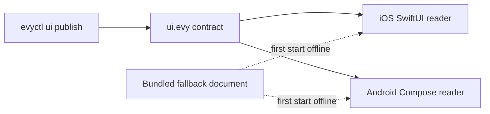

# 2.3 Native SDUI readers

## Repositories

| Repository | Role | Work in this plan |
| --- | --- | --- |
| [evy](https://github.com/EVY-Platform/evy) | Modified | The SwiftUI reader in `ios/` reads `ui.evy`. New Compose reader in `android/`. New `scripts/generate-kotlin-sdui.ts`. Shared reader fixtures in `scripts/fixtures/readers/`. The `reader_parity.yml` and `mobile_builds.yml` workflows |
| [freenet-appkit](https://github.com/glesage/freenet-appkit) | Used | `FreenetAppKit` Swift package and `org.freenet.appkit` Kotlin library, with the call API from 2.1 Hello EVY world |
| [freenet-core](https://github.com/freenet/freenet-core) | Used | Embedded node |

The iOS reader reuses EVY's existing SwiftUI reader and data stores. The Android reader builds the same behaviour in Compose. [Supplied EVY code and integration scope in 2.1 Hello EVY world](01-hello-evy-world.md#supplied-evy-code-and-integration-scope) lists the existing code.

## Purpose

EVY on iOS and Android draws its UI from the signed document in `ui.evy`. SwiftUI and Compose use the same row types, actions and fixtures. GitHub builds and signs both apps from one commit.

- Alice opens EVY on her iPhone. The SwiftUI reader opens Home from UI version 1. She taps "Hello" and sees "Hello EVY world".
- Bob does the same on his Android phone with the Compose reader.
- The publisher publishes a new UI version. Both readers show it within 30 seconds.

Release builds open Home. The native Hello screen stays only in the development bootstrap build from [2.1 Hello EVY world](01-hello-evy-world.md#the-hello-screen).

## Session lifecycle

Each EVY installation owns one node, one store and one admitted native session at a time, under [Native session admission in 2.1 Hello EVY world](01-hello-evy-world.md#native-session-admission). Trusted native code holds the credential and authorizes reader calls. Test and production builds use separate app IDs and stores.

| Event | What the reader does |
| --- | --- |
| Start | Starts the node, establishes native session admission, reads the UI as in [Reading the application UI contract](#reading-the-application-ui-contract) and opens the `entry` route |
| Background, including when the phone locks | Ends native session admission, stops the node and ends the reader session. Discards views, decrypted values and native buffers it controls |
| Return to the foreground | Starts the node, establishes a fresh admitted session and reopens the last route in the current document |
| A picker or callback returns after its session ended | Drops the result |

## Device actions

| Action | Where it comes from | Rule |
| --- | --- | --- |
| Copy | `copy_to_clipboard` | Runs only after a user tap |
| Photo picker | `select_photo` row | Opens the iOS or Android system picker. The reader gets only the photos the user chose |
| Open link | An action with an HTTPS URL | HTTPS only. Opens the system browser after a user tap |
| Map | `map` row | Shows a point from the document. Asks for no location permission |
| Internal route | `navigate_route` | The route and its arguments must exist in the current document |

The reader asks for an OS permission only at its first use.

## Private values

Some values reach the reader decrypted, such as a private address. The reader follows these rules on iOS and Android:

- Decrypted values stay in memory only. SwiftData and Room never store them. When the reader needs a value again, it asks for it to be decrypted again.
- The draft being edited stays in memory. `EVYDraftStore` on iOS and its Kotlin twin on Android hold it outside SwiftData and Room.
- The reader marks every value that came from decryption.
- The user may act on a marked value directly: copy it, or tap a link inside it, such as a link someone sent.
- A UI document may not write a marked value into a public record, or build it into an outgoing request or URL. The reader refuses the action and records the row ID in its diagnostics.

A shared fixture holds a hostile test document. It tries to write a decrypted test address into a public record, to put it in a URL and to send it in a request. All three fail on iOS and Android.

## Reading the application UI contract

Each build includes `ui.evy` in `types/freenet/contract-keys.json` and the bundled fallback document from [Bundled fallback document in 2.2 EVY UI contracts and publishing](02-ui-contracts.md#bundled-fallback-document).

1. On a first start with no saved document, draw the bundled fallback document while reading.
2. GET and subscribe to `ui.evy` through the call API from 2.1 Hello EVY world. Before the node first joins, the GET returns the stored copy.
3. Verify each document: `service`, the key chain, signature and canonical encoding, using the shared vectors from 2.2 EVY UI contracts and publishing.
4. Pick the highest generation at or below the reader's version that still holds a document. When a revocation leaves no such generation, draw the bundled fallback document. Save the exact bytes and `(version, document hash)` in one write.
5. Open the `entry` route.
6. On each update notification, repeat steps 3 and 4.

When a newer document arrives, the reader applies the route rules from [2.2 EVY UI contracts and publishing](02-ui-contracts.md#application-routes-and-compatible-updates):

| The user is | What happens |
| --- | --- |
| On a screen without a draft | The reader applies the new document at the next navigation |
| On a screen with a draft | The reader keeps the current document until the user leaves that screen |
| Back on a route that has a draft | The reader opens the route in the current document |
| Back on a route the current document no longer supports | The reader warns "This draft can't be opened in the updated EVY" and discards the draft after the user confirms |
| Using a reader older than the newest generation | The reader keeps drawing its own generation and shows "Update EVY" |

The data layer owns the one UI subscription. Views read its verified data.

### First open and offline

| Situation | Result |
| --- | --- |
| EVY opened before, now offline | Draw the saved document |
| Fresh install, offline | Draw the bundled fallback document. Replace it once the contract is read |
| The network has no copy of `ui.evy` | Draw the saved or bundled document, with a Retry banner |
| The newest generation needs a newer reader | Keep drawing the saved document and show "Update EVY" |
| A revocation empties the newest generation | Draw the highest remaining generation the reader supports |
| A revocation empties every generation the reader supports | Draw the bundled fallback document |

On restart the reader verifies the saved bytes again. Diagnostics record the contract key, version, document hash and the failed check, as in [1.3 Single-application host](../1-freenet-mobile-appkit/03-host.md).

## The SwiftUI reader

The SwiftUI reader stores flow, page and row records in `EVYDataStore` and draws them with `EVYPage` and `EVYRow` ([sdui.md](https://github.com/EVY-Platform/evy/blob/d0fb7e6475f1dfc5c74325e37d4e92aed88d84ed/docs/evy/sdui.md#ios-and-web-sdui-data-flow)).

| Part | SwiftUI implementation |
| --- | --- |
| Flow source | `EVYUIContractSource` reads `ui.evy` through the `FreenetAppKit` call API, as in [Reading the application UI contract](#reading-the-application-ui-contract). Wire it into [EVY+Sync.swift](https://github.com/EVY-Platform/evy/blob/d0fb7e6475f1dfc5c74325e37d4e92aed88d84ed/ios/evy/Core/EVY+Sync.swift) and [EVYAPIManager.swift](https://github.com/EVY-Platform/evy/blob/d0fb7e6475f1dfc5c74325e37d4e92aed88d84ed/ios/evy/Data/EVYAPIManager.swift) |
| Stored records | `EVYUIContractSource` splits each accepted document into flat flow, page and row records and stores them by UI version. It keeps the previous version's records while a screen with a draft still uses them. `EVYFlowStore`, `EVYPageStore` and `EVYRowStore` read them from `EVYDataStore` ([EVYFlowStore.swift](https://github.com/EVY-Platform/evy/blob/d0fb7e6475f1dfc5c74325e37d4e92aed88d84ed/ios/evy/Core/EVYFlowStore.swift)) |
| Entry point | [ContentView.swift](https://github.com/EVY-Platform/evy/blob/d0fb7e6475f1dfc5c74325e37d4e92aed88d84ed/ios/evy/ContentView.swift) opens the `entry` route and uses `NavigationStack` for routes |
| Drawing and actions | `EVYPage`, `EVYRow`, the row views in [ios/evy/UI/Rows](https://github.com/EVY-Platform/evy/tree/d0fb7e6475f1dfc5c74325e37d4e92aed88d84ed/ios/evy/UI/Rows), [EVYActionRunner.swift](https://github.com/EVY-Platform/evy/blob/d0fb7e6475f1dfc5c74325e37d4e92aed88d84ed/ios/evy/UI/EVYActionRunner.swift) and [interpreter.swift](https://github.com/EVY-Platform/evy/blob/d0fb7e6475f1dfc5c74325e37d4e92aed88d84ed/ios/evy/Utils/interpreter.swift). The call API delivers callbacks on the main actor, where `EVYUIContractSource` applies each document |

## The Compose reader

The Compose reader lives in the Android app from [The EVY app on iOS and Android in 2.1 Hello EVY world](01-hello-evy-world.md#the-evy-app-on-ios-and-android) and opens on the `entry` route. It implements the SwiftUI reader's behaviour in Kotlin.

| Part | SwiftUI reader | Compose reader |
| --- | --- | --- |
| UI types | `types/generated/swift/` from [generate-swift-sdui.ts](https://github.com/EVY-Platform/evy/blob/d0fb7e6475f1dfc5c74325e37d4e92aed88d84ed/scripts/generate-swift-sdui.ts) | `types/generated/kotlin/` from `generate-kotlin-sdui.ts` |
| Expressions and action parsing | [interpreter.swift](https://github.com/EVY-Platform/evy/blob/d0fb7e6475f1dfc5c74325e37d4e92aed88d84ed/ios/evy/Utils/interpreter.swift), [functions.swift](https://github.com/EVY-Platform/evy/blob/d0fb7e6475f1dfc5c74325e37d4e92aed88d84ed/ios/evy/Utils/functions.swift), [EVYActionParser.swift](https://github.com/EVY-Platform/evy/blob/d0fb7e6475f1dfc5c74325e37d4e92aed88d84ed/ios/evy/UI/EVYActionParser.swift), [EVYObjectLiteral.swift](https://github.com/EVY-Platform/evy/blob/d0fb7e6475f1dfc5c74325e37d4e92aed88d84ed/ios/evy/UI/EVYObjectLiteral.swift) | Kotlin ports |
| Action runner | `EVYActionRunner` | Kotlin port with the same order: a false condition runs its `false` branch and stops the list |
| UI contract source | `EVYUIContractSource` | `EvyUiContractSource`, through the `org.freenet.appkit` call API |
| Record and draft stores | `EVYDataStore` on SwiftData for public records. `EVYDraftStore` in memory | A Room database for public records. A draft store in memory |
| Pages and sheets | `NavigationStack` and `.sheet` | Navigation Compose and `ModalBottomSheet` |
| UI thread | Main actor | Main dispatcher |
| Inline icons such as `::image-plus::` | [lucide-icons-swift](https://github.com/JakubMazur/lucide-icons-swift) | The same Lucide icons for Compose |
| Font | SF Pro Text, bundled in [ios/evy/UI/Assets](https://github.com/EVY-Platform/evy/tree/d0fb7e6475f1dfc5c74325e37d4e92aed88d84ed/ios/evy/UI/Assets) | Roboto, Android's system font. Apple licenses SF Pro for Apple platforms only |

### Kotlin types

`scripts/generate-kotlin-sdui.ts` sits beside `generate-swift-sdui.ts`. It reads the same `evy.schema.json`, `action.schema.json` and row schemas through `rowSpecFromDefinitions` in [sdui-row-schema-utils.ts](https://github.com/EVY-Platform/evy/blob/d0fb7e6475f1dfc5c74325e37d4e92aed88d84ed/scripts/sdui-row-schema-utils.ts). It writes `UIEnums.kt`, `UIShapes.kt` and `UIRowPayloads.kt`, with kotlinx.serialization annotations, to `types/generated/kotlin/`.

- [generate-types.ts](https://github.com/EVY-Platform/evy/blob/d0fb7e6475f1dfc5c74325e37d4e92aed88d84ed/scripts/generate-types.ts) runs it after the Swift generator, so `bun run types:generate` writes Swift and Kotlin from one set of schemas. Action branches are handwritten, as `EVYActionBranch` in Swift and `EvyActionBranch` in Kotlin.
- The Compose reader's `when` over the generated row payloads has no `else` branch, as the Swift `switch` in [EVYRow.swift](https://github.com/EVY-Platform/evy/blob/d0fb7e6475f1dfc5c74325e37d4e92aed88d84ed/ios/evy/UI/EVYRow.swift) has no `default`. A new row schema fails both builds until each reader draws it.

### Row types

Both readers draw the 21 row types in [types/schema/sdui/definitions](https://github.com/EVY-Platform/evy/tree/d0fb7e6475f1dfc5c74325e37d4e92aed88d84ed/types/schema/sdui/definitions). Triggers come from each schema's `triggers` block.

| Row type | Triggers | SwiftUI view | Compose |
| --- | --- | --- | --- |
| `button` | `tap` | `EVYButtonRow` | `Button`, red for `style: "danger"` |
| `calendar` | `tap`, `tap_row`, `tap_column` | `EVYCalendarRow` | Grid of timeslots with day and time headers |
| `dropdown` | `tap` | `EVYDropdownRow`, a list in a sheet | The same list in a `ModalBottomSheet` |
| `heading` | `tap`, `swipe_left` | `EVYHeadingRow` | Heading text |
| `horizontal_container` | `tap` | `EVYHorizontalContainerRow` | `Row` of its children |
| `inline_picker` | `tap` | `EVYInlinePickerRow` | One toggle button per option |
| `input` | `tap`, `submit`, `swipe_left` | `EVYInputRow` | `OutlinedTextField`. `submit` runs on the keyboard's Done key or when focus leaves |
| `input_list` | `tap` | `EVYInputListRow` | Scrolling list of values |
| `list_item` | `tap`, `swipe_left` | `EVYListItemRow` | `ListItem` with image, title and subtitle |
| `map` | `tap` | `EVYMapRow`, on MapKit | Maps Compose, on the Google Maps SDK for Android |
| `photo_gallery` | `tap` | `EVYPhotoGalleryRow` | `HorizontalPager`, with a full-screen view |
| `search` | `tap` | `EVYSearchRow` | Text field and results, each drawn with the first child variant whose `visible` is true. No placeholder gives a plain list |
| `select_photo` | `tap`, `delete` | `EVYSelectPhotoRow`, with `PhotosPicker` | Photo tiles, with the Android photo picker |
| `tab_container` | `tap` | `EVYTabContainerRow`, a segmented `Picker` | `SingleChoiceSegmentedButtonRow` |
| `text` | `tap`, `swipe_left` | `EVYTextRow` | Text with title and subtitle |
| `text_action` | `tap` | `EVYTextActionRow` | Text with an action label, such as "Change" |
| `text_area` | `tap`, `submit` | `EVYTextAreaRow` | Multi-line `OutlinedTextField` |
| `text_expand` | `tap` | `EVYTextExpandRow` | Text that opens with its `expand_label` |
| `text_select` | `tap` | `EVYTextSelectRow` | Text with a check box |
| `timeslot_picker` | `tap` | `EVYTimeslotPickerRow` | Grid of timeslots |
| `vertical_container` | `tap` | `EVYVerticalContainerRow` | `Column` of its children |

Rows with a `swipe_left` action get a trailing swipe button, from [EVYSwipeableRow.swift](https://github.com/EVY-Platform/evy/blob/d0fb7e6475f1dfc5c74325e37d4e92aed88d84ed/ios/evy/UI/EVYSwipeableRow.swift) on iOS and an `anchoredDraggable` reveal on Android. A `show` action opens a row's `sheet` in a sheet on iOS and a `ModalBottomSheet` on Android ([sdui.md](https://github.com/EVY-Platform/evy/blob/d0fb7e6475f1dfc5c74325e37d4e92aed88d84ed/docs/evy/sdui.md#row-relationships)).

## Keeping both readers the same

Both readers run the same fixtures in evy. Each fixture has an expected result, and both readers must produce it.

| Fixture | What it holds | Expected result |
| --- | --- | --- |
| [types/grammar/conformance.json](https://github.com/EVY-Platform/evy/blob/d0fb7e6475f1dfc5c74325e37d4e92aed88d84ed/types/grammar/conformance.json) | Expression, value-position and action-parsing vectors. Swift ([GrammarConformanceTests.swift](https://github.com/EVY-Platform/evy/blob/d0fb7e6475f1dfc5c74325e37d4e92aed88d84ed/ios/evyTests/GrammarConformanceTests.swift)), Kotlin and TypeScript run these vectors | A new Kotlin test gives the vectors' results |
| `scripts/fixtures/readers/rows/<row type>.json` | One complete UI document per row type, with every attribute and trigger its schema declares | `<row type>.semantics.json` |
| `scripts/fixtures/readers/evy.json` | UI documents with Home, Hello and route navigation | `evy.semantics.json` |
| EVY's existing flows in [service_sdui.json](https://github.com/EVY-Platform/evy/blob/d0fb7e6475f1dfc5c74325e37d4e92aed88d84ed/scripts/fixtures/services/service_sdui.json), with records from [service_data.json](https://github.com/EVY-Platform/evy/blob/d0fb7e6475f1dfc5c74325e37d4e92aed88d84ed/scripts/fixtures/services/service_data.json) loaded into the record store | The "View Item" and "Create item" flows | `marketplace.semantics.json` |
| `scripts/fixtures/readers/private-values.json` | The hostile document from [Private values](#private-values) | Every leaking action refused |

For each fixture page, an XCTest UI test on iOS and a Compose UI test on Android draw the same document and write two things:

- A semantic snapshot records each row's ID, type, shown texts, value, enabled state and accessibility label. iOS reads it from the accessibility tree and Android from the Compose semantics tree. Each row sets its row ID as its accessibility identifier on iOS and its test tag on Android.
- An action trace. The test taps, types into and swipes each row, then records the actions the runner ran and the draft writes, in order, for example `select(...)`, `show(<row id>)`, `navigate(<flow id>,<page id>)` and `navigate_route(<route>,<arguments>)`.

Both outputs must equal the expected file, so VoiceOver and TalkBack read the same names, roles and values. Layout may differ, because fonts and system controls differ, so each platform keeps its own expected screenshots for review, with swift-snapshot-testing on iOS and Roborazzi on Android.

`.github/workflows/reader_parity.yml` runs both on every pull request that touches `ios/`, `android/`, `types/` or `scripts/fixtures/`: the iOS Simulator on the macOS runner that [e2e_tests.yml](https://github.com/EVY-Platform/evy/blob/d0fb7e6475f1dfc5c74325e37d4e92aed88d84ed/.github/workflows/e2e_tests.yml) uses, and the Android emulator on Linux. A change to either reader's behaviour updates the expected files in the same commit.

## Builds from GitHub

EVY publishes from its organization accounts: an Apple Developer Program organization account and a Google Play organization developer account.

`.github/workflows/mobile_builds.yml` in evy runs only when a maintainer starts it (`workflow_dispatch`). It takes a git ref and a `variant`, `store` or `test`, and builds both apps from that one commit. A `test` build adds a `.preview` suffix to the app IDs, so it installs beside a `store` build.

| Step | iOS job | Android job |
| --- | --- | --- |
| Runner | `blacksmith-6vcpu-macos-26`, as in e2e_tests.yml | Linux |
| Prepare | `bun run types:generate`, `evyctl ui fallback --reader <N>`, then the reader parity tests | The same |
| Build | `xcodebuild archive` of the `evy` scheme in Release, for arm64. The build number is the workflow run number | `./gradlew bundleRelease` for arm64-v8a and x86_64. The `versionCode` is the workflow run number |
| Sign | Distribution certificate and App Store provisioning profile | Upload key |
| Deliver | Upload with an App Store Connect API key to TestFlight | Upload with a Play service account to Play internal testing and closed testing |

- Both apps use the same freenet-appkit release for the Swift package and the Kotlin library, and both read the same `types/freenet/contract-keys.json` and `types/freenet/ui-fallback.json`.
- The secrets live in the GitHub environment `mobile-builds`, which only maintainers can use: `APP_STORE_CONNECT_KEY_ID`, `APP_STORE_CONNECT_ISSUER_ID` and `APP_STORE_CONNECT_KEY` for TestFlight, `IOS_DISTRIBUTION_P12`, `IOS_DISTRIBUTION_P12_PASSWORD` and `IOS_PROVISIONING_PROFILE` for iOS signing, `ANDROID_UPLOAD_KEYSTORE` and `ANDROID_UPLOAD_KEYSTORE_PASSWORD` for Android signing, `PLAY_SERVICE_ACCOUNT_JSON` for Play uploads, and `ANDROID_MAPS_API_KEY` for the `map` row on Android.
- The run summary lists the commit, the variant, both build numbers, the freenet-appkit release, the reader version and the hashes of `contract-keys.json` and `ui-fallback.json`.

### Build and channel evidence

The workflow runs the store build checks from [1.9 Testing and release](../1-freenet-mobile-appkit/09-testing-and-release.md) on both artifacts, with application `EVY`, iOS deployment target 17 and Android API 28.

| Channel | iOS | Android |
| --- | --- | --- |
| Team testing | TestFlight internal testing | Play internal testing |
| Pilot | TestFlight external testing, after Apple's Beta App Review | Play closed testing, after Google Play's review |

Before either reviewed pilot channel opens, the builds pass [Native session admission in 2.1 Hello EVY world](01-hello-evy-world.md#native-session-admission) on iOS and Android. The two pilot reviews supply EVY's store review evidence. Record the admission results, review result, build number and a fresh install and an update on each platform.

## Acceptance

- On iOS and Android, a release build opens Home from UI version 1 and navigates to Hello, which shows "Hello EVY world".
- A new UI version reaches both running readers within 30 seconds. Both produce matching semantic snapshots and action traces.
- On iOS and Android, a fresh install in Airplane Mode draws the bundled fallback document, then the contract's document once online. A restart offline after a successful read draws the saved document.
- On iOS and Android, a user types a draft on a screen while a new UI version arrives. The screen keeps its document. After leaving and returning, the draft opens through its route in the new document. When the new document drops that route, the reader warns that the draft will be lost.
- On iOS and Android, locking the phone stops the node and ends the session. A photo picker result that returns after the lock is dropped. Unlocking opens a fresh session on the last route.
- On iOS and Android, SDUI documents and reader-controlled arguments stay outside the admission credential. A reader call outside the ordinary message list is refused by the trusted host, and callbacks from an ended session are dropped. Reviewed pilot and public builds pass the native admission tests in 2.1 Hello EVY world.
- Copy, photo picker, open link, map and internal route fixtures pass their rules on iOS and Android.
- On iOS and Android, the hostile private-values document cannot write a decrypted test address into a public record, a URL or a request. The user can still copy the address and tap a link in it. No decrypted value appears in SwiftData or Room files.
- A wrong contract key, a bad signature, a revoked publishing key, noncanonical bytes, a stale tuple and a malformed route leave the saved document in place and produce diagnostics without private data.
- Equal-version documents arriving in opposite orders end on the same higher hash. A newer generation keeps the reader on its own generation with "Update EVY" across restarts.
- On iOS and Android, a revocation that empties the newest generation moves the reader to the highest remaining generation it supports. A revocation that empties every generation it supports moves it to the bundled fallback document.
- Shared row and grammar fixtures pass in Swift, Kotlin and TypeScript. A row type with no native view fails the iOS or Android build.
- One workflow run produces matching signed iOS and Android builds with the same appkit release and the same `contract-keys.json` and `ui-fallback.json` hashes. Android builds hold arm64-v8a and x86_64 only. Test builds use separate app IDs.
- A `store` build passes Apple's Beta App Review for TestFlight external testing and Google Play's review for closed testing.
