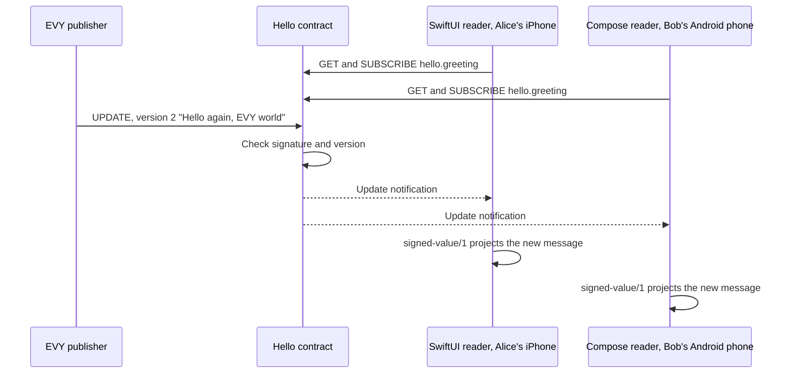
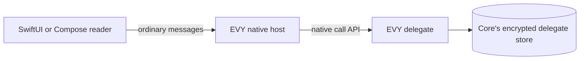
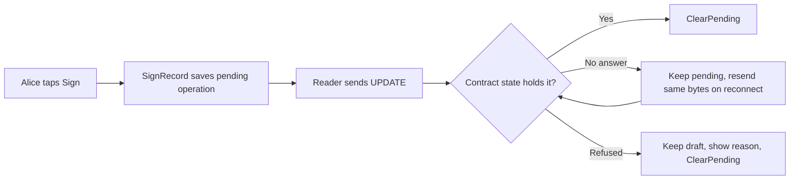

# 2.4 SDUI data and actions

## Repositories

| Repository | Role | Work in this plan |
| --- | --- | --- |
| [evy](https://github.com/EVY-Platform/evy) | Modified | `signed-register/1` codec, vector suite, resource catalogue and delegate message schemas in `freenet/common/`. The EVY delegate in `freenet/delegates/evy/`, with its key vectors. The list-first registration in the native start sequence. Collection contract in `freenet/contracts/collection/`. `signed-value/1` and `collection/1` adapters in the SwiftUI and Compose readers. `resources` checks in `scripts/validate-ui-document.ts`. UI version 2 in `freenet/ui/evy.json`. `evyctl record remove` |
| [freenet-appkit](https://github.com/glesage/freenet-appkit) | Used | Swift package and Kotlin library, with the native contract and delegate call API from [2.1 Hello EVY world](01-hello-evy-world.md) |
| [freenet-core](https://github.com/freenet/freenet-core) | Used | Node, encrypted delegate store, `fdev execute` and `fdev verify-merge` |
| [freenet-stdlib](https://github.com/freenet/freenet-stdlib) | Used | Contract and delegate interfaces, `MessageOrigin` and the Wasm random source |

This plan replaces EVY's JSON-RPC resource bindings with Freenet contract adapters. It keeps EVY's existing data and action rules. [Supplied EVY code and integration scope in 2.1 Hello EVY world](01-hello-evy-world.md#supplied-evy-code-and-integration-scope) records the starting point.

## Purpose

This plan builds the binding system that connects SDUI pages to Freenet contracts. It defines:

- the resource catalogue and its adapters
- `signed-register/1`, the one signed record format every EVY contract uses
- the EVY delegate, which holds each user's keys and signs, seals and queues their writes
- how actions read and write contract state, online and offline

UI version 2 uses it to bind the Hello greeting:

- The EVY publisher publishes UI version 2. The Hello page's text row now shows `{hello.greeting.message}` through the `signed-value/1` adapter.
- Alice opens Hello on her iPhone and Bob opens it on his Android phone. Both see "Hello EVY world".
- The publisher runs `evyctl hello publish --message "Hello again, EVY world"`. Both pages change within 30 seconds.



Writes by users run through the EVY delegate. This plan's suite proves them with a test collection, `test.notes`, which does not ship in EVY. Vector fixtures load fixed test seeds into the delegate, so results repeat across platforms.

## Resources and contracts

This plan fills the `resources` map of [The UI document in 2.2 EVY UI contracts and publishing](02-ui-contracts.md#the-ui-document). Each entry maps a resource reference to an adapter and its contract. References keep EVY's `<feature>.<resource>` form ([rpc.schema.json](https://github.com/EVY-Platform/evy/blob/d0fb7e6475f1dfc5c74325e37d4e92aed88d84ed/types/schema/common/rpc.schema.json)), for example `hello.greeting`.

### EVY resource catalogue

The catalogue lives in `freenet/common/resources.json`, with the wire schemas and shared fixtures beside it. Each entry records:

- the adapter name and version, such as `collection/1`
- the contract code hashes it supports
- its parameter codec
- its operations and signing domains
- the minimum reader version that ships it

Both readers ship every catalogued adapter, its schemas and the supported contract Wasm in matching iOS and Android builds. A signed UI document picks adapters from the catalogue and supplies bindings. It cannot add code. Unsupported bindings follow [Reader compatibility in 2.2 EVY UI contracts and publishing](02-ui-contracts.md#reader-compatibility).

This plan adds two adapters. New adapters join the catalogue the same way.

| Adapter | Reads | Writes |
| --- | --- | --- |
| `signed-value/1` | One `signed-register/1` state signed by an EVY publishing key, such as the hello greeting. It projects the payload fields as one row | None from readers. The publisher sends new versions with `evyctl` |
| `collection/1` | A [collection contract](#the-collection-contract). It projects each record as one row | `create` and `update` sign the author's records. The publisher removes records with `evyctl record remove` |

### The `signed-register/1` format

Every signed state or record in EVY uses this one format. The hello state from [The hello contract in 2.1 Hello EVY world](01-hello-evy-world.md#the-hello-contract) already follows it. Each plan names only its domain and payload fields.

| Part | Rule |
| --- | --- |
| Fields | The payload fields, `version` (integer, 1 or more), optional `signer` and `signature` |
| Signer | `signer` is the signing key in base58. It is left out when the key is the contract parameter |
| Signed bytes | The domain's UTF-8 bytes, such as `evy.hello/1`, followed by the [RFC 8785](https://www.rfc-editor.org/rfc/rfc8785) canonical JSON of every field except `signature` |
| Signature | Ed25519, as standard padded base64 |
| Stored bytes | RFC 8785 canonical JSON of the complete signed object |
| Hash | BLAKE3 of the stored bytes, including `signature` |
| Order | Higher `version` wins. At equal versions, the higher hash wins, comparing bytes as unsigned |

EVY publishing keys sign with a certificate from the UI root key, as set up in [2.1 Hello EVY world](01-hello-evy-world.md). A contract whose parameter is the UI root key accepts a record from a publishing key only with a valid certificate. It drops records from a key that a root-signed revocation names.

One shared vector suite in `freenet/common/vectors/` runs in Rust, Swift, Kotlin and TypeScript. It fixes test keys, canonical bytes, signatures, hashes and ordering results.

### Resource bindings

Each binding names its adapter, contract code and exact parameter bytes. Freenet derives the contract key from the code hash and those bytes, so both readers know exactly which contract a page reads or changes.

```jsonc
{
  "service": "evy",                   // application envelope from 2.2 EVY UI contracts and publishing
  "version": 2,                       // UI version 2 binds the greeting
  "resources": {
    "hello.greeting": {
      "adapter": "signed-value/1",    // from the catalogue
      "contract": "hello",            // freenet/contracts/hello/
      "code_hash": "8kHn...Qw3",      // base58 BLAKE3 of the hello Wasm
      "parameters": [
        { "key": "9xFq...Tz2" }       // 32 bytes: the hello contract parameter from 2.1 Hello EVY world
      ],
      "private": []                   // fields the EVY delegate seals, none here
    }
  }
}
```

The test suite binds `test.notes` the same way, with `"adapter": "collection/1"`, `"contract": "collection"` and two parameter parts: `{ "key": <UI root key> }` and `{ "text": "test.notes" }`.

- A `key` part adds 32 bytes. A `text` part adds its UTF-8 bytes. Only the last part may be text, so the bytes split one way.
- Part values follow EVY's [value-position rules](https://github.com/EVY-Platform/evy/blob/d0fb7e6475f1dfc5c74325e37d4e92aed88d84ed/docs/evy/actions.md#value-position).
- Fixtures check that Rust, Swift and Kotlin derive the same contract key.
- A binding may name another binding, for example a list of files that belong to a collection. The validator resolves these links, checks their declared types and rejects cycles.
- `scripts/validate-ui-document.ts` runs inside `evyctl ui publish`. It checks each binding against the catalogue and checks that every resource reference in the flows has a binding.
- Before publishing a UI version that binds a new contract, `evyctl` PUTs that contract's valid initial state with `fdev execute put`.

UI version 2 is published with `evyctl ui publish`, as in [Publishing a UI version in 2.2 EVY UI contracts and publishing](02-ui-contracts.md#publishing-a-ui-version).

### Resource operations and permissions

| Adapter | Read projection | Writes and ownership |
| --- | --- | --- |
| `signed-value/1` | The newest verified state as one row, with its received time | Read only for readers. `owns` is always false |
| `collection/1` | Each record as one row, newest first by `created_at`. Removed records do not show | `create` signs a new record with the author's feature key. `update` raises `version` on the author's own record. `owns` is true when `author` is the user's key for that feature |

`owns` only drives the UI. Each write is checked again:

1. The adapter checks the operation, the feature and the target contract.
2. The EVY delegate checks the feature, scope and signing domain before it signs.
3. Every peer's contract checks the signature and the record rules.

### Record rules

- Contracts check signatures, field types and the size of the whole state. They set no per-field text limits.
- Text checks stay in the UI, with EVY's existing `length()` condition ([methods.md](https://github.com/EVY-Platform/evy/blob/d0fb7e6475f1dfc5c74325e37d4e92aed88d84ed/docs/evy/methods.md)). For example, a Sign button runs only when `{length(message) > 0}`.
- Amounts are integer cents.

### The collection contract

`freenet/contracts/collection/` holds many records from many authors. Anyone may write, with no per-author cap. The contract's only size limit is Core's 50 MB state limit.

```jsonc
{
  "records": { "<id>": { /* signed-register/1 record */ } },
  "removed": { "<id>": { /* signed-register/1 removal marker */ } },
  "revocations": [ /* root-signed revocations of publishing keys */ ],
  "floor": ["2026-10-07T09:30:00.000Z", "<id>"]   // only after old entries were dropped
}
```

A record in `test.notes`:

| Field | Example | Rule |
| --- | --- | --- |
| `id` | `5f0c2a9e-...` | UUID from the first 16 bytes of BLAKE3 over canonical `{author, created_at, salt}` |
| `author` | Alice's key for the `test` feature, base58 | The record's signer |
| `created_at` | `2026-10-07T09:30:00.000Z` | UTC with millisecond precision. Edits keep it |
| `salt` | base64 | 16 random bytes |
| `version` | `1` | One higher on each edit |
| `message` | "Hi from Alice" | Feature payload |
| `signature` | base64 | `signed-register/1` with domain `evy.record/1 test.notes` |

A removal marker holds `id`, `created_at`, `version` 1, the publishing key as `signer`, its certificate and a signature with domain `evy.removal/1 test.notes`. It replaces the record, so the record's bytes are freed. The marker is about 300 bytes.

| Function | Rule |
| --- | --- |
| `validate_state` | Every record and marker passes the `signed-register/1` rules and the ID rule. Revocations verify with the UI root key. Markers come from certified, unrevoked publishing keys. Nothing is at or below `floor`. The canonical state fits Core's limit |
| `update_state` | Union both sides, including revocations. Drop markers from revoked keys. For one ID, a marker beats a record. Between records, the higher `(version, hash)` wins. Between markers, the higher hash wins. Drop entries at or below `floor`. If the state is over Core's limit, drop the oldest entries by `(created_at, id)` and raise `floor` to the last one dropped |
| `summarize_state` | Each ID with its `(version, hash)` or marker hash, plus `floor` |
| `get_state_delta` | Entries the peer lacks or holds at a lower order, above the peer's `floor`. An up-to-date peer gets an empty delta |

`floor` stops an old dropped record from coming back through a later merge.

Accepted risks:

- A record with a future `created_at` stays longer than newer honest records.
- Each client UPDATE resends the full state until Core sends client update deltas ([#4072](https://github.com/freenet/freenet-core/pull/4072) deferred the delta wire format).

The publisher removes a record with `evyctl record remove test.notes <id>`. It signs the marker with the publishing key, sends it with `fdev execute update` and reads it back with `fdev execute get`. This is the same send-and-read-back routine as `evyctl hello publish` in [2.1 Hello EVY world](01-hello-evy-world.md#publishing-a-new-greeting).

## The EVY delegate

Adapters never hold user keys. The EVY delegate holds them, and signs, seals and queues each write. It lives in `freenet/delegates/evy/`. Each iOS and Android installation runs one, and both apps carry its Wasm. Its parameters are empty, so its key is the hash of its code.

Example: Alice taps "Sign" on a test note on her iPhone. The reader asks the delegate to sign the note with her `test` feature key. The delegate saves the signed note as a pending operation, then returns it. The reader sends it.



### Secrets

| Secret | What it holds |
| --- | --- |
| `root_seed` | 32 random bytes, made on first start from Core's random source for Wasm ([rand.rs](https://github.com/freenet/freenet-stdlib/blob/7782c176a622efc3f284ce4710b4f184c4986405/rust/src/rand.rs)) |
| `addresses/<id>` | One private address-book row, such as a pickup address, with its `version` |
| `drafts/<feature>/<draft id>` | One page draft from `PutDraft` |
| `pending/<feature>/<operation id>` | One signed operation with its adapter, target contract key, exact parameters, scope and operation ID, kept to resend the same bytes |

Core keeps these secrets in its encrypted delegate store, protected by the node key from [1.5 Identity, keys and local protection](../1-freenet-mobile-appkit/05-identity.md).

### Keys

The delegate derives one Ed25519 signing key and one X25519 encryption key per feature and scope. Separate keys stop anyone linking one feature's records to another's.

- HKDF-SHA256 over `root_seed`.
- The info bytes are `evy/1`, then the 2-byte big-endian length of `feature` and its UTF-8 bytes, then the same for `scope`, then `signing` or `encryption`.
- With no scope, the scope length is 0.
- `feature` and `scope` may not contain `/`, because secret names use `/` as a separator.

Example: Alice's hello signing key uses the info bytes `evy/1`, `00 05`, `hello`, `00 00`, `signing`. A scope such as a record ID gives that record its own key.

### Registration

EVY establishes [Native session admission from 2.1 Hello EVY world](01-hello-evy-world.md#native-session-admission), then registers its delegate list-first on each start, as River does in [Setup in 1.4 Application bundles](../1-freenet-mobile-appkit/04-bundles.md#setup):

1. EVY sends `ListPending` first.
2. If Core answers that the delegate is missing, EVY registers it with empty parameters and waits for the reply.
3. EVY opens its first screen and sends the pending operations from step 1.

### Ordinary messages

Messages are JSON, with schemas in `freenet/common/`. Readers send only these ordinary messages:

| Message | Reply | Used for |
| --- | --- | --- |
| `GetPublicKeys { feature, scope? }` | Signing and encryption public keys, base58 | `author`, `readers` and `owns()` |
| `SignRecord { feature, scope?, resource, context, record }` | The signed record. The delegate saves it as a pending operation before it replies | `create` and `update` |
| `SignOperation { feature, scope?, resource, context, kind, payload }` | The signed operation, saved as pending before the reply | Operations whose schema the resource's catalogue entry names |
| `ListPending { after?, limit }` | One page of pending operations and a `next` cursor | Each start |
| `ClearPending { feature, operation_id, evidence }` | Done | The target state holds the operation, or the contract refused it for good |
| `Seal { feature, scope?, resource, context, fields, readers }` | `sealed` ciphertext | Fields in the binding's `private` list |
| `Open { feature, scope?, resource, context, sealed }` | The fields, or `NotSealedForYou` | Drawing a private field |
| `PutDraft`, `GetDraft`, `DeleteDraft { feature, draft_id }` | The draft, or done | Page drafts |
| `ListAddresses { after?, limit }` | One page of address rows and a `next` cursor | Address-book views |
| `PutAddress { id, expected_version, fields }` | The saved row with its next `version` | Creating and editing an address. A version conflict keeps the draft for review |

- `context` carries the adapter version, operation ID, target contract key and exact parameters.
- The delegate checks that context and the signing domain before it signs or decrypts.
- Editing an address leaves copies already sealed into other records unchanged.

### Caller rules

- Core verifies the EVY native host and current session under [Native session admission in 2.1 Hello EVY world](01-hello-evy-world.md#native-session-admission) before it runs the delegate. This boundary covers every connection and equivalent API path.
- The delegate accepts calls from that admitted native session and checks the feature, scope, domain and operation context. It also rejects a web app or another delegate as `MessageOrigin` ([delegate_interface.rs](https://github.com/freenet/freenet-stdlib/blob/7782c176a622efc3f284ce4710b4f184c4986405/rust/src/delegate_interface.rs)).
- The native host authorizes the ordinary messages above from the reader's call path. Only the native migration runner may request the lifecycle messages in [2.11 EVY delegate updates and recovery](11-delegate-updates-and-recovery.md#lifecycle-messages).
- Private replies reach only their admitted session. The release tests verify confidential delivery, including attempts by another local connection to register for the same delegate's output. [RFC #5919](https://github.com/freenet/freenet-core/issues/5919) supplies design input for addressed pushes and native grants; the release uses an implemented, tested boundary.

### Bounds

| Bound | Limit |
| --- | --- |
| One request message | 256 KiB of canonical JSON |
| One reply | 1 MiB |
| One page from `ListPending` or `ListAddresses` | 256 records |

The native call API checks the request size before sending. The delegate refuses anything larger.

### Private fields and drafts

The binding's `private` list names fields for chosen readers. `Seal` encrypts them to the author and to each X25519 key in `readers` with HPKE ([RFC 9180](https://www.rfc-editor.org/rfc/rfc9180): X25519, HKDF-SHA256, ChaCha20-Poly1305). The record stores the ciphertext in `sealed`. `Open` decrypts only fields sealed to the local user.

- Readers keep decrypted fields in memory only. They call `Open` again when a page needs the field again.
- Readers save drafts only through `PutDraft`. SwiftData on iOS and Room on Android hold public projections only.
- Readers mark every value that came from `Open`. The user may copy a marked value or tap a link inside it.
- A UI document cannot write a marked value into a public record. It cannot put one into an outgoing request or URL on its own.

## Reads and subscriptions

The EVY data layer GETs and SUBSCRIBEs a bound contract when an open page or a pending operation needs it. It uses the native call API from [2.1 Hello EVY world](01-hello-evy-world.md).

- Before the node's first join, the GET returns the node's stored copy.
- The data layer holds one subscription per contract and releases it when nothing needs it.
- The adapter writes public rows to `EVYDataStore` (SwiftData) on iOS and Room on Android. Views observe those rows.
- Each update notification refreshes the rows of that contract only.
- EVY's backend node subscribes to every contract the live UI binds, as [2.2 EVY UI contracts and publishing](02-ui-contracts.md) states.

| Binding | Reader behavior |
| --- | --- |
| `{hello.greeting.message}` | `signed-value/1` projects the newest verified state. Offline, the page draws the stored value |
| `{test.notes}` | `collection/1` projects verified records into rows ([EVY+Sync.swift](https://github.com/EVY-Platform/evy/blob/d0fb7e6475f1dfc5c74325e37d4e92aed88d84ed/ios/evy/Core/EVY+Sync.swift)) |
| `$datum`, `sort`, `filter`, `findFirst`, `count`, `length` | Run over the projected rows ([methods.md](https://github.com/EVY-Platform/evy/blob/d0fb7e6475f1dfc5c74325e37d4e92aed88d84ed/docs/evy/methods.md)) |
| `owns(resource, id)` | The adapter's predicate, with keys from `GetPublicKeys` ([EVY+Ownership.swift](https://github.com/EVY-Platform/evy/blob/d0fb7e6475f1dfc5c74325e37d4e92aed88d84ed/ios/evy/Core/EVY+Ownership.swift)) |
| Public and private rows | Contract state is public. The EVY delegate seals fields in the `private` list. Row visibility follows [data.md](https://github.com/EVY-Platform/evy/blob/d0fb7e6475f1dfc5c74325e37d4e92aed88d84ed/docs/evy/data.md#visibility) |

## Actions

The action runner follows EVY's [sequencing rules](https://github.com/EVY-Platform/evy/blob/d0fb7e6475f1dfc5c74325e37d4e92aed88d84ed/docs/evy/sdui.md#sequencing). `create` and `update` write the reader's store at once and send in the background ([EVY+Mutations.swift](https://github.com/EVY-Platform/evy/blob/d0fb7e6475f1dfc5c74325e37d4e92aed88d84ed/ios/evy/Core/EVY+Mutations.swift)). The next action runs while the write is pending.

| Action ([actions.md](https://github.com/EVY-Platform/evy/blob/d0fb7e6475f1dfc5c74325e37d4e92aed88d84ed/docs/evy/actions.md)) | What it does on Freenet |
| --- | --- |
| `create(resource, submit)`, and the map and path forms | The adapter builds the record: `salt`, `id`, `author`, `version` 1 and `created_at`. `SignRecord` signs it and the reader sends an UPDATE. The row shows "Sending" until the contract state holds it. Writes the new ID to `idDestination` if given |
| `update(resource, {filter}, {changes})` | For each matching row the user owns, applies the changes, raises `version`, signs and sends. A refused write shows the contract's reason |
| `update(resource, {}, {changes}, draft)`, `select`, `clear`, `highlight_required` | Page drafts and checks on the phone. Drafts are saved with `PutDraft` |
| `copy_to_clipboard` | `UIPasteboard` on iOS, `ClipboardManager` on Android. Android 13 and later shows its own confirmation |
| `navigate`, `navigate_route`, `show`, `close`, `select_photo`, `delete_photo`, `expand_photo`, `expand_text` | Inside the reader: `NavigationStack` and sheets on iOS, Navigation Compose and `ModalBottomSheet` on Android |

## Service rules

Contracts enforce record rules on every peer. Work that needs an outside system runs in the EVY backend, which subscribes to the contract and acts on new records ([hooks.md](https://github.com/EVY-Platform/evy/blob/d0fb7e6475f1dfc5c74325e37d4e92aed88d84ed/docs/evy/hooks.md)).

| Work | Implementation |
| --- | --- |
| Validate a record | The contract checks it in `validate_state` and `update_state` |
| Report a refused write | The writer's node rejects the UPDATE. The SDK returns a [typed error from 1.2 Embedded node and mobile SDK](../1-freenet-mobile-appkit/02-sdk.md#requests-events-and-errors). The reader shows the reason in EVY's error alert |
| Run outside work after a write | The backend subscribes with freenet-stdlib's TypeScript client and signs its results under its own domain |

## Offline writes

The EVY delegate saves each signed operation before it returns it. The reader shows the row as "Sending" until the adapter sees the operation in the contract state.



| Alice's phone when she taps "Sign" on her test note | What happens to "Hi from Alice" |
| --- | --- |
| Offline after an earlier join | The delegate saves the note. The row shows "Sending". The reader sends it when the node reconnects |
| Before the first join since startup | The delegate saves the note. The reader sends it after the join |
| EVY closes before the contract holds it | The note stays pending. On the next start, `ListPending` returns it. The adapter reads the contract and resends the same bytes if needed |
| The pending save fails | The draft stays. The reader shows the storage error and retries the save before sending |
| Bob writes to the same collection meanwhile | The contract merges both notes. A resend of Alice's note does not duplicate it |
| The contract refuses the note | The draft stays with the reason. The row goes away. `ClearPending` removes the operation |

## Acceptance

- The `signed-register/1` vector suite passes in Rust, Swift, Kotlin and TypeScript. It covers canonical bytes, signatures, hashes, equal versions with different hashes, extra fields, noncanonical JSON and a publishing key without a valid certificate. The hello state from 2.1 Hello EVY world decodes as `signed-register/1` with domain `evy.hello/1`.
- On iOS and Android, UI version 2 shows "Hello EVY world" on Hello. When the publisher publishes "Hello again, EVY world", Alice's iPhone and Bob's Android phone show it within 30 seconds. Relaunched offline, both draw the stored greeting.
- `fdev verify-merge` passes on the collection contract under [Merge-law coverage in 1.9 Testing and release](../1-freenet-mobile-appkit/09-testing-and-release.md#merge-law-coverage). Fixtures cover all merge orders, equal versions with different hashes, a higher version with a lower hash, a marker arriving with its record, a resent record and states at the collection's size ceiling. The release report records actual cases checked and every omission.
- A collection fixture filled past Core's limit keeps the newest records by `created_at` and raises `floor`. A resent record at or below `floor` changes nothing. A removal frees the record's bytes. A marker from a revoked publishing key is dropped.
- Two peers start with different valid records for the same ID and version. Summary and delta exchange in either order converges both on the higher hash. A repeated exchange gives an empty delta.
- In the SwiftUI and Compose readers, shared fixtures give the same contract keys, records, hashes and action traces for `create`, `update`, `select`, `copy_to_clipboard`, `navigate`, `navigate_route` and `show`.
- The validator rejects unknown adapters, unsupported code hashes, missing or cyclic binding links and references with no binding.
- On iOS and Android, each case in [Offline writes](#offline-writes) passes with the EVY delegate. The collection holds one copy of each accepted note. When the publisher runs `evyctl record remove`, both readers drop the note.
- A malicious fixture document tries to write a decrypted private field into a public record, a request and a URL. All three fail. Copying the field works.
- After a sealed field is drawn and the page closes, neither SwiftData, Room nor any draft store holds its plaintext.

The EVY delegate, on iOS and Android:

- On a fresh install EVY registers the delegate. On a later start it skips registration.
- The root seed is made once. Derived public keys stay the same after a restart.
- Key vectors with length-prefixed info pass in Rust, Swift and Kotlin. Feature `ab` with scope `c` and feature `a` with scope `bc` give different keys. A `/` in a feature or scope is refused.
- The delegate refuses to sign a record whose domain or context belongs to another feature.
- The delegate rejects web app and delegate origins. The host refuses a reader message outside the ordinary list. A second local client that claims EVY's identity or omits Origin is refused signing, decryption, draft and address access, private replies and pending-operation changes. An ended session is refused on every connection, as [Native session admission in 2.1 Hello EVY world](01-hello-evy-world.md#native-session-admission) requires.
- A private field opens for each listed reader. A third device gets `NotSealedForYou`.
- With 1,000 pending operations, `ListPending` returns every record in pages of at most 256. A request over 256 KiB is refused.
- Alice saves an address, then edits it. A second edit with the old `expected_version` is refused, and her draft stays for review. `ListAddresses` returns the new row after a restart.
