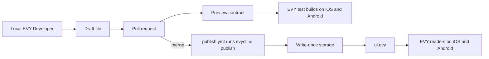

# 2.5 EVY authoring and publishing

## Repositories

| Repository | Role | Work in this plan |
| --- | --- | --- |
| [evy](https://github.com/EVY-Platform/evy) | Modified | Local EVY Developer in `web/` with draft import and export. Document validation shared with `evyctl`. `evyctl ui get` and `evyctl ui preview`. The publishing workflow in `.github/workflows/publish.yml` and preview publishing in `.github/workflows/ui_preview.yml` |
| [freenet-core](https://github.com/freenet/freenet-core) | Used | `fdev execute` and the EVY backend node |
| [freenet-stdlib](https://github.com/freenet/freenet-stdlib) | Used | Contract interface |

## Purpose

This plan defines how EVY authors change the UI and how EVY publishes every signed contract state. It builds on the `evyctl` routine from [Publishing a new greeting in 2.1 Hello EVY world](01-hello-evy-world.md#publishing-a-new-greeting) and the write-once storage from [2.2 EVY UI contracts and publishing](02-ui-contracts.md#write-once-storage).

The example:

1. Carol, an EVY author, changes the label of Home's "Hello" button to "Say hello" in the local EVY Developer.
2. She opens a pull request. CI publishes a preview. She checks it on her iPhone and Bob checks it on his Android phone.
3. A maintainer merges the pull request. `publish.yml` publishes the next UI version.
4. Alice's and Bob's running EVY apps show "Say hello" within 30 seconds.

## Local editor and draft files

Keep the React builder's [canvas](https://github.com/EVY-Platform/evy/blob/d0fb7e6475f1dfc5c74325e37d4e92aed88d84ed/web/app/components/CanvasViewport.tsx), [rows panel](https://github.com/EVY-Platform/evy/blob/d0fb7e6475f1dfc5c74325e37d4e92aed88d84ed/web/app/components/RowsPanel.tsx) and [configuration panel](https://github.com/EVY-Platform/evy/blob/d0fb7e6475f1dfc5c74325e37d4e92aed88d84ed/web/app/components/ConfigurationPanel.tsx). Authors run the editor from `web/` on their own computer.

1. Load the live document with `evyctl ui get`, which reads `ui.evy` with `fdev execute get` and verifies it, or load `freenet/ui/evy.json` from git.
2. Pick Home, Hello or another flow from the flow tree. The editor keeps the selected flow, page and row in its local URL.
3. Edit. The editor saves the draft in browser storage, with its base UI version and document hash.
4. Export the complete draft to `freenet/ui/evy.json`, or to the feature source files that `evyctl` assembles into it.

`assembleFlatFlows` rebuilds nested flows and their submits. When the live document is newer than the draft's base, the author either rebases the draft or keeps it on its base.

Validation uses `scripts/validate-ui-document.ts` and the reader schemas from [Reader compatibility in 2.2 EVY UI contracts and publishing](02-ui-contracts.md#reader-compatibility). The editor and `evyctl` show the same JSON-path errors for rows, actions and routes.

## Previewing on a phone

A preview contract runs the production UI contract code with different parameters: a preview root key followed by UTF-8 `evy`. The preview root key and its certified preview publishing key are test keys in the GitHub environment `preview`.

- `ui_preview.yml` runs on each pull request that changes `freenet/ui/`. It runs `evyctl ui preview`, which validates and signs the draft, then publishes it with the same routine. Preview documents skip write-once storage.
- The job posts a QR code on the pull request. The QR holds the preview contract key, the preview root key and the schema and reader versions.
- The `test` builds from [Builds from GitHub in 2.3 Native SDUI readers](03-readers.md#builds-from-github) have a "Scan preview" screen. They check the contract code hash and parameters before reading.
- Preview documents use test keys and test contracts only. `store` builds carry no preview contract key and never read a preview.

## Publishing the application

Every EVY-signed contract state goes through one routine: `evyctl` signs and saves the bytes in its outbox, and `fdev` sends and reads back. UI documents also pass through write-once storage before the send.

| Step | What happens for a UI version |
| --- | --- |
| Validate | `evyctl ui publish` validates the complete document |
| Version | `fdev execute get` reads `ui.evy`. `evyctl` picks one above the highest version |
| Sign | The publishing key signs under `evy-ui/1` |
| Store | `evyctl` saves the exact bytes in git and in the object-locked bucket |
| Send | `fdev execute update --as-state` through the EVY backend node |
| Read back | `fdev execute get` through a second node, compared with the saved bytes |

| Path | Where | Key |
| --- | --- | --- |
| Normal | `publish.yml` in GitHub Actions. It runs when a merge to `main` changes `freenet/ui/`, and when a maintainer starts it for another state such as the hello greeting | `ci-1`, from the GitHub environment `publishing`, which needs a maintainer's approval |
| Emergency | The publisher's laptop, with the same `evyctl` commands | `laptop-1`, from the OS keychain |

- `publish.yml` uses one concurrency group, so EVY's own runs never race for a version.
- After a crash, the next run reads back every open outbox entry before it signs anything new.
- When another state wins at the same version, the contract keeps the higher hash. `evyctl` reports the winner and the run fails.

## Publishing keys

- `ci-1` lives only in the GitHub environment `publishing`. `laptop-1` lives only in the publisher's OS keychain.
- Neither key has a backup. On loss or leak, the UI root key revokes it and certifies a replacement, as in [EVY signing keys in 2.1 Hello EVY world](01-hello-evy-world.md#evy-signing-keys).
- To undo a bad version, the UI root key revokes the key that signed it, then the publisher publishes the fix with another key.

## Contributor keys

- Each author, such as Carol, has one Ed25519 contributor key in her OS keychain on her own computer.
- `evyctl` signs every contributor operation with it. The local EVY Developer never holds a key; it exchanges draft files with `evyctl`.
- The key has no backup kept by EVY. Carol backs it up herself.

## Backend requests

`evyctl` calls EVY's backend over HTTPS for contributor and payout operations.

| Rule | What `evyctl` does |
| --- | --- |
| Endpoint | Calls only endpoints listed in EVY's signed configuration, and checks the signature first |
| Sign-in | Gets a fresh challenge, signs it with the contributor key for that exact endpoint, with an expiry. The backend accepts each challenge once |
| Operations | Signs each operation with its own ID. A retry after a crash reuses the same signed operation |
| Replies | Checks the backend's signature on every reply before showing it |

## Acceptance

- The local editor imports and exports complete UI documents and keeps the draft's base version and hash across reload and a file round trip.
- Carol's "Say hello" change publishes as one new complete UI version with every route and other flow intact. On iOS and Android, both running release builds show "Say hello" within 30 seconds.
- Editor and `evyctl` validation return matching JSON paths for malformed rows, routes and actions.
- On iOS and Android, test builds scan the preview QR, verify the preview contract and receive later preview versions. Store builds refuse a preview QR.
- `publish.yml` is stopped after signing, after storage and after the send. Each next run ends with one published document whose bytes match the saved copy.
- Two `publish.yml` runs started together run one after the other and publish consecutive versions.
- A publication from the laptop with `laptop-1` passes the same readback and leaves the same write-once copies.
- After the UI root key revokes `ci-1` and certifies `ci-2`, `publish.yml` publishes with `ci-2` and no app update.
