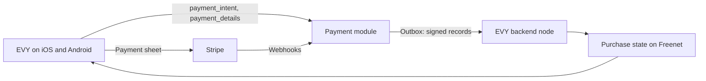
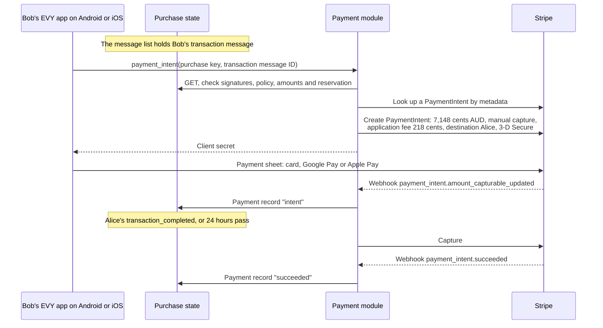

# 2.6 Payments

## Repositories

| Repository | Role | Work in this plan |
| --- | --- | --- |
| [evy](https://github.com/EVY-Platform/evy) | Modified | `api/src/modules/payment`: Stripe calls, webhooks, seller onboarding and withdrawals, card details and the signed payment records. `evy-txn-sig-v2` in `types/`. Payment record, dispute summary, payment key certificate and revocation payloads, with their contract checks, in `freenet/common/`. The payment sheet adapter in the SwiftUI and Compose readers. Financial policy 1 in `freenet/published/policy/` |
| [freenet-core](https://github.com/freenet/freenet-core) | Used | The EVY backend node that sends payment records |
| [freenet-stdlib](https://github.com/freenet/freenet-stdlib) | Used | [TypeScript client](https://github.com/freenet/freenet-stdlib/blob/7782c176a622efc3f284ce4710b4f184c4986405/typescript/src/websocket-interface.ts) for the backend node |
| [freenet-appkit](https://github.com/glesage/freenet-appkit) | Used | Swift package and Kotlin library in the EVY app |
| [stripe-ios](https://github.com/stripe/stripe-ios), [stripe-android](https://github.com/stripe/stripe-android) | Used | Payment sheets on iOS and Android, with Apple Pay and Google Pay |

## Purpose

EVY on iOS and Android takes Stripe payments for purchases stored in Freenet.

Example: Bob buys Alice's skateboard for 70 dollars under UI version 4 and policy 1.

- Bob pays 71.48 dollars in Stripe's payment sheet on his Android phone: the 70-dollar price plus a 1.48-dollar service fee that covers Stripe's card fee.
- Alice receives 69.30 dollars.
- Contributors share the full 0.70-dollar contributor fee.
- The payment module writes a signed payment record into the purchase, so both phones show the payment.

This plan builds `api/src/modules/payment` in EVY's shared TypeScript/Bun backend, with its own `payment` PostgreSQL schema. It reuses EVY's [payment procedures](https://github.com/EVY-Platform/evy/blob/d0fb7e6475f1dfc5c74325e37d4e92aed88d84ed/api/src/procedures/payments.ts) and [payment orchestration](https://github.com/EVY-Platform/evy/blob/d0fb7e6475f1dfc5c74325e37d4e92aed88d84ed/docs/services/marketplace/data.md#payment-orchestration).

On Bob's phone, the EVY delegate from [The EVY delegate in 2.4 SDUI data and actions](04-data-and-actions.md#the-evy-delegate) holds his buyer key. It signs his payment messages and his calls to the payment module.



## Service setup

Install the payment module before its first test charge:

- the `payment` schema, with the webhook inbox and the purchase-to-Stripe mapping
- the payment service key, held in the backend's key service
- an outbox store in the `payment` schema, for Stripe calls and Freenet sends

Every Stripe call and every signed record in this plan goes through the [outbox from 2.1 Hello EVY world](01-hello-evy-world.md#the-outbox). The module saves each entry in the same database transaction as its change.

- For a Freenet send, read-back GETs the purchase through a second node.
- For a Stripe call, read-back looks Stripe up by purchase key and operation ID in the metadata. The module always looks up first, because Stripe keeps [idempotency keys](https://docs.stripe.com/api/idempotent_requests) for only 24 hours.

## What the payment module needs from a purchase

The payment module works on any purchase that supplies the parts below. This plan tests it with fixture purchases built from the shared vectors.

| Part | Used for |
| --- | --- |
| Purchase key | Stripe metadata, the database mapping and the target for signed records |
| Purchase terms signed by Bob's buyer key: seller key, item, `amount_cents`, `service_fee_cents`, `fee_cents`, currency, `policy_version` and `policy_digest` | The PaymentIntent amounts |
| A message list signed by the payment service key, holding Bob's `transaction` message with his payment request | Proof that Alice accepted and Bob authorized the payment |
| Alice's `transaction_completed` or `transaction_rejected` message in that list | Capture or cancel |
| Confirmation that this purchase holds the item's reservation | Only one buyer pays for an item |
| Alice's connected Stripe account, found by her seller key | The destination of the charge |
| A purchase state that accepts records signed by a certified payment service key | Where payment records and dispute summaries go |

## Financial policy identity

The payment root key signs each financial policy. It is an offline hardware key, kept apart from the UI root key from [EVY signing keys in 2.1 Hello EVY world](01-hello-evy-world.md#evy-signing-keys). The policy is a `signed-register/1` record from [2.4 SDUI data and actions](04-data-and-actions.md) with domain `evy.service-policy/1`. Its `version` is the policy version.

Policy 1:

```jsonc
{
  "version": 1,                                  // policy 1
  "fee_rate_bp": 100,                            // contributor fee: 1% of the price
  "service_fee": { "card_rate_bp": 165, "card_fixed_cents": 30 }, // Stripe's domestic card fee, passed to the buyer
  "reservation_grace_seconds": 3600,             // a reservation lasts until one hour after the agreed pickup end
  "dispute_loss_payer": "seller",                // the seller pays for a lost dispute
  "dispute_contributor_hold": "while_open",      // contributor cents stay held while a dispute is open
  "lost_dispute_reverses_contributors": true,    // a lost dispute reverses contributor allocations
  "signature": "<payment root key>"
}
```

- `policy_digest` is the base58 BLAKE3 hash of the exact signed bytes.
- `evyctl` saves the signed policy in write-once storage under `freenet/published/policy/<hash>.json`, as [Write-once storage in 2.2 EVY UI contracts and publishing](02-ui-contracts.md#write-once-storage) defines.
- This plan adds two top-level fields to the UI document: `policy_version` and `policy_digest`. A UI version that takes payments names its policy there.
- Readers fetch the signed policy by digest with `payment_policy`. They check the payment root signature and the digest, then compute the fees.
- A purchase keeps the policy named by the UI version Bob used. A newer policy applies only to new purchases.

## Fees and seller accounts

Each sale is a Stripe [destination charge](https://docs.stripe.com/connect/destination-charges). Prices are in AUD, the one currency EVY's `toStripeAmount` accepts ([stripeGateway.ts](https://github.com/EVY-Platform/evy/blob/d0fb7e6475f1dfc5c74325e37d4e92aed88d84ed/api/src/procedures/stripeGateway.ts)). Alice's account is Australian like EVY's platform account, as destination charges require.

| Amount | Rule | Skateboard sale |
| --- | --- | --- |
| Price | Set by Alice | 70.00 |
| Contributor fee (`fee_cents`) | `fee_rate_bp` of the price, rounded half up | 0.70 |
| Service fee (`service_fee_cents`) | (price × card rate + card fixed fee) ÷ (1 − card rate), rounded up | 1.48 |
| Bob pays | Price + service fee | 71.48 |
| `application_fee_amount` | Contributor fee + service fee | 2.18 |
| Alice receives | Bob pays − `application_fee_amount` | 69.30 |
| Stripe's card fee | 1.65% + 0.30 dollars of 71.48 for an Australian card ([Stripe pricing](https://stripe.com/au/pricing), checked 2026-10-07). Stripe takes it from EVY's balance | 1.48 |
| Contributors | Application fee − Stripe's card fee | 0.70 |

Bob sees the price, the service fee and the total before he pays. When Stripe's actual card fee differs, for example for an international card, EVY's budget covers the difference. Contributors still get the full contributor fee.

Alice links her account once, before she lists her first item:

1. Alice taps "Get paid". Her app calls `seller_onboarding`, signed with her seller key.
2. The module creates a connected account with these settings, then an Account Link ([hosted onboarding](https://docs.stripe.com/connect/hosted-onboarding)):
   - `controller.fees.payer` and `controller.losses.payments` set to `application`
   - `controller.stripe_dashboard.type` set to `express`
   - `settings.payouts.schedule.interval` set to `manual`
3. EVY opens the link in `SFSafariViewController` on iOS and Custom Tabs on Android, because Stripe-hosted onboarding runs only in a browser.
4. Alice accepts EVY's seller terms. They make her liable for lost disputes on her sales.
5. When Stripe's `account.updated` webhook shows the account can take transfers, the module stores Alice's seller key with her account ID.

Alice's money stays in her Stripe balance until she withdraws it:

1. Alice taps "Withdraw". Her app calls `seller_withdraw`, signed with her seller key.
2. The module shows the amount after Stripe's monthly active-account fee: 2.00 dollars in each month in which Stripe pays Alice out ([Connect pricing](https://stripe.com/au/connect/pricing)).
3. The module deducts that fee from the withdrawal and creates one [payout](https://docs.stripe.com/connect/payouts-connected-accounts) for the rest. EVY pays Stripe's payout fee of 0.25% plus 0.25 dollars.

## Paying on a phone



| Step | Rule |
| --- | --- |
| Authorize | Bob taps "Item received" and pays at the pickup. The reader adds his `transaction` message to the purchase. The message holds his payment request, signed with his buyer key |
| Create the intent | `payment_intent` checks Bob's signature, the policy, the amounts and the reservation. It looks up Stripe for a PaymentIntent with this purchase key in its metadata, and creates one only when none exists. A repeated call returns the same client secret |
| Pay | Stripe's payment sheet runs on iOS and Android. It offers cards, Apple Pay on iOS and Google Pay on Android |
| Authenticate | Every card payment requests 3-D Secure (`payment_method_options.card.request_three_d_secure: any`). Apple Pay and Google Pay authenticate Bob on his phone |
| Hold | Stripe holds the funds. The module writes an `intent` record |
| Capture | Alice taps "Confirm" and her `transaction_completed` message reaches the purchase. The module captures and writes a `succeeded` record |
| Capture without Alice | After `transaction`, only Alice can answer. If she sends neither `transaction_completed` nor `transaction_rejected` within 24 hours, the module captures automatically |
| Cancel | Alice's `transaction_rejected` cancels the PaymentIntent and the hold. The module writes a `canceled` record |

- The reader's payment adapter runs this step for a `create(evy.messages, ...)` action whose data holds EVY's `payment_signature(...)` marker ([EVYPaymentSignature.swift](https://github.com/EVY-Platform/evy/blob/d0fb7e6475f1dfc5c74325e37d4e92aed88d84ed/ios/evy/Utils/EVYPaymentSignature.swift)). The EVY delegate from [2.4 SDUI data and actions](04-data-and-actions.md#the-evy-delegate) signs it with Bob's purchase-scoped buyer key.
- The reader calls the module over JSON-RPC 2.0 on a WebSocket, using EVY's service transport ([wsServer.ts](https://github.com/EVY-Platform/evy/blob/d0fb7e6475f1dfc5c74325e37d4e92aed88d84ed/types/wsServer.ts)). Each call is signed by Bob's buyer key over a fresh backend challenge.
- stripe-ios needs iOS 15 or later and stripe-android API 23 or later. Both fit EVY's iOS 17 and Android 9 floors from [The EVY app on iOS and Android in 2.1 Hello EVY world](01-hello-evy-world.md#the-evy-app-on-ios-and-android).
- Postgres maps the purchase key to its one PaymentIntent, following the `item_payment_intents` table in Marketplace ([paymentIntents.ts](https://github.com/EVY-Platform/evy/blob/d0fb7e6475f1dfc5c74325e37d4e92aed88d84ed/services/marketplace/src/paymentIntents.ts)).
- The EVY backend node subscribes to each purchase the module charges. It sends each payment record through the outbox, so the purchase updates even when Bob closes EVY.
- A card hold usually lasts 7 days ([place a hold](https://docs.stripe.com/payments/place-a-hold-on-a-payment-method)). The 24-hour automatic capture happens well before it ends.

### Retrying a card payment

A declined card returns the PaymentIntent to `requires_payment_method` ([PaymentIntent lifecycle](https://docs.stripe.com/payments/paymentintents/lifecycle)). Bob can try again.

| Step | What happens |
| --- | --- |
| 1. Choose | Bob taps "Try again". EVY reopens the payment sheet for the same purchase |
| 2. Resume | The reader calls `payment_intent` with the same purchase key and `transaction` message ID. The module checks that the purchase still holds the reservation and returns the same PaymentIntent's client secret |
| 3. Confirm | Bob picks another card or wallet. Stripe runs 3-D Secure for a card |
| 4. Hold | The module writes an `intent` record at a higher purchase revision |
| 5. Capture | Alice confirms the handover, or 24 hours pass. The module captures once and writes `succeeded` |

The record sequence is `failed → intent → succeeded`. A retry reuses Bob's original `transaction` message and payment request, so the message list does not grow.

## The payment record

The backend ledger keeps EVY's transaction signature trail: a SHA-256 hash of the amount, currency, authorizing message, time, provider and the card's last 4 digits ([transaction-signature-trail.md](https://github.com/EVY-Platform/evy/blob/d0fb7e6475f1dfc5c74325e37d4e92aed88d84ed/docs/plans/transaction-signature-trail.md), [paymentSignature.ts](https://github.com/EVY-Platform/evy/blob/d0fb7e6475f1dfc5c74325e37d4e92aed88d84ed/types/paymentSignature.ts)). This plan adds two signed parts:

1. Bob's payment request, in `data.signature` of his `transaction` message, under the scheme `evy-txn-sig-v2`. Its canonical string holds the amount Bob pays, the service fee, the contributor fee, currency, message ID, `created_at`, provider, purchase key, UI version and digest, and policy version and digest. Bob's buyer key signs its hash.
2. The payment record, a `signed-register/1` record with domain `evy.payment/2`, signed by the payment service key.

```jsonc
{
  "purchase": "7HqK...",                    // purchase key
  "version": 6,                             // the purchase revision, see below
  "messages_hash": "Fp2c...",               // hash of the message list holding Bob's transaction message
  "authorization_message_id": "b2e0...",    // Bob's transaction message, EVY's field name
  "request_hash": "3b9e...",                // hash of Bob's evy-txn-sig-v2 payment request
  "status": "succeeded",                    // failed, intent, succeeded, canceled or refunded
  "amount_cents": 7000,                     // item price
  "service_fee_cents": 148,                 // covers Stripe's card fee
  "fee_cents": 70,                          // contributor fee
  "currency": "AUD",
  "refunded_cents": 0,                      // price refunded to Bob so far
  "fee_refunded_cents": 0,                  // contributor fee taken back for those refunds
  "policy_version": 1,
  "policy_digest": "9a2f...",
  "signer": "Rk9v...",                      // payment service key
  "signature": "MEUC..."
}
```

- Card details, including the last 4 digits, stay in the backend. The purchase state holds no card data.
- `messages_hash` ties the record to the message list. The backend outbox and write-once storage keep the full bytes of every list it refers to.
- The purchase revision is one counter per purchase in the module's Postgres. It rises by one for every record the payment service key signs for that purchase: message lists, payment records and dispute summaries.
- A purchase keeps the payment record with the highest `(version, hash)`, the `signed-register/1` order. Delivery order does not matter.

| Current Stripe state | Signed status |
| --- | --- |
| A declined attempt awaiting another payment method | `failed` |
| Funds held, awaiting capture | `intent` |
| Captured, with no refund or a partial refund | `succeeded` |
| PaymentIntent canceled | `canceled` |
| Captured, and refunds equal `amount_cents` | `refunded` |

The purchase contract runs the checks in `freenet/common/` on each record:

- the signature, the signer's certificate and any revocation, from [Payment signing-key revocation](#payment-signing-key-revocation)
- `0 <= refunded_cents <= amount_cents` and `0 <= fee_refunded_cents <= fee_cents`, in integer cents
- records before capture have zero refund totals
- `succeeded` has `refunded_cents < amount_cents`; `refunded` has `refunded_cents == amount_cents`

### Webhooks

The module checks webhooks with EVY's existing handler ([stripeWebhookHttp.ts](https://github.com/EVY-Platform/evy/blob/d0fb7e6475f1dfc5c74325e37d4e92aed88d84ed/api/src/shared/stripeWebhookHttp.ts)). It handles:

- `payment_intent.amount_capturable_updated`, `payment_intent.succeeded`, `payment_intent.payment_failed` and `payment_intent.canceled`
- `charge.refunded`, `refund.created`, `refund.updated`, `refund.failed` and `transfer.reversed`
- `charge.dispute.created`, `charge.dispute.updated`, `charge.dispute.closed`, `charge.dispute.funds_withdrawn` and `charge.dispute.funds_reinstated`

Stripe can send duplicate events and events out of order ([webhook delivery](https://docs.stripe.com/webhooks#event-ordering)). So each event only starts a reconciliation:

1. Postgres drops an event ID it has already seen.
2. The module locks the purchase, so reconciliations run one at a time per purchase.
3. It reads the current PaymentIntent, charge, refunds, transfer reversals and disputes from Stripe.
4. If the result differs from the last record, it signs a new record at the next purchase revision. It saves the record in the outbox in the same transaction.
5. It raises an internal event with the purchase key for the other backend modules.

A failed or partial Stripe read leaves the reconciliation pending, and the module tries again. Stripe charge, refund, transfer and dispute IDs stay in Postgres.

### Card details

Bob's card details stay in the backend. `payment_details(purchase key)`, signed by Bob's buyer key, returns his card brand and last 4 digits for display. Support recomputes `request_hash` and asks Bob for his card's last 4 digits, following EVY's support flow ([data.md](https://github.com/EVY-Platform/evy/blob/d0fb7e6475f1dfc5c74325e37d4e92aed88d84ed/docs/evy/data.md#data_evy_transaction)).

### Payment signing-key revocation

The payment root certifies one payment service key at a time. Purchase contracts compile in the payment root's public key.

| Record | Signed by | Fields |
| --- | --- | --- |
| `evy.payment-key/1` certificate | Payment root | Payment service key and the time it starts |
| `evy.payment-revocation/1` | Payment root | Revoked key K, the target (a purchase key) and the last trusted revision R |

- Each purchase state carries the certificate of every key that signed its records.
- Any other state that holds payment service key records uses the same two records, with its own target and revision counter.
- A record is valid when its signer has a certificate in the state and no revocation in the state covers it.
- A revocation covers every record signed by key K with a purchase revision above R.

When the payment service key leaks:

1. The module stops signing.
2. The payment root signs a certificate for a new key, and one revocation for each affected purchase. Each revocation names that purchase's last trusted revision.
3. The outbox sends each revocation into its purchase. The contract checks it with the payment root key alone, with no lookup of another contract.
4. The module re-signs the genuine records after R with the new key, from its database, at higher purchase revisions.
5. Peers drop records signed by K after R and keep the re-signed ones.

## Refunds

Before capture, Alice's `transaction_rejected` releases the hold. The money stays on Bob's card.

After capture, the EVY operator refunds with `payment_refund`. Refunds return the price. EVY keeps the service fee, because Stripe keeps its card fee.

| Step | Rule |
| --- | --- |
| Request | `payment_refund` takes the purchase key, a refund operation ID and `amount_cents`, up to the price not yet refunded. A changed amount under the same operation ID fails |
| Refund Bob | The module looks up Stripe for a refund with this operation ID in its metadata. It creates the [refund](https://docs.stripe.com/api/refunds/create) only when none exists. Destination charge refunds come from EVY's balance |
| Recover from Alice | The contributor share of the refund is `fee_cents × amount ÷ price`, rounded half up. The module reverses Alice's transfer by the rest of the refund ([transfer reversals](https://docs.stripe.com/api/transfer_reversals/create)). It looks up an existing reversal with this operation ID first |
| Record | The module writes the new cumulative `refunded_cents` and `fee_refunded_cents` |

The operator refunds only through `payment_refund`, so every refund has both steps.

Example: a 35.00-dollar refund of the skateboard.

- Bob receives 35.00 dollars.
- Alice's transfer is reversed by 34.65 dollars.
- The contributor fee loses 0.35 dollars.
- The record shows `refunded_cents: 3500` and `fee_refunded_cents: 35`. The status stays `succeeded`.

A later refund of the other 35.00 dollars raises the totals to 7000 and 70, and the status becomes `refunded`.

## Card disputes

Card disputes follow Stripe's deadlines and the [Disputes API](https://docs.stripe.com/disputes/api), checked 14 October 2026. Stripe takes the disputed amount and its dispute fee from EVY's balance when a dispute opens.

| Outcome | What the module does |
| --- | --- |
| Open | Records the dispute. Contributor cents for the purchase stay held while it is open |
| Won | Records the reinstated funds. The hold ends |
| Lost | Reverses Alice's transfer for the lost amount less the contributor fee, up to what the transfer allows. The contributor allocations are reversed. Alice owes any remainder, including Stripe's dispute fee, under the seller terms. EVY covers only what it cannot recover from her |

Each change writes a public `evy.dispute-summary/1` record into the purchase. It is a `signed-register/1` record signed by the payment service key, at the next purchase revision:

```jsonc
{
  "purchase": "7HqK...",
  "version": 8,                 // purchase revision
  "status": "lost",             // open, won or lost
  "disputed_cents": 7148,
  "lost_cents": 7148,
  "recovered_from_seller_cents": 7078,
  "signer": "Rk9v...",
  "signature": "..."
}
```

The dispute evidence that EVY submits to Stripe stays private in the backend. iOS and Android readers show the dispute status next to the payment and refund amounts.

## Store payment rules

EVY takes payment only for physical goods and services used outside the app, such as Alice's skateboard. Both stores require these payments to use a method outside their own billing, so EVY on iOS and Android takes them through Stripe's payment sheet. EVY's App Store privacy details and Play data safety form list the card details Stripe collects.

| Store | Rule for physical goods |
| --- | --- |
| App Store | [App Review Guidelines](https://developer.apple.com/app-store/review/guidelines/) 3.1.3(e), "Goods and Services Outside of the App", requires methods outside in-app purchase, such as Apple Pay or card entry |
| Google Play | [Payments policy](https://support.google.com/googleplay/android-developer/answer/9858738) section 3 requires payments primarily for physical goods to use a method outside Google Play billing |

## Acceptance

These tests use fixture purchases from the shared vectors and Stripe test mode.

- Shared vectors give the same results in Rust, Swift, Kotlin and TypeScript for `evy-txn-sig-v2`, the payment record, the dispute summary, the certificate and the revocation. Follow the pattern in EVY's [paymentSignature.test.ts](https://github.com/EVY-Platform/evy/blob/d0fb7e6475f1dfc5c74325e37d4e92aed88d84ed/api/src/tests/paymentSignature.test.ts) and [EVYPaymentSignatureTests.swift](https://github.com/EVY-Platform/evy/blob/d0fb7e6475f1dfc5c74325e37d4e92aed88d84ed/ios/evyTests/EVYPaymentSignatureTests.swift).
- On iOS and Android, Alice links a connected account in the browser and accepts the seller terms. Her account has a manual payout schedule.
- On iOS and Android, Bob pays for the skateboard fixture in the payment sheet, once with a test card and once with Apple Pay on iOS and Google Pay on Android. The run checks the Stripe objects:
  - the PaymentIntent is 7,148 cents and requests 3-D Secure
  - the application fee object is 218 cents
  - Alice's net from the charge is 6,930 cents
  - Stripe's fee on the balance transaction is about 148 cents, so EVY's net from the sale is 70 cents
- A 3-D Secure test card completes inside the payment sheet on iOS and Android. Closing EVY during payment and reopening it shows the payment record from the purchase.
- Alice's `transaction_completed` captures once. With the backend clock 24 hours past `transaction` and no answer from Alice, the module captures automatically. `transaction_rejected` cancels the hold and the record shows `canceled`.
- `payment_intent` fails before any Stripe call for: a bad buyer signature, a purchase without the reservation, a wrong policy, amount or fee, and a seller with no connected account.
- Bob's first card is declined. He taps "Try again" and pays with a valid card. The same PaymentIntent produces `failed → intent → succeeded` at rising purchase revisions.
- Duplicate, delayed and reordered webhooks produce the same final record. Peers that receive record revisions in different orders keep the same record.
- Look-up-first: replay a PaymentIntent, refund and transfer-reversal request after its idempotency key has expired. Stripe holds one of each.
- Refund 35.00 dollars, then the rest. Totals go 3500 and 35, then 7000 and 70. The status goes `succeeded`, then `refunded`. Alice's transfer reversals total 69.30 dollars.
- A test dispute that is lost reverses Alice's transfer and shows `lost` in the dispute summary. A won dispute ends the hold.
- `payment_details` returns the card's last 4 digits to Bob's signed call only. No purchase state holds card data.
- Revocation drill: the payment root revokes a test key K with cutoff R. The contract checks drop K's records after R and accept the re-signed records.
- A purchase under policy 1 keeps policy 1 amounts after a fixture policy 2 is signed.
- Alice withdraws her balance. The payout equals her balance less the monthly active-account fee.
