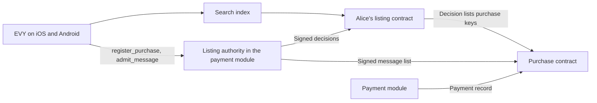

# 2.7 EVY Marketplace

## Repositories

| Repository | Role | Work in this plan |
| --- | --- | --- |
| [evy](https://github.com/EVY-Platform/evy) | Modified | The listing contract in `freenet/contracts/listing/`, the purchase contract in `freenet/contracts/purchase/` and the photo contract in `freenet/contracts/photo/`. The search index as a collection instance. The listing authority role in `api/src/modules/payment`. `listing/1`, `purchase/2`, `purchase-messages/2`, `address/1` and `file/1` adapters in the SwiftUI and Compose readers. UI versions 3 and 4 in `freenet/ui/evy.json`. Marketplace lookups and the seller list, sent with `evyctl lookups publish`. Report, Block and terms flows |
| [freenet-core](https://github.com/freenet/freenet-core) | Used | Node, `fdev execute` for `evyctl`, `fdev verify-merge`, and the EVY backend node that hosts Marketplace contracts |
| [freenet-stdlib](https://github.com/freenet/freenet-stdlib) | Used | Contract interface |
| [freenet-appkit](https://github.com/glesage/freenet-appkit) | Used | Swift package and Kotlin library in the EVY app |

## Purpose

Marketplace is a feature inside the EVY app. This plan builds its contracts and flows and runs the skateboard sale end to end on Freenet:

- one listing contract per seller
- one search index for all of EVY
- one purchase contract per purchase, with one message list signed by the payment service key
- the listing authority: the payment module's role that accepts requests, holds one reservation per item and permits one sale
- UI version 3, the Marketplace test item: a test page that binds `marketplace.items` to a test listing contract. This plan's contract tests use it
- UI version 4, the Marketplace flows and Home search

UI version 4 adds these flows to the one signed EVY UI document:

- Home search, with the "For you", "From you" and "Scheduled" tabs and the "Sell something" button
- "View Item", where a buyer reads an item and asks to buy it
- "Create item", where a seller lists an item

This plan uses:

- stable routes from [Application routes and compatible updates in 2.2 EVY UI contracts and publishing](02-ui-contracts.md#application-routes-and-compatible-updates)
- `signed-register/1`, the collection contract and resource bindings from [2.4 SDUI data and actions](04-data-and-actions.md)
- the EVY delegate from [The EVY delegate in 2.4 SDUI data and actions](04-data-and-actions.md#the-evy-delegate), for keys, signing, sealing, the address book and pending operations
- the payment module, payment records and payment key revocation from [2.6 Payments](06-payments.md)

Example: Alice lists her skateboard for 70 dollars on her iPhone. Bob finds it in Home search on his Android phone, asks to pick it up on Saturday and pays 71.48 dollars in Stripe's payment sheet. The sale runs under UI version 4 and policy 1. Both phones show `available`, `pickup_pending` and `sold`, and an independent peer reads the same item and purchase.



## What is cloned

| Marketplace component | On Freenet |
| --- | --- |
| Items, `marketplace.items` ([item.schema.json](https://github.com/EVY-Platform/evy/blob/d0fb7e6475f1dfc5c74325e37d4e92aed88d84ed/services/marketplace/src/schema/item.schema.json)) | Each seller's items live in that seller's [listing contract](#the-listing-contract). Items keep EVY's item schema |
| Item search | `marketplace.search`, the [search index](#the-search-index) |
| Lookups: `selling_reasons`, `conditions`, `durations` and `areas` ([lookup.schema.json](https://github.com/EVY-Platform/evy/blob/d0fb7e6475f1dfc5c74325e37d4e92aed88d84ed/services/marketplace/src/schema/lookup.schema.json)) | One lookups contract, signed by EVY's publishing key and seeded from [service_data.json](https://github.com/EVY-Platform/evy/blob/d0fb7e6475f1dfc5c74325e37d4e92aed88d84ed/scripts/fixtures/services/service_data.json). It also holds the seller list |
| Item statuses, `marketplace.item_statuses` ([status.ts](https://github.com/EVY-Platform/evy/blob/d0fb7e6475f1dfc5c74325e37d4e92aed88d84ed/services/marketplace/src/status.ts)) | Readers derive them under [Item availability](#item-availability) |
| Requests and replies, `evy.messages` ([purchase.ts](https://github.com/EVY-Platform/evy/blob/d0fb7e6475f1dfc5c74325e37d4e92aed88d84ed/services/marketplace/src/purchase.ts)) | Signed messages in each [purchase contract](#the-purchase-contract) |
| Payment calls and `item_payment_intents` ([payments.ts](https://github.com/EVY-Platform/evy/blob/d0fb7e6475f1dfc5c74325e37d4e92aed88d84ed/services/marketplace/src/payments.ts)) | `api/src/modules/payment` from [2.6 Payments](06-payments.md) |
| Pickup address, `evy.addresses` | Alice's private address book in her EVY delegate. Her `accept` message carries a copy sealed to Alice and Bob |
| Photos, `evy.files`, named in `photo_ids` | One immutable [photo contract](#photo-contracts) per JPEG |
| "View Item" flow (page "Item details") and "Create item" flow (pages "Create listing", "Describe item", "Pickup and delivery" and "Payment options") ([service_sdui.json](https://github.com/EVY-Platform/evy/blob/d0fb7e6475f1dfc5c74325e37d4e92aed88d84ed/scripts/fixtures/services/service_sdui.json)) | Flows in the EVY UI document, published with `evyctl ui publish` |
| Home search, tabs and "Sell something" ([evy_sdui.json](https://github.com/EVY-Platform/evy/blob/d0fb7e6475f1dfc5c74325e37d4e92aed88d84ed/scripts/fixtures/evy/evy_sdui.json)) | Home rows in the same document. Search results open `marketplace.view-item`; "Sell something" opens `marketplace.create-item`; Marketplace returns through `entry` |
| Checks on items and messages ([validation.ts](https://github.com/EVY-Platform/evy/blob/d0fb7e6475f1dfc5c74325e37d4e92aed88d84ed/services/marketplace/src/validation.ts), purchase.ts) | Contract checks, under [Record rules in 2.4 SDUI data and actions](04-data-and-actions.md#record-rules) |

## Contracts

| Contract | Parameters | Holds | Writers |
| --- | --- | --- | --- |
| Listing contract | Alice's Marketplace seller key, and the text `marketplace.items` | Alice's items, one listing decision per item and removal markers | Alice writes items. The listing authority writes decisions. EVY's publishing key writes removal markers |
| Search index | The UI root key, and the text `marketplace.search` | One entry per listed item | Anyone. EVY's publishing key removes entries |
| Purchase contract | 80 bytes: seller key, buyer purchase key and purchase ID (16 UUID bytes) | Buyer-signed terms, the message list, the payment record and the dispute summary | Bob writes the terms. The payment service key writes the rest |
| Photo contract | The JPEG's BLAKE3 hash | The JPEG | The seller's app, once. The state never changes |

- The listing and purchase contracts compile in the UI root key and the payment root key. They accept removal markers only from certified publishing keys, and service records only from certified payment service keys.
- The seller key is Alice's EVY key for the `marketplace` feature. Bob's EVY delegate derives his buyer key with `GetPublicKeys { feature: "marketplace", scope: "purchase:<purchase ID>" }`, so each purchase has its own key.
- The iOS and Android apps create purchase IDs as UUIDs, following EVY's message-ID generation ([EVY+Mutations.swift](https://github.com/EVY-Platform/evy/blob/d0fb7e6475f1dfc5c74325e37d4e92aed88d84ed/ios/evy/Core/EVY+Mutations.swift)).
- Every signed state and record uses `signed-register/1`. This plan names only domains and payload fields.
- Contracts limit only the size of the whole state, under Core's 50 MB limit.

### The listing contract

| Part | Domain | Payload |
| --- | --- | --- |
| Item | `evy.record/1 marketplace.items`, signed by Alice | EVY's item schema fields, `photo_ids` and `address_id` |
| Decision | `evy.listing-decision/1`, signed by the payment service key | The decision fields below |
| Removal marker | `evy.removal/1 marketplace.items`, signed by a publishing key | The removed item ID |

| Decision field | Holds |
| --- | --- |
| `item_id` | The item |
| `version` | One counter per item |
| `live` | Purchase keys of open requests |
| `reserved` | One purchase key or none |
| `queue` | Accepted requests waiting, oldest acceptance first |
| `reservation_deadline` | When the reservation ends |
| `sold` | One purchase key or none |

- For each item, the higher `(version, hash)` wins, separately for items and decisions.
- A removal marker beats the item with the same ID.
- `update_state` refuses a decision that clears `sold`. A sale closes the item for good.
- The state also holds payment key certificates and revocations from [Payment signing-key revocation in 2.6 Payments](06-payments.md#payment-signing-key-revocation). A revocation for a decision names the item and its last trusted decision version.

### The search index

The search index is an instance of the [collection contract from 2.4 SDUI data and actions](04-data-and-actions.md#the-collection-contract). It follows the collection rules:

- Anyone may write. There is no per-author cap.
- When the state is full, the newest entries by `created_at` stay.
- A publisher removal frees its space.

An entry holds `listing` (the listing contract key), `item_id`, `title`, `price_cents`, `area` and the first photo ID. Alice's app writes the entry when she lists an item and updates it when she edits the item.

Readers show an entry only when it matches the listing contract: the entry's author is the listing's seller, and the item exists, is not removed and is not sold.

### The purchase contract

Bob signs the terms when he asks to buy:

```jsonc
{
  "resource": "marketplace.items",
  "fk": "4f1c6a0e-2b7d-4c1e-9a55-0d8e3f6b2a91",        // item ID, EVY's fk
  "listing": "6tVb...",                                // Alice's listing contract key
  "application_key": "<ui.evy contract key>",
  "feature": "marketplace",
  "ui_version": 4,
  "ui_digest": "3b9e...",                              // hash of the exact UI document Bob used
  "policy_version": 1,
  "policy_digest": "9a2f...",
  "runtime_context": {                                // filled in by the native host
    "platform": "android",                             // ios or android
    "build": 413,                                      // build number or versionCode
    "artifact_digest": "7Hq3...",                      // digest of that build
    "contracts": "<exact binding identities>"          // resolved contract identities
  },
  "type": "pickup",                                    // EVY's transfer type
  "amount_cents": 7000,                                // the item's price
  "service_fee_cents": 148,                            // covers Stripe's card fee
  "fee_cents": 70,                                     // contributor fee
  "currency": "AUD",
  "version": 1,
  "signature": "pX3a..."                               // Bob's buyer key, domain evy.purchase/1
}
```

- `runtime_context` records the reader that made the purchase: its platform, build and artifact digest, and the resolved contract identities.
- The trusted native host fills in `runtime_context`, outside any SDUI-controlled field. Bob's signature covers it.
- The terms never change. Changed terms need a new purchase.

### Photo contracts

Each photo has an immutable contract:

- Its parameter is the JPEG's BLAKE3 hash. Its state is the JPEG. The contract rejects bytes that do not match the hash.
- The iOS and Android apps keep each photo below 1 MiB, so peers can fetch it from a phone behind NAT ([#5643](https://github.com/freenet/freenet-core/issues/5643)).
- `photo_ids` holds the contract keys. Each phone caches the JPEG.
- The iOS adapter reuses [EVYFileRPC.swift](https://github.com/EVY-Platform/evy/blob/d0fb7e6475f1dfc5c74325e37d4e92aed88d84ed/ios/evy/Data/API/EVYFileRPC.swift) and [EVYFileCache.swift](https://github.com/EVY-Platform/evy/blob/d0fb7e6475f1dfc5c74325e37d4e92aed88d84ed/ios/evy/Data/EVYFileCache.swift). The Android adapter matches them.
- [seed-files](https://github.com/EVY-Platform/evy/tree/d0fb7e6475f1dfc5c74325e37d4e92aed88d84ed/scripts/fixtures/services/seed-files) supplies fixtures.

## The message list and status

### The message list

Each purchase holds one message list, signed by the payment service key:

```jsonc
{
  "purchase": "7HqK...",
  "version": 5,                      // purchase revision, shared with payment records and dispute summaries
  "terms_hash": "Qm1x...",           // hash of Bob's signed terms
  "messages": [                      // each signed by its author under evy.message/1
    { "id": "...", "parent": null,  "value": "pending",               "by": "buyer"  },
    { "id": "...", "parent": "...", "value": "accept",                "by": "seller" },  // data holds the sealed address
    { "id": "...", "parent": "...", "value": "transaction",           "by": "buyer"  },  // data.signature holds the payment request
    { "id": "...", "parent": "...", "value": "transaction_completed", "by": "seller" }
  ],
  "signer": "Rk9v...",
  "signature": "..."
}
```

- The list holds at most 16 messages and 64 KiB. The skateboard sale uses 4.
- The contract checks the list's signature and `terms_hash`, each author's signature against the seller and buyer parameters, parent order and each transition in the status table below.
- The highest `(version, hash)` wins. Only the listing authority writes the list, so a purchase has one status at any time.
- Payment records refer to the list by `messages_hash`. The payment module's [outbox](06-payments.md#service-setup) and write-once storage keep the full bytes of every list.

### Purchase status

Status follows EVY's purchase status machine ([purchase.ts](https://github.com/EVY-Platform/evy/blob/d0fb7e6475f1dfc5c74325e37d4e92aed88d84ed/services/marketplace/src/purchase.ts)), the message list and the latest payment record.

| Message | Author | Allowed when | Status after it | Payment module |
| --- | --- | --- | --- | --- |
| `pending` | Bob | First message | `available` | Nothing |
| `accept` | Alice | After `pending` | `pickup_pending` | The listing authority reserves the item, or queues the purchase |
| `reject` | Alice | Before `transaction` | `available` | Releases any reservation |
| `cancel` | Alice or Bob | Before `transaction` | `available` | Releases any reservation |
| `transaction` | Bob | This purchase holds the reservation | `pickup_pending` | Creates the PaymentIntent when Bob's app calls `payment_intent` |
| `transaction_completed` | Alice | After `transaction` | `sold` once the payment record is `succeeded` | Captures |
| `transaction_rejected` | Alice | After `transaction` | `available` | Cancels the PaymentIntent and releases the reservation |

- After `transaction`, only Alice may write. If she writes nothing within 24 hours, the payment module captures and the status becomes `sold`.
- A `failed` payment record keeps `pickup_pending` while Bob retries. A `canceled` record sets `available`.
- A partial refund keeps `sold`. A full refund sets `refunded`, as [Refunds in 2.6 Payments](06-payments.md#refunds) describes.

### Item availability

Readers derive each item's availability from the listing authority's decision and from the sale's payment record. The reader uses the first matching row:

| Evidence | Availability | Reader shows |
| --- | --- | --- |
| A sale record exists. Its latest payment record has no refund or a partial refund | `sold` | Hidden from search. Participants see the sale and any refund amount |
| A sale record exists. Its latest payment record has a full refund | `refunded` | The listing stays closed. Participants see the refund |
| A sale record exists, but its payment record is not read yet | `sold` | The listing stays closed, with "Payment details refreshing" |
| The decision reserves one purchase, including a declined card awaiting retry | `pickup_pending` | The reservation and its purchase. Other accepted requests show "Another request is reserved" and wait their turn |
| The decision is missing or fails its checks | Unknown | "Availability unknown", with a refresh action |
| The decision has no reservation and no sale | `available` | The listing in search, with "Request". At the request limit it shows "Requests full" |

- A sale closes the listing for good, through refunds and seller edits. To sell again after a refund, Alice lists a new item.
- Offline views show when the purchase state was last read, and refresh on reconnect.

## Listing authority and reservations

The listing authority runs in the payment module and signs with the payment service key. Callers sign each call with their seller or buyer key.

| Call or event | Rule |
| --- | --- |
| `register_listing` | Checks that the seller is `admitted` on the seller list and has a connected Stripe account. Saves a copy of the listing contract in the hosting inventory. Signs decision version 1 with no requests, no reservation and no sale |
| `register_purchase` | Checks Bob's terms against the item, the policy and the UI document. Checks Bob's buyer enrollment: one live request per enrolled buyer per item, and at most 32 live requests per item. Signs message list revision 1 with the `pending` message. PUTs the purchase state and adds the purchase key to the decision's `live` list |
| `admit_message` | Locks the purchase. Checks the author's key, the parent, the transition and the list limit. Appends the message, signs the next revision and returns the signed list |
| Reservation | On `accept`, reserves the item for this purchase when no reservation exists. Otherwise appends the purchase to `queue` |
| Release | `reject`, `cancel`, `transaction_rejected`, a canceled PaymentIntent or a passed deadline ends the reservation. It passes to the first purchase in `queue`, oldest acceptance first |
| Deadline | The agreed pickup end time plus the policy's `reservation_grace_seconds`, 3,600 in policy 1. The deadline applies only before `transaction` |
| One sale | Postgres holds one sale key per item. The module captures only for the reserved purchase. After `succeeded`, the decision sets `sold` |
| Uncertain Stripe result | The reservation stays until a Stripe look-up shows the PaymentIntent canceled or captured |

- Every signed list and decision goes through the payment module's outbox, so it reaches Freenet even when both apps are closed.
- A refusal returns a reason, such as "Requests full" or "Message limit reached". The reader keeps the draft and shows the reason.
- After a database restore, the listing authority looks up Stripe and reads the hosted listing and purchase contracts before it accepts new work.

## Flows

The UI document's `resources` map binds `marketplace.items`, `marketplace.search`, `evy.purchases`, `evy.messages`, `evy.addresses` and `evy.files`, following [Resource bindings in 2.4 SDUI data and actions](04-data-and-actions.md#resource-bindings). Matching iOS and Android readers draw the flows. Home and Marketplace read the same rows and route each action to the same purchase.

### Shared resources

| Resource | In Home and Marketplace |
| --- | --- |
| `evy.purchases` | One purchase row with its item, purchase key, terms, derived status, latest payment record and dispute summary. Either view opens the same purchase and shows the same status |
| `evy.messages` | One row per message, with its purchase key, ID, parent, author role and data. Actions sign with the actor's buyer or seller key |
| `evy.addresses` | `address/1`. Create item saves Alice's address in her private address book and keeps its `address_id` in the item. Her `accept` message seals a copy to Alice and to Bob's purchase key, bound to the feature, resource, purchase key and message ID. `Open` checks that binding |
| `evy.files` | `file/1`. Photo selection, checks, publication, caching and fetch use one adapter in each reader. The item's signed `photo_ids` supply the references |

### Purchase operations

The adapters run in both readers and use the messages from [Ordinary messages in 2.4 SDUI data and actions](04-data-and-actions.md#ordinary-messages).

| Operation | Binding | What the adapter does |
| --- | --- | --- |
| Discover | Search results and "For you" | Search index entries lead to listing contracts. A decision's `live`, `reserved` and `sold` keys lead to purchases. Alice's app subscribes to her listing contract, so it sees new requests while open |
| Request pickup | `create(evy.purchases, ...)` with the item reference and pickup time | Makes the purchase UUID and gets Bob's buyer key. Derives the contract key. Signs the terms and the `pending` message with `SignRecord`. Calls `register_purchase`. The row shows "Sending" until the purchase state holds the list |
| Accept, reject, cancel, pay and handover | `create(evy.messages, ...)` with the `purchase_key` and the parent message ID | Signs the message with `SignRecord` and calls `admit_message`. The row shows "Sending" until the purchase state holds it |
| Retry | The same action | A pending operation keeps its UUID, keys, parameters and signed bytes. A retry sends the same bytes, so a repeat returns the saved result. `runtime_context` stays the same |
| Latest request or message by item and type | Select by purchase key and role | Buyers see their own purchases. Sellers see every request for their items |
| Status | Home's `marketplace.item_statuses` binds to the derived status | Uses [Item availability](#item-availability) |
| Pickup address | Create item saves `evy.addresses`. Acceptance finds `address_id` | The address book holds the address before any purchase. Acceptance seals a copy into the `accept` message |
| Pay | A `transaction` message for the reserved purchase | Opens the payment sheet, as in [Paying on a phone in 2.6 Payments](06-payments.md#paying-on-a-phone) |
| Card details | Bob's purchase view | Calls `payment_details` from [Card details in 2.6 Payments](06-payments.md#card-details) |

## Moderation and seller admission

The moderators are named in the README. The support page states the report response time, a 14-day buyer dispute window after pickup and a 7-day moderation decision window.

| Record | Where it lives | Signed by |
| --- | --- | --- |
| Seller list, `marketplace.sellers` | The lookups contract, public. One entry per seller key: enrollment ID, status (`admitted` or `suspended`) and the time it starts | EVY's publishing key, through `evyctl` |
| Report | The authenticated backend reports endpoint, private. See [Reports](#reports) | The reporter's feature key |
| Removal | A removal marker in the target's contract: the item in the seller's listing contract, or its entry in the search index. A removed item hides its photos | EVY's publishing key, through `evyctl record remove` |

Seller admission:

1. Alice proves her seller key with a signed backend challenge.
2. She links her Stripe account, as [Fees and seller accounts in 2.6 Payments](06-payments.md#fees-and-seller-accounts) describes.
3. She accepts the seller terms. They make her liable for lost disputes on her sales.
4. The operator adds her key to the seller list as `admitted`.

- The listing authority checks the seller list before it accepts a listing or a new request.
- Suspension stops new listings and requests. Existing purchases, payments, refunds and sale records continue.
- Suspending a seller publishes a new seller list with that entry set to `suspended`.
- Bob accepts the buyer terms before his first request. The backend records the terms version and time for each user.

## Reports

A report names a target (an item, a photo or a purchase message), a reason (`prohibited`, `scam`, `offensive` or `other`) and optional details. The reader signs it with the reporter's feature key and sends it to the backend reports endpoint. Reports never appear in public contract state.

| What users write | Report and Block |
| --- | --- |
| Item details, description and photos | Report the content. Block the seller's key. Home search and Marketplace hide removed and blocked content |
| Purchase requests and messages | Report the message. Block its author's purchase key. The purchase keeps its status, receipts and dispute access |

- Each user's block list stays private on their phone. A purchase-scoped block covers only that purchase.
- Moderators read and resolve reports in the backend with their own credentials. Refunds use `payment_refund` from [Refunds in 2.6 Payments](06-payments.md#refunds).

```text
evyctl lookups publish --feature marketplace lookups.json
evyctl lookups publish --feature marketplace sellers.json
evyctl record remove marketplace.items <item-id> --seller <seller-key> --reason scam
evyctl record remove marketplace.search <entry-id> --reason scam
```

Each command builds and signs the state with the publishing key and sends it through the [outbox from 2.1 Hello EVY world](01-hello-evy-world.md#the-outbox).

## Pilot hosting

EVY's backend node keeps Marketplace data hosted:

- It subscribes to every listing contract, the search index, every live purchase and every photo of a live listing.
- It saves a copy of each one in the hosting bucket before the user sees it as accepted. This list of saved copies is the hosting inventory.
- It keeps purchases hosted for the 14-day dispute window after pickup, and photos for as long as their listing.
- Its hourly readback check PUTs a saved copy again when the network has lost it or holds an older one.

## Pilot enrollment

The pilot runs in Sydney, in AUD.

- Sellers are on the seller list.
- The operator issues one buyer enrollment to each verified buyer.
- Each enrolled buyer may hold one live request per item, across all of their purchase keys.
- Set hosting storage, repair alarms and retention periods before the pilot.

## The skateboard sale

Alice sells her skateboard on her iPhone and Bob buys it on his Android phone, under UI version 4 and policy 1.

| Step | Who | What they do | Message | Availability |
| --- | --- | --- | --- | --- |
| 1 | Alice | Lists the skateboard in "Create item" for 70 dollars, with photos and Saturday pickup times | None | `available` |
| 2 | Bob | Finds it in Home search, opens "Item details" and taps "Request 10:00" for Saturday | `pending` | `available` |
| 3 | Alice | Taps "Accept" in "For you". Her message carries the sealed pickup address. The listing authority reserves the item for Bob | `accept` | `pickup_pending` |
| 4 | Bob | At the pickup, taps "Item received" and pays 71.48 dollars in Stripe's payment sheet: 70.00 plus a 1.48 service fee | `transaction` | `pickup_pending` |
| 5 | Alice | Taps "Confirm" in "Item given". The payment module captures the payment | `transaction_completed` | `sold` |

- Before step 4, Alice or Bob can cancel. The reservation then passes to the next accepted request, oldest first.
- After step 4, Bob can no longer cancel. Only Alice answers, with "Confirm" or "Reject". If she does neither within 24 hours, the payment module captures automatically.
- Alice receives 69.30 dollars and contributors share 0.70 dollars, as [Fees and seller accounts in 2.6 Payments](06-payments.md#fees-and-seller-accounts) shows.
- Readers hide the sold skateboard from search, even while Alice's app is closed.

## Acceptance

Reader tests use the shared SwiftUI and Compose fixtures for listings, purchases and payment records.

Contracts:

- The [merge-law coverage gate in 1.9 Testing and release](../1-freenet-mobile-appkit/09-testing-and-release.md#merge-law-coverage) and shared vectors in Rust, Swift, Kotlin and TypeScript cover the listing and purchase contracts: every delivery order converges, equal versions break ties by hash, a removal marker beats its item and no merge clears `sold`. Include focused near-capacity corpora for the listing and search index, with removal markers, pruning and concurrent updates.
- The purchase contract key comes out the same in Rust, Swift, Kotlin and TypeScript. A substituted seller, buyer or purchase ID fails.
- The search index takes entries from many sellers. A publisher removal frees its space. An entry whose author is not the listing's seller stays hidden.
- A photo contract rejects bytes that do not match its hash.
- No purchase state holds card data.
- Payment key revocation: records signed by a test key K after the cutoff are dropped from the purchase and listing contracts. The re-signed records are accepted.

UI and flows:

- `evyctl ui publish` accepts UI version 3 with the Marketplace test item, and UI version 4 with Home and Marketplace flows, valid routes and bindings.
- On iOS and Android, Home shows item search, the three tabs and "Sell something". A search result opens "View Item" and "Sell something" opens "Create item".
- Home and Marketplace read the same purchase, message and file rows on iOS and Android. Bob's phone shows the skateboard's photos from their photo contracts.
- Only Alice's and Bob's phones open the pickup address. Substituting another feature, purchase, message or recipient in the binding fails `Open`.
- Alice's address exists before any request and stays after she restarts EVY.
- Bob's `runtime_context` stays the same through retries and through a restart of EVY between creation and admission.

The skateboard sale:

- On iOS and Android, the skateboard sale runs on Freenet with Alice on iOS and Bob on Android, then swapped. Both phones show `available`, `pickup_pending` and `sold` at the steps in [The skateboard sale](#the-skateboard-sale). An independent peer reads the same item and purchase.
- Bob's checkout shows the price, the 1.48 service fee and the 71.48 total.
- After `transaction`, Bob's view offers no Cancel. Alice's view offers "Confirm" and "Reject". Bob's `cancel` after `transaction` fails in `admit_message` and in the contract.
- With no answer from Alice for 24 hours, the module captures and the status becomes `sold`.
- Terminate Alice's app after her `transaction_completed` message is admitted and before capture. The payment module captures. Bob's reader and a third reader show `sold` and hide the item from search.

Availability and reservations:

- Availability fixtures cover every row of [Item availability](#item-availability), including a sale record next to a stale `available` decision, a declined card awaiting retry and a full refund.
- Bob and Carol both request the skateboard and Alice accepts both. Bob holds the reservation and Carol sees "Another request is reserved". Bob cancels before paying, and the reservation passes to Carol.
- Race two acceptances, then restore the database to before the second. One purchase holds the reservation and the item has one sale.
- A 17th message and a list over 64 KiB are refused. The reader keeps the draft and shows the reason.
- One enrolled buyer with two purchase keys cannot hold two live requests on the same item.

Moderation and hosting:

- A report reaches the backend endpoint signed by the reporter's feature key. No report appears in public contract state.
- `evyctl record remove` hides an item and its search entry on both phones. A blocked seller's items and a blocked author's messages disappear, while the purchase keeps its status and receipts.
- A suspended seller sees "Selling paused" in "Create item". Their existing sale keeps its payment and refund display.
- A test removes a hosted listing contract from the test network. The readback check PUTs the saved copy, and a second node reads the same bytes.
