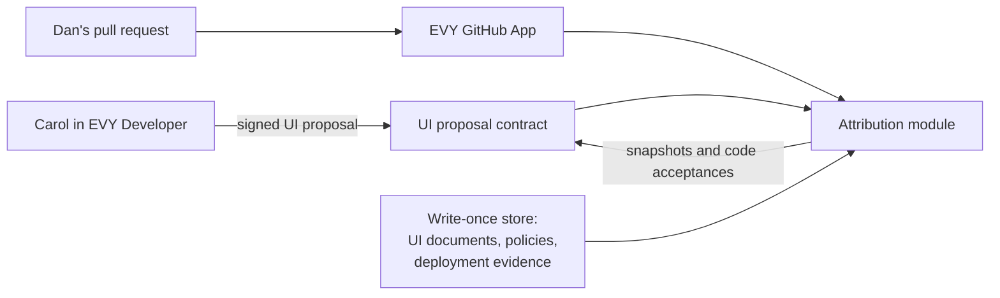
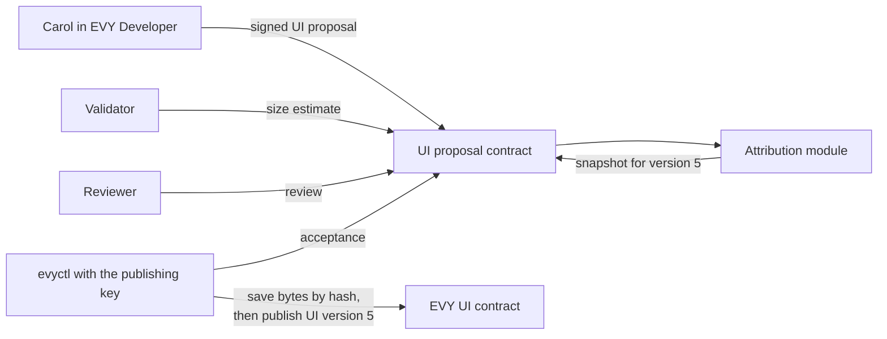

# 2.8 Attribution

## Repositories

| Repository | Role | Work in this plan |
| --- | --- | --- |
| [evy](https://github.com/EVY-Platform/evy) | Modified | `api/src/modules/attribution` and the EVY GitHub App. EVY Developer (`web/`) and `evyctl` gain contributor-key, proposal and review commands. The UI proposal contract in `freenet/contracts/ui_proposal/`. `evyctl` signs `evy.code-deployment/1` deployment evidence |
| [freenet-core](https://github.com/freenet/freenet-core) | Used | Backend node that reads and writes the UI proposal contract |
| [freenet-stdlib](https://github.com/freenet/freenet-stdlib) | Used | TypeScript client for the attribution module |

## Purpose

The attribution module records who built each part of EVY. Units decide each contributor's part of the 1% contributor fee that [Fees and seller accounts in 2.6 Payments](06-payments.md#fees-and-seller-accounts) collects on each sale.

Two kinds of work earn units:

- **UI work.** Carol moves the "Listing dimensions" row of Marketplace's "Create item" flow from the "Create listing" page to the "Describe item" page ([service_sdui.json](https://github.com/EVY-Platform/evy/blob/d0fb7e6475f1dfc5c74325e37d4e92aed88d84ed/scripts/fixtures/services/service_sdui.json)). EVY publishes her proposal as UI version 5. Carol earns 6.8 units for `marketplace.item.create`.
- **Repository work.** Dan opens a pull request to evy. It makes Marketplace's contract accept a pickup request only at a time Alice offered. It merges and first ships in iOS and Android build 412. Dan earns 4.25 units for `marketplace.item.buy` in every purchase made from build 412 or later.



Implement `api/src/modules/attribution` with its `attribution` PostgreSQL schema inside the shared TypeScript/Bun backend in [`api/`](https://github.com/EVY-Platform/evy/tree/d0fb7e6475f1dfc5c74325e37d4e92aed88d84ed/api). Reuse the domain patterns in [`services/marketplace`](https://github.com/EVY-Platform/evy/blob/d0fb7e6475f1dfc5c74325e37d4e92aed88d84ed/services/marketplace/package.json). Install the schema before EVY publishes its first contributed UI version.

## Contributor keys

Carol keeps an Ed25519 contributor key in her protected local workspace, as [Contributor keys in 2.5 EVY authoring and publishing](05-developer.md#contributor-keys) describes. `evyctl` signs every contributor operation. EVY Developer exchanges draft files with `evyctl`.

| Action | Local tool | Attribution module |
| --- | --- | --- |
| Register | Creates a contributor key and signs a registration | Verifies it and assigns an `ActorId` |
| Link GitHub | Completes GitHub sign-in at the policy's `contributor_url` | Binds the GitHub user ID to the `ActorId` |
| Rotate | Signs an old-to-new key statement with the current key | Keeps roles and units under the same `ActorId` |
| Back up | Exports encrypted contributor credentials and drafts | Keeps every acknowledged contribution record |

Each operation has its own signing domain. [Backend requests in 2.5 EVY authoring and publishing](05-developer.md#backend-requests) checks the endpoint, audience, challenge, expiry and signed response.

| If Carol loses her key | Result |
| --- | --- |
| She restores her contributor-key backup | Same key and `ActorId` |
| She recovers through her linked GitHub account | A new key replaces the old one after a 7-day hold. A signature from the old key during the hold cancels the replacement |
| She has no backup and no GitHub link | She registers a new `ActorId`. Earlier units stay with the old one |

## Policy version 2

The payment root key signs policy version 2. It extends policy version 1 from [Financial policy identity in 2.6 Payments](06-payments.md#financial-policy-identity) with attribution fields. `evyctl` saves its exact bytes by hash before publishing, as [2.2 EVY UI contracts and publishing](02-ui-contracts.md) does for every policy.

UI version 5 names policy 2 through `policy_version` and `policy_digest`. Purchases made from UI version 5 use policy 2. A purchase keeps the policy it was created under.

```jsonc
{
  "service": "evy",
  "policy_version": 2,
  "...": "...",                                          // every policy 1 field from 2.6 Payments
  "capabilities": {                                      // credited behavior, by capability ID
    "marketplace.item.create": {
      "feature": "marketplace",                          // internal EVY feature
      "weight_bp": 4000,                                 // 40% of each fee. A feature's weights total 10,000
      "flows": ["ca47e6c5-da19-4491-8422-adb40d9e8a27"]  // flow IDs in the UI document
    },
    "marketplace.item.buy": {
      "feature": "marketplace",
      "weight_bp": 6000,                                 // 60% of each fee
      "flows": ["74a49d4b-2176-4925-857a-e29e2991f1bd"]
    }
  },
  "allocation_rounding": "evy.allocation/2",             // cent rounding used by the payout ledger
  "sizes": [1, 2, 3, 5, 8, 13, 21],                      // the sizes a piece of work can have
  "role_split_bp": [8500, 1000, 500],                    // contributors, reviewer, validators
  "challenge_days": 30,                                  // days after acceptance to open a challenge
  "payout_hold_days": 30,                                // days after a sale before a share can be withdrawn
  "contributor_url": "https://attribution.example/contributor", // signed contributor statements
  "payouts_url": "https://remuneration.example/payouts",        // earnings, sign-in and Withdraw
  "signature": "<canonical padded base64 Ed25519 signature>"    // by the payment root key
}
```

Reviewer and validator lists live in the attribution module's configuration in evy. Maintainers change them through a reviewed pull request. Each acceptance records the reviewer and validators it used.

## The UI proposal contract

One contract in `freenet/contracts/ui_proposal/` holds the public attribution records. Its parameters are the UI root key from [2.1 Hello EVY world](01-hello-evy-world.md) and the `evy` namespace. Record its key and code hash in `types/freenet/contract-keys.json`.

| Record | Signed by | The contract accepts it when |
| --- | --- | --- |
| Contributor registration | Attribution key | The key is certified by the UI root key and not revoked |
| UI proposal | Contributor key | The key is registered and has no other open proposal |
| Size estimate, review, challenge | Validator, reviewer or contributor key | The key is registered |
| Acceptance | Publishing key | The key is certified by the UI root key and not revoked |
| Snapshot and code acceptance | Attribution key | The key is certified by the UI root key and not revoked |

- Every record uses `signed-register/1` from [2.4 SDUI data and actions](04-data-and-actions.md) with its own domain, such as `evy.ui-proposal/1`.
- A closed proposal keeps its record and drops its flows. The attribution module keeps their bytes.
- Core's 50 MB state limit applies. The contract adds no size cap of its own.
- A root-signed revocation of a publishing or attribution key makes the contract drop that key's records. The attribution module then re-signs its genuine records with a newly certified key.

## Proposing a UI change



| Step | Who | What happens |
| --- | --- | --- |
| 1. Draft | Carol | Opens the Marketplace flow from the live UI document in proposal mode, as [Local editor and draft files in 2.5 EVY authoring and publishing](05-developer.md#local-editor-and-draft-files) describes. She moves the "Listing dimensions" row to the "Describe item" page |
| 2. Preview | Carol | Checks the change on the EVY test build on iOS and Android, as [Previewing on a phone in 2.5 EVY authoring and publishing](05-developer.md#previewing-on-a-phone) describes |
| 3. Propose | Carol | Picks `marketplace.item.create` and size 8. `evyctl` signs the proposal with her key and sends it as an UPDATE. The proposal covers the changed "Create item" flow (about 17 KB), base UI version 4, the capability, contributor shares totaling 10,000 and the size |
| 4. Size | Validator | Signs a size estimate through `evyctl` |
| 5. Review | Reviewer | Opens the proposal beside UI version 4 and previews it on iOS and Android. Signs an approval or a rejection. A rejection closes the proposal |
| 6. Publish | EVY maintainer | Builds UI version 5 from version 4 with the approved flow in place. Publishes it through [Publishing a UI version in 2.2 EVY UI contracts and publishing](02-ui-contracts.md#publishing-a-ui-version), which saves the exact bytes by hash first. Signs an acceptance naming the proposal, version 5 and the document's hash |
| 7. Record | Attribution module | Reads version 5's bytes by hash, checks the acceptance and records Carol's units |

The attribution module accepts the work only when all of these hold:

- The reviewer and validators are in its configuration.
- Nobody reviews or sizes their own work.
- The size is in `sizes` and shares total 10,000.
- Every changed flow belongs to a claimed capability.
- No challenge is open.

## Repository contributions

The EVY GitHub App, served by `api/src/modules/attribution`, handles code, tests and documentation in `evy`. Dan's pull request names the feature, capability and size in trailers:

```text
EVY-Feature: marketplace
EVY-Capability: marketplace.item.buy
EVY-Size: 5
```

The reviewer also records the work's targets: `ios`, `android` or `backend`. Dan's contract change ships inside both apps, so its targets are `ios` and `android`. Tests and documentation name the targets they support and earn units the same way as code.

| Step | Who | What happens |
| --- | --- | --- |
| 1. Check | EVY GitHub App | Checks Dan's linked contributor key, the capability and the size. Sets the attribution check to pending |
| 2. Review | Reviewer | Approves the exact head commit, trailers and targets from a linked GitHub account |
| 3. Size | Validator | Confirms the size and shares from a linked account |
| 4. Merge | GitHub | The required check passes for the reviewed head. Dan merges with merge, squash or rebase |
| 5. Record merge | Attribution module | Matches the merge commit to the reviewed head. Saves the PR, reviewed head, merge commit and targets |
| 6. Find first builds | Attribution module | For each target, finds the first deployment evidence whose source commit contains the merge commit |
| 7. Accept | Attribution module | Signs one code acceptance with its units and the first build per target. Writes it to the UI proposal contract |

- A changed head or changed trailers renew the review and size checks.
- A pull request without EVY trailers follows ordinary branch protection.
- The database allows one acceptance per repository and PR number. Duplicate webhooks, racing workers and restarts end in that one acceptance.
- Verify webhook signatures and re-read the PR's current state from GitHub before each step.

### Deployment evidence

This plan defines `evy.code-deployment/1`. `evyctl` signs one record with the publishing key each time a build reaches users:

- after `mobile_builds.yml` from [Builds from GitHub in 2.3 Native SDUI readers](03-readers.md#builds-from-github) delivers a store build to testers or a store
- after a backend release is deployed

| Field | Example | Meaning |
| --- | --- | --- |
| `target` | `"android"` | `ios`, `android` or `backend` |
| `source_commit` | `"9c41e0d..."` | The evy commit the artifact was built from |
| `build` | `412` | iOS build number or Android `versionCode`, both the workflow run number. Backend releases use their release tag |
| `artifact_digest` | `"7Hq3..."` | Base58 BLAKE3 of the signed IPA, AAB or backend image |
| `activated_at` | `"2026-11-02T09:00:00Z"` | When the build became available to users |

Before sending anything, `evyctl` saves the exact signed bytes, named by hash, to the EVY git repository and to the object-locked bucket. This is the same write-once store [2.2 EVY UI contracts and publishing](02-ui-contracts.md) uses for UI documents and policies. The attribution module looks every record up by hash. A record whose bytes do not match its hash fails.

## Crediting a purchase

Each purchase carries the buyer-signed `runtime_context` from [The purchase contract in 2.7 EVY Marketplace](07-marketplace.md#the-purchase-contract), retained with the purchase as [Financial policy identity in 2.6 Payments](06-payments.md#financial-policy-identity) lists. This plan uses these fields:

```jsonc
"runtime_context": {
  "platform": "android",   // ios or android
  "build": 413,            // build number or versionCode
  "artifact_digest": "7Hq3..." // must match that build's deployment evidence
}
```

A purchase credits:

- **UI work** listed in the snapshot for the purchase's `ui_version`.
- **Code acceptances** that meet the rule for their target:

| Target | The purchase credits the work when |
| --- | --- |
| `ios` or `android` | The buyer's platform is one of the work's targets, and the buyer's build is at or after the first build on that platform that contains the work |
| `backend` | The work's first backend deployment was active before the purchase was created |

Both rules also require the acceptance to exist before the payment was captured. The ledger records the acceptance IDs it used.

| Buyer's build | Dan's change (`ios`, `android`, first build 412) | A change with target `ios` only |
| --- | --- | --- |
| Android 411 | Not credited | Not credited |
| Android 413 | Credited | Not credited |
| iOS 413 | Credited | Credited |

- Credit starts with the first build that contains the work. It does not wait for a new UI version.
- Later builds keep the credit, even after the code is refactored, replaced or removed.
- A build number or digest without matching deployment evidence leaves the allocation pending until the evidence is found.

## Attribution units

Each capability keeps cumulative units. New work adds units and dilutes earlier contributors' shares as the total grows. Earlier units never shrink.

The attribution module splits each accepted size by `role_split_bp` and stores units as integer ten-thousandths of a size point.

- Each part rounds down to whole units. The remainder goes to the largest share; equal shares go to the lower `ActorId`.
- The same rule splits the contributor part among co-authors and the validator part among validators.
- If the first validator's estimate differs from the proposed size, a second validator picks one of the two. The validator part goes to the validators whose estimate equals the accepted size.

| Acceptance | Capability | Size | Contributor | Reviewer | Validator |
| --- | --- | ---: | ---: | ---: | ---: |
| Carol's UI proposal | `marketplace.item.create` | 8 | Carol 6.8 (68,000) | 0.8 (8,000) | 0.4 (4,000) |
| Dan's pull request | `marketplace.item.buy` | 5 | Dan 4.25 (42,500) | 0.5 (5,000) | 0.25 (2,500) |

In both examples, the same reviewer approves the work and the same validator confirms its size.

For each published UI version, the attribution module signs a snapshot with the attribution key and writes it to the UI proposal contract. EVY Developer shows Carol her units, and anyone can check them.

- A snapshot names the UI contract key, UI version, document hash, and the policy version and digest named by that document.
- It lists the UI units per capability and `ActorId` that count in that version. A UI proposal counts from the version that published it.
- Signed snapshots never change. UI version 5's snapshot includes Carol's 6.8 units.

| Challenge | Opened by | Resolved when |
| --- | --- | --- |
| Omitted author | The person left out | The claimant and every contributor on the work sign a resolution |
| Shares | A contributor on the work | Every contributor on the work signs a resolution |
| Size | A contributor or validator on the work | A validator outside the work picks one of the disputed sizes |

- A challenge on a UI proposal is a signed record in the UI proposal contract.
- A challenge on a pull request is a `/evy challenge` comment from a linked account.
- An open challenge blocks acceptance. A challenge within `challenge_days` after acceptance marks the acceptance as challenged.
- A resolution that changes shares or size creates a new acceptance. UI work counts from the next UI version's snapshot. Code work counts for purchases captured after the new acceptance. Earlier snapshots and allocations stay as they are.

## Acceptance

- Carol registers and rotates her key through `evyctl`. The private key stays in her local workspace. A rotation signed by the old key keeps her `ActorId`. A GitHub recovery links a new key after the 7-day hold, and an old-key signature during the hold cancels it.
- The UI proposal contract refuses a proposal from an unregistered key, a second open proposal from one key, an acceptance from an uncertified or revoked publishing key, and a snapshot or code acceptance from an uncertified or revoked attribution key.
- After a root-signed revocation of the attribution key, the contract drops that key's records. The module re-signs them with a new certified key, and earlier allocations still match their recorded snapshot hashes.
- The attribution module refuses self-review, self-sizing, reviewers and validators missing from its configuration, sizes outside `sizes`, share totals other than 10,000 and a proposal that changes a flow outside its capabilities.
- On iOS and Android, the Marketplace "Create item" flow shows "Listing dimensions" on the "Describe item" page after EVY publishes Carol's proposal as UI version 5.
- UI version 5's snapshot holds Carol's 6.8 units. Stored acceptances reproduce it, and each acceptance's parts sum to its size.
- Unit-split vectors pass: a validator part of 4,000 split among three validators gives 1,334, 1,333 and 1,333, with the extra unit to the lower `ActorId`.
- Dan's pull request stays pending until the review and size arrive. A changed head renews the checks, and GitHub blocks the merge until they pass. A pull request without EVY trailers merges with the check passed.
- Merge, squash and rebase fixtures each produce one acceptance linked to the reviewed head. Duplicate and reordered webhooks, racing workers and a restart keep one acceptance per PR.
- On iOS and Android, purchases from builds 411, 412 and 413 follow the crediting table above. An `ios`-only change is never credited to an Android purchase.
- A backend change counts for purchases created after its first deployment and not for earlier ones.
- Refactor, replace and remove Dan's code in later builds. His units stay. A new acceptance in the same capability dilutes his share in later purchases. Older allocations stay unchanged.
- Deployment evidence, UI documents and policies are found by hash in both the git repository and the object-locked bucket. A record whose bytes do not match its hash fails.
- An open challenge blocks acceptance. A resolution after UI version 5 changes only later snapshots and later purchases.
