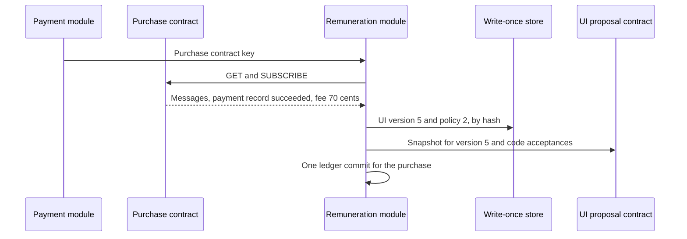
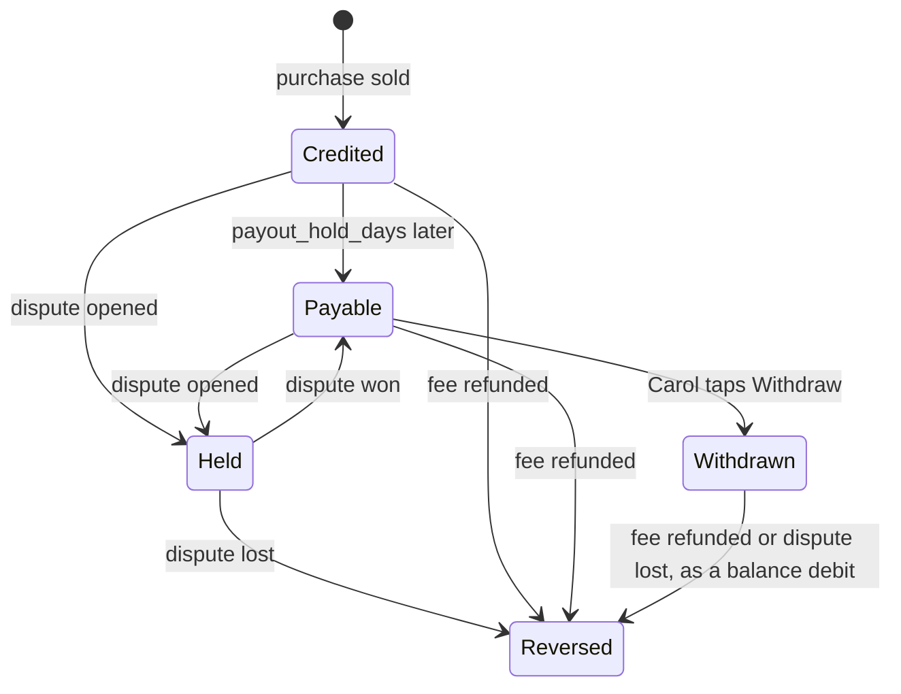

# 2.9 Remuneration and payouts

## Repositories

| Repository | Role | Work in this plan |
| --- | --- | --- |
| [evy](https://github.com/EVY-Platform/evy) | Modified | `api/src/modules/remuneration`: the ledger, balances, Withdraw and the payouts page. `api/src/modules/payment` reports captures, refunds and disputes to it |
| [freenet-core](https://github.com/freenet/freenet-core) | Used | Backend node that subscribes to purchase contracts |
| [freenet-stdlib](https://github.com/freenet/freenet-stdlib) | Used | [TypeScript client](https://github.com/freenet/freenet-stdlib/blob/7782c176a622efc3f284ce4710b4f184c4986405/typescript/src/websocket-interface.ts) for purchase contract subscriptions |

## Purpose

The remuneration module pays contributors after a completed purchase.

Alice sells a second skateboard to Dave for 70 dollars. Dave buys from UI version 5, which names policy 2, so Carol's change from [2.8 Attribution](08-attribution.md) earns. As [Fees and seller accounts in 2.6 Payments](06-payments.md#fees-and-seller-accounts) shows:

| Party | Amount |
| --- | --- |
| Dave pays | About 71.48 dollars: the 70-dollar price plus a service fee that covers Stripe's card fee |
| Alice receives | 69.30 dollars |
| Contributors share | 0.70 dollars, the 1% contributor fee |

After the handover and capture, the module splits the 0.70 dollars among the contributions that [Crediting a purchase in 2.8 Attribution](08-attribution.md#crediting-a-purchase) credits for Dave's purchase. It tracks balances, and contributors withdraw them through Stripe Connect.

Implement `api/src/modules/remuneration` with its `remuneration` PostgreSQL schema inside the shared TypeScript/Bun backend in [`api/`](https://github.com/EVY-Platform/evy/tree/d0fb7e6475f1dfc5c74325e37d4e92aed88d84ed/api).

The module uses these purchase fields, which [Financial policy identity in 2.6 Payments](06-payments.md#financial-policy-identity) lists:

| Field | Dave's purchase |
| --- | --- |
| `feature` | `marketplace` |
| `ui_version` and `ui_digest` | 5 and the hash of UI version 5's exact signed bytes |
| `policy_version` and `policy_digest` | 2 and the hash of policy 2's exact signed bytes |
| `runtime_context` | Dave's platform, build number and artifact digest |
| `fee_cents` | 70 |

Dave's buyer key signs all of them when he asks to buy.

## Crediting a completed purchase

The module reads captures and refunds over Freenet. It subscribes to each purchase contract and checks every payment record itself.

| Step | What the module does |
| --- | --- |
| 1. Learn | The payment module sends the purchase contract key whenever it writes a payment record, including refunds and disputes |
| 2. Subscribe | GETs and SUBSCRIBEs to the purchase contract through the backend node |
| 3. Check payment | Verifies [the payment record in 2.6 Payments](06-payments.md#the-payment-record): its signature from a payment service key that the payment root key certified, and that no revocation in the purchase state covers it. Reads the captured amount, `fee_cents`, `refunded_cents` and `fee_refunded_cents` |
| 4. Check completion | Finds Alice's `transaction_completed` message in the purchase's message list and a `succeeded` or `refunded` payment record |
| 5. Find the version | Reads UI version 5 and policy 2 by hash from the write-once store in [2.2 EVY UI contracts and publishing](02-ui-contracts.md). Checks both hashes. Reads the signed snapshot for version 5 and the code acceptances from the UI proposal contract. Applies [Crediting a purchase in 2.8 Attribution](08-attribution.md#crediting-a-purchase) to Dave's `runtime_context` |
| 6. Commit | Writes the original allocations, and any reversals for the current `fee_refunded_cents`, in one database transaction. Records the snapshot hash, the acceptance IDs used and the runtime context with each allocation |

- If any input is missing or its hash does not match, the allocation waits and the module retries.
- The ledger allows one allocation per purchase, capability and recipient. Repeated notifications and racing workers produce one result.
- A fake sale between two people who work together pays contributors at most that sale's own fee, and the seller pays that fee.
- A purchase under policy 1, such as Bob's first skateboard purchase, has no capabilities. EVY holds its 0.70 dollars as unassigned.

## Splitting the fee

Work in integer cents and split the fee in two rounds:

1. Across the capabilities of the purchase's feature, by `weight_bp`. Only capabilities with credited units take part, and their weights are scaled to fill the whole fee. If no capability has units, EVY holds the fee as unassigned.
2. Within each capability, across recipients by their units.

Both rounds use the largest remainder rule, which the policy names `evy.allocation/2`:

- Give each capability or recipient the whole cents of its exact share.
- Give leftover cents one at a time in order of largest remainder.
- Round 1 ties go to the lower capability ID; round 2 ties go to the lower `ActorId`. Compare IDs byte by byte in UTF-8.

Dave's build contains Dan's change, so both capabilities have units. Round 1 gives `marketplace.item.create` 40% of 70, which is 28 cents, and `marketplace.item.buy` 60%, which is 42 cents. Round 2:

| Capability | Recipient | Units | Exact share | Whole cents | Leftover cent | Credited |
| --- | --- | ---: | ---: | ---: | ---: | ---: |
| `marketplace.item.create`, 28 cents | Carol | 6.8 | 23.8 | 23 | 1 | 24 |
| | Reviewer | 0.8 | 2.8 | 2 | 1 | 3 |
| | Validator | 0.4 | 1.4 | 1 | 0 | 1 |
| `marketplace.item.buy`, 42 cents | Dan | 4.25 | 35.7 | 35 | 1 | 36 |
| | Reviewer | 0.5 | 4.2 | 4 | 0 | 4 |
| | Validator | 0.25 | 2.1 | 2 | 0 | 2 |
| Total | | | 70 | 67 | 3 | 70 |

Carol gets 24 cents, Dan 36, the reviewer 7 and the validator 3. If Dave's build were older than Dan's first build, `marketplace.item.buy` would have no units and all 70 cents would go to `marketplace.item.create`.

## Balances and withdrawals

- **Sign-in.** Carol opens the payouts page at the policy's `payouts_url` through [Backend requests in 2.5 EVY authoring and publishing](05-developer.md#backend-requests). Her contributor key signs a one-time sign-in statement. The page shows her balances by feature, payable dates and past withdrawals.
- **Account.** Before her first withdrawal, Carol links a Stripe connected account through [Stripe-hosted onboarding](https://docs.stripe.com/connect/hosted-onboarding), with the same account settings Alice uses in [Fees and seller accounts in 2.6 Payments](06-payments.md#fees-and-seller-accounts). Stripe holds her identity, bank details and tax forms. Her account uses Stripe's manual payout schedule. Carol signs each new payout account with her contributor key.
- **Withdraw.** EVY pays nothing automatically and sets no minimum. Carol taps Withdraw to move her whole payable balance. The module makes one [transfer](https://docs.stripe.com/api/transfers/create) from EVY's platform balance to her connected account, then one [payout](https://docs.stripe.com/connect/payouts-connected-accounts) to her bank.
- **Fees.** Stripe charges 2.00 dollars for each month in which a connected account receives a payout ([Connect pricing](https://stripe.com/au/connect/pricing)). The module deducts it from Carol's first withdrawal in each calendar month and shows it before she confirms. Withdraw is available when her payable balance is more than the fee due. EVY pays Stripe's per-payout fee of 0.25% plus 0.25 dollars.
- **No double transfers.** The withdrawal ID is the Stripe [idempotency key](https://docs.stripe.com/api/idempotent_requests) and goes in `transfer_group` and `metadata[withdrawal_id]`. Before every transfer, and on any retry after 24 hours, the module [lists the transfers](https://docs.stripe.com/api/transfers/list) for that `transfer_group`, reads every page and matches `metadata[withdrawal_id]`. It creates a transfer only when a complete read finds none. A failed or partial read keeps the withdrawal pending.

### Contributor countries

The pilot pays contributors in Australia only.

- EVY's Stripe platform account is Australian.
- Stripe allows [cross-border transfers](https://docs.stripe.com/connect/account-capabilities#transfers-cross-border) only for platforms in the United States, Canada, the United Kingdom, the EEA and Switzerland (checked 15 October 2026).
- So every contributor's connected account must be Australian, with an Australian bank account.

| Contributor | Earns credit | Withdraws |
| --- | --- | --- |
| Carol, in Australia | Yes | To her Australian account |
| A contributor in another country | Yes | Only to an Australian account |

The payouts page offers onboarding for Australian accounts only. A contributor elsewhere keeps earning units and credited cents. They withdraw once they link an Australian account.

## Disputes

[Card disputes in 2.6 Payments](06-payments.md#card-disputes) publishes a signed `evy.dispute-summary/1` record in the purchase state. The module reads it from the purchase contract like any other payment record.

| Dispute state | What the module does |
| --- | --- |
| Open | Holds the purchase's contributor cents that are not yet withdrawn. They stay held until every dispute on the purchase is closed |
| Won | Releases the hold. The cents become payable on their original date |
| Lost | Reverses all of the purchase's contributor allocations. Cents already withdrawn become a balance debit |

A lost dispute reverses the whole contributor fee. A later fee refund on the same purchase reverses nothing more.

## Refunds

The module uses the cumulative `fee_refunded_cents` from [Refunds in 2.6 Payments](06-payments.md#refunds). It reverses only the contributor fee that Stripe has returned. A buyer refund still waiting for its fee refund keeps the contributor earnings until the fee refund is confirmed.

### Cumulative reversal calculation

The ledger keeps each purchase's original integer allocations. Their total is `fee_cents`, including any unassigned EVY bucket.

| Step | Rule |
| --- | --- |
| 1. Order the cents | An allocation of `A` cents has positions `(2k - 1) / (2A)` for `k = 1..A`. Sort all positions from lowest to highest, comparing fractions by integer cross-products. Ties go to the lower capability ID, then the lower `ActorId`. This order spreads reversals in proportion to each allocation |
| 2. Pick the total | For a cumulative refunded fee `R`, reverse the first `R` cents in that order |
| 3. Apply the difference | Subtract the reversal already recorded for each allocation. Commit only the extra cents, with the new `R`, in one transaction under a per-purchase lock. A duplicate or older total changes nothing |

One refund and several refunds reaching the same total give the same result.

| When the fee refund is confirmed | What the module does |
| --- | --- |
| Before capture | Nothing. There is no allocation |
| Before withdrawal | Lowers the credited or payable balance. The rest keeps its original payable date |
| After withdrawal | Records a balance debit. Later credits pay it off before the next withdrawal |
| Before the allocation is first processed | Builds the original allocation and applies the current reversal in the same transaction |

A 35.00-dollar refund of Dave's purchase returns 35 cents of the contributor fee, and the ledger reverses 35 cents. If the remaining 35.00 dollars are refunded later, the total reversal is 70 cents. After a withdrawal, the debits across both refunds are Carol 24 cents, Dan 36, the reviewer 7 and the validator 3, the same as one full refund. EVY carries any debit that later earnings never pay off.

## Acceptance

- On iOS and Android in Stripe test mode, Dave buys Alice's second skateboard from UI version 5 under policy 2, once with Alice on iOS and Dave on Android and once the other way round. After `transaction_completed` and capture, the ledger credits Carol 24 cents, Dan 36, the reviewer 7 and the validator 3.
- Dave buys from a build older than Dan's first build. All 70 cents go to `marketplace.item.create`.
- Bob's first skateboard purchase under policy 1 leaves 70 cents unassigned.
- Duplicate notifications, a restart and two racing workers produce one allocation per purchase, capability and recipient.
- A payment record signed by an uncertified or revoked payment service key creates no credit.
- A UI document, policy or snapshot that is missing or does not match its hash keeps the allocation waiting.
- A policy change after Dave's purchase leaves his allocation on policy 2.
- A share becomes payable only after `payout_hold_days`. Carol withdraws any payable balance above the fee due. Her first withdrawal in a month has 2.00 dollars deducted; a second withdrawal in that month has none.
- A transfer timeout followed by a retry creates one Stripe transfer, both within 24 hours and after. A partial transfer-list read keeps the withdrawal pending.
- The payouts page offers onboarding for Australian accounts only, as [Contributor countries](#contributor-countries) sets. A contributor with no Australian account keeps earning credit and cannot withdraw.
- For every `R` from 0 through 70, the reversal fixture reverses exactly `R` cents. Each allocation's reversal only grows and never exceeds its original credit. `R = 70` reverses everything. One refund and several refunds reaching the same total match.
- A fee-only refund changes the ledger while the purchase stays `sold`. A purchase first seen after a refund builds its allocation and current reversal in one transaction, including the unassigned case.
- An open dispute holds unwithdrawn cents. A won dispute releases them. A lost dispute reverses all allocations, including cents already withdrawn as a debit. Two disputes on one purchase keep the hold until both close.
- Shared allocation vectors cover equal remainders in both rounds, byte ordering of IDs and unassigned fees.
