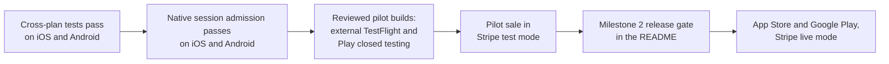
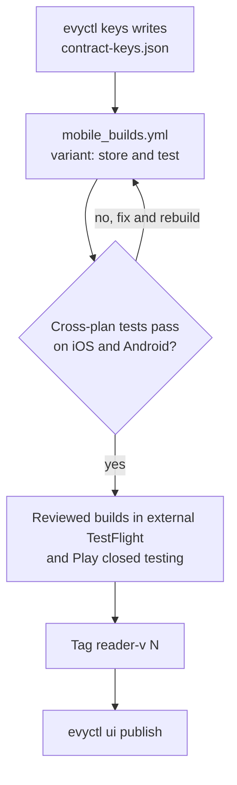

# 2.10 Testing and release

## Repositories

| Repository | Role | Work in this plan |
| --- | --- | --- |
| [evy](https://github.com/EVY-Platform/evy) | Modified | Cross-plan release tests, store listings, the support page and the first-sale record in `docs/launch/` |
| [freenet-appkit](https://github.com/glesage/freenet-appkit) | Used | Swift package, Kotlin library and store build checks |
| [freenet-core](https://github.com/freenet/freenet-core) | Used | Core build, the backend node and `fdev verify-merge` |
| [freenet-test-network](https://github.com/freenet/freenet-test-network) | Used | Isolated test network |
| [stripe-ios](https://github.com/stripe/stripe-ios), [stripe-android](https://github.com/stripe/stripe-android) | Used | Payment sheets in Stripe test mode and live mode |

## Purpose

Test milestone 2 (EVY on Freenet) across the plans in [Test ownership](#test-ownership) on real iOS and Android phones, and get the EVY builds through store review. Each earlier plan owns its own acceptance; this plan runs the tests that span several plans and the store checks.

EVY reaches live users only after the milestone 2 release gate in the [README](../README.md) passes. Until then every build is a pilot build and Stripe stays in test mode.

Reviewed pilot and public releases on iOS and Android require [Native session admission in 2.1 Hello EVY world](01-hello-evy-world.md#native-session-admission). The selected Core implementation must enforce the native host's session on every SDK connection and equivalent API route. Track that implementation through [Core #5264](https://github.com/freenet/freenet-core/issues/5264) and its native-client requirements in [RFC #5919](https://github.com/freenet/freenet-core/issues/5919).

## Test ownership

| Plan | Owns |
| --- | --- |
| [1.8 Thin-peer protocol](../1-freenet-mobile-appkit/08-thin-peer.md#acceptance) | Thin-peer behavior, rerun here with EVY's workloads |
| [1.9 Testing and release](../1-freenet-mobile-appkit/09-testing-and-release.md#release-tests) | Device limits and store build checks, rerun here on EVY's builds |
| [2.1 Hello EVY world](01-hello-evy-world.md#acceptance) | The hello contract, the EVY keys and app startup |
| [2.2 EVY UI contracts and publishing](02-ui-contracts.md#acceptance) | UI documents, versions, equal-version conflicts and the write-once store |
| [2.3 Native SDUI readers](03-readers.md#acceptance) | Reader parity, offline start, UI updates within a flow and builds |
| [2.4 SDUI data and actions](04-data-and-actions.md#acceptance) | Bindings, actions, offline writes and `signed-register/1` |
| [2.5 EVY authoring and publishing](05-developer.md#acceptance) | EVY Developer, `evyctl` and publishing |
| [2.6 Payments](06-payments.md#acceptance) | Stripe intents, capture, refunds, disputes and payment keys |
| [2.7 EVY Marketplace](07-marketplace.md#acceptance) | Listing, search and purchase contracts, the listing authority, Marketplace flows, availability, moderation and photos |
| [2.8 Attribution](08-attribution.md#acceptance) | Contributions, deployment evidence and units |
| [2.9 Remuneration and payouts](09-remuneration.md#acceptance) | Allocations, reversals, dispute holds and withdrawals |
| [2.11 EVY delegate updates and recovery](11-delegate-updates-and-recovery.md#acceptance) | Native migration, lifecycle-message authorization, dependency alignment, backup and Forget |
| This plan | Tests that span those plans on real store builds, and store review |

Record each plan's results once, with its suite, source commit and build numbers. This plan's tests reference those results instead of repeating them.

## Test setup

- Run every test on real phones in the thin-peer role, with the node in network mode. Simulator and emulator runs are reported apart.
- Alice has an iPhone on iOS 17 and Bob an Android phone on Android 9 (API 28), the minimums in [The EVY app on iOS and Android in 2.1 Hello EVY world](01-hello-evy-world.md#the-evy-app-on-ios-and-android). Dave uses a current Android phone and Carol a current iPhone.
- Build the test apps with `mobile_builds.yml` and `variant: test`, as [Builds from GitHub in 2.3 Native SDUI readers](03-readers.md#builds-from-github) describes. They install beside the store build and open preview UI contracts through "Scan preview", as [Previewing on a phone in 2.5 EVY authoring and publishing](05-developer.md#previewing-on-a-phone) describes.
- Pass [Test-network dependencies in 1.9 Testing and release](../1-freenet-mobile-appkit/09-testing-and-release.md#test-network-dependencies) for each linked NAT harness binary before using the isolated network for release evidence. Retain the locked dependency graph, toolchain and linker results.

| | Isolated test network | Public network |
| --- | --- | --- |
| Network | freenet-test-network. Each node gets explicit gateways, and each run checks that every peer stays in the isolated network | Freenet's public network through Core's gateways |
| Keys | A test UI root key, publishing key and payment root key from `evyctl key new` | EVY's own keys from [2.1 Hello EVY world](01-hello-evy-world.md) and [2.6 Payments](06-payments.md) |
| EVY builds | iOS and Android debug builds with test contract keys and test-network gateways | Store-variant pilot builds |
| Backend | One test deployment with the payment, attribution and remuneration modules and a backend node | EVY's backend |
| Stripe | Test mode with test cards and test connected accounts | Test mode until the release gate passes |
| Used for | Forged states, serving-peer loss, carrier NAT and refunds after a withdrawal with a short hold | Every cross-plan test on store builds and the pilot sale |

## Cross-plan tests

Run every test on iOS and Android, with the platforms swapped on a second run.

| Test | Plans | Passing result |
| --- | --- | --- |
| EVY on the thin peer | 1.8 Thin-peer protocol; 2.1 Hello EVY world | [Acceptance in 1.8 Thin-peer protocol](../1-freenet-mobile-appkit/08-thin-peer.md#acceptance) passes with EVY's Home, Marketplace and purchase traffic |
| EVY device limits | 1.9 Testing and release; 2.1 Hello EVY world; 2.3 Native SDUI readers | Rerun the memory, Wasm, battery and storage tests from [Release tests in 1.9 Testing and release](../1-freenet-mobile-appkit/09-testing-and-release.md#release-tests) on EVY's iOS and Android store builds, with Home, Marketplace and an open purchase |
| Repeated node lifecycles | 1.2 Embedded node and mobile SDK; 2.3 Native SDUI readers | The in-process lifecycle tests from [Acceptance in 1.2 Embedded node and mobile SDK](../1-freenet-mobile-appkit/02-sdk.md#acceptance) pass with EVY's node, delegate and subscriptions. Stopped node generations leave zero live owned tasks, stale callbacks stop, and their port and store are reusable |
| Native session admission | 2.1 Hello EVY world; 2.4 SDUI data and actions; 2.11 EVY delegate updates and recovery | [Native session admission in 2.1 Hello EVY world](01-hello-evy-world.md#native-session-admission) passes on every SDK connection and equivalent API route. Another local client and a stale session fail signing, decryption, export, import and deletion; the current authorized session completes the same operations |
| Merge-law coverage | 1.9 Testing and release; 2.4 SDUI data and actions | [Merge-law coverage in 1.9 Testing and release](../1-freenet-mobile-appkit/09-testing-and-release.md#merge-law-coverage) passes on every contract in the release manifest, including near-capacity UI generations and collection states, purchase transitions and revocations. Save the per-property reports and explicit boundary fixtures |
| Core version | 1.9 Testing and release; 2.1 Hello EVY world | A test peer requires a newer Core than the store builds use. Both phones show "Update EVY" from [2.1 Hello EVY world](01-hello-evy-world.md) and keep drawing saved UI documents |
| One application | 2.1 Hello EVY world; 2.2 EVY UI contracts and publishing; 2.3 Native SDUI readers; 2.7 EVY Marketplace | Home, Hello and Marketplace navigate within one UI document. Test and store installs have separate app IDs, stores and keys |
| Skateboard sale | 2.4 SDUI data and actions; 2.6 Payments; 2.7 EVY Marketplace | Alice sells to Bob under UI version 4 and policy 1. Check the Stripe objects: a PaymentIntent of 7,148 cents, `application_fee_amount` of 218 cents (70 contributor fee plus 148 service fee) and 6,930 cents to Alice's account. After Stripe's card fee, EVY's net is 70 cents. Both phones show `sold`, and an independent peer reads the same purchase |
| Offline at the pickup | 2.4 SDUI data and actions; 2.6 Payments | Alice taps "Confirm" with no signal, and Bob closes EVY right after paying. Alice's signed confirmation waits under [Offline writes in 2.4 SDUI data and actions](04-data-and-actions.md#offline-writes) and goes out on reconnect. The payment module captures once, and both phones show `sold` |
| Seller closes before capture | 2.6 Payments; 2.7 EVY Marketplace | Alice confirms the handover and closes EVY before capture finishes. Bob's reader and a third reader show `sold` and hide the listing from search |
| UI updates during a sale | 2.2 EVY UI contracts and publishing; 2.3 Native SDUI readers; 2.6 Payments | Bob asks to buy under UI version 4. EVY publishes UI version 5 while Bob has a draft open; his screen keeps version 4 until he leaves it. EVY then publishes UI version 6, which needs a newer reader. Bob's phone keeps drawing version 5 with the update banner, and he pays. After he installs the new build, his phone draws version 6. His purchase keeps `ui_version` 4 throughout |
| Contributor credit | 2.5 EVY authoring and publishing; 2.8 Attribution; 2.9 Remuneration and payouts | Carol proposes her change in EVY Developer, and EVY publishes it as UI version 5 under policy 2. Dave buys Alice's second skateboard. The ledger credits Carol 24 cents, Dan 36, the reviewer 7 and the validator 3. A purchase from a build older than Dan's first build credits Dan nothing |
| Refunds across apps and ledger | 2.6 Payments; 2.7 EVY Marketplace; 2.9 Remuneration and payouts | Refund 35 dollars of Dave's purchase, then the rest. Both phones show the refunded totals and keep the listing closed. The ledger reverses 35 cents, then 70 |
| Disputes across payment and ledger | 2.6 Payments; 2.9 Remuneration and payouts | Open a test-mode dispute on Dave's purchase. Both phones show the dispute. Contributor cents are held. A lost dispute reverses the seller transfer and every contributor allocation; a won dispute releases the hold |
| Withdrawal | 2.6 Payments; 2.9 Remuneration and payouts | After a short test hold, Carol taps Withdraw. One transfer and one payout reach her Australian test connected account, with the 2.00-dollar monthly fee deducted |
| Marketplace reader parity | 2.3 Native SDUI readers; 2.7 EVY Marketplace | "Home", "View Item" and "Create item" at UI versions 4 and 5, with the payment step, Report, Block and terms rows, give the same snapshots and action traces in SwiftUI and Compose. VoiceOver and TalkBack read the same names |

## Store requirements

EVY publishes from organization Apple Developer Program and Google Play Console accounts. Listings and requests meet both stores' user-generated content rules and the [store requirements in 1.9 Testing and release](../1-freenet-mobile-appkit/09-testing-and-release.md#store-requirements).

| Requirement | What the release does | App Store | Google Play |
| --- | --- | --- | --- |
| Reporting | Every user-written flow has Report, as [Moderation and seller admission in 2.7 EVY Marketplace](07-marketplace.md#moderation-and-seller-admission) sets. A moderator and support response time are set | [Guidelines](https://developer.apple.com/app-store/review/guidelines/) 1.2 | [User-generated content](https://support.google.com/googleplay/android-developer/answer/9876937) |
| Blocking | Both readers pass the Block action in [Moderation and seller admission in 2.7 EVY Marketplace](07-marketplace.md#moderation-and-seller-admission) | Guidelines 1.2 | User-generated content |
| Content filter | Only admitted sellers' items and unremoved items show in Home and Marketplace, as 2.7 EVY Marketplace sets | Guidelines 1.2 | User-generated content |
| Terms | Sellers and buyers accept their terms before listing or requesting, as 2.7 EVY Marketplace sets | – | User-generated content |
| Support URL | A support page with contact details, the report response time and the dispute deadlines. Both store listings link to it | Guidelines 1.2 | User-generated content |
| Privacy details | Declare the card and contact details Stripe's payment sheet collects, the device data Stripe collects against fraud ([Stripe mobile SDK privacy details](https://support.stripe.com/questions/stripe-ios-sdk-privacy-details)), the seller and contributor identity and bank details Stripe-hosted onboarding collects, the public item data (title, photos, price, pickup postcode and map point), and the EVY public keys and IP addresses the node sends to peers | [App privacy details](https://developer.apple.com/app-store/app-privacy-details/) | [Data safety](https://support.google.com/googleplay/android-developer/answer/10787469) |
| Physical goods | Bob pays for Alice's skateboard in Stripe's payment sheet, as [Store payment rules in 2.6 Payments](06-payments.md#store-payment-rules) sets | Guidelines 3.1.3(e) | [Payments policy](https://support.google.com/googleplay/android-developer/answer/9858738) section 3 |
| Financial features | Declare in Play Console that EVY takes card payments for physical goods through Stripe | – | [Financial features declaration](https://support.google.com/googleplay/android-developer/answer/13849271) |
| Downloaded code | `contract-keys.json` holds the hello contract key and the `ui.evy` key and code hash. The app carries the EVY delegate's Wasm. Readers check UI documents against EVY's keys. UI documents are screen data for compiled native readers. Preview scanning exists only in test builds | Guidelines 2.5.2; [DPLA](https://developer.apple.com/support/terms/apple-developer-program-license-agreement/) 3.3.1(B) | [Device and network abuse](https://support.google.com/googleplay/android-developer/answer/16559646) |
| Review notes | Explain the embedded node in the thin-peer role and the Pulley interpreter, citing Guideline 2.5.2 and DPLA 3.3.1(B). Say that readers draw signed screen data, that payments are for physical goods picked up in person, and which test listing to open | Guidelines 2.5.2 and 3.1.3(e); DPLA 3.3.1(B) | – |

- `mobile_builds.yml` runs every [store build check in 1.9 Testing and release](../1-freenet-mobile-appkit/09-testing-and-release.md#store-build-checks) on the store variant. It uses the iOS 17 deployment target and Android `minSdk` 28 from 2.1 Hello EVY world, and passes [Merge-law coverage in 1.9 Testing and release](../1-freenet-mobile-appkit/09-testing-and-release.md#merge-law-coverage) for every contract in `freenet/contracts/`. Both iOS and Android build records retain the verifier reports, corpus digests and dependency manifest.
- The iOS build ships arm64. The Android build ships the arm64-v8a and x86_64 ABIs.
- The EVY delegate seals with X25519, HKDF-SHA256 and ChaCha20-Poly1305, which the encryption declaration in 1.9 Testing and release already covers.

## Pilot

The pilot runs on reviewed builds that pass [Native session admission in 2.1 Hello EVY world](01-hello-evy-world.md#native-session-admission) on iOS and Android. Apple's beta review covers external [TestFlight](https://developer.apple.com/testflight/) testing, which takes up to 10,000 testers. Google reviews [Play closed testing](https://support.google.com/googleplay/android-developer/answer/9845334) releases. Both reviews supply the store review evidence.

- Run the pilot in Sydney, Australia, in AUD. Sydney is the city of Marketplace's fixture addresses in [service_data.json](https://github.com/EVY-Platform/evy/blob/d0fb7e6475f1dfc5c74325e37d4e92aed88d84ed/scripts/fixtures/services/service_data.json), and AUD is the one currency of EVY's Stripe code.
- EVY admits pilot sellers and publishes the seller list from [Moderation and seller admission in 2.7 EVY Marketplace](07-marketplace.md#moderation-and-seller-admission). Search in "Home" shows only their items.
- Pilot users install the store-variant builds from external TestFlight and Play closed testing. Stripe stays in test mode.
- Pilot contributors withdraw to Australian accounts only, as [Contributor countries in 2.9 Remuneration and payouts](09-remuneration.md#contributor-countries) sets.

### The pilot sale

Alice on her iPhone sells her skateboard for 70 dollars to Bob on his Android phone, with Saturday pickup, under UI version 4 and policy 1.

| Step | Who | What happens | Plan | What is checked |
| --- | --- | --- | --- | --- |
| 1 | Alice | Taps "Get paid" and links her Stripe account | [Fees and seller accounts in 2.6 Payments](06-payments.md#fees-and-seller-accounts) | Her account can take transfers and uses the manual payout schedule. Her key is on the seller list |
| 2 | Alice | Accepts the seller terms and lists the skateboard in "Create item" for 70 dollars, with photos and Saturday pickup times | [The skateboard sale in 2.7 EVY Marketplace](07-marketplace.md#the-skateboard-sale) | The item is `available` on Bob's phone and on an independent peer |
| 3 | Bob | Accepts the buyer terms and taps "Request 10:00" for Saturday | The skateboard sale in 2.7 EVY Marketplace | Bob's buyer key signs the purchase with `amount_cents` 7000, `fee_cents` 70, `ui_version` 4, policy 1 and his `runtime_context` |
| 4 | Alice | Taps "Accept" in "For you" | The skateboard sale in 2.7 EVY Marketplace | Both phones show `pickup_pending` and open the sealed pickup address |
| 5 | Bob | At the pickup on Saturday, taps "Item received" and pays about 71.48 dollars in Stripe's payment sheet | [Paying on a phone in 2.6 Payments](06-payments.md#paying-on-a-phone) | One PaymentIntent of 7,148 cents with a 218-cent application fee |
| 6 | Alice | Taps "Confirm" in "Item given" | Paying on a phone in 2.6 Payments | Both phones show `sold`. Alice's account receives 69.30 dollars and EVY nets 0.70 after Stripe's card fee |
| 7 | Remuneration module | Records the 0.70 dollars | [2.9 Remuneration and payouts](09-remuneration.md#crediting-a-completed-purchase) | Policy 1 has no capabilities, so the 0.70 dollars stay unassigned |

The sale runs again with the seller on Android and the buyer on iOS. Then Alice sells a second skateboard to Dave under UI version 5 and policy 2, and the "Contributor credit" and "Withdrawal" tests run on that purchase.

## Releasing from GitHub

A maintainer releases EVY from one evy commit. Readers reach the stores before any UI version that needs them, as [Reader compatibility in 2.2 EVY UI contracts and publishing](02-ui-contracts.md#reader-compatibility) requires.

| Step | What happens | Check |
| --- | --- | --- |
| 1. Generate contract keys | `evyctl keys --out types/freenet/contract-keys.json` runs on the release commit, and the file is committed with it | CI in evy passes. Each key reads back on the public network |
| 2. Build | Run `mobile_builds.yml` on the commit with `variant: store`, then `variant: test`. Deliver the store variant to external TestFlight and Play closed testing | The build number and `versionCode` are the workflow run number. The run summary lists the commit, both build numbers, the freenet-appkit release and the hash of `contract-keys.json`. `evyctl` signs deployment evidence for each build, as [Deployment evidence in 2.8 Attribution](08-attribution.md#deployment-evidence) describes |
| 3. Test | The [cross-plan tests](#cross-plan-tests) run on these builds. UI versions that need the new reader run as preview UI contracts in the test build | Every row passes |
| 4. Tag | Once both builds pass review, tag the commit `reader-v<N>`, where N is its reader version | The tag names the reviewed build |
| 5. Publish the UI | `evyctl ui publish` publishes the UI document, as [Publishing the application in 2.5 EVY authoring and publishing](05-developer.md#publishing-the-application) describes | The exact bytes are in the write-once store, and a second node reads them back. Home, Hello and Marketplace routes resolve |
| 6. Release authoring tools | Release EVY Developer and `evyctl` from the same commit | A contributor exports a draft, validates it and previews it on iOS and Android |

A compatible UI version publishes with step 5 once the reader it needs is in both stores. A change to `ui.evy` code or to any contract key ships in matching iOS and Android builds.

## Going live

When the milestone 2 release gate in the [README](../README.md) passes:

1. Submit the reviewed store-variant builds to the App Store and Google Play production tracks.
2. Deploy the backend with Stripe live-mode keys.
3. Run the pilot sale again in live mode with real participants, in both platform pairings.
4. Record the build numbers, UI version and purchase contract keys in `docs/launch/first-sale.md` in evy.

## Acceptance

- Every row in [Cross-plan tests](#cross-plan-tests) passes on the same store-variant builds, on iOS and Android, in both platform pairings.
- Before reviewed pilot or public distribution, native session admission passes on iOS and Android, including unauthorized local callers and ended sessions on every SDK connection and equivalent API route.
- The release records include passing test-network dependency checks and merge-law coverage reports for the exact contract Wasm, parameters and boundary fixtures.
- The external TestFlight build and the Play closed testing release both pass store review, and every [store requirement](#store-requirements) holds.
- The pilot sale and the second-skateboard sale pass in Stripe test mode, with results recorded against the build numbers and UI versions used.
