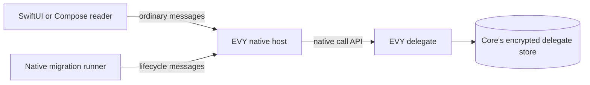
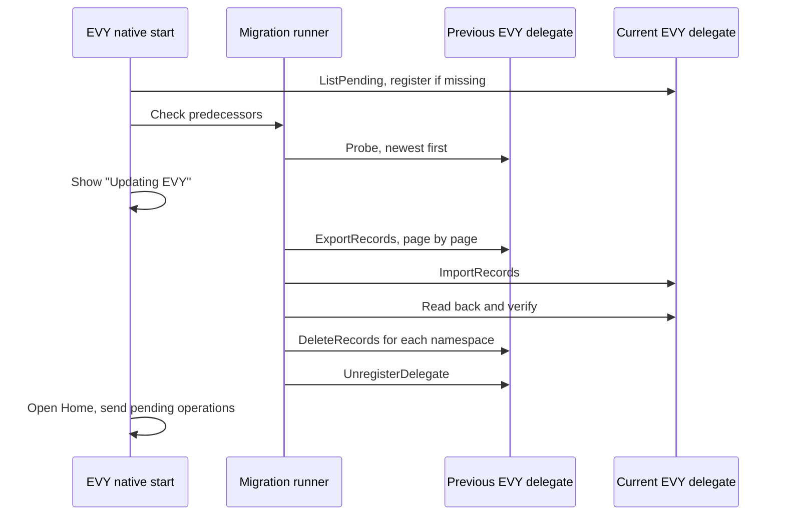

# 2.11 EVY delegate updates and recovery

## Repositories

| Repository | Role | Work in this plan |
| --- | --- | --- |
| [evy](https://github.com/EVY-Platform/evy) | Modified | Lifecycle messages in the EVY delegate in `freenet/delegates/evy/`, its predecessor registry `legacy.toml`, the `migration-dependencies` manifest, the migration step in the native start sequence, backup and Forget screens, and migration fixtures |
| [freenet-core](https://github.com/freenet/freenet-core) | Modified | Native migration runner in `crates/mobile`, exposed to Swift and Kotlin through the admitted native session |
| [freenet-migrate](https://github.com/freenet/freenet-migrate) | Used | freenet-migrate 0.8.0 with `migrate_delegate_secrets_journaled` and the `NewestSnapshotWins` walk; freenet-migrate-build 0.2.0 |
| [freenet-stdlib](https://github.com/freenet/freenet-stdlib) | Used | Delegate interface |
| [freenet-appkit](https://github.com/glesage/freenet-appkit) | Used | Swift package and Kotlin library, the native call API from [2.1 Hello EVY world](01-hello-evy-world.md), and the backup screens from [1.10 Backup and restore](../1-freenet-mobile-appkit/10-backup-and-restore.md) |

## Purpose

This plan keeps the EVY delegate from [The EVY delegate in 2.4 SDUI data and actions](04-data-and-actions.md#the-evy-delegate) working across app updates, backup and Forget. It:

- moves the delegate's records to each new delegate build through the native migration runner
- covers those records in backup through Core's FNSX export
- erases them with Forget
- lists where every EVY record lives

Example: Alice has a saved pickup address and a pending signed operation on her iPhone. She installs an EVY build whose delegate code changed. On first start the runner moves her records to the new delegate. Her keys stay the same, so her pending operation still sends.

## Lifecycle messages

The EVY delegate adds these messages to the ordinary messages from [Ordinary messages in 2.4 SDUI data and actions](04-data-and-actions.md#ordinary-messages):

| Message | Reply | Sent by |
| --- | --- | --- |
| `ExportRecords { after?, limit }` | One page of records and a `next` cursor | The migration runner, reading a predecessor |
| `ImportRecords { records }` | A result per record | The migration runner, writing the current delegate |
| `DeleteRecords { namespace }` | Done | The migration runner, retiring a predecessor. `namespace` is `root_seed`, `addresses`, `drafts` or `pending` |

- Only the native migration runner sends lifecycle messages, through [Native session admission in 2.1 Hello EVY world](01-hello-evy-world.md#native-session-admission). The host authorizes the runner before forwarding a lifecycle call and refuses these calls from the reader's path, under [Caller rules in 2.4 SDUI data and actions](04-data-and-actions.md#caller-rules).
- `ExportRecords` pages hold at most 256 records, under [Bounds in 2.4 SDUI data and actions](04-data-and-actions.md#bounds).
- The native backup screen uses Core's FNSX export. The native Forget screen uses Forget from 1.5 Identity, keys and local protection.

## Application data inventory

| Record | Where it lives | Backup | Forget |
| --- | --- | --- | --- |
| Root seed, addresses, drafts and pending operations | EVY delegate secrets in Core's encrypted store | Core's FNSX export | Erased with the node key |
| Public rows | SwiftData on iOS, Room on Android | Not backed up. Read again from the contracts | Wiped |
| Stored UI documents and contract states | The node's store | Not backed up. Read again from the network | Wiped |

## Backup and Forget

Backup uses existing tools. EVY reuses the mobile parts from [1.10 Backup and restore](../1-freenet-mobile-appkit/10-backup-and-restore.md): the recovery-code screen, the iOS and Android save and open dialogs, and restore.

| Step | What happens |
| --- | --- |
| Export | The native backup screen asks Core for an FNSX export of the EVY delegate's secrets, protected by the recovery code |
| Restore on a fresh phone | Core imports the file. The normal start then runs the [migration check](#updating-the-evy-delegate), which moves records from an older delegate build to the current one |
| Restore on a phone with EVY data | EVY shows what will be lost, runs Forget, then imports |
| Pending operations after restore | EVY asks before it resends restored pending operations |

Restoring records from an older delegate build needs that build's code in the export ([#4035](https://github.com/freenet/freenet-core/issues/4035)). Consistent snapshots follow the upstream issue linked in 1.10 Backup and restore.

Forget uses Forget from [1.5 Identity, keys and local protection](../1-freenet-mobile-appkit/05-identity.md): it erases the node key, then wipes EVY's data folder.

Locking the phone backgrounds EVY. The host stops the node and ends the reader session. A migration in progress stops and resumes on the next start.

## Updating the EVY delegate

A new delegate build has a new key. This plan adds a migration check to the start sequence from [Registration in 2.4 SDUI data and actions](04-data-and-actions.md#registration). It runs after registration and before EVY opens its first screen. On first start of a new build, the native migration runner moves Alice's records from the old delegate to the new one.

| Step | What happens |
| --- | --- |
| 1. Record | `freenet/delegates/evy/legacy.toml` lists every earlier code hash, oldest first. `freenet-migrate-build` generates the table. CI fails when the Wasm changes without a new row. From generation 2 on, CI also fails when the generated table is empty ([freenet-migrate#20](https://github.com/freenet/freenet-migrate/issues/20)) |
| 2. Probe | The runner derives each earlier key from its code hash and probes newest first. Core answers an unregistered key with `DelegateError::Missing` ([#5729](https://github.com/freenet/freenet-core/pull/5729)) |
| 3. Move | The runner calls `migrate_delegate_secrets_journaled` with `NewestSnapshotWins`. It reads with `ExportRecords` and writes with `ImportRecords`. The walk stops at the first predecessor that does not answer |
| 4. Verify | The runner reads the current delegate back. It checks the root seed, the derived public keys, addresses, drafts and the exact pending operation bytes |
| 5. Retire | The runner sends `DeleteRecords` for each namespace to the old delegate, then `UnregisterDelegate` for its key |

EVY opens Home and sends pending operations only after step 4 succeeds. If the move stops early, the old delegate keeps its records and the next start resumes from freenet-migrate's completion record.

### The native migration runner

The runner is Rust in freenet-core's `crates/mobile`. Swift on iOS and Kotlin on Android call it through UniFFI. It uses the admitted native session, reports progress and completion to the EVY app, and authorizes retirement before sending `UnregisterDelegate`.

Use freenet-migrate 0.8.0 and freenet-stdlib 0.12.1 directly in the runner. Core 0.2.152 and freenet-migrate 0.8.0 use the same stdlib types for keys, parameters, messages and errors. Pin the resolved dependencies in `Cargo.lock` and use freenet-migrate-build 0.2.0 for the predecessor table. Sources: [freenet-migrate dependency declaration](https://github.com/freenet/freenet-migrate/blob/66d9d093def9caecf25e7c3ffcfee59cf7d1ed7f/freenet-migrate/Cargo.toml) and [0.8.0 release notes](https://github.com/freenet/freenet-migrate/blob/66d9d093def9caecf25e7c3ffcfee59cf7d1ed7f/CHANGELOG.md).

When changing a contract or delegate's stdlib dependency, record the outgoing Wasm and exact parameters in its predecessor registry before rebuilding. Derive and test the resulting keys on iOS and Android, then run the migration fixtures with the pinned toolchain and dependency set.

Each EVY build records a `migration-dependencies` manifest in evy:

- the Core commit
- the single freenet-stdlib version and checksum shared by Core and the native migration runner
- the freenet-migrate and freenet-migrate-build versions, source revisions and checksums
- the `Cargo.lock` digest

CI fails when the built dependency set differs from the manifest or a production native or Wasm dependency graph contains multiple freenet-stdlib versions. Record the runner's iOS and Android artifact digests with the migration results. Test-network dependencies follow [Test-network dependencies in 1.9 Testing and release](../1-freenet-mobile-appkit/09-testing-and-release.md#test-network-dependencies).

## Acceptance

- A reader that sends `ExportRecords`, `ImportRecords` or `DeleteRecords` is refused by the host.
- On iOS and Android, a second local client is refused export, import, deletion, delegate unregistration and their private replies, including when it claims EVY's identity or omits Origin. Lifecycle calls from an ended session are refused; a fresh admitted runner completes migration.
- With 1,000 pending operations, `ExportRecords` returns every record in pages of at most 256.
- On iOS and Android, a move from delegate generation 1 to 2 keeps the root seed, keys, addresses, drafts and pending operation bytes. A move from generation 1 to 3 works the same.
- Bob's pending skateboard request from [2.7 EVY Marketplace](07-marketplace.md) keeps its signed bytes, including `runtime_context`, through an app update that changes the delegate.
- Interrupting the move before import, after import and before retirement keeps the old records. The next start completes the move. Locking the phone during the move gives the same result.
- After a completed move, the old delegate holds no records, and its key is unregistered.
- CI fails for changed delegate Wasm without a registry row, multiple freenet-stdlib versions in a production graph, or a dependency set that differs from `migration-dependencies`. The pinned freenet-migrate 0.8.0 runner uses Core's stdlib types directly. Migration results record the exact iOS and Android artifacts.
- On iOS and Android, an FNSX backup restores onto a fresh phone. Alice's derived public keys stay the same, and her saved pickup address from 2.7 EVY Marketplace is still there. A backup from delegate generation 1 restores into a generation 2 build and migrates.
- Restoring onto a phone with EVY data shows what will be lost first. EVY asks before it resends restored pending operations.
- After Forget, no EVY record can be read on the phone.
