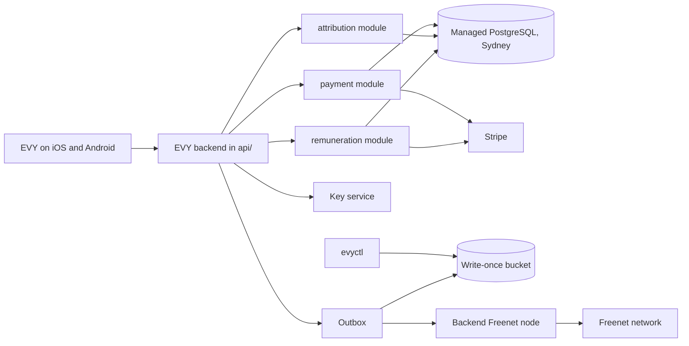
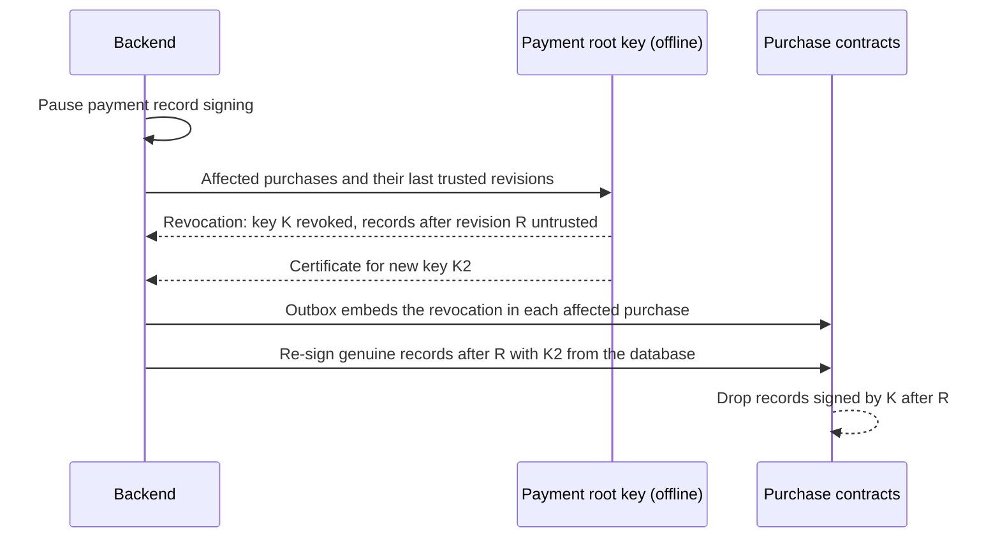

# 2.12 Backend operations and recovery

## Repositories

| Repository | Role | Work in this plan |
| --- | --- | --- |
| [evy](https://github.com/EVY-Platform/evy) | Modified | Deployment of `api/`, the module layout under `api/src/modules/`, the backend outbox store in PostgreSQL, the backend Freenet node, the reports endpoint, the restore drill and the recovery runbooks |
| [freenet-core](https://github.com/freenet/freenet-core) | Used | The backend Freenet node |
| [freenet-stdlib](https://github.com/freenet/freenet-stdlib) | Used | [TypeScript client](https://github.com/freenet/freenet-stdlib/blob/7782c176a622efc3f284ce4710b4f184c4986405/typescript/src/websocket-interface.ts) for the backend node adapter |

## Purpose

This plan runs EVY's backend for milestone 2 (EVY on Freenet) and recovers it after a failure. It defines these shared parts:

- the backend outbox store, which every backend module uses
- the backend Freenet node and what it subscribes to
- the one backend key list
- backups, recovery targets and the restore drill
- signing-key recovery

Other plans define what each module does. This plan runs the modules and brings them back.

Example: Bob pays about 71.48 dollars for Alice's skateboard. Alice confirms the handover and the payment module captures the payment. The database then fails. The team restores it to a point before the capture. The payment module looks up Stripe before capturing again, finds the captured payment and does not charge Bob twice.

## The backend

The backend is the existing `api/` Bun application. Reuse its [server bootstrap](https://github.com/EVY-Platform/evy/blob/d0fb7e6475f1dfc5c74325e37d4e92aed88d84ed/api/src/index.ts#L18), [build and database commands](https://github.com/EVY-Platform/evy/blob/d0fb7e6475f1dfc5c74325e37d4e92aed88d84ed/api/package.json#L8), payment procedures and Stripe webhook handler. Update [`docker-compose.prod.yml`](https://github.com/EVY-Platform/evy/blob/d0fb7e6475f1dfc5c74325e37d4e92aed88d84ed/docker-compose.prod.yml) to deploy one backend application and one backend Freenet node. The database is the managed PostgreSQL service in [Provider requirements](#provider-requirements).

| Module | Code | Database schema | Defined in |
| --- | --- | --- | --- |
| Payment | `api/src/modules/payment` | `payment` | [2.6 Payments](06-payments.md) |
| Attribution | `api/src/modules/attribution` | `attribution` | [2.8 Attribution](08-attribution.md) |
| Remuneration | `api/src/modules/remuneration` | `remuneration` | [2.9 Remuneration and payouts](09-remuneration.md) |

Rules for every module:

- A module writes only to its own schema. Other modules call its interface.
- A module saves its work to the database before it calls Stripe or the network.
- Each module has a health check and a pause switch for incidents and restores.

## Provider requirements

The backend runs with one cloud provider in Sydney. The provider must meet every requirement below.

| Need | Requirement | Provider choice |
| --- | --- | --- |
| Database | Managed PostgreSQL 16 in Sydney. Built-in point-in-time recovery and encryption at rest | Amazon RDS for PostgreSQL in `ap-southeast-2`, with 35 days of point-in-time recovery |
| Key service | Signs with Ed25519 inside the service. Private keys never leave it | AWS KMS, key spec `ECC_NIST_EDWARDS25519`, algorithm `ED25519_SHA_512` ([AWS KMS key specs](https://docs.aws.amazon.com/kms/latest/developerguide/symm-asymm-choose-key-spec.html)) |
| Write-once bucket | Objects cannot be changed or deleted during retention | Amazon S3 with Object Lock in compliance mode |
| Hosting bucket | Keeps every version of each object | Amazon S3 with versioning |

Before setup, confirm Ed25519 support: sign a test message with a KMS key and verify it with the `signed-register/1` vectors from [2.4 SDUI data and actions](04-data-and-actions.md) in Rust, Swift, Kotlin and TypeScript.

## The backend outbox

Every backend module uses the [outbox from 2.1 Hello EVY world](01-hello-evy-world.md#the-outbox) for each job that sends bytes or calls an outside service. The backend keeps the outbox entries in PostgreSQL.

| Step | Freenet job | Stripe job |
| --- | --- | --- |
| 1. Save | Save the exact signed bytes, the contract key and an operation ID in the same database transaction as the change | Save the request, the purchase key and an operation ID in the same transaction |
| 2. Send | Send through the backend Freenet node | Call Stripe with the operation ID as idempotency key and in metadata |
| 3. Read back | GET the contract through a second node. It passes when the state holds these bytes or a higher version | Look Stripe up by metadata (purchase key and operation ID) |
| 4. After a crash | Read back first, then resend the same bytes | Look up first. Create the object only when Stripe has none |

Look-up-first rule: before the payment module creates a PaymentIntent or a refund, or the remuneration module creates a transfer, it searches Stripe for an object with the same purchase key and operation ID. Stripe keeps idempotency keys for only 24 hours ([idempotent requests](https://docs.stripe.com/api/idempotent_requests)), so the look-up protects older entries.

Before publishing, `evyctl` saves each signed UI document, financial policy and deployment record to the write-once bucket and to the EVY git repository, named by its hash. Attribution and disputes look these bytes up by hash.

## The backend Freenet node

The backend node subscribes to these contracts:

- `ui.evy`, from [2.2 EVY UI contracts and publishing](02-ui-contracts.md)
- every contract the live UI document binds, from [2.4 SDUI data and actions](04-data-and-actions.md)
- the listing, purchase and photo contracts in the hosting inventory of [2.7 EVY Marketplace](07-marketplace.md)

When a new UI version binds a new contract, the node adds that subscription.

Every hour a readback check GETs each subscribed contract through a second node. If a contract is missing or older than the saved copy, the check PUTs the saved copy again and raises an alert.

## Keys

This is the one backend key list. [2.10 Testing and release](10-testing-and-release.md) links to it.

| Key | Held in | Used for | Rotation | If lost or leaked |
| --- | --- | --- | --- | --- |
| UI root key | Offline hardware, with a second hardware copy kept in a separate place | Contract parameter of EVY's UI and data contracts. Certifies publishing keys and signs their revocations | Not rotated. A new root changes contract keys and needs new iOS and Android builds | Use the second hardware copy |
| Payment root key | Offline hardware, with a second hardware copy kept in a separate place | Certifies the payment service key. Signs financial policies and payment-key revocations | Not rotated. A new root changes purchase contract keys and needs new iOS and Android builds | Use the second hardware copy |
| Publishing key | Key service. CI uses it; a laptop uses it only in an emergency | Signs UI documents, the hello greeting, lookups, removals and collections through `evyctl` | Yearly | The UI root signs a revocation and certifies a new key. Contracts drop the revoked key's states, as [2.2 EVY UI contracts and publishing](02-ui-contracts.md) defines. `evyctl` republishes the current versions |
| Payment service key | Key service | Signs payment records and the service-signed message list in each purchase | Yearly | Follow [Signing-key recovery](#signing-key-recovery) |
| Attribution key | Key service | Signs attribution snapshots | Yearly | The payment root signs a new policy version with the new attribution key. The attribution module re-signs affected snapshots from its records |
| Backup key | Key service | Encrypts the database, its backups and both buckets | Automatic yearly rotation in the key service, which keeps old key material for decryption | Set the deletion waiting period to 30 days and cancel any deletion request. A leak alone does not expose data, because the key never leaves the key service |
| Stripe credentials | Secrets store | Restricted API keys per module and the webhook secret | [Roll the key](https://docs.stripe.com/keys#rolling-keys) with up to 7 days of overlap. [Roll the webhook secret](https://docs.stripe.com/webhooks) with up to 24 hours of overlap | Roll at once with no overlap |

Keys in the key service have no backup. When one is lost or leaked, create a new key and have its root certify it.

## Backups and recovery targets

The managed database takes automatic backups and keeps 35 days of point-in-time recovery, encrypted with the backup key. Stripe [lists events for 30 days](https://docs.stripe.com/api/events/list), and purchase contracts hold the signed records. Together they recover work lost inside the recovery point.

| Area | What is backed up | Recovery point | Recovery time |
| --- | --- | --- | --- |
| Payment | Seller admissions, listing reservations, private reports, the webhook inbox, the Stripe and Freenet outbox, signed payment records and message lists, card details | 5 minutes | 2 hours, to restore checkout |
| Attribution | Contributor keys and GitHub links, proposals and reviews, reviewer and validator lists, deployment records, snapshots | 5 minutes | 24 hours |
| Remuneration | Allocations, reversals, balances, dispute holds, withdrawals and the transfer outbox | 5 minutes | 24 hours |
| Hosting | Photos, saved copies of listing and purchase contracts, the hosting inventory, the backend node's data directory | Every copy saved before the user saw it as accepted | 24 hours. The network keeps serving while the copies are restored |
| Signed bytes | UI documents, financial policies and deployment records in the write-once bucket and the EVY git repository | Every object saved before publishing | 24 hours |

The backend node's data directory has a daily volume snapshot. If the snapshot is lost, rebuild it from the saved contract copies and the subscription list.

## Restore drill

Run the restore drill before the first live payment, then every quarter. The drill uses a Stripe test-mode skateboard sale.

| Step | Action | Passes when |
| --- | --- | --- |
| 1. Restore | Restore the database to a chosen time in an isolated deployment. Restore the hosting bucket and node data. Use a read-only Stripe key. Pause all modules | Schema versions match. Ledger totals match the restore point |
| 2. Reconcile | Read Stripe events and objects, and the purchase contracts. Match each to an outbox entry | Every Stripe object matches one outbox entry. Unmatched entries stay paused |
| 3. Replay twice | Switch to a Stripe test-mode write key and an isolated Freenet network with test keys. Send every outbox entry twice. Include entries older than 24 hours | Finished work creates no new charge, refund or transfer. One seeded unsent entry creates exactly one |
| 4. Check hosting | PUT the saved copies on the isolated network. Read them through a second node | Every photo, listing and purchase reads back with the saved bytes or a higher version |
| 5. Check signed bytes | Fetch sample UI documents and policies by hash from the write-once bucket | Each hash matches its bytes |
| 6. Record | Record the restore point, time taken and results. Revoke the test keys | Every area meets its recovery targets |

A production restore runs steps 1 and 2 with a live read-only Stripe key. Each module resumes after its own reconciliation passes. The payment module resumes first.

## Reports endpoint

Marketplace reports go to an authenticated backend endpoint. The reader signs each report with the reporter's feature key from the EVY delegate. Reports stay private in the database. Only signed removal decisions and the seller list are public. [2.7 EVY Marketplace](07-marketplace.md) defines the report flow.

## Signing-key recovery

The payment root certifies one payment service key at a time. When that key leaks:

The revocation names, for each affected purchase, key K and the last trusted purchase revision R. The purchase contract checks it with no lookup of another contract, as [The purchase contract in 2.7 EVY Marketplace](07-marketplace.md#the-purchase-contract) defines. The remuneration module then re-checks the affected purchases.

## Acceptance

- A key service signature with `ECC_NIST_EDWARDS25519` verifies with the `signed-register/1` vectors in Rust, Swift, Kotlin and TypeScript.
- The database has point-in-time recovery and encryption on. The write-once bucket rejects a delete during retention.
- Backend outbox: a crash after save, after send and after readback each ends with one effect. A resend uses the same bytes.
- Look-up-first: replaying a Stripe outbox entry older than 24 hours creates no second PaymentIntent, refund or transfer.
- Backend node: the subscription list holds `ui.evy`, every contract the live UI binds and every hosted contract. A test removes a hosted contract from the test network; the readback check PUTs it again.
- The restore drill passes before the first live payment and its record is kept. The quarterly drill repeats it.
- Payment service key drill: the payment root revokes key K with a cutoff. Purchase contracts reject K's records after the cutoff and accept the re-signed records. Remuneration totals stay the same.
- Publishing key drill: the UI root revokes the publishing key. Readers on iOS and Android drop its states and show the republished version.
- The reports endpoint rejects unsigned reports. No report appears in public contract state.
