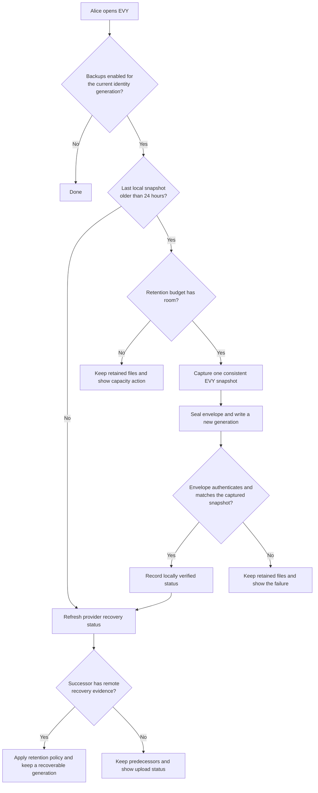

# 3.1 Automated backup

## Repositories

| Repository | Role | Work in this plan |
| --- | --- | --- |
| [evy](https://github.com/EVY-Platform/evy) | Modified | Backup and restore screens in SwiftUI and Compose; folder pickers on iOS and Android |
| [freenet-core](https://github.com/freenet/freenet-core) | Modified | Backup key storage and deletion, daily export and restore in `crates/mobile` |
| [freenet-appkit](https://github.com/glesage/freenet-appkit) | Used | Swift package and Kotlin library that call `crates/mobile` |

## Purpose

On iOS and Android, this plan backs up the EVY delegate's records once a day while EVY is open. [The EVY delegate in 2.11 EVY delegate and private records](../2-evy-on-freenet/11-delegate-and-private-records.md#the-evy-delegate) keeps these records in the node's encrypted secret store from [1.5 Identity, keys and local protection](../1-freenet-mobile-appkit/05-identity.md#what-the-key-protects). This plan reuses the recovery code and restore steps from [Export and import in 1.10 Backup and restore](../1-freenet-mobile-appkit/10-backup-and-restore.md#export-and-import).

Alice turns on backups and picks a folder in iCloud Drive or Google Drive. EVY writes a new backup generation each day she opens the app and shows its local verification and cloud recovery status. She accepts Bob's skateboard purchase for a Saturday pickup, then loses her phone. On a new iOS or Android phone, she installs EVY and restores the file with her recovery code. Bob's purchase appears again.

| Record | Example for Alice | After a restore |
| --- | --- | --- |
| `root_seed` | The seed of her keys for the Hello and Marketplace features | From the backup file |
| Pending records, `pending/<service>/<id>` | A signed edit to her skateboard listing awaiting confirmation in the items contract | From the backup file. The reader sends it on the next start, as [Offline writes in 2.4 SDUI data and actions](../2-evy-on-freenet/04-data-and-actions.md#offline-writes) describes |
| Private addresses, `addresses/<id>` | The pickup address Alice saved before listing the skateboard | From the backup file |
| Purchase records, statuses and payment records | Bob's purchase in its [purchase contract from 2.12 Listings and purchases](../2-evy-on-freenet/12-listings-and-purchases.md#the-purchase-contract), referenced by the listing's admitted live requests or retained sale evidence | From the network and the pilot operator's hosting inventory |
| Listings and UI documents | Her skateboard listing and Marketplace's flows | From the network |
| Sync group data, when enabled | Group manifest, epoch, record schemas, causal contexts and tombstones from [3.2 Device sync](02-sync.md) | From the backup as a recovery snapshot. The new installation joins with fresh device credentials through the current membership authority |

## The backup key

During setup, derive the `application-backup/1` master key from the recovery code using the exact profile and setup salt in [1.10 Backup and restore](../1-freenet-mobile-appkit/10-backup-and-restore.md#the-backup-file). Store that master key in EVY-owned protected device storage, separate from the installation KEK, with the platform settings in [1.5 Identity, keys and local protection](../1-freenet-mobile-appkit/05-identity.md#node-encryption-key). Daily backup derives a fresh envelope key from the stored master key and new envelope salt.

Bind key, setup salt/profile and folder settings to the active EVY identity generation. Confirm the recovery code during setup. Require the phone passcode before folder changes or disabling backups. Files represent their snapshot time, including then-pending records. Forget deletes this master key and folder grants through the global inventory.

## Backup format and provider access

Use `application-backup/1` and the capture, authentication, inventory and staged-restore interfaces defined by [1.10 Backup and restore](../1-freenet-mobile-appkit/10-backup-and-restore.md#the-backup-file). That plan owns envelope/KDF parameters, byte limits, snapshot barriers, source-generation validation and activation. This plan owns scheduling, protected automatic-backup key setup, folder access, upload evidence and retention.

Select EVY's complete inventory under [2.11 EVY delegate and private records](../2-evy-on-freenet/11-delegate-and-private-records.md#application-data-inventory). Use the shared capture/seal operations and coverage report. Sync recovery creates fresh member/replica credentials under [3.2 Device sync](02-sync.md#recovery-and-mixed-versions) and obeys its two-device replacement workflow.

Alice picks the folder with the iOS document picker or Android Storage Access Framework. Recheck the session after selection. EVY keeps an identity-bound security-scoped bookmark on iOS or persistable URI permission on Android. The provider's cellular/Wi-Fi setting controls upload. Record file bytes, that setting and available upload evidence, with OS/provider measurement uncertainty. The Backup page states this policy under [1.11 Cellular data and resource budgets](../1-freenet-mobile-appkit/11-cellular-data-and-resource-budgets.md#accounting-scope-and-external-traffic).

## Running a backup

On iOS and Android, EVY runs Core in the foreground ([Foreground lifecycle in 1.1 Mobile feasibility and supported profiles](../1-freenet-mobile-appkit/01-feasibility.md#foreground-lifecycle)). A backup starts while Alice has EVY open or when she taps "Back up now".

### Recovery status and retention

The Backup page shows the snapshot time and each available evidence level separately:

| Status | Evidence | Meaning for Alice |
| --- | --- | --- |
| Locally verified | EVY reopens the provider file, authenticates the complete envelope and checks its backup ID, snapshot generation and digests | The selected provider returns a valid copy on this phone |
| Provider upload confirmed | The supported provider reports completed remote upload for that exact generation; EVY records the provider identity, file ID, digest and confirmation time | The provider reports that this generation reached its cloud storage |
| Independently recovered | A separate iOS or Android installation downloads the generation from the provider and completes a restore check; the restore screen produces a receipt with its backup ID and digest, which Alice scans or confirms in the source phone's Backup page | That generation has passed recovery on another device |

An iCloud adapter can use [upload status](https://developer.apple.com/documentation/foundation/urlresourcekey/ubiquitousitemisuploadedkey). Each supported iOS and Android provider has a tested adapter that states its evidence level. Local readback from a cached document establishes the first level. Providers that expose only file access show "Saved to folder; cloud upload unconfirmed" until independent recovery supplies evidence. Restoring a file remains available at every level. Independent recovery confirmation belongs to the Backup UI: Alice compares the exact backup ID and digest on the two installations. It works before device sync is enabled.

Retain at most seven completed generations per configured folder, within a 1 GiB EVY backup budget. Reserve space for the next complete generation before writing it. A verified remote generation remains protected until a newer generation has provider upload confirmation or independent recovery evidence. Where neither form of evidence is available, retain completed generations until the budget is reached, then pause automatic backups and offer another folder, a larger user-approved budget or an independent recovery check. Capacity cleanup deletes only generations made eligible by a newer evidenced generation; it always keeps that successor and the newest locally verified generation. Setup shows these limits and each provider's evidence level.

Persist the generation index and cleanup decisions before deletion. Recheck the current EVY identity generation before file publication, provider callbacks and cleanup. Interruption resumes verification or cleanup from the index. A failure keeps protected generations and shows the last local and remote recovery times. Incomplete files can be removed after the coordinator verifies that they are outside the retained set. Foreground capture or writes interrupted by backgrounding retry on the next open.

## Forget and backup cleanup

Use the cleanup coordinator and defining Forget suite in [1.5 Identity, keys and local protection](../1-freenet-mobile-appkit/05-identity.md#forget). Register the automatic-backup resources below in EVY's global inventory so cleanup shares its identity-generation fencing and durable retry journal.

| Resource | Cleanup and verification |
| --- | --- |
| Scheduler and active runs | Disable scheduling, cancel captures/provider writes and expire picker, upload and verification callbacks for the removed generation |
| Protected automatic-backup key | Delete the separate Keychain entry on iOS or Keystore entry on Android and clear controlled cached buffers |
| Local settings and files | Delete setup salt/profile, folder settings, generation index and temporary snapshots/files after the shared coordinator classifies them |
| Provider grants | Stop security-scoped access and delete the bookmark on iOS; release persistable URI permission and trusted grant records on Android |

This plan supplies provider-specific deletion/grant evidence to the shared cleanup report. A failed deletion remains pending through restart and gates new backup setup. Earlier cloud files remain recoverable with their recovery code; the report identifies those retained provider copies.

## Restoring on a new phone

The trusted first-run screen on iOS and Android opens the shared restore flow in [1.10 Backup and restore](../1-freenet-mobile-appkit/10-backup-and-restore.md#restore), using EVY's record adapters from [2.11 EVY delegate and private records](../2-evy-on-freenet/11-delegate-and-private-records.md#updating-the-evy-delegate). Show snapshot time, coverage and supported path before confirmation. Open EVY after the coordinator reports complete activation; discover purchases through the operator's [Pilot hosting in 2.7 EVY Marketplace](../2-evy-on-freenet/07-marketplace.md#pilot-hosting) inventory.

After activation, store the automatic-backup key for the current identity generation and ask Alice to select a folder. A setup failure leaves the restored identity active and offers a retry; daily scheduling starts after both key and folder access verify. The shared Forget coordinator expires delayed setup callbacks.

Cross-platform recovery uses a provider tested on iOS and Android. Google Drive is a target provider. Record OS/provider versions, picker and persistent-access results, file IDs/digests, upload evidence and a restore from a separately downloaded generation.

## Acceptance

| Defining suite | Evidence consumed by this plan |
| --- | --- |
| [1.10 Backup and restore](../1-freenet-mobile-appkit/10-backup-and-restore.md#acceptance) | Complete authenticated snapshots, wrong/damaged files, supported predecessor paths, interruption and atomic activation; manual/automatic cross-restore with EVY adapters |
| [1.5 Identity, keys and local protection](../1-freenet-mobile-appkit/05-identity.md#acceptance) | Protected key settings, lock, global Forget, deletion retry and stale-generation rejection |
| [2.11 EVY delegate and private records](../2-evy-on-freenet/11-delegate-and-private-records.md#acceptance) | EVY keys, addresses and exact pending-operation coverage through restore/migration |

Run these suites on the same iOS and Android artifacts and retain their defining results once. This plan owns the following scheduler/provider checks:

- Opening EVY more than 24 hours after the last locally verified snapshot writes one new generation when the retention budget permits it. Background interruption retries on next open and preserves retained generations.
- A fresh iOS and Android installation restores a provider-downloaded file, then resolves Bob's open purchase through the hosting inventory. iOS-to-Android and Android-to-iOS runs distinguish private-record recovery from network availability.
- Failure to store the automatic-backup key or folder grant after activation keeps the identity usable and offers retry. A folder change requires the phone passcode and current identity generation.
- Full/removed folders, failed writes and damaged new provider files preserve the last verified generation and show the failed run.
- Forget during provider upload, verification, setup or post-restore key storage supplies the shared cleanup suite with separate-key deletion, grant-release and stale-callback evidence. Interrupted grant/key deletion retries before a new identity enables scheduling. Retained cloud files still open with their recovery code.

- On iOS and Android, provider-local readback alone shows locally verified status. Delayed upload, offline operation, quota failure, provider sign-out and process termination retain the known recoverable predecessor. A supported provider's exact-generation upload confirmation or an independently recovered successor makes predecessor cleanup eligible.
- On iOS and Android, a provider without upload evidence retains generations within the configured limits, pauses at capacity and shows the available action. Interrupted cleanup and reordered provider callbacks retain a recoverable generation and respect Forget's identity-generation checks.
- On iOS and Android, a separate installation restores a provider-downloaded generation after the source phone is unavailable. The run records the file identity, digest, provider/OS versions and recovery evidence. Restore tests distinguish private-record recovery from purchase and listing availability on the supported Freenet network.
