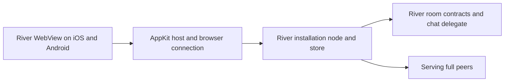
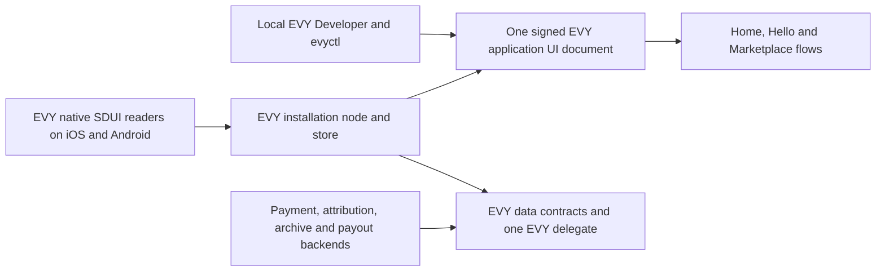

# EVY + Freenet <3

These plans lay out how we might build the [EVY plantform](https://github.com/EVY-Platform/evy) on top of Freenet. The 1st milestone is simply to add a generic mobile ecosystem in order to allow app builders to create native mobile apps on freenet, while the other 2 milestones focus on building EVY. Feel free to only read milestone 1 if you have limited time (:

## EVY's vision

Imagine smartphones and the internet built by the people, for the people. We want to enable anyone to connect consumers to services, free from gatekeepers taking a cut, and compensate contributors fairly.

A driver could deliver food without a middleman taking 30%. You could sell your skateboard without your data being used to target you with ads. Bringing these services together in one open platform means you can use the same identity and payment setup, instead of downloading another app, signing up and entering your details each time.

That is the vision for EVY. Its code and data are open for anyone to inspect, so people can verify how it works. Private data stays protected and is shared only with the parties who need it, such as an address sent directly to the driver making a delivery, not to the cloud.

EVY starts with a simple idea: a super app on your phone that acts as your identity and your key. The app is community built, and those contributors get paid when an in-app transaction uses their functionality, giving them a reason to build useful features.

A server-driven UI system ensures consistent design and allows contributors and agents to quickly create applications and release them to customers in realtime instead of going through app store release cycles.

The initial launch product is a Marketplace (facebook/craigslist style) because we believe we can build a 10x better product than what is out there.

EVY fits with Freenet perfectly as it's peer network distributes applications and verifies who published them, and its delegates keep private data and signing keys on the device.

## Roadmap

### Milestone 1 (Freenet mobile AppKit)

Use River as the AppKit test application on iOS and Android. Its signed web UI runs in one WebView served by the installation's embedded node. Its existing room contracts and chat delegate exercise the mobile lifecycle, network, permissions and recovery paths.

- [1.1 Mobile feasibility and supported profiles](1-freenet-mobile-appkit/01-feasibility.md)
- [1.2 Embedded node and mobile SDK](1-freenet-mobile-appkit/02-sdk.md)
- [1.3 Single-application host](1-freenet-mobile-appkit/03-host.md)
- [1.4 Application bundles](1-freenet-mobile-appkit/04-bundles.md)
- [1.5 Identity, keys and local protection](1-freenet-mobile-appkit/05-identity.md)
- [1.6 Application protocols, data and operations](1-freenet-mobile-appkit/06-data-and-operations.md)
- [1.7 Upgrades and migration](1-freenet-mobile-appkit/07-migration.md)
- [1.8 Thin-peer protocol](1-freenet-mobile-appkit/08-thin-peer.md)
- [1.9 Testing and release](1-freenet-mobile-appkit/09-testing-and-release.md)
- [1.10 Backup and restore](1-freenet-mobile-appkit/10-backup-and-restore.md)
- [1.11 Cellular data and resource budgets](1-freenet-mobile-appkit/11-cellular-data-and-resource-budgets.md)

### Milestone 2 (EVY on Freenet)

Build EVY as one published Freenet application on iOS and Android, with native SDUI readers. MVP of EVY Developer editor is also part of this milestone, along with attribution and remuneration.

- [2.1 Hello EVY world](2-evy-on-freenet/01-hello-evy-world.md)
- [2.2 EVY UI contracts and publishing](2-evy-on-freenet/02-ui-contracts.md)
- [2.3 Native SDUI readers](2-evy-on-freenet/03-readers.md)
- [2.4 SDUI data and actions](2-evy-on-freenet/04-data-and-actions.md)
- [2.5 EVY authoring and publishing](2-evy-on-freenet/05-developer.md)
- [2.6 Payments](2-evy-on-freenet/06-payments.md)
- [2.7 EVY Marketplace](2-evy-on-freenet/07-marketplace.md)
- [2.8 Attribution](2-evy-on-freenet/08-attribution.md)
- [2.9 Remuneration and payouts](2-evy-on-freenet/09-remuneration.md)
- [2.10 Testing and release](2-evy-on-freenet/10-testing-and-release.md)
- [2.11 EVY delegate and private records](2-evy-on-freenet/11-delegate-and-private-records.md)
- [2.12 Listings and purchases](2-evy-on-freenet/12-listings-and-purchases.md)
- [2.13 Release archive and policy evidence](2-evy-on-freenet/13-release-archive-and-policy-evidence.md)
- [2.14 Backend operations and recovery](2-evy-on-freenet/14-backend-operations-and-recovery.md)

### Milestone 3 (Optional extensions)

- [3.1 Automated backup](3-optional-extensions/01-backup.md)
- [3.2 Device sync](3-optional-extensions/02-sync.md)
- [3.3 Peer reputation](3-optional-extensions/03-reputation.md) (idea note)
- [3.4 Live authoring collaboration](3-optional-extensions/04-collaboration.md) (idea note)
- [3.5 Saved payment methods](3-optional-extensions/05-payment-methods.md) (idea note)
- [3.6 EVY services for Freenet apps](3-optional-extensions/06-evy-services-for-freenet-apps.md) (idea note)
- [3.7 Bitcoin payments](3-optional-extensions/07-bitcoin-payments.md) (idea note)

## Decision gates

New adds mobile, application or tooling functionality. **Change** modifies shared Core behavior or its protocol, including proposals that also add functionality.

| Today | Type | Proposal |
| --- | --- | --- |
| [Core](https://github.com/freenet/freenet-core) runs a node and provides client APIs for contract operations. | New | Add a mobile crate with node lifecycle and contract APIs, plus Swift bindings for iOS and Kotlin bindings for Android. [1.2](1-freenet-mobile-appkit/02-sdk.md#what-to-build) |
| [The browser client](https://github.com/freenet/freenet-stdlib) has contract calls and delegate message formats. | **Change** | Add public browser methods to register, unregister and message delegates, and match replies to the requesting call. [1.2](1-freenet-mobile-appkit/02-sdk.md#application-connections) |
| [Core](https://github.com/freenet/freenet-core) authenticates connections and sends delegate notifications to local clients that have messaged the delegate. | **Change** | Bind calls and private replies to the verified app and current session, with component access and permissions users can revoke. [1.3](1-freenet-mobile-appkit/03-host.md#freenet-issues-being-worked-on-that-are-required) |
| [Core](https://github.com/freenet/freenet-core) handles delegate prompts and startup consent through its own prompter. | New | Expose a host-supplied prompter so iOS and Android apps show delegate prompts and startup consent in trusted native screens. [1.3](1-freenet-mobile-appkit/03-host.md#background-runs-and-delegate-prompts) |
| [Core](https://github.com/freenet/freenet-core) resolves gateway hostnames during node startup. | **Change** | Move gateway lookups into the join loop so River opens saved rooms offline and connects when a signal returns. [1.2](1-freenet-mobile-appkit/02-sdk.md#gateway-hostnames) |
| [Core](https://github.com/freenet/freenet-core) returns `PeerNotJoined` for updates, writes and subscriptions before joining Freenet. | **Change** | Allow local reads, message updates and subscriptions before the first join; send saved changes when Freenet connects. [1.2](1-freenet-mobile-appkit/02-sdk.md#local-operations-before-the-first-join) |
| [Core](https://github.com/freenet/freenet-core) loads and runs contract and delegate Wasm code. | **Change** | Enforce each iOS and Android build's permitted code, parameters and roles before execution, including code used for upgrades and recovery. [1.4](1-freenet-mobile-appkit/04-bundles.md#execution-policy) |
| [Core](https://github.com/freenet/freenet-core) stores its node encryption key in a file, systemd credential or desktop keyring. | New | Add iOS Keychain and Android Keystore backends for the node encryption key that protects private records. [1.5](1-freenet-mobile-appkit/05-identity.md#node-encryption-key) |
| [Core](https://github.com/freenet/freenet-core) keeps loaded encryption keys in memory; River's page holds signing keys and decrypted records. | **Change** | Add a lock/unlock API that stops signing, clears controlled keys and plaintext, and opens fresh sessions after unlock. [1.5](1-freenet-mobile-appkit/05-identity.md#locking-and-unlocking) |
| [The Rust migration library](https://github.com/freenet/freenet-migrate) moves contract state and delegate secrets through application adapters. | New | Release a compatible migration library with Swift bindings for iOS and Kotlin bindings for Android, preserving keys, drafts and pending messages across upgrades. [1.7](1-freenet-mobile-appkit/07-migration.md#mobile-migration-interface) |
| [Core](https://github.com/freenet/freenet-core) exports delegate secrets in passphrase-encrypted FNSX files. | **Change** | Extend FNSX with a versioned application backup containing secrets, host records, delegate code and registrations, so supported earlier backups restore on new phones. [1.10](1-freenet-mobile-appkit/10-backup-and-restore.md#the-backup-file) |
| [Core](https://github.com/freenet/freenet-core) exports delegate secrets; River's UI and CLI export room identities. | **Change** | Capture keys, drafts, pending signed messages and host records as one consistent snapshot, pausing writes while the snapshot is taken. [1.10](1-freenet-mobile-appkit/10-backup-and-restore.md#export) |
| [Core](https://github.com/freenet/freenet-core) imports secrets individually into the selected store. | **Change** | Import into a separate staging store, validate the complete restore, then switch stores atomically. [1.10](1-freenet-mobile-appkit/10-backup-and-restore.md#staged-restore-transaction) |
| [Core](https://github.com/freenet/freenet-core)'s network peers route requests and host contract data. | **Change** | Add a negotiated thin-peer role with retained connections; phones verify application state while full peers route requests and host network data. [1.8](1-freenet-mobile-appkit/08-thin-peer.md#scope-and-trust-boundary) |
| [Core](https://github.com/freenet/freenet-core) counts uploads at the socket and downloads after successful decryption. | **Change** | Count incoming bytes before authentication, save cellular usage and close Freenet's cellular connections at the user's data limit. [1.11](1-freenet-mobile-appkit/11-cellular-data-and-resource-budgets.md#cellular-budget-contract) |
| [fdev website publish](https://github.com/freenet/freenet-core) archives, signs and submits a release in one command. | New | Split release preparation and submission. Save the signed release before upload so interrupted uploads retry the same bytes, signature and version. [1.4](1-freenet-mobile-appkit/04-bundles.md#prepare-and-submit) |
| [River](https://github.com/freenet/river) bundles its web UI, room contract and chat delegate Wasm files. | New | Add `app_definition.json` naming River's code, protocols and permissions so the host verifies components, checks access and selects recovery adapters. [1.4](1-freenet-mobile-appkit/04-bundles.md#river-release-metadata) |
| [River](https://github.com/freenet/river) signs chat messages in its page and submits them to the room contract. | New | Add delegate storage for drafts and exact signed messages, with save confirmations and version checks, so Bob resumes sending after restart. [1.6](1-freenet-mobile-appkit/06-data-and-operations.md#bobs-saved-draft) |

### Optional decisions

| Today | Type | Proposal |
| --- | --- | --- |
| [Core](https://github.com/freenet/freenet-core) reserves 256 MiB per Wasm instance and reads its memory address before guest calls. | **Change** | Read memory addresses again after contract and delegate calls to allow smaller reservations. Adopt default executor and Store limits after maintainer approval and passing iOS and Android tests. [1.2](1-freenet-mobile-appkit/02-sdk.md#running-wasm) |
| [Core](https://github.com/freenet/freenet-core) forwards client updates as full merged state and resends contract code in PUT and GET transfers. | **Change** | Send client UPDATE deltas and reduce repeated transfers after agreeing protocol compatibility and passing sender/receiver tests. Select further optimizations according to measured traffic and data-limit requirements. [1.11](1-freenet-mobile-appkit/11-cellular-data-and-resource-budgets.md#client-update-deltas), [1.8](1-freenet-mobile-appkit/08-thin-peer.md#upstream-work-and-carrier-evidence) |
| [Core](https://github.com/freenet/freenet-core) stores contract state, shares it with peers and evicts copies according to demand and storage limits. | **Change** | Add bounded contract pinning, improve persistence and restore hosting demand after restart. Adopt stronger retention and offline delivery guarantees after maintainer agreement and passing eviction and restart tests. [1.6](1-freenet-mobile-appkit/06-data-and-operations.md#core-retention-and-offline-delivery) |
| [Core](https://github.com/freenet/freenet-core) stores delegate secrets; applications transfer them through predecessor and successor message handlers. | **Change** | Let Core verify delegate publishers and transfer secrets to approved successor delegates. Adopt after maintainer agreement and tests verifying publisher identity, secret transfer and preserved application records. [1.7](1-freenet-mobile-appkit/07-migration.md#core-assisted-migration) |
| [Core](https://github.com/freenet/freenet-core) exports and imports delegate secrets through passphrase-encrypted FNSX files. | **Change** | Let passkeys unlock the backup master key after maintainer and recovery-lead agreement. Enable after iOS and Android tests verify cross-platform recovery and access from trusted recovery screens. [1.10](1-freenet-mobile-appkit/10-backup-and-restore.md#optional-passkey-recovery) |
| [Core](https://github.com/freenet/freenet-core) delegates can read and subscribe over the network; their updates use the local store. | **Change** | Agree the sync protocol and protected device-key interfaces with Core maintainers; add delegate network updates and subscription recovery. Enable after security review, naming an owner and iOS and Android pairing, removal and recovery tests. [3.2](3-optional-extensions/02-sync.md#what-core-still-needs) |

## Sources

Repository sources with a checked commit below are pinned to that commit for these plans.

- [freenet/freenet-core](https://github.com/freenet/freenet-core): checked commit [`e7d0b06c9326f377d250bf8344baaac2ba2658c6`](https://github.com/freenet/freenet-core/commit/e7d0b06c9326f377d250bf8344baaac2ba2658c6)
- [freenet/river](https://github.com/freenet/river): checked commit [`8cf54dd7799514851da7eab051e4cc43f797208d`](https://github.com/freenet/river/commit/8cf54dd7799514851da7eab051e4cc43f797208d)
- [freenet/freenet-migrate](https://github.com/freenet/freenet-migrate): checked commit [`74aed27eaec8a4347b47fa2665ea511d2fd14175`](https://github.com/freenet/freenet-migrate/commit/74aed27eaec8a4347b47fa2665ea511d2fd14175)
- [freenet/freenet-stdlib](https://github.com/freenet/freenet-stdlib): checked commit [`fca0848b78b12942f77422309bb07f76108940d6`](https://github.com/freenet/freenet-stdlib/commit/fca0848b78b12942f77422309bb07f76108940d6)
- [EVY-Platform/evy](https://github.com/EVY-Platform/evy): checked commit [`d0fb7e6475f1dfc5c74325e37d4e92aed88d84ed`](https://github.com/EVY-Platform/evy/commit/d0fb7e6475f1dfc5c74325e37d4e92aed88d84ed)
- [freenet/delta](https://github.com/freenet/delta): checked commit [`6e8c96031642e03f9cdcbe1bea71059b03699b1d`](https://github.com/freenet/delta/commit/6e8c96031642e03f9cdcbe1bea71059b03699b1d)
- [freenet/harvest](https://github.com/freenet/harvest): checked commit [`9eb4a04ed30e75c478df0b89f38f68044bbd947c`](https://github.com/freenet/harvest/commit/9eb4a04ed30e75c478df0b89f38f68044bbd947c)
- [freenet/atlas](https://github.com/freenet/atlas): checked commit [`051e38033e81a4232341ffa4360af94232e7809b`](https://github.com/freenet/atlas/commit/051e38033e81a4232341ffa4360af94232e7809b)
- [glesage/freenet-appkit](https://github.com/glesage/freenet-appkit): checked commit [`1988c5cbdfc5c1f88065382de2a4f86093948b6e`](https://github.com/glesage/freenet-appkit/commit/1988c5cbdfc5c1f88065382de2a4f86093948b6e)
- [freenet/paper-1](https://github.com/freenet/paper-1): checked commit [`bff15702759800a003ffbfce639fe859f57d966d`](https://github.com/freenet/paper-1/commit/bff15702759800a003ffbfce639fe859f57d966d)
- [freenet/freenet-agent-skills](https://github.com/freenet/freenet-agent-skills): checked commit [`890ad1b20c03ee99dd0a0ae89ec3e3b17c19eac4`](https://github.com/freenet/freenet-agent-skills/commit/890ad1b20c03ee99dd0a0ae89ec3e3b17c19eac4)
- [Ghostkeys](https://github.com/freenet/ghostkeys)
- [freenet-test-network](https://github.com/freenet/freenet-test-network)
- [freenet-bitcoin](https://github.com/freenet/freenet-bitcoin)
- [freenet-wiki](https://github.com/freenet/freenet-wiki)
- [freenet.org website](https://github.com/freenet/web)

Sources also include related discussions, issues, pull requests and RFCs.
