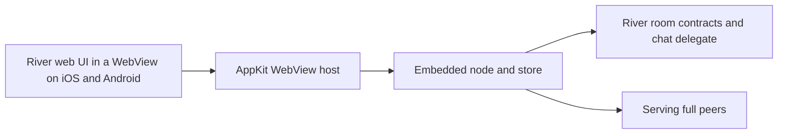
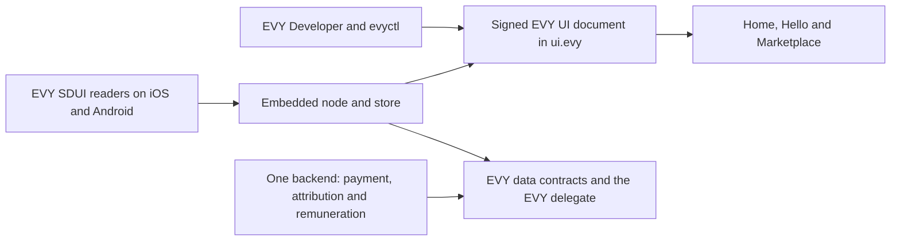

# EVY + Freenet <3

## EVY's vision

Imagine smartphones and the internet built by the people, for the people. We want to enable anyone to connect consumers to services, free from gatekeepers taking a cut, and compensate contributors fairly.

A driver could deliver food without a middleman taking 30%. You could sell your skateboard without your data being used to target you with ads. Bringing these services together in one open platform means you can use the same identity and payment setup, instead of downloading another app, signing up and entering your details each time.

That is the vision for EVY. Its code and data are open for anyone to inspect, so people can verify how it works. Private data stays protected and is shared only with the parties who need it, such as an address sent directly to the driver making a delivery, not to the cloud.

EVY starts with a simple idea: a super app on your phone that acts as your identity and your key. The app is community built, and those contributors get paid when an in-app transaction uses their functionality, giving them a reason to build useful features.

A server-driven UI system ensures consistent design and allows contributors and agents to quickly create applications and release them to customers in realtime instead of going through app store release cycles.

The initial launch product is a Marketplace (facebook/craigslist style) because we believe we can build a 10x better product than what is out there.

EVY fits with Freenet perfectly as it's peer network distributes applications and verifies who published them, and its delegates keep private data and signing keys on the device.

## Roadmap

### Milestone 1 (Freenet mobile AppKit)

Run River on iOS and Android, embedding a Freenet node and showing River's signed web UI in a WebView. The Swift package for iOS and the Kotlin package for Android start, stop and report on the node and run the WebView host.

- [1.1 Mobile feasibility and supported profiles](1-freenet-mobile-appkit/01-feasibility.md)
- [1.2 Embedded node and mobile SDK](1-freenet-mobile-appkit/02-sdk.md)
- [1.3 Single-application host](1-freenet-mobile-appkit/03-host.md)
- [1.4 Application bundles](1-freenet-mobile-appkit/04-bundles.md)
- [1.5 Identity, keys and local protection](1-freenet-mobile-appkit/05-identity.md)
- [1.6 Application protocols, data and operations](1-freenet-mobile-appkit/06-data-and-operations.md)
- [1.7 Upgrades and migration](1-freenet-mobile-appkit/07-migration.md)
- [1.8 Thin-peer protocol](1-freenet-mobile-appkit/08-thin-peer.md)
- [1.9 Testing and release](1-freenet-mobile-appkit/09-testing-and-release.md)
- [1.10 Backup and restore](1-freenet-mobile-appkit/10-backup-and-restore.md)

### Milestone 2 (EVY on Freenet)

Build EVY's native SDUI app: a SwiftUI reader on iOS and a Compose reader on Android, on the node from milestone 1 (Freenet mobile AppKit). EVY is the first app with many contracts: signed UI documents, data and actions, the EVY Developer editor, Marketplace payments, attribution and remuneration.

- [2.1 Hello EVY world](2-evy-on-freenet/01-hello-evy-world.md)
- [2.2 EVY UI contracts and publishing](2-evy-on-freenet/02-ui-contracts.md)
- [2.3 Native SDUI readers](2-evy-on-freenet/03-readers.md)
- [2.4 SDUI data and actions](2-evy-on-freenet/04-data-and-actions.md)
- [2.5 EVY authoring and publishing](2-evy-on-freenet/05-developer.md)
- [2.6 Payments](2-evy-on-freenet/06-payments.md)
- [2.7 EVY Marketplace](2-evy-on-freenet/07-marketplace.md)
- [2.8 Attribution](2-evy-on-freenet/08-attribution.md)
- [2.9 Remuneration and payouts](2-evy-on-freenet/09-remuneration.md)
- [2.10 Testing and release](2-evy-on-freenet/10-testing-and-release.md)
- [2.11 EVY delegate updates and recovery](2-evy-on-freenet/11-delegate-updates-and-recovery.md)
- [2.12 Backend operations and recovery](2-evy-on-freenet/12-backend-operations-and-recovery.md)

### Milestone 3 (Optional extensions)

These are idea notes. Each becomes a full plan when its trigger in "When this becomes a plan" is met.

- [3.1 Automated backup](3-optional-extensions/01-backup.md)
- [3.2 Device sync](3-optional-extensions/02-sync.md)
- [3.3 Peer reputation](3-optional-extensions/03-reputation.md)
- [3.4 Live authoring collaboration](3-optional-extensions/04-collaboration.md)
- [3.5 Saved payment methods](3-optional-extensions/05-payment-methods.md)
- [3.6 EVY services for Freenet apps](3-optional-extensions/06-evy-services-for-freenet-apps.md)
- [3.7 Bitcoin payments](3-optional-extensions/07-bitcoin-payments.md)

## Release gates

Each plan owns its acceptance tests. A release ships only when the plans listed here pass on the exact iOS and Android builds being released.

| Release | Channels | Plans that must pass | Also required |
| --- | --- | --- | --- |
| River test release, end of milestone 1 (Freenet mobile AppKit) | TestFlight internal testing on iOS, Play internal testing on Android | All plans in milestone 1 (Freenet mobile AppKit) | Every build runs as a thin peer |
| River public release | App Store and Google Play | All plans in milestone 1 (Freenet mobile AppKit) | Core session admission ([#5264](https://github.com/freenet/freenet-core/issues/5264)) |
| EVY pilot and live users, end of milestone 2 (EVY on Freenet) | External TestFlight and Play closed testing (both reviewed), then the App Store and Google Play | All plans in milestone 2 (EVY on Freenet) | Organization Apple and Play developer accounts; authenticated native sessions under [2.1 Hello EVY world](2-evy-on-freenet/01-hello-evy-world.md#native-session-admission), implemented and tested on both builds |

Both milestones use the release evidence owned by [1.9 Testing and release](1-freenet-mobile-appkit/09-testing-and-release.md):

| Evidence | Required result |
| --- | --- |
| Embedded node teardown | Repeated in-process start and stop passes [1.2 Embedded node and mobile SDK](1-freenet-mobile-appkit/02-sdk.md#acceptance), including termination of node-owned background tasks ([Core #6048](https://github.com/freenet/freenet-core/issues/6048)) |
| Merge-law coverage | The pinned verifier checks the required properties and near-capacity fixtures under [Merge-law coverage in 1.9 Testing and release](1-freenet-mobile-appkit/09-testing-and-release.md#merge-law-coverage) |
| NAT harness dependencies | Each linked harness binary passes [Test-network dependencies in 1.9 Testing and release](1-freenet-mobile-appkit/09-testing-and-release.md#test-network-dependencies), including its stdlib and linker checks ([Core #5950](https://github.com/freenet/freenet-core/issues/5950)) |
| Mobile release profile | Exact iOS and Android artifacts record effective runtime, transport and bandwidth settings under [1.1 Mobile feasibility and supported profiles](1-freenet-mobile-appkit/01-feasibility.md#release-profile-evidence) |

## Shared conventions

### Example UI versions

Plans use these EVY UI versions in their examples.

| UI version | Contents | Plan |
| --- | --- | --- |
| 1 | Home and Hello, static pages | 2.2 EVY UI contracts and publishing |
| 2 | Hello binds the greeting through `signed-value/1` | 2.4 SDUI data and actions |
| 3 | Marketplace test item | 2.7 EVY Marketplace |
| 4 | Marketplace flows and Home search | 2.7 EVY Marketplace |
| 5 | Carol's accepted Marketplace change and the contribution snapshot | 2.8 Attribution |
| 6 | Reader-upgrade fixture with a new reader generation | 2.10 Testing and release |

Financial policy 1 starts payments in 2.6 Payments. Policy 2 adds attribution in 2.8 Attribution. Alice sells her skateboard to Bob under UI version 4 and policy 1: Bob pays about 71.48 dollars, Alice receives 69.30 and contributors share 0.70.

### Names

| Concept | Name |
| --- | --- |
| River's signed website release | Bundle: the website container holding `index.html`, `app_definition.json` and Wasm files |
| EVY UI document format and signing domain | `evy-ui/1` |
| Internal EVY feature | `feature`, for example `feature: "marketplace"`. Pull request trailer `EVY-Feature:` |
| EVY application namespace | `service: "evy"`, only in the UI envelope |
| EVY signed record format | `signed-register/1` |
| Save exact bytes, send, read back, resend after a crash | Outbox, one library defined in 2.1 Hello EVY world |
| The payment module's Marketplace admission and reservation role | Listing authority |

### People

Plans own their rules. People who hold keys or roles are named here once.

| Role | Plans | Person |
| --- | --- | --- |
| River publisher key holder | 1.4 Application bundles | To be named |
| EVY UI root and payment root key holders | 2.1 Hello EVY world | To be named |
| Marketplace moderators | 2.7 EVY Marketplace | To be named |
| Backend operators | 2.12 Backend operations and recovery | To be named |

## Decision gates

| Type | Meaning |
| --- | --- |
| New | Adds mobile, application or tooling functionality |
| **Change** | Modifies shared Core behavior or its protocol |
| Release profile | Chooses Core settings for the release builds, with no code change |

| Today | Type | Proposal |
| --- | --- | --- |
| [Core](https://github.com/freenet/freenet-core) runs a node and provides client APIs for contract operations. | New | Add `crates/mobile` with node lifecycle, WebView host support and Swift bindings for iOS and Kotlin bindings for Android. [1.2 Embedded node and mobile SDK](1-freenet-mobile-appkit/02-sdk.md#sdk-interface-and-packages) |
| [Core](https://github.com/freenet/freenet-core) treats every loopback connection as local. | **Change** | Session admission upstream ([#5264](https://github.com/freenet/freenet-core/issues/5264)), so other apps on the phone cannot reach River's node. Public release waits for it. [1.3 Single-application host](1-freenet-mobile-appkit/03-host.md#freenet-issues-being-worked-on-that-are-required) |
| [Core](https://github.com/freenet/freenet-core) monitors node background tasks. | **Change** | Complete task cancellation and teardown under [#6048](https://github.com/freenet/freenet-core/issues/6048), then verify repeated in-process lifecycles on iOS and Android. [1.2 Embedded node and mobile SDK](1-freenet-mobile-appkit/02-sdk.md#start-stop-and-reconnect) |
| [Core](https://github.com/freenet/freenet-core) resolves gateway hostnames during node startup and returns `PeerNotJoined` before joining. | **Change** | Resolve gateways in the join loop and serve stored contracts and delegate storage before the first join, so Alice opens "Skate club" offline. [1.2 Embedded node and mobile SDK](1-freenet-mobile-appkit/02-sdk.md#offline-startup) |
| [Core](https://github.com/freenet/freenet-core) runs Wasm with configured reservations, executors and Store replacement limits. | Release profile | Use the measured fixed-reservation profile for the first iOS and Android release, with Android on arm64-v8a and x86_64. [1.2 Embedded node and mobile SDK](1-freenet-mobile-appkit/02-sdk.md#running-wasm) |
| [Core](https://github.com/freenet/freenet-core) stores its node encryption key in a file, systemd credential or desktop keyring. | New | Add a host-supplied key backend. Swift keeps the key in the iOS Keychain and Kotlin in the Android Keystore. [1.5 Identity, keys and local protection](1-freenet-mobile-appkit/05-identity.md#node-encryption-key) |
| [Core](https://github.com/freenet/freenet-core)'s network peers route requests and host contract data. | **Change** | Extend the outbound-only light-client proposal ([#5917](https://github.com/freenet/freenet-core/issues/5917)) with the thin-peer role: phones verify their own data while at least two serving full peers route and host. [1.8 Thin-peer protocol](1-freenet-mobile-appkit/08-thin-peer.md#scope-and-trust-boundary) |
| [Core](https://github.com/freenet/freenet-core) exports delegate secrets but not the delegate code that wrote them. | **Change** | Include delegate code in exports ([#4035](https://github.com/freenet/freenet-core/issues/4035)), and file an issue for consistent snapshots, so old River backups restore on a new phone. [1.10 Backup and restore](1-freenet-mobile-appkit/10-backup-and-restore.md#older-river-releases) |
| [River](https://github.com/freenet/river) bundles its web UI, room contract and chat delegate Wasm files. | New | Add `app_definition.json` with River's name, host API, delegates and permissions. [1.4 Application bundles](1-freenet-mobile-appkit/04-bundles.md#app_definitionjson) |
| [River](https://github.com/freenet/river) signs chat messages in its page and submits them to the room contract. | New | Keep each draft and pending message under its own key in the chat delegate until the network has the message. Answer the host's `flush_request` and send `migration_done`. [1.6 Application protocols, data and operations](1-freenet-mobile-appkit/06-data-and-operations.md#bobs-saved-draft) |
| [Core](https://github.com/freenet/freenet-core) clients call contracts and delegates over a WebSocket. | New | Add a native contract and delegate call API to `crates/mobile` for EVY's Swift and Kotlin readers. Bind every connection and equivalent API path to the authenticated native host session under [#5264](https://github.com/freenet/freenet-core/issues/5264). [2.1 Hello EVY world](2-evy-on-freenet/01-hello-evy-world.md#native-session-admission) |
| [freenet-migrate 0.8.0](https://github.com/freenet/freenet-migrate/blob/66d9d093def9caecf25e7c3ffcfee59cf7d1ed7f/CHANGELOG.md) and Core use stdlib 0.12.1. | New | Run the migration library directly in `crates/mobile` for the EVY delegate, with one stdlib version in the runner's dependency graph. [2.11 EVY delegate updates and recovery](2-evy-on-freenet/11-delegate-updates-and-recovery.md#the-native-migration-runner) |

### Optional decisions

| Today | Type | Proposal |
| --- | --- | --- |
| [Core](https://github.com/freenet/freenet-core) reserves 256 MiB per Wasm instance. | **Change** | Adopt smaller reservations once upstream Core ships the memory-address handling and iOS and Android tests pass. Then add Android armeabi-v7a. [1.2 Embedded node and mobile SDK](1-freenet-mobile-appkit/02-sdk.md#running-wasm) |
| [Core](https://github.com/freenet/freenet-core) forwards client updates as full merged state ([#4072](https://github.com/freenet/freenet-core/pull/4072)). | **Change** | Send client UPDATEs as deltas. [1.8 Thin-peer protocol](1-freenet-mobile-appkit/08-thin-peer.md#upstream-work-and-carrier-evidence) |
| [Core](https://github.com/freenet/freenet-core) counts client and delegate subscriptions as local hosting demand. | **Change** | Add bounded contract pinning and stronger offline delivery after maintainer agreement and eviction and restart tests. [1.6 Application protocols, data and operations](1-freenet-mobile-appkit/06-data-and-operations.md#core-retention-and-offline-delivery) |
| [Core](https://github.com/freenet/freenet-core) stores delegate secrets; apps move them through predecessor and successor delegates. | **Change** | Let Core move secrets to approved successor delegates. [1.7 Upgrades and migration](1-freenet-mobile-appkit/07-migration.md#core-assisted-migration) |

## Sources

Core, stdlib and migration-library checkpoints below were checked on 30 October 2026. River's merge and cleanup checks use the listed commits. Each implementation link pins the source used for that claim. Feasibility measurements in [1.1 Mobile feasibility and supported profiles](1-freenet-mobile-appkit/01-feasibility.md) retain their recorded build revisions. Release acceptance pins the selected dependency and patch set and exact iOS and Android artifacts.

- [freenet/freenet-core](https://github.com/freenet/freenet-core): Core 0.2.152, commit [`8942fd239b2b53e606ffb1e26ee986623008afb2`](https://github.com/freenet/freenet-core/commit/8942fd239b2b53e606ffb1e26ee986623008afb2)
- [freenet/river](https://github.com/freenet/river): checked commit [`78307756805f3e02399791dda142c86b83780b8f`](https://github.com/freenet/river/commit/78307756805f3e02399791dda142c86b83780b8f)
- [River merge-law changes](https://github.com/freenet/river/pull/793): commit [`a7f9f17c4f7f69e0785598e239cfe6073030ab9b`](https://github.com/freenet/river/commit/a7f9f17c4f7f69e0785598e239cfe6073030ab9b); [River cleanup changes](https://github.com/freenet/river/pull/815): commit [`a4b0e06c20e784d4d7d3c1e234dca4b083ca2e4d`](https://github.com/freenet/river/commit/a4b0e06c20e784d4d7d3c1e234dca4b083ca2e4d)
- [freenet/freenet-migrate](https://github.com/freenet/freenet-migrate): 0.8.0, commit [`66d9d093def9caecf25e7c3ffcfee59cf7d1ed7f`](https://github.com/freenet/freenet-migrate/commit/66d9d093def9caecf25e7c3ffcfee59cf7d1ed7f)
- [freenet/freenet-stdlib](https://github.com/freenet/freenet-stdlib): checked commit [`7782c176a622efc3f284ce4710b4f184c4986405`](https://github.com/freenet/freenet-stdlib/commit/7782c176a622efc3f284ce4710b4f184c4986405)
- [EVY-Platform/evy](https://github.com/EVY-Platform/evy): checked commit [`d0fb7e6475f1dfc5c74325e37d4e92aed88d84ed`](https://github.com/EVY-Platform/evy/commit/d0fb7e6475f1dfc5c74325e37d4e92aed88d84ed)
- [freenet/delta](https://github.com/freenet/delta): checked commit [`6e8c96031642e03f9cdcbe1bea71059b03699b1d`](https://github.com/freenet/delta/commit/6e8c96031642e03f9cdcbe1bea71059b03699b1d)
- [freenet/atlas](https://github.com/freenet/atlas): checked commit [`051e38033e81a4232341ffa4360af94232e7809b`](https://github.com/freenet/atlas/commit/051e38033e81a4232341ffa4360af94232e7809b)
- [glesage/freenet-appkit](https://github.com/glesage/freenet-appkit): checked commit [`1988c5cbdfc5c1f88065382de2a4f86093948b6e`](https://github.com/glesage/freenet-appkit/commit/1988c5cbdfc5c1f88065382de2a4f86093948b6e)
- [freenet/paper-1](https://github.com/freenet/paper-1): checked commit [`bff15702759800a003ffbfce639fe859f57d966d`](https://github.com/freenet/paper-1/commit/bff15702759800a003ffbfce639fe859f57d966d)
- [freenet/freenet-agent-skills](https://github.com/freenet/freenet-agent-skills): checked commit [`890ad1b20c03ee99dd0a0ae89ec3e3b17c19eac4`](https://github.com/freenet/freenet-agent-skills/commit/890ad1b20c03ee99dd0a0ae89ec3e3b17c19eac4)
- [Ghostkeys](https://github.com/freenet/ghostkeys)
- [freenet-test-network](https://github.com/freenet/freenet-test-network)
- [freenet-bitcoin](https://github.com/freenet/freenet-bitcoin)
- [freenet-wiki](https://github.com/freenet/freenet-wiki)
- [freenet.org website](https://github.com/freenet/web)

Sources also include related discussions, issues, pull requests and RFCs.
